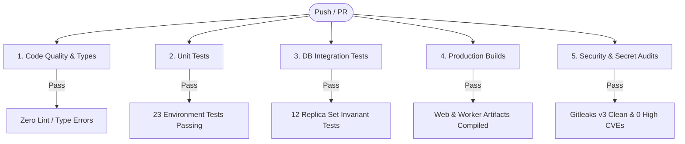

# Part-time Coder — Continuous Integration (CI) Architecture & Quality Gates

> **Document ID:** PTC-CI-README-001  
> **Status:** Active CI/CD Contract  
> **Workflow Path:** [`.github/workflows/ci.yml`](file:///f:/Code%20Practice/AI-Projects/part-time-coder/.github/workflows/ci.yml)  
> **Governing Policy:** `AGENTS.md` Section 12 & `docs/TRD.md` Section 8

---

## 1. Overview & Pipeline Structure

The Part-time Coder GitHub Actions pipeline enforces automated quality, security, and integration gates across all pushes and pull requests targeting `main`, `feat/**`, and `fix/**` branches.



---

## 2. Mandatory Quality Gates

| Job Name | Identifier | Key Commands | Criteria for Pass |
|---|---|---|---|
| **Code Quality & Type Safety** | `quality` | `pnpm lint`<br>`pnpm typecheck` | 0 ESLint warnings/errors; `tsc --noEmit` clean in strict mode across all 8 workspace packages |
| **Unit & Regression Tests** | `test-unit` | `pnpm test:unit` | All 23 unit tests in `packages/config` pass |
| **Database Integration Tests** | `test-integration` | `pnpm test:integration` | All 12 integration tests pass against an in-memory replica set (ACID transactions, compound unique indexes, client isolation) |
| **Production Builds** | `build` | `pnpm build` | `@ptc/worker` builds via `tsc`; `@ptc/web` builds via Next.js 16 (Turbopack) |
| **Security & Secret Audits** | `security` | `gitleaks-action@v3`<br>`pnpm audit --audit-level=high`<br>`git diff --exit-code pnpm-lock.yaml` | Zero secret leaks in commit history; zero high/critical vulnerabilities; lockfile clean and intact |

---

## 3. Secret Scanner Compatibility & Licensing

- **Scanner Version:** `gitleaks/gitleaks-action` pinned to immutable commit SHA `e0c47f4f8be36e29cdc102c57e68cb5cbf0e8d1e` (`v3.0.0`).
- **Runtime:** Migrated from legacy Node 20 to Node 24 runtime to guarantee forward compatibility with GitHub-hosted runners.
- **Scanning Scope:** Configured with `fetch-depth: 0` to scan the full Git commit history across branches.
- **Licensing Compliance:** Free for personal user accounts and open source repositories (`MSabbirHossen/part-time-coder`). Commercial organizational accounts require `GITLEAKS_LICENSE` secret if configured under organization ownership.
- **Least-Privilege Permissions:** Global workflow permission is locked to `permissions: contents: read`. PR comment posting and artifact uploads are disabled to eliminate privilege-escalation vectors on untrusted pull requests.

---

## 4. In-Memory Database Fixtures in CI

- **Replica Set Support:** Tests execute with `mongodb-memory-server` using the WiredTiger storage engine to validate multi-document ACID transactions and rollback behaviors.
- **Binary Caching:** Uses `actions/cache@v4` pointing to `~/.cache/mongodb-binaries` keyed by MongoDB version `8.2.6` to eliminate redundant ~100MB downloads per CI execution.
- **Zero Production Connection:** Database tests run entirely inside ephemeral runner memory with no connection to external networks or MongoDB Atlas.
- **Timeout Protection:** Step timeout set to 10 minutes with strict fail-closed behavior (`continue-on-error: false`).

---

## 5. Local Reproduction Commands

Developers must verify all CI gates locally prior to pushing:

```bash
# 1. Typecheck and linting
pnpm typecheck
pnpm lint

# 2. Automated test suites
pnpm test:unit
pnpm test:integration

# 3. Production compilation
pnpm build

# 4. Dependency security audit
pnpm audit --audit-level=high
```
