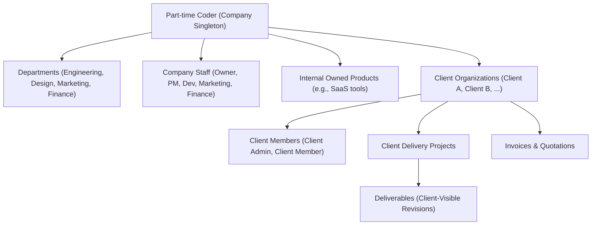

# Architecture Decision Record (ADR-0003)

```yaml
id: ADR-0003
title: Single-Company Architecture and Client Organization Isolation
status: approved
owner_decision: approved
decision_date: "2026-10-14"
approver: "Owner"
reason: "Define the multi-organization tenant model ensuring Part-time Coder operates as a single internal enterprise while providing absolute data isolation and scoped access for multiple client organizations."
source_sections:
  - "docs/PRD.md: Section 4 (Platform Tenancy and Company Model)"
  - "docs/TRD.md: Section 1.2 (System Boundaries) & Section 4 (Multi-Organization and Tenancy)"
  - "docs/BACKEND_SCHEMA.md: Section 1 (Runtime Architecture) & Section 3.1-3.2 (Collections)"
  - "AGENTS.md: Section 2 (Immutable Product Boundaries) & Section 6 (Client Isolation)"
requirement_ids:
  - PTC-GOV-002
  - PTC-ORG-001
  - PTC-ORG-002
  - PTC-ORG-003
  - PTC-ORG-004
  - PTC-ORG-005
  - PTC-ORG-006
  - PTC-SEC-001
  - PTC-SEC-002
affected_routes_apis_models:
  - "packages/database/src/models/company/*.model.ts"
  - "packages/database/src/models/clients/*.model.ts"
  - "packages/core/src/domains/organizations/**"
  - "packages/auth/src/evaluator.ts"
  - "apps/web/src/app/api/v1/clients/**"
  - "apps/web/src/app/(dashboard)/client/**"
options_and_tradeoffs:
  - "Option A (Selected): Single operating company singleton (Part-time Coder) with distinct, scoped ClientOrganization entities and strict deny-by-default repository filters."
  - "Option B: Multi-tenant SaaS architecture where any company can register as an independent tenant."
  - "Option C: Physical database-per-client or schema-per-client architecture."
security_privacy_finance_impact: "Guarantees zero cross-client information leakage. Client users can strictly access only projects, deliverables, invoices, and discussions explicitly linked to their verified clientOrganizationId and project grants."
provider_cost_or_approval_impact: "Avoids costly multi-tenant SaaS management infrastructure and multi-database Atlas clusters while maintaining ironclad logical isolation."
migration_and_rollback: "If an enterprise client requires dedicated data residency in the future, the scoped data model allows cleanly exporting their client organization subtree to a dedicated cluster."
updated_acceptance_tests:
  - IMP-AT-004
  - IMP-AT-005
```

---

## 1. Context and Problem Statement

Part-time Coder is a software company that provides:
1. Client development and digital agency services.
2. Proprietary owned software products.

The platform is **NOT** a white-label multi-tenant SaaS for third-party agencies. There is exactly one operating company: **Part-time Coder**. However, the platform must serve multiple external clients, each with their own authorized staff (`client_admin`, `client_member`).

The architecture must guarantee:
- Absolute isolation between different client organizations.
- Inability of any client to see other clients' records, projects, tasks, invoices, or files.
- Separation between internal company records (internal products, employee workload, agency margins) and client-visible deliverables.

---

## 2. Applicable PRD Requirement IDs

- **PTC-GOV-002:** Hybrid business model: internal agency services + proprietary software products under a single company identity.
- **PTC-ORG-001:** Single company singleton model for Part-time Coder operator.
- **PTC-ORG-002:** Client organizations modeled as distinct, isolated customer entities.
- **PTC-ORG-003:** Client organization members scoped strictly to their organization's resources.
- **PTC-ORG-004:** Multi-department internal structure for Part-time Coder (Engineering, Design, Marketing, Finance).
- **PTC-ORG-005:** Projects categorized cleanly as `client_delivery` or `internal_owned_product`.
- **PTC-ORG-006:** Client invitations bound to specific client organization IDs with single-use hashed tokens.
- **PTC-SEC-001:** Deny-by-default access control enforced at server service boundary.
- **PTC-SEC-002:** Complete data isolation preventing IDOR (Insecure Direct Object Reference) and cross-client leakage.

---

## 3. Technical and Business Constraints

- Exactly one `Company` record exists in the database representing Part-time Coder.
- Client organizations are represented by `ClientOrganization` records.
- Every client-bound resource (projects, deliverables, invoices, messages, media) MUST contain a non-null `clientOrganizationId`.
- No request from a client user can ever execute a database query without scoping to their verified `clientOrganizationId`.
- Organization membership alone does not grant access to all projects in that organization; explicit project grants are required where specified.
- Never trust `clientOrganizationId` supplied in HTTP request bodies or query strings; it must be derived from the verified user session and active grants.

---

## 4. Alternatives Considered

1. **Option A (Selected): Single-Company Singleton with Scoped Client Organizations**
   - Single shared database with strict logical data isolation at the repository and service layers.
   - Resource access rule: `resource.clientOrganizationId === user.effectiveClientOrgId`.
   - Distinct entity types: `Company` (singleton operator) vs `ClientOrganization` (customers).

2. **Option B: Multi-Tenant White-Label SaaS Architecture**
   - Generalizes the system so any agency can sign up, create their own company tenant, and manage their own clients.
   - Requires dynamic subdomain routing, tenant-isolated schemas, complex billing tiers, and extensive enterprise SaaS overhead.

3. **Option C: Database-per-Client Architecture**
   - Each client organization gets an independent MongoDB database.
   - Guarantees physical isolation but introduces massive operational complexity, connection pool exhaustion, schema migration challenges across dozens of databases, and prohibitive infrastructure costs on MongoDB Atlas.

---

## 5. Selected Architecture

We select **Option A: Single-Company Singleton with Scoped Client Organizations**.

### Tenancy and Entity Hierarchy



### Data Isolation Rules

1. **Mandatory Scoping:**
   - In Mongoose queries for client users, `clientOrganizationId` is automatically injected by domain repositories:
     ```typescript
     // Enforced repository pattern
     const clientProjects = await ProjectModel.find({
       clientOrganizationId: session.clientOrganizationId,
       status: { $ne: 'deleted' }
     });
     ```
2. **Denial by 404 (Anti-Enumeration):**
   - If a client requests `/api/v1/projects/:id` and the project belongs to another client, the service returns `404 Not Found` (never `403 Forbidden`) to prevent resource existence enumeration.
3. **Data Projections (DTO Allowlisting):**
   - Client DTO serializers explicitly omit internal estimates, cost rates, employee hourly wages, internal comments, and other clients' metadata.

---

## 6. Justification and Trade-offs

### Advantages
- Aligns 100% with the real business model of Part-time Coder.
- Avoids premature overengineering of multi-tenant SaaS features.
- Single MongoDB Atlas connection pool and single migration ledger.
- Clean separation between internal products and agency client work.

### Trade-offs
- Logical isolation relies on software discipline and comprehensive automated tests (mitigated by mandatory adversarial cross-client integration tests in CI).

---

## 7. Security, Performance, and Operational Implications

- **Security:** Tested against IDOR vulnerabilities. CI includes automated tests verifying that Client A cannot access Client B's projects, invoices, or files.
- **Performance:** Compound indexes include `clientOrganizationId` as prefix (e.g., `{ clientOrganizationId: 1, status: 1, createdAt: -1 }`), providing optimal indexed query performance.
- **Operations:** Single operational backup and restore procedure.

---

## 8. Cost Implications

- Lowest cost: Runs on a single shared MongoDB Atlas cluster (M0 free-tier for development, M10 for commercial production) without per-database pricing overhead.

---

## 9. Migration or Future Scalability Considerations

If a future enterprise client contracts for dedicated hosting, their documents can be queried via `clientOrganizationId` and migrated to a dedicated cluster with straightforward ETL scripts.

---

## 10. Rejected Alternatives and Reasons

- **Multi-Tenant SaaS (Option B) Rejected:** Contradicts PRD core requirement PTC-GOV-002. Part-time Coder is an operating software company, not a SaaS platform vendor.
- **Database-per-Client (Option C) Rejected:** Excessive operational cost and complex multi-database connection management without business necessity.

---

## 11. Risks and Mitigations

| Risk | Mitigation |
|---|---|
| Developer forgets `clientOrganizationId` filter in query | Repositories must enforce query builders that require tenant context; static analysis and adversarial IDOR test suites in CI. |
| Leaking internal notes in client API responses | Enforce strict Zod outward DTO schemas and serializer functions; raw Mongoose documents are never returned. |
| Client admin inviting users across org boundaries | Invitation service validates that target `scopeId` matches the inviter's own `clientOrganizationId`. |

---

## 12. Verification Requirements

- Automated test suite `IMP-AT-004`: Client A tries to read/modify Client B's resources and receives 404.
- Automated test suite `IMP-AT-005`: Client DTO serialization test ensuring internal fields are stripped.
- Unique compound indexes on `(clientOrganizationId, slug)` verified.

---

## 13. Decision Owner and Review Status

- **Proposed by:** AI Development Agent (Antigravity)
- **Reviewer:** Part-time Coder Owner / Tech Lead
- **Status:** `approved` (Approved by Owner on 14 October 2026)
