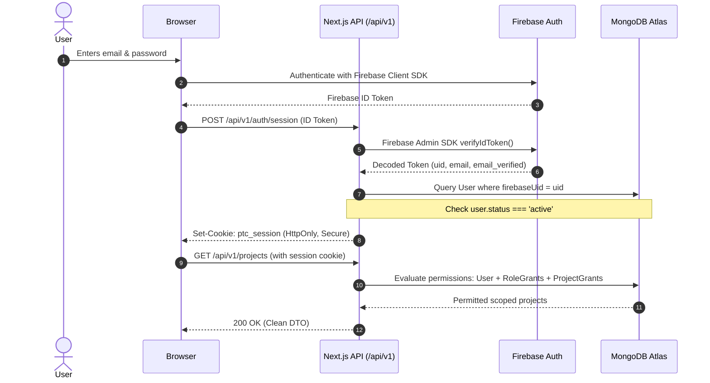

# Architecture Decision Record (ADR-0004)

```yaml
id: ADR-0004
title: Firebase Authentication and Database-Backed Scoped RBAC
status: approved
owner_decision: approved
decision_date: "2026-10-14"
approver: "Owner"
reason: "Establish the identity and authorization architecture separating external identity verification from fine-grained, database-backed role-based and scope-based access control."
source_sections:
  - "docs/PRD.md: Section 6 (User Roles, Access & Identity)"
  - "docs/TRD.md: Section 3 (Authentication, Sessions, and Authorization Architecture)"
  - "docs/BACKEND_SCHEMA.md: Section 3.1 (Identity and Company Collections)"
  - "AGENTS.md: Section 6 (Authentication, Sessions, RBAC and Client Isolation)"
requirement_ids:
  - PTC-IAM-001
  - PTC-IAM-002
  - PTC-IAM-003
  - PTC-IAM-004
  - PTC-IAM-005
  - PTC-IAM-006
  - PTC-IAM-007
  - PTC-IAM-008
  - PTC-IAM-009
  - PTC-IAM-010
  - PTC-SEC-001
  - PTC-SEC-003
  - PTC-SEC-004
affected_routes_apis_models:
  - "packages/auth/**"
  - "packages/database/src/models/identity/*.model.ts"
  - "apps/web/src/app/api/v1/auth/**"
  - "apps/web/src/middleware.ts"
options_and_tradeoffs:
  - "Option A (Selected): Hybrid Firebase Authentication for identity + MongoDB Atlas for granular scoped RBAC, session cookie management, and last-owner protection."
  - "Option B: Custom in-house auth (bcrypt/Argon2 + JWTs in MongoDB)."
  - "Option C: Pure Firebase Auth using Firebase Custom Claims for all roles and permissions."
security_privacy_finance_impact: "Guarantees that token theft or revoked privileges take effect immediately via database-backed authorization revisions; prevents privilege escalation; protects last owner from accidental lockout."
provider_cost_or_approval_impact: "Uses Firebase Spark (free) for email/password and token verification in dev/staging; any upgrade to Blaze (pay-as-you-go) for SMS MFA or advanced Identity Platform features requires explicit Owner approval."
migration_and_rollback: "Decoupled Firebase UID mapping in MongoDB allows swapping identity providers (e.g. Auth0, Clerk, self-hosted OIDC) without altering business data schemas."
updated_acceptance_tests:
  - IMP-AT-006
  - IMP-AT-007
  - IMP-AT-008
```

---

## 1. Context and Problem Statement

Part-time Coder requires a battle-tested authentication and access control system that supports:
1. Public registration with default baseline role (`registered_user`).
2. Multi-role internal company staff (`owner`, `admin`, `department_manager`, `project_manager`, `employee`, `operations_staff`, `marketing_manager`, `content_creator`, `finance_manager`).
3. External client roles (`client_admin`, `client_member`).
4. Granular, scope-bound permissions (e.g., a Project Manager only has edit rights to projects explicitly assigned to them).
5. Privileged multi-factor authentication (MFA) for Owner and financial operations.
6. Immediate session and privilege revocation when an employee is offboarded or suspended.

---

## 2. Applicable PRD Requirement IDs

- **PTC-IAM-001:** Firebase Authentication integration for email/password, credential verification, and account security.
- **PTC-IAM-002:** Server-side session verification via signed, secure `HttpOnly` cookies.
- **PTC-IAM-003:** Application `users` collection mapping Firebase `uid` to profile, status, locale, and timezone.
- **PTC-IAM-004:** Granular role-based access control with scoped grants (`company`, `department`, `client_org`, `project`).
- **PTC-IAM-005:** Single-use invitation workflow with hashed tokens for staff and client onboarding.
- **PTC-IAM-006:** Suspension and deactivation semantics immediately denying API access.
- **PTC-IAM-007:** Multi-factor authentication (MFA) requirement for privileged administrative and financial actions.
- **PTC-IAM-008:** Audit logging of security events (logins, password resets, role changes, privilege escalations).
- **PTC-IAM-009:** Workspace-switching context without privilege cross-contamination.
- **PTC-IAM-010:** Last-owner lockout protection preventing deletion or demotion of the final active owner.
- **PTC-SEC-001:** Deny-by-default server authorization.
- **PTC-SEC-003:** Session revocation and token invalidation on credential or role changes.
- **PTC-SEC-004:** Separation of identity (who you are) from authorization (what you may do).

---

## 3. Technical and Business Constraints

- Firebase Admin SDK is strictly **server-side only** (never exposed in client bundles).
- Browser stores ONLY an `HttpOnly`, `Secure`, `SameSite=Lax` session cookie.
- Firebase Custom Claims MUST NOT be used as the authoritative source of permissions (Custom Claims have a 1000-byte limit and cannot handle dynamic resource-scoped grants).
- MongoDB is the single source of truth for authorization status and effective permissions.
- Server-side authorization check formula (from `AGENTS.md` §6.2):
  ```text
  allow = authenticated_session_valid
      AND user_active
      AND privilege_factors_satisfied_if_required
      AND has_permission(action, resource_type, effective_memberships)
      AND company_or_client_scope_matches(resource, user)
      AND project_or_document_grant_exists_if_required
      AND resource_state_allows(action)
      AND request_version_or_approval_revision_is_current
  ```

---

## 4. Alternatives Considered

1. **Option A (Selected): Hybrid Firebase Auth (Identity) + MongoDB Scoped RBAC (Authorization)**
   - Firebase verifies credentials, sends reset emails, manages MFA, and issues ID tokens.
   - Next.js server verifies ID tokens, establishes `HttpOnly` session cookie, and looks up `User`, `RoleGrant`, and `Membership` in MongoDB.
   - Deny-by-default policy evaluation in `packages/auth`.

2. **Option B: Pure In-House Authentication (Self-Managed)**
   - Store salted password hashes (Argon2/bcrypt) in MongoDB, issue custom JWTs or server sessions.
   - Requires building credential security, rate limiting, brute force defense, email delivery, MFA TOTP, and token rotation from scratch. High security risk for a small team.

3. **Option C: Pure Firebase Auth with Custom Claims for RBAC**
   - Encode roles directly in Firebase Custom Claims (`auth.token.role = 'admin'`).
   - Fails because custom claims have a 1,000-byte limit, cannot model project-level grants across dozens of projects, and take up to an hour to refresh unless forced.

---

## 5. Selected Architecture

We select **Option A: Hybrid Firebase Auth + MongoDB Scoped RBAC**.

### Architecture Workflow



### Key Authorization Invariants

1. **Revocation Strategy:**
   - Every `User` document has `authzRevision: number` and `sessionInvalidAfter: Date`.
   - Modifying a user's role or suspending their account increments `authzRevision` and invalidates active sessions immediately.
2. **Last-Owner Protection:**
   - The `RoleGrant` service enforces an atomic database check before any role revocation or account deactivation:
     ```typescript
     if (targetRole === 'owner') {
       const activeOwnerCount = await countActiveOwners();
       if (activeOwnerCount <= 1) {
         throw new ForbiddenError('Cannot demote or deactivate the last remaining owner.');
       }
     }
     ```
3. **Audit Trail:**
   - All role modifications and failed authentications are recorded in `sessionSecurityEvents` with hashed IP and user agent metadata.

---

## 6. Justification and Trade-offs

### Advantages
- **Security-in-Depth:** Leverages Google's hardened identity infrastructure (Firebase Auth) while retaining complete domain ownership over permissions in MongoDB.
- **Fast Revocation:** Permissions are evaluated on the server against current database state; role changes take effect instantaneously.
- **Vendor Independence:** MongoDB `users` references `firebaseUid` as an external key. Migrating identity providers in the future requires only remapping the UID.

### Trade-offs
- Two roundtrips during initial login: authenticate with Firebase client, then exchange ID token for session cookie with backend (negligible impact on user experience).

---

## 7. Security, Performance, and Operational Implications

- **Security:** CSRF-protected session cookie; zero credentials stored in application database; zero passwords handled by backend servers.
- **Performance:** Cached permission grants during request lifecycle; indexed query `{ userId: 1, active: 1, scopeType: 1 }` resolves grants in <5ms.
- **Operations:** Zero maintenance of password hashing algorithms or credential storage compliance.

---

## 8. Cost Implications & Plan Quota Disciplinary Rules

- **Firebase Spark (Free Tier):**
  - Covers baseline email/password authentication, password resets, and server ID token verification at zero monthly cost for local and staging development.
  - Does **not** include phone/SMS MFA without strict limits (Spark includes only 10 SMS verifications/day for testing in specific regions).
  - Advanced multi-tenancy and enterprise OIDC/SAML features are not available on Spark.
- **Firebase Blaze (Pay-as-You-Go Plan):**
  - While Firebase Authentication with Identity Platform offers a free tier of up to 50,000 monthly active users (MAUs) for email/password and social providers under Blaze, enabling Blaze requires adding a billing account.
  - SMS-based MFA incurs per-verification carrier charges and requires Blaze.
- **Owner Approval Checkpoint:**
  - Upgrading from Spark to Blaze, enabling Identity Platform features, or activating SMS-based MFA is an explicit Owner financial gate. It must not be enabled automatically.
  - Preferred MVP MFA approach: TOTP (authenticator app) or web-based step-up authentication where supported on free tier, deferring SMS telephony charges until approved.

---

## 9. Migration or Future Scalability Considerations

If single-sign-on (SAML/SSO) is required for enterprise clients in future phases, Firebase Auth supports SAML/OIDC enterprise providers without rewriting application authorization logic.

---

## 10. Rejected Alternatives and Reasons

- **In-House Auth (Option B) Rejected:** Massive development overhead and critical security risks associated with custom credential storage and recovery flows.
- **Pure Custom Claims (Option C) Rejected:** Size constraints (1KB limit) make it impossible to store fine-grained, dynamic project and department grants in JWT payload.

---

## 11. Risks and Mitigations

| Risk | Mitigation |
|---|---|
| User suspended in MongoDB but Firebase token still valid | Server-side session verification always queries the MongoDB `users` status before serving requests. |
| Accidental lockout of the last Owner | Database invariant and domain service transaction refuse any deletion or demotion of the final active owner. |
| Session hijacking | `HttpOnly`, `Secure`, `SameSite=Lax` cookie policy, paired with IP/UA fingerprint anomaly detection in `sessionSecurityEvents`. |
| Unintended SMS billing on Blaze | Require Owner sign-off before Blaze activation; prioritize non-SMS MFA (TOTP). |

---

## 12. Verification Requirements

- Integration tests covering login, token exchange, and session cookie issuance (`IMP-AT-006`).
- Adversarial test: Suspended user with valid Firebase token is immediately rejected with 401/403 (`IMP-AT-007`).
- Last-owner protection test: Attempting to remove the last owner returns 403 Forbidden with exact error code (`IMP-AT-008`).

---

## 13. Decision Owner and Review Status

- **Proposed by:** AI Development Agent (Antigravity)
- **Reviewer:** Part-time Coder Owner / Tech Lead
- **Status:** `approved` (Approved by Owner on 14 October 2026 with Spark/Blaze quota clarification)
