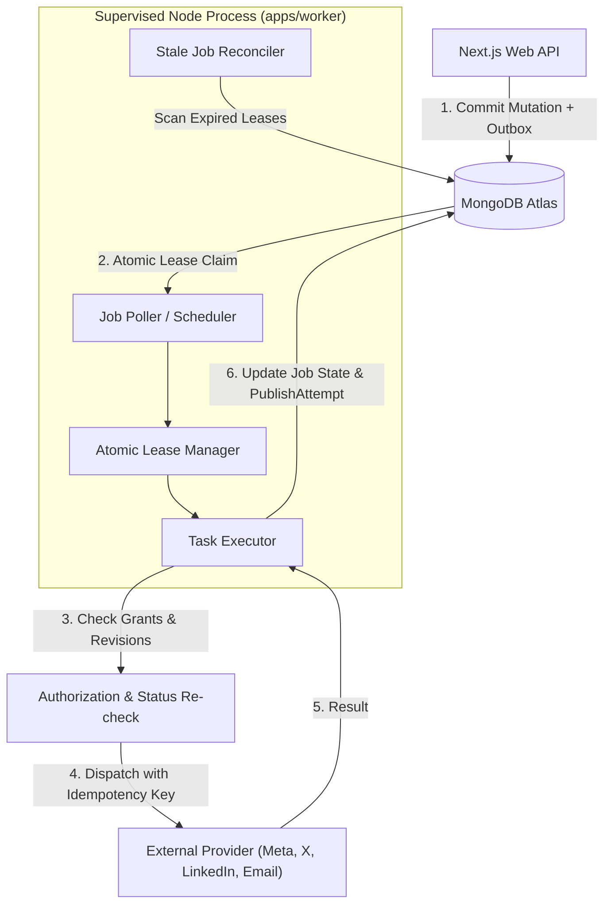

# Architecture Decision Record (ADR-0005)

```yaml
id: ADR-0005
title: Dedicated Background Worker and Durable Job Processing
status: proposed
owner_decision: pending
decision_date: null
approver: null
reason: "Establish the background worker architecture, durable job scheduling, and outbox event dispatch mechanism ensuring reliable asynchronous operations without degrading web application responsiveness."
source_sections:
  - "docs/PRD.md: Section 10 (Social Campaign Management & Publishing) & Section 14 (Operational Requirements)"
  - "docs/TRD.md: Section 5 (Background Worker and Durable Job Processing)"
  - "docs/BACKEND_SCHEMA.md: Section 7 (Social Campaign, Publishing and Queue Collections)"
  - "AGENTS.md: Section 11 (Six-Platform Social Publishing Rules)"
requirement_ids:
  - PTC-SOC-004
  - PTC-SOC-005
  - PTC-OPS-004
  - PTC-NFR-007
affected_routes_apis_models:
  - "apps/worker/**"
  - "packages/database/src/models/ops/jobQueue.model.ts"
  - "packages/database/src/models/ops/outboxEvents.model.ts"
  - "packages/core/src/domains/social/publishing/**"
options_and_tradeoffs:
  - "Option A (Selected): Dedicated supervised Node.js process with MongoDB-backed durable job queue, lease locks, idempotency keys, and transactional outbox."
  - "Option B: External managed queue (AWS SQS, Redis + BullMQ, RabbitMQ)."
  - "Option C: Next.js serverless background functions / cron endpoints."
security_privacy_finance_impact: "Prevents duplicate social publishing and financial notification re-sends via strict idempotency keys; worker enforces scoped permissions and checks current authorization before executing any side effect."
provider_cost_or_approval_impact: "Avoids additional Redis/SQS infrastructure costs in early phases; runs as a lightweight container/process alongside existing MongoDB Atlas cluster."
migration_and_rollback: "Job payloads are versioned JSON; worker can be scaled or backed by Redis BullMQ in future high-throughput phases without altering business event schemas."
updated_acceptance_tests:
  - IMP-AT-009
  - IMP-AT-010
```

---

## 1. Context and Problem Statement

The platform requires robust asynchronous processing for:
1. Social media post publishing across 6 platforms (Facebook, Instagram, LinkedIn, YouTube, X, TikTok) at precise scheduled times.
2. Handling external API rate limits, transient network timeouts, and ambiguous publishing outcomes.
3. Transactional domain event dispatch (e.g. email notifications for lead inquiries, client invitations, invoice notifications).
4. Periodic reconciliation and health monitoring.

Next.js web route handlers run in short-lived HTTP request-response cycles. Executing long-running tasks, heavy uploads, or arbitrary retries inside HTTP handlers risks connection timeouts, degraded web performance, and dropped jobs during redeployments.

---

## 2. Applicable PRD Requirement IDs

- **PTC-SOC-004:** Scheduled publication across target social networks with accurate time execution.
- **PTC-SOC-005:** Retry handling for transient provider errors; escalation to manual publish workflow on persistent failure.
- **PTC-OPS-004:** Durable background job processor with lease locks, bounded retries, and dead-letter queues.
- **PTC-NFR-007:** High reliability and at-least-once delivery guarantee for critical notifications and publishing jobs.

---

## 3. Technical and Business Constraints

- Asynchronous operations MUST survive web application restarts and deployments.
- No duplicate social posts: external API calls MUST be strictly idempotent.
- Ambiguous network failures (e.g., request sent, but connection closed before response) MUST NOT be blindly retried. They must transition to `unknown_outcome` for verification.
- The worker MUST validate the current state and approval revision before executing any publishing job. If content was modified or approval was revoked after scheduling, the job must be aborted.
- Zero reliance on serverless execution timeouts or ephemeral cron endpoints that could be cancelled mid-operation.

---

## 4. Alternatives Considered

1. **Option A (Selected): Dedicated Node Worker with MongoDB-Backed Durable Queue**
   - Independent persistent process (`apps/worker/src/main.ts`).
   - Jobs persisted in MongoDB `jobQueue` collection with atomic lease locking via `findOneAndUpdate`.
   - Transactional Outbox pattern (`outboxEvents`) committed in the same database transaction as business mutations.

2. **Option B: Redis + BullMQ or Cloud SQS Queue**
   - Introduces an external Redis instance or cloud message broker.
   - Excellent throughput, but introduces an extra moving part, additional monthly infrastructure cost ($15–$30/mo for managed Redis), and prevents single-database atomic transactions between business state and queue events.

3. **Option C: Next.js API Cron Endpoints / Webhook Pings**
   - Schedule jobs via Vercel Cron or GitHub Actions pinging `/api/v1/cron/jobs`.
   - Fragile: HTTP timeout limits (10s on Vercel Hobby, 60s on Pro), risk of endpoint abuse if unprotected, and inability to maintain long-lived polling loops.

---

## 5. Selected Architecture

We select **Option A: Dedicated Node Worker with MongoDB-Backed Durable Queue**.

### Worker Topology and Lifecycle



### Atomic Lease Protocol

1. **Polling:** Worker executes an atomic conditional update:
   ```typescript
   const job = await JobQueueModel.findOneAndUpdate(
     {
       state: { $in: ['scheduled', 'retry_wait'] },
       scheduledFor: { $lte: new Date() },
       $or: [
         { lockedUntil: { $exists: false } },
         { lockedUntil: { $lt: new Date() } } // Stale lease reclamation
       ]
     },
     {
       $set: {
         state: 'claimed',
         lockedBy: workerInstanceId,
         lockedUntil: new Date(Date.now() + LEASE_DURATION_MS)
       },
       $inc: { attemptCount: 1 }
     },
     { new: true, sort: { priority: -1, scheduledFor: 1 } }
   );
   ```
2. **Heartbeat:** For long jobs (e.g. video uploads), the worker extends `lockedUntil` periodically.
3. **Re-validation:** Before dispatching an external side-effect, the worker confirms:
   - Owning company/client status is active.
   - Content variant approved revision matches the currently scheduled revision.
   - Provider connection is active and has valid credentials.
4. **Failure & Dead-Letter:**
   - On transient failure: exponential backoff with jitter (`retry_wait`).
   - On terminal failure or max attempts exceeded: `dead_letter` or `manual_required`.
   - On network timeout: `unknown_outcome` (prompts human verification, never auto-retried).

---

## 6. Justification and Trade-offs

### Advantages
- **ACID Transactional Consistency:** Domain entities and outbox events commit in a single database transaction. No split-brain states where an entity is saved but its queue job is lost.
- **Zero Additional Infrastructure:** Reuses the existing MongoDB Atlas replica set; no Redis cluster required for MVP scale (<10,000 jobs/day).
- **Process Isolation:** Heavy network operations or worker crashes have zero effect on web UI responsiveness.

### Trade-offs
- MongoDB polling creates slight database read traffic (mitigated by indexed query and adaptive polling intervals: 2s when active, up to 10s when idle).

---

## 7. Security, Performance, and Operational Implications

- **Security:** Worker operates under dedicated MongoDB least-privilege credentials. It never bypasses tenant isolation and re-evaluates approval state before posting.
- **Performance:** Worker runs in a separate Node.js process/container with dedicated memory limits.
- **Operations:** Supervised via systemd, PM2, or container orchestrator with graceful shutdown (`SIGTERM`/`SIGINT`) to finish active jobs or release leases.

---

## 8. Cost Implications

- Hosted on a low-cost persistent container (e.g., Railway/Render/VPS at $5–$10/month), avoiding expensive dedicated queue broker services.

---

## 9. Migration or Future Scalability Considerations

When Part-time Coder scales beyond 100,000 background events per day, the `packages/core` job interface can swap the queue driver to Redis BullMQ or AWS SQS with zero modifications to domain event creators or job handler logic.

---

## 10. Rejected Alternatives and Reasons

- **Redis BullMQ (Option B) Rejected for MVP:** Unnecessary infrastructure complexity and cost for MVP workloads, and lacks multi-document ACID transaction guarantees with MongoDB domain entities.
- **Serverless Cron (Option C) Rejected:** Hard execution time limits, cannot reliably manage atomic long-duration leases or video processing, and risks missed schedules.

---

## 11. Risks and Mitigations

| Risk | Mitigation |
|---|---|
| Worker process crashes during job execution | Lease expires; reconciler re-claims the job or marks ambiguous outcomes for investigation. |
| Duplicate publishing on external provider | Deterministic client idempotency keys sent in provider API headers; never blindly retry unconfirmed responses. |
| Queue starvation from failing jobs | Exponential backoff with jitter and a hard maximum retry cap (e.g., 5 attempts) before dead-lettering. |

---

## 12. Verification Requirements

- Unit test of atomic lease locking and state transitions (`IMP-AT-009`).
- Failure-injection test verifying lease recovery after worker crash simulation (`IMP-AT-010`).
- Outbox event transactional commit test verifying rollback behavior on domain mutation failure.

---

## 13. Decision Owner and Review Status

- **Proposed by:** AI Development Agent (Antigravity)
- **Reviewer:** Part-time Coder Owner / Tech Lead
- **Status:** `proposed` (Pending Owner Approval)
