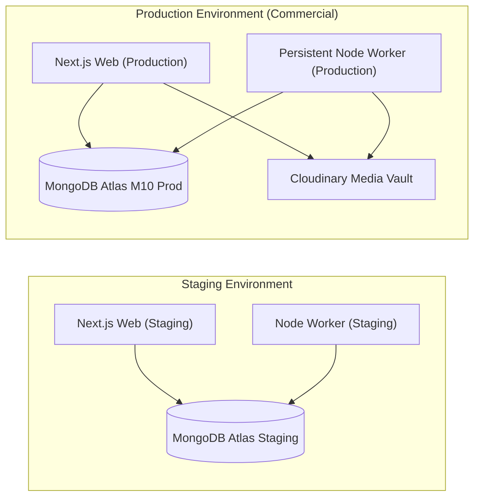

# Architecture Decision Record (ADR-0006)

```yaml
id: ADR-0006
title: Commercial Hosting, Deployment Separation, and Environment Strategy
status: proposed
owner_decision: pending
decision_date: null
approver: null
reason: "Establish the infrastructure hosting architecture, multi-environment lifecycle, typed configuration management, and deployment separation between the web platform and background worker in compliance with commercial-use terms."
source_sections:
  - "docs/PRD.md: Section 14 (Operational Requirements & Non-Functional)"
  - "docs/TRD.md: Section 7 (Deployment, Environments, and Infrastructure Architecture)"
  - "docs/IMPLEMENTATION_PLAN.md: Section 3 (Phase P00 / Ticket IMP-00-07)"
  - "AGENTS.md: Section 2 (Immutable Product Boundaries: Budget & Commercial Hosting)"
requirement_ids:
  - PTC-OPS-001
  - PTC-OPS-002
  - PTC-OPS-003
  - PTC-NFR-015
affected_routes_apis_models:
  - "packages/config/**"
  - ".env.example"
  - ".github/workflows/**"
  - "apps/web/**"
  - "apps/worker/**"
options_and_tradeoffs:
  - "Option A (Selected): Commercial-compliant PaaS/VPS hosting (e.g., Vercel Pro or Railway/Render for web, persistent Node container for worker, MongoDB Atlas, Cloudinary) across isolated local, staging, and production environments."
  - "Option B: Pure free-tier hosting on non-commercial personal accounts (e.g., Vercel Hobby), violating platform terms for commercial client services."
  - "Option C: Self-managed Kubernetes / multi-cloud infrastructure."
security_privacy_finance_impact: "Guarantees production data isolation; staging environment utilizes anonymized fixtures; typed startup validation prevents silent server boots with missing encryption keys or exposed credentials."
provider_cost_or_approval_impact: "Establishes a predictable, Owner-capped operational budget (~$25–$60/month) while maintaining legal compliance with commercial terms of service."
migration_and_rollback: "Standard Dockerfile and Node runtime compatibility allows migrating between hosting vendors (Vercel, Render, Railway, DigitalOcean, AWS ECS) without codebase alterations."
updated_acceptance_tests:
  - IMP-AT-011
  - IMP-AT-012
```

---

## 1. Context and Problem Statement

Part-time Coder is a commercial enterprise offering paid client software services and proprietary products.

Key operational obligations:
1. **Commercial Terms of Service:** Hobby/personal free tiers on several platforms (such as Vercel Hobby) strictly prohibit commercial or client agency use. The production deployment must run on plans that legally authorize commercial activity.
2. **Persistent Worker Requirement:** The background worker (`apps/worker`) requires a persistent, long-running process with reliable event loop execution, graceful shutdown handling, and continuous network connectivity, which standard serverless edge functions cannot provide.
3. **Multi-Environment Isolation:** Development, staging, and production environments must be completely decoupled in database storage, API credentials, and third-party webhook targets.
4. **Configuration Safety:** Misconfigured or missing environment variables must fail closed at server boot before serving traffic.

---

## 2. Applicable PRD Requirement IDs

- **PTC-OPS-001:** Production infrastructure legally and technically suitable for commercial operations.
- **PTC-OPS-002:** Environment tiering: `local`, `staging`, `production` with complete database and credential separation.
- **PTC-OPS-003:** Typed environment variable validation on application startup; zero runtime fallback to insecure defaults in production.
- **PTC-NFR-015:** Cost-effective deployment architecture with documented budget caps and operational ownership.

---

## 3. Technical and Business Constraints

- Production environment MUST permit commercial use under provider terms.
- Low-cost development resources are encouraged for local/staging, but production hosting must not rely on fabricated perpetual-free assumptions.
- Secrets (`FIREBASE_SERVICE_ACCOUNT_KEY`, `MONGODB_URI`, `SESSION_SECRET`, `SOCIAL_CLIENT_SECRETS`) MUST NEVER be committed to Git.
- Next.js web application and Node worker process deploy as independent units so web redeploys do not interrupt active background jobs.
- Automated health check endpoints (`/api/v1/health` for web, internal heartbeat for worker) required.

---

## 4. Alternatives Considered

1. **Option A (Selected): PaaS / Container Deployment with Commercial Compliance**
   - Web App (`apps/web`): Deployed on Vercel Pro ($20/mo) or Render/Railway Web Service ($7–$15/mo) with commercial licensing.
   - Worker (`apps/worker`): Deployed on a persistent container (Railway, Render, or low-cost VPS/Fly.io at $5–$10/mo).
   - Database: MongoDB Atlas (M0 for local/staging test fixtures; M10 dedicated cluster for production).
   - Storage: Cloudinary or AWS S3 for media assets.

2. **Option B: Non-Commercial Free-Tier Stacking (Vercel Hobby + Free Cron)**
   - Violates Vercel's Terms of Service for commercial client agency revenue.
   - Serverless timeout limits break long video uploads and background batch jobs. High legal and operational risk.

3. **Option C: Custom Kubernetes Cluster (EKS/GKE)**
   - High complexity, excessive baseline cost ($70–$150/month minimum), and heavy DevOps maintenance burden unsuitable for a lean team.

---

## 5. Selected Architecture

We select **Option A: Commercial-Compliant PaaS/Container Deployment**.

### Deployment Topology



### Environment Tier Matrix

| Dimension | Local (`local`) | Staging (`staging`) | Production (`production`) |
|---|---|---|---|
| Web Host | Local Node (`localhost:3000`) | Preview / Staging PaaS | Commercial PaaS / VPS |
| Worker Host | Local Node (`pnpm --filter worker dev`) | Staging container | Persistent Container (PM2 / Docker) |
| Database | Disposable local/Atlas free tier | Dedicated staging Atlas cluster | MongoDB Atlas M10 (Automated daily backup) |
| Identity | Firebase Emulator or dev project | Staging Firebase project | Production Firebase project with MFA |
| Social APIs | Sandbox / Mock adapters | Test accounts / Sandbox | Approved provider developer apps |
| Media Storage | Local filesystem / Mock | Staging Cloudinary bucket | Production Cloudinary bucket |

### Startup Environment Validation Contract

A centralized config validator (`packages/config/src/env.ts`) runs before any application code executes:

```typescript
import { z } from 'zod';

const envSchema = z.object({
  NODE_ENV: z.enum(['development', 'test', 'production']),
  PORT: z.coerce.number().default(3000),
  MONGODB_URI: z.string().url().startsWith('mongodb'),
  SESSION_SECRET: z.string().min(32),
  FIREBASE_PROJECT_ID: z.string().min(1),
  FIREBASE_CLIENT_EMAIL: z.string().email(),
  FIREBASE_PRIVATE_KEY: z.string().min(1),
  CLOUDINARY_CLOUD_NAME: z.string().min(1),
  CLOUDINARY_API_KEY: z.string().min(1),
  CLOUDINARY_API_SECRET: z.string().min(1),
});

export const env = envSchema.parse(process.env);
```
If any variable is missing or invalid, the process terminates immediately with an explicit error output pointing to the missing configuration name (without logging secret values).

---

## 6. Justification and Trade-offs

### Advantages
- **Legal & Operational Safety:** Complies with provider commercial terms; guarantees reliable worker execution.
- **Fail-Closed Reliability:** Typed startup validation eliminates elusive runtime `undefined` configuration crashes in production.
- **Cost Predictability:** Total baseline production hosting cost is capped at $25–$60/month, fulfilling the Owner budget constraints.

### Trade-offs
- Small monthly hosting expense compared to unsupported free-tier tricks, but necessary for commercial compliance and business continuity.

---

## 7. Security, Performance, and Operational Implications

- **Security:** Zero cross-environment data leakage. Staging never uses production customer data. Secrets injected via environment vaults at deploy time.
- **Performance:** CDN edge caching for public marketing assets; sub-second dynamic SSR for dashboard shells.
- **Operations:** Independent redeployment of web and worker. Zero downtime rollbacks supported on PaaS.

---

## 8. Cost Implications

- **Baseline Monthly Production Budget (Proposed):**
  - Web Hosting (PaaS Commercial): ~$15–$20/mo
  - Worker Container: ~$5–$10/mo
  - MongoDB Atlas (M10): ~$25–$30/mo (or M0/M2 during initial pilot)
  - Cloudinary Media: $0 (Free tier covers 25GB managed assets)
  - Total proposed operating ceiling: **$45–$60/month**.

---

## 9. Migration or Future Scalability Considerations

Both `apps/web` and `apps/worker` include standard `Dockerfile` definitions. If hosting costs on PaaS scale up as traffic grows, the entire system can migrate seamlessly to a dedicated VPS (e.g. Hetzner, DigitalOcean) running Docker Compose or Dokku without code modifications.

---

## 10. Rejected Alternatives and Reasons

- **Non-Commercial Free Tier (Option B) Rejected:** Breaches provider contracts, lacks SLAs, and risks account termination when monetized services launch.
- **Self-Managed Kubernetes (Option C) Rejected:** Excessive operational overhead and infrastructure bills with zero return for an MVP company platform.

---

## 11. Risks and Mitigations

| Risk | Mitigation |
|---|---|
| Accidental commit of `.env` | Strict `.gitignore`, pre-commit hooks, and CI secret scanning (TruffleHog / GitGuardian pattern). |
| Hosting bill spikes from runaway loops | Set hard billing alerts and spending caps in provider dashboards. |
| Production database corruption | Automated point-in-time recovery (PITR) and daily snapshots in MongoDB Atlas. |

---

## 12. Verification Requirements

- Typed environment schema unit tests (`IMP-AT-011`): Missing variable causes process exit; valid variables pass schema.
- Health check route test (`IMP-AT-012`): `/api/v1/health` returns status, database connectivity, and timestamp.
- Verified absence of secrets in Git repository history.

---

## 13. Decision Owner and Review Status

- **Proposed by:** AI Development Agent (Antigravity)
- **Reviewer:** Part-time Coder Owner / Tech Lead
- **Status:** `proposed` (Pending Owner Approval)
