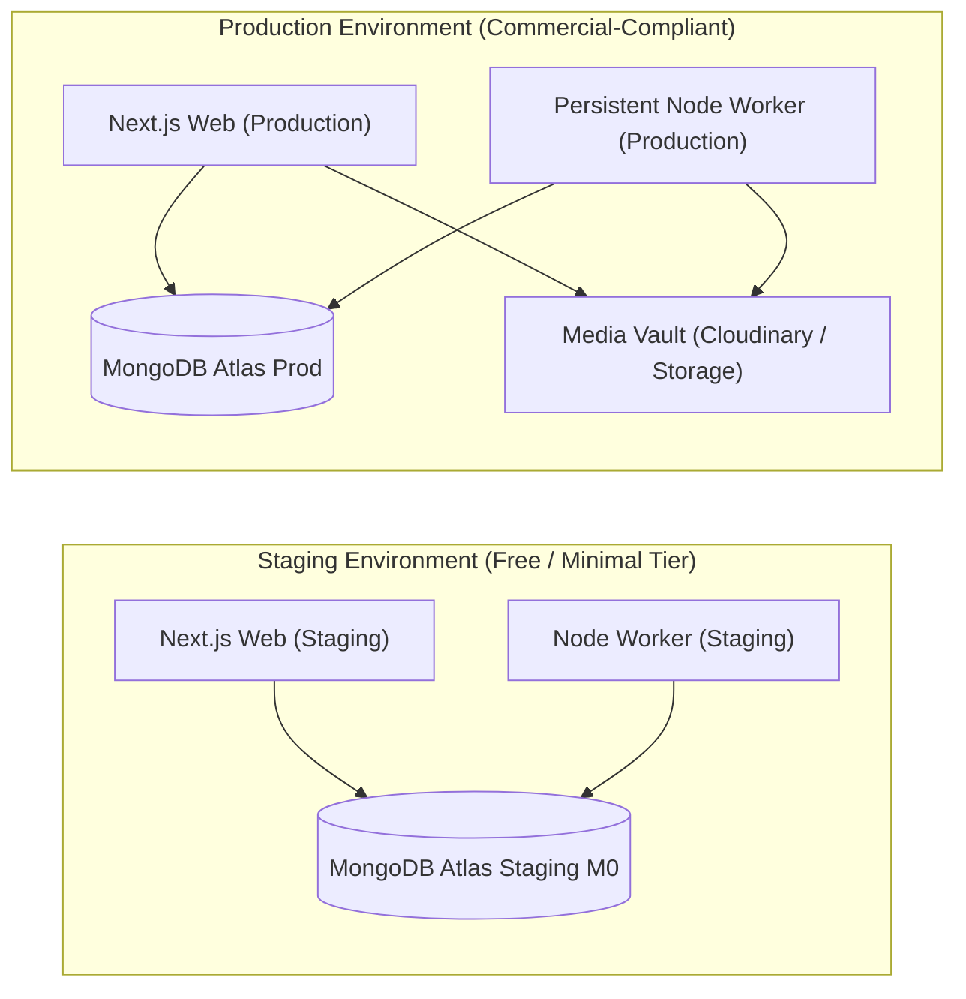

# Architecture Decision Record (ADR-0006)

```yaml
id: ADR-0006
title: Commercial Hosting, Deployment Separation, and Environment Strategy
status: proposed
owner_decision: pending
decision_date: null
approver: null
reason: "Establish the infrastructure hosting architecture, multi-environment lifecycle, typed configuration management, and deployment separation between the web platform and background worker in compliance with commercial-use terms and a free-tier-first cost discipline."
source_sections:
  - "docs/PRD.md: Section 14 (Operational Requirements & Non-Functional)"
  - "docs/TRD.md: Section 7 (Deployment, Environments, and Infrastructure Architecture)"
  - "docs/IMPLEMENTATION_PLAN.md: Section 3 (Phase P00 / Ticket IMP-00-07)"
  - "AGENTS.md: Section 2 (Immutable Product Boundaries: Budget & Commercial Hosting)"
requirement_ids:
  - PTC-OPS-001
  - PTC-OPS-002
  - PTC-OPS-003
  - PTC-NFR-015
affected_routes_apis_models:
  - "packages/config/**"
  - ".env.example"
  - ".github/workflows/**"
  - "apps/web/**"
  - "apps/worker/**"
options_and_tradeoffs:
  - "Option A (Selected Principle): Free-tier-first strategy across local and staging; commercial-compliant, license-adherent deployment architecture for production with independent web and worker processes; actual provider selection and budget ceiling evaluated and approved by Owner under IMP-00-07."
  - "Option B: Pure non-commercial personal free tiers (e.g. Vercel Hobby) used for production commercial services (violates provider Terms of Service)."
  - "Option C: Complex container orchestration (Kubernetes) or multi-cloud infrastructure."
security_privacy_finance_impact: "Guarantees production data isolation; staging environment uses disposable/anonymized fixtures; typed startup validation prevents silent server boots with missing secrets; protects against runaway infrastructure expenses through Owner checkpoints."
provider_cost_or_approval_impact: "Preserves free-tier-first strategy for local and staging; requires explicit Owner approval before any paid hosting, database upgrade, or social API commitment is incurred."
migration_and_rollback: "Standard Dockerfile and Node runtime compatibility allows migrating between hosting candidates (e.g. Vercel, Render, Railway, DigitalOcean, VPS) without codebase alterations."
updated_acceptance_tests:
  - IMP-AT-011
  - IMP-AT-012
```

---

## 1. Context and Problem Statement

Part-time Coder requires a deployment and environment architecture that supports:
1. **Free-Tier-First Strategy:** Development, testing, and staging must maximize lawful free tiers (local emulators, MongoDB Atlas M0, Firebase free tier, Cloudinary free tier) to minimize burn rate.
2. **Commercial Compliance:** Commercial production deployments must respect provider licensing and service terms (e.g. personal hobby plans that forbid commercial client services must not be assumed for production).
3. **Persistent Worker Independence:** The background worker (`apps/worker`) requires a persistent runtime with reliable event loop execution, durable job lease handling, and continuous network connectivity, deploying independently of the web frontend (`apps/web`).
4. **Owner-Gated Financial Commitments:** No paid hosting, database tier upgrades, worker hosting subscriptions, or paid API plans can be committed without explicit Owner approval.

---

## 2. Applicable PRD Requirement IDs

- **PTC-OPS-001:** Production infrastructure legally and technically compliant with commercial operations and provider terms.
- **PTC-OPS-002:** Strict environment isolation across `local`, `staging`, and `production` tiers.
- **PTC-OPS-003:** Typed environment variable validation on startup; process fails closed on missing required configurations.
- **PTC-NFR-015:** Cost-effective deployment architecture with documented budget caps and operational ownership.

---

## 3. Technical and Business Constraints

- Free-tier-first remains the primary cost discipline across development and staging.
- Production hosting must comply with provider licensing and commercial terms; no fabricated perpetual-free or non-compliant personal tier assumptions.
- No fixed production budget ceiling is approved at this stage; formal pricing, provider comparison, and cost caps will be evaluated and submitted for Owner sign-off under `IMP-00-07`.
- No paid production provider is selected or contracted at this stage.
- Independent deployment capability for `apps/web` (Next.js) and `apps/worker` (Node.js) must be preserved.
- Zero credentials or secrets committed to source control; configuration validated via Zod at startup.

---

## 4. Alternatives Considered

1. **Option A (Selected Principle): Free-Tier-First with Commercial Compliance & Owner Approval Gate**
   - Local/Staging: Maximize lawful free tiers ($0/month).
   - Production: Commercial-compliant architecture with separate web and worker execution units.
   - Provider Selection & Budget: Candidate options (Vercel, Railway, Render, DigitalOcean, Fly.io, Atlas) to be evaluated and submitted for Owner review under `IMP-00-07`. No vendor lock-in or premature financial commitment.

2. **Option B: Non-Commercial Free-Tier Stacking for Production (Vercel Hobby + Ephemeral Crons)**
   - Breaches commercial terms of service; serverless timeout constraints break durable queue processing and long video uploads.

3. **Option C: Premature Enterprise Kubernetes / Multi-Cloud Setup**
   - High initial baseline infrastructure costs and unnecessary DevOps maintenance burden.

---

## 5. Selected Architecture

We select **Option A: Free-Tier-First with Commercial Compliance, Deployment Separation, and Owner Approval Checkpoints**.

### Deployment Separation



### Environment Tier Matrix & Cost Separation

| Dimension | Local (`local`) | Staging (`staging`) | Production (`production`) |
|---|---|---|---|
| **Primary Strategy** | Free tier / local emulation | Free / preview sandbox | Commercial-compliant; Owner-approved |
| **Estimated Cost** | **$0 / month** | **$0 / month** (or nominal test credits) | **To be finalized under IMP-00-07** |
| **Web Runtime** | Local Node (`localhost:3000`) | Free/preview PaaS deployment | Commercial PaaS / Container (Independent unit) |
| **Worker Runtime** | Local Node process (`pnpm dev:worker`) | Local or free preview container | Persistent container / process (Independent unit) |
| **Database** | Disposable local or Atlas M0 free tier | Dedicated staging Atlas M0 tier | MongoDB Atlas (Tier subject to Owner approval) |
| **Identity** | Firebase Local Emulator / Dev project | Staging Firebase project (Free tier) | Production Firebase project (Free up to 50k MAU) |
| **Media Storage** | Local filesystem / Mock storage | Staging Cloudinary bucket (Free tier) | Production Cloudinary bucket (Free tier first) |
| **Social APIs** | Mock adapters / local sandbox | Developer sandbox / test accounts | Approved provider developer apps (Owner approved) |

---

## 6. Startup Environment Validation Contract

A centralized config validator (`packages/config/src/env.ts`) parses and validates all required environment variables using Zod before any application code executes:

```typescript
import { z } from 'zod';

const envSchema = z.object({
  NODE_ENV: z.enum(['development', 'test', 'production']),
  PORT: z.coerce.number().default(3000),
  MONGODB_URI: z.string().url().startsWith('mongodb'),
  SESSION_SECRET: z.string().min(32),
  FIREBASE_PROJECT_ID: z.string().min(1),
  FIREBASE_CLIENT_EMAIL: z.string().email(),
  FIREBASE_PRIVATE_KEY: z.string().min(1),
  CLOUDINARY_CLOUD_NAME: z.string().min(1),
  CLOUDINARY_API_KEY: z.string().min(1),
  CLOUDINARY_API_SECRET: z.string().min(1),
});

export const env = envSchema.parse(process.env);
```

If any required variable is absent or invalid, the process terminates immediately with an explicit log identifying the missing variable name without leaking secrets.

---

## 7. Owner Financial Checkpoints & Approval Gates

The following financial and provider commitments **MUST NOT** be incurred autonomously by AI agents or engineering staff. Each requires an explicit Owner review and documented decision:

1. **Paid Web Hosting:** Selection of commercial production web hosting provider and tier.
2. **Persistent Worker Hosting:** Selection of production container/VPS hosting for `apps/worker`.
3. **Database Tier Upgrades:** Upgrading from MongoDB Atlas free M0 tier to dedicated paid tiers (M2/M5/M10).
4. **Media Storage Upgrades:** Moving beyond Cloudinary's free tier.
5. **Paid Social Developer Accounts:** Any fee associated with third-party social API access (e.g. X API paid tiers).
6. **Domain & DNS Purchases:** Production domain registration and DNS service expenses.

*All hosting options, feature limits, and actual pricing proposals will be comprehensively evaluated and presented to the Owner under task `IMP-00-07`.*

---

## 8. Migration or Future Scalability Considerations

Both `apps/web` and `apps/worker` will include standard multi-stage `Dockerfile` definitions. By building against standard container and Node.js runtime interfaces, the application can run on any PaaS (Vercel, Render, Railway), bare container host (Fly.io, Cloud Run), or low-cost VPS (Hetzner, DigitalOcean) without code refactoring.

---

## 9. Rejected Alternatives and Reasons

- **Non-Commercial Free Tier for Production (Option B) Rejected:** Violates platform terms of service for commercial client services; presents unacceptable legal and operational discontinuity risks.
- **Premature Kubernetes (Option C) Rejected:** Excessive operational overhead and baseline infrastructure expense with zero return for an MVP platform.

---

## 10. Risks and Mitigations

| Risk | Mitigation |
|---|---|
| Accidental commit of `.env` secrets | Enforce `.gitignore`, pre-commit secret scans, and CI secret detection. |
| Unexpected hosting billing charges | Hard billing alerts, spending limits, and mandatory Owner approval checkpoints. |
| Production database data loss | Automated daily snapshots and point-in-time recovery (PITR) in MongoDB Atlas. |

---

## 11. Verification Requirements

- Typed environment schema unit tests (`IMP-AT-011`): Missing variable triggers process exit; valid variables pass schema cleanly.
- Health check route test (`IMP-AT-012`): `/api/v1/health` verifies database connectivity and process uptime.
- Verification that local and staging environments run completely on free tiers.

---

## 12. Decision Owner and Review Status

- **Proposed by:** AI Development Agent (Antigravity)
- **Reviewer:** Part-time Coder Owner / Tech Lead
- **Status:** `proposed` (Pending Owner Approval)
