# Part-time Coder — Application Flow & Interaction Specification

> **Document ID:** PTC-AFLOW-001  
> **Version:** 1.0.0  
> **Status:** Implementation-ready **draft for owner approval**; no code is claimed to exist  
> **Prepared:** 14 October 2026  
> **Product:** Part-time Coder — Unified Company Platform  
> **Repository path:** `docs/APP_FLOW.md`  
> **Authority:** `docs/PRD.md` (product authority; source artifact: `Part_time_Coder_PRD_v1.0.md`) → `docs/TRD.md` (technical authority) → this App Flow (navigation, states, user journeys). If a conflict is found, stop the affected implementation, document the discrepancy, and request owner-approved change control rather than silently overriding either source.  
> **Audience:** Owner, product manager, UX/UI designer, frontend/backend engineers, QA, security reviewer, and AI development agents.

---

## 0. Reading guide and rules

### 0.1 Purpose
This document describes **which screens exist**, **who can reach them**, **what users can do**, **what each action changes**, **how UI states respond**, and **what to test**, across every MVP workspace. It converts the PRD's requirements and the TRD's API/security contracts into user-centric, executable navigation and interaction specifications. It is not a substitute for the detailed backend schema or visual design brief.

### 0.2 Conventions
- **M** = MVP launch scope; **C** = integration-gated capability; **F** = post-MVP. **P0** means mandatory launch behavior, not an assurance every provider granted access.
- **UI route** is a navigable web page. **API route** is a backend endpoint. UI paths use Next.js route groups internally but route-group names are **not** visible URLs.
- **Actor** may hold multiple roles. All menus are derived from the server's *effective* grants, membership, assignments, account status, and resource visibility. Role names indicate default personas, not blanket entitlements.
- **Allow** means authorization is verified by the backend; hiding a link is never sufficient. **No-access** means 403/404 without leaking resource details; **expired session** means 401 and authenticated return behavior.
- **Client-visible** means an explicitly approved, allowlisted projection; public website material requires separate CMS publication.
- **Approve** in the social hub is an editorial approval of a specific revision; it is **not** equivalent to platform API authorization. **Published (API)** and **manually published** are separately tracked.
- In this document `PTC-XYZ-###` refers to the **existing** PRD ID. `AF-###` = screen flow; `J-###` = journey; `SM-###` = state machine; `AC-AF-###` = App Flow acceptance case. IDs here are unique and stable.
- `[id]`, `[slug]`, and `[type]` represent **route parameters** with server-side validation; never trust an ID supplied by a browser.
- **Normative:** MUST / SHALL = required for stated release; SHOULD = default practice requiring rationale for deviation; MAY = optional.

### 0.3 Requirements hierarchy / scope resolution
| Priority | Governing source | App Flow consequence |
|---|---|---|
| 1 | Approved PRD decisions and P0/M acceptance | Determines whether a feature must ship |
| 2 | TRD security, API semantics, worker and data boundaries | Determines permitted behavior and failure contracts |
| 3 | This document | Determines exact navigation, screen states and interaction sequence |
| 4 | Later `UI_UX_DESIGN_BRIEF.md` and `BACKEND_SCHEMA.md` | Specify styling and persistence without weakening this contract |
| 5 | `IMPLEMENTATION_PLAN.md`, `AGENTS.md` | Schedule work and impose engineering gates |

**Important reconciliation notes:** The PRD route inventory is intentionally a *candidate IA*. This document turns it into an MVP navigation contract and distinguishes F routes. TRD API paths are proposed examples, not an exhaustive implemented OpenAPI definition; references here indicate expected contracts, not existing endpoints. The product decisions select a commercial-compatible host, but do **not** select a specific production vendor. No six-network account integration is automatically certified.

### 0.4 Target capabilities and system surfaces
| Surface | Responsibility | Scope |
|---|---|---|
| Public | Company site, services, products, portfolio, articles, inbound lead generation | M |
| Authentication & account | Firebase identity, secure server session, invitations, account preferences | M |
| Admin | Overview, personnel access, clients, sales operations, company content, audit/settings | M |
| Employee / project | Assigned tasks, project delivery, comments, milestones, private files | M |
| Client | Authorized project progress, deliverables, feedback, scoped invoices, messages | M |
| Marketing | Six-provider account catalog, editor, reviews, calendar, jobs, analytics and fallback | M + C |
| Finance | Basic quotes, invoices, payment entries, client-safe issued documents | M |
| HR/advanced operations | Leave, recruitment, payroll, timesheets, advanced tickets | F |

---

## 1. Personas, role composition, and landing behavior

### 1.1 Personas and default start pages
| Persona | Default when only that grant is present | Primary actions | Explicit boundaries | PRD anchors |
|---|---|---|---|---|
| Guest | `/` | Browse, submit contact/quote, read public content | No internal records | `PTC-PUB-001`, `PTC-PUB-007` |
| Registered user | `/dashboard` | Profile, own inquiries and updates | No company/client workspace by default | `PTC-IAM-003`, `PTC-IAM-005` |
| Client Member | `/client` | View assigned project, deliverables, feedback, invoices if granted | Own organization **and** project scope only | `PTC-CLI-001`, `PTC-CLI-002` |
| Client Admin | `/client` | Invite/revoke organization members within entitlement; review projects | Cannot grant access to unassigned projects or company roles | `PTC-CLI-005` |
| Employee/Developer/Designer | `/workspace` | Assigned tasks and files; personal status | No unrelated projects; no internal cost/HR by default | `PTC-EMP-001`, `PTC-EMP-002` |
| Project Manager | `/workspace/projects` | Plan/assign/monitor authorized projects, approve client-safe deliverables | Project-scoped, not company-wide finance | `PTC-PRJ-001`, `PTC-PRJ-007` |
| Operations Staff | `/workspace` | Assigned operational/project functions | Only explicitly granted resources | `PTC-IAM-005` |
| Department Manager | `/workspace` | Assigned department personnel/work | No implied cross-department access | `PTC-ORG-001`, `PTC-IAM-005` |
| Content Creator | `/marketing` | Draft, edit, submit content | No default approval or credential-management rights | `PTC-SOC-003`, `PTC-SOC-004` |
| Marketing Manager | `/marketing` | Review and schedule approved variants; permitted connections | Trusted connection grants separate from editorial rights | `PTC-SOC-003`, `PTC-SOC-004` |
| Finance Manager | `/finance/invoices` | Quotes, invoices and manual payments | No unrelated privileged security actions | `PTC-FIN-001`, `PTC-FIN-006` |
| HR Manager | `/workspace` in MVP; `/hr` when enabled | Assigned staff profile access; future HR functions | F routes hidden in MVP | `PTC-EMP-005`, `PTC-EMP-006` |
| Company Admin | `/admin` | Manage company, staff access, projects, CMS, inquiries | Cannot remove final Owner; high-risk changes step-up | `PTC-ORG-001`, `PTC-IAM-007` |
| Owner / Super Admin | `/admin` | Owner oversight, delegated rights, security/recovery | Cannot override legal/provider restrictions | `PTC-IAM-008`, `PTC-IAM-007` |

**Multi-role rule:** After authentication, if a user has access to more than one primary workspace, choose their saved **valid preferred workspace**; otherwise show a `Choose workspace` screen or route to the highest-priority accessible landing per policy. A client-organization selector appears only when the actor holds *more than one valid client membership*. Switching workspaces **does not** change the person's identity and **does not** merge permission scopes.

### 1.2 Roles vs permissions matrix (illustrative MVP gate; not code constants)
Legend: **V** view; **E** edit; **A** approve; **P** publish/perform; **S** scope restricted; **—** denied unless an explicit compatible grant exists.

| Capability | Owner/Admin | PM | Employee | Marketing Creator | Marketing Manager | Client Admin | Client Member | Registered |
|---|---|---|---|---|---|---|---|---|
| Company admin overview | V | — | — | — | — | — | — | — |
| Manage staff grants | E (step-up for sensitive) | — | — | — | — | — | — | — |
| Lead/quote intake | V/E with sales grant | S | — | — | — | own authorized summary | own authorized summary | own request |
| Project setup | E/S | E/S | — | — | — | — | — | — |
| Task operations | E/S | E/S | E/S assigned | — except project grant | — except project grant | client projection | client projection | — |
| Internal/private comments | V/S | V/S | V/S | — | — | — | — | — |
| Client-facing feedback | S | S | S | — | — | E/S | E/S | — |
| CMS draft | E if granted | — | — | E with CMS grant | E with CMS grant | — | — | — |
| CMS publish | P with CMS grant | — | — | — | P with CMS grant | — | — | — |
| Social draft | E with social grant | — | — | E | E | — | — | — |
| Social approve | A with grant | — | — | — by default | A | — | — | — |
| Social account connect | P with trusted grant, step-up | — | — | — | P only when trusted grant | — | — | — |
| Invoice issue/payment record | E with finance grant | — | — | — | — | read **issued own** only | read **issued own** only | — |
| View audit/security controls | Owner/security grant | — | — | — | — | — | — | — |

Implement exact grants as policy data, not hardcoded role-name checks. Each API checks action, target company/client/project, membership, visibility and current workflow state (TRD §4.2, §10).

### 1.3 Role switching and client organization selector
- Workspace switcher lists **only authorized** workspaces; unauthorized route never appears. Switching is navigation, not privilege escalation.
- Client organization selector lists memberships from `/api/v1/me` or another server-authorized endpoint. Selected organization is context, *not* proof of access; all queries include server-verified organization scope.
- On revoked membership, invalidate scoped caches, remove that organization's routes/cards, close open resource drawers and redirect to another permitted workspace or `/account`.
- On role changes during an active session, the server rejects subsequent unauthorized requests immediately; UI refreshes entitlements and presents a neutral notice.

### 1.4 Start, logout, and safe return navigation
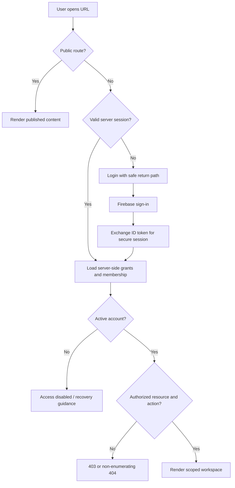

**Post-login return path:** Allow only validated, same-origin relative paths on a whitelist of authorized destinations. Never redirect to arbitrary URLs from query parameters. First-login invite acceptance can override a stored default landing when a valid invitation exists. Logout revokes/clears the server session, clears user-scoped client caches, and navigates to `/auth/login` (or safe public homepage).

---

## 2. Sitemap, top-level navigation, and URL strategy

### 2.1 Full application sitemap (MVP and future)
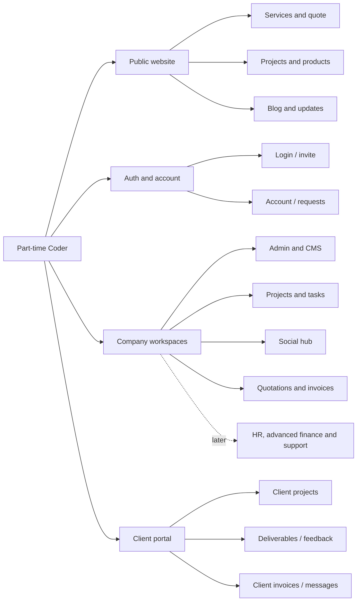

### 2.2 Public and authentication routes
| Route | Scope | Screen / details | Access | Primary intent | PRD |
|---|---|---|---|---|---|
| `/` | M | Home | Public | Trust, CTAs, featured work | `PTC-PUB-001` |
| `/about` | M | Company/team, CMS-approved | Public | Company information | `PTC-PUB-002` |
| `/services` | M | Filtered published service catalog | Public | Explore solutions | `PTC-PUB-003` |
| `/services/[slug]` | M | Published service detail | Public | Start quote with service preselected | `PTC-PUB-003`, `PTC-PUB-007` |
| `/projects` | M | Public portfolio | Public | Browse vetted case studies | `PTC-PUB-004` |
| `/projects/[slug]` | M | Public case study | Public | Evidence of outcomes | `PTC-PUB-004`, `PTC-PRJ-009` |
| `/products` | M | Owned product catalog | Public | Discover company products | `PTC-PUB-005` |
| `/products/[slug]` | M | Owned product detail | Public | Learn product status / release | `PTC-PUB-005` |
| `/blog` | M | Published articles/news | Public | Read updates | `PTC-PUB-006` |
| `/blog/[slug]` | M | Article detail | Public | Share/learn | `PTC-PUB-006` |
| `/contact` | M | Contact form / contact info | Public | Make inquiry | `PTC-PUB-007` |
| `/get-quote` | M | Guided quotation request form | Public | Start new lead | `PTC-PUB-007`, `PTC-CRM-001` |
| `/privacy`, `/terms` | M | Published legal pages | Public | Policy and consent | `PTC-PUB-008` |
| `/careers` | F | Careers/jobs board | Public later | Recruiting | `PTC-PUB-010` |
| `/auth/login` | M | Sign in | Guest / signed-out | Authenticate | `PTC-IAM-001` |
| `/auth/register` | M | Public standard-user sign up | Guest | Registration with minimal role | `PTC-IAM-003` |
| `/auth/forgot-password` | M | Request reset | Guest | Restore access | `PTC-IAM-006` |
| `/auth/verify-email` | M | Verification instructions/result | Auth-dependent | Verify email | `PTC-IAM-003` |
| `/auth/accept-invite` | M | Token validate + accept | Target identity | Scoped staff/client enrollment | `PTC-IAM-004` |
| `/auth/access-disabled` | M | Safe locked-account information | Auth-dependent | Recovery instructions | `PTC-IAM-007` |
| `/auth/reauth` | M | Fresh-login/step-up screen | Auth + action-specific | Sensitive action authorization | `PTC-IAM-007`, `PTC-SEC-003` |
| `/403`, `/404` | M | Generic access denied / not found | Any | Safe failure handling | `PTC-SEC-002` |

**SEO:** Public published pages may be indexed; account, client, previews, admin, social and invoices MUST be `noindex` and never enter the sitemap. An unknown/unpublished slug shows a public 404, not draft metadata.

### 2.3 Registered user / account routes
| Route | Scope | Purpose | Gate | PRD |
|---|---|---|---|---|
| `/dashboard` | M | Personal dashboard and own requests | Signed-in active account | `PTC-IAM-005` |
| `/account` | M | Profile, display preferences, locale/timezone | Signed-in own profile | `PTC-IAM-005`, `PTC-EMP-003` |
| `/account/requests` | M | Own inquiries and basic statuses | Request owner | `PTC-CRM-001`, `PTC-IAM-005` |
| `/account/requests/[id]` | M | Own request details, allowed fields only | Request owner; conceal others | `PTC-CRM-001` |
| `/account/notifications` | M | Own notifications | Recipient only | `PTC-COM-002`, `PTC-COM-004` |
| `/account/security` | M | Sessions/security info, reset links where supported | Signed-in + step-up for sensitive changes | `PTC-IAM-006`, `PTC-SEC-003` |

### 2.4 Company administration and content routes
| Route | Scope | Purpose | Permission gate | PRD |
|---|---|---|---|---|
| `/admin` | M | Operational overview and alerts | `admin.overview.read` | `PTC-ORG-003`, `PTC-ANA-001` |
| `/admin/users` | M | User list/status/invitations | `users.read` | `PTC-IAM-004`, `PTC-ORG-001` |
| `/admin/users/[id]` | M | Profile, grants, membership, suspension | `users.manage` for mutations; sensitive step-up | `PTC-IAM-005`, `PTC-IAM-007` |
| `/admin/invitations` | M | Invite/stale/expired invitation listing | `invitations.manage` | `PTC-IAM-004` |
| `/admin/clients` | M | Client organizations and contacts | `clients.read` | `PTC-CRM-005` |
| `/admin/clients/[id]` | M | Client org, membership, projects and access | `clients.manage`/scoped read | `PTC-CRM-005`, `PTC-CLI-005` |
| `/admin/projects` | M | Projects company administration | `projects.read` | `PTC-PRJ-001` |
| `/admin/leads` | M | Intake pipeline | `crm.read` | `PTC-CRM-002` |
| `/admin/leads/[id]` | M | Qualification, notes, conversion | `crm.read`/`crm.manage` | `PTC-CRM-002`, `PTC-CRM-004` |
| `/admin/cms` | M | CMS home/content types | `cms.read` | `PTC-CMS-001` |
| `/admin/cms/[type]` | M | Items by type | `cms.read` | `PTC-CMS-001` |
| `/admin/cms/[type]/new` | M | Create draft | `cms.edit` | `PTC-CMS-001` |
| `/admin/cms/[type]/[id]/edit` | M | Edit, review, preview, publish | `cms.edit` + `cms.publish` when invoked | `PTC-CMS-002`, `PTC-CMS-005` |
| `/admin/media` | M | Upload, alt text, ownership/media classification | `media.read`/`media.write` | `PTC-CMS-004` |
| `/admin/audit-logs` | M | Scoped immutable audit listing | `audit.read` | `PTC-SEC-005` |
| `/admin/settings` | M | Company profile, restricted settings | `settings.read`/`settings.manage` | `PTC-ORG-004` |
| `/admin/settings/security` | M | Owner/security-controlled session/policy settings | `security.manage` + step-up | `PTC-SEC-003` |
| `/admin/settings/integrations` | M | Feature flags and provider status; no secret exposure | `integrations.read/manage` | `PTC-INT-001`, `PTC-INT-002` |

`[type]` allowlist: `services`, `case-studies`, `products`, `articles`, `team`, `testimonials`, `homepage`, `legal`. Unknown types return 404. Type-specific fields and review requirements belong to schema/design documents; all obey draft-only/publication gate.

### 2.5 Project and employee routes
| Route | Scope | Purpose | Gate | PRD |
|---|---|---|---|---|
| `/workspace` | M | Employee landing / permitted work | `workspace.access` | `PTC-EMP-001` |
| `/workspace/projects` | M | Authorized projects (list/cards) | `projects.read`, scoped | `PTC-PRJ-001` |
| `/workspace/projects/new` | M | Create internal/client project | `projects.create` | `PTC-PRJ-001` |
| `/workspace/projects/[id]` | M | Project overview | Project membership or scoped admin | `PTC-PRJ-001` |
| `/workspace/projects/[id]/tasks` | M | List/Kanban project tasks | Scoped task read | `PTC-PRJ-002`, `PTC-PRJ-004` |
| `/workspace/projects/[id]/tasks/[taskId]` | M | Task details/comments/attachments | Scoped task read/edit | `PTC-PRJ-002`, `PTC-EMP-002` |
| `/workspace/projects/[id]/milestones` | M | Milestone list, targets, client visibility | Scoped project read/manage | `PTC-PRJ-003` |
| `/workspace/projects/[id]/deliverables` | M | Upload/classify client-safe deliverables | `deliverables.manage`, project scope | `PTC-PRJ-006`, `PTC-PRJ-007` |
| `/workspace/projects/[id]/members` | M | Add/remove scoped staff | `project.members.manage` | `PTC-PRJ-005` |
| `/workspace/projects/[id]/activity` | M | Activity/comments with audience policy | Project scope | `PTC-PRJ-008`, `PTC-COM-001` |
| `/workspace/my-tasks` | M | Assigned tasks, status, due date | Own assignments + grants | `PTC-EMP-001`, `PTC-EMP-002` |
| `/workspace/notifications` | M | Employee-specific alerts | Recipient scope | `PTC-EMP-004` |
| `/workspace/timesheets` | F | Time entry | Future HR/project billing | `PTC-EMP-005` |

### 2.6 Client portal routes
| Route | Scope | Purpose | Gate | PRD |
|---|---|---|---|---|
| `/client` | M | Client-selected org overview | Client membership + org context | `PTC-CLI-001` |
| `/client/projects` | M | Client-authorized projects | Org + project membership | `PTC-CLI-001`, `PTC-CLI-002` |
| `/client/projects/[id]` | M | Client-safe project detail, milestones | Org + project scope | `PTC-CLI-002` |
| `/client/projects/[id]/deliverables` | M | Visible files and feedback | Org + project + file visibility | `PTC-CLI-003`, `PTC-CLI-004` |
| `/client/deliverables/[id]` | M | Versioned deliverable review | Org + project + deliverable | `PTC-CLI-003`, `PTC-CLI-004` |
| `/client/requests` | M | Own organization service requests/quotes | Client org scope | `PTC-CLI-006` |
| `/client/invoices` | M | Issued own invoices | Client org + explicit invoice visibility | `PTC-FIN-004` |
| `/client/invoices/[id]` | M | Invoice detail/download | Client-safe financial DTO | `PTC-FIN-004` |
| `/client/messages` | M | Client-visible project discussions | Org/project scope | `PTC-CLI-007` |
| `/client/members` | M | Client Admin invites/revokes authorized members | `client.members.manage`, same org | `PTC-CLI-005` |
| `/client/settings` | M | Org selection/contact preferences | Authorized client org | `PTC-CLI-001`, `PTC-COM-004` |
| `/client/support` | F | Ticket/SLA center | Future entitlement | `PTC-CLI-009` |

### 2.7 Unified social/marketing routes
| Route | Scope | Purpose | Gate | PRD |
|---|---|---|---|---|
| `/marketing` | M | Calendar snapshot, approvals, account health, failures | `social.read` | `PTC-SOC-001`, `PTC-ANA-003` |
| `/marketing/composer` | M | New campaign and variants | `social.draft.create` | `PTC-SOC-003`, `PTC-SOC-004` |
| `/marketing/campaigns` | M | Campaign list | `social.read` | `PTC-SOC-004` |
| `/marketing/campaigns/[id]` | M | Campaign overview, per-provider statuses | `social.read`, campaign scope | `PTC-SOC-003`, `PTC-SOC-009` |
| `/marketing/campaigns/[id]/edit` | M | Edit campaign + variants (revision discipline) | `social.draft.edit` | `PTC-SOC-003`, `PTC-SOC-004` |
| `/marketing/reviews` | M | Pending exact-revision approvals | `social.review` | `PTC-SOC-003`, `PTC-SOC-004` |
| `/marketing/calendar` | M | Schedule/calendar by timezone | `social.read`; write `social.schedule` | `PTC-SOC-005` |
| `/marketing/posts` | M | Variant/job list and outcome filters | `social.read` | `PTC-SOC-009`, `PTC-SOC-013` |
| `/marketing/posts/[id]` | M | Variant content, attempts, reconciliation/manual action | scoped `social.read`; action-specific gates | `PTC-SOC-006`, `PTC-SOC-009` |
| `/marketing/accounts` | M | Six provider cards, connected-account health | `social.accounts.read` | `PTC-SOC-001`, `PTC-SOC-002` |
| `/marketing/accounts/[id]` | M | Connection health, capability matrix, reconnect/disconnect | read, plus trusted `social.accounts.manage` | `PTC-SOC-001`, `PTC-SOC-002` |
| `/marketing/analytics` | M | Publishing counts and supported provider metrics | `social.analytics.read` | `PTC-SOC-012`, `PTC-ANA-003` |
| `/marketing/media` | M | Social-safe media library | `social.media.read/write` | `PTC-SOC-011`, `PTC-CMS-004` |
| `/marketing/inbox` | F | Omnichannel comments/messages | Future provider and privacy review | `PTC-SOC-018` |

Connection OAuth callbacks are **API handlers**, not navigable credential-bearing screens. A short user-facing callback-result page may display success/failure after the server consumes and validates `state`/PKCE; tokens never appear in URL or logs.

### 2.8 Finance and deferred modules
| Route | Scope | Purpose | Gate | PRD |
|---|---|---|---|---|
| `/finance/quotes` | M | Quote list with scope filter | `finance.quotes.read` | `PTC-FIN-001`, `PTC-CRM-003` |
| `/finance/quotes/new` | M | Create line-item quote | `finance.quotes.create` | `PTC-FIN-001` |
| `/finance/quotes/[id]` | M | Quote editing/issue tracking | `finance.quotes.manage`, version/state | `PTC-FIN-001` |
| `/finance/invoices` | M | Invoice register, statuses, outstanding | `finance.invoices.read` | `PTC-FIN-002`, `PTC-ANA-005` |
| `/finance/invoices/new` | M | Draft invoice | `finance.invoices.create` | `PTC-FIN-002` |
| `/finance/invoices/[id]` | M | Draft/issued detail, manual payment history | `finance.invoices.manage` (mutations) | `PTC-FIN-002`, `PTC-FIN-003` |
| `/finance/expenses` | F | Expense ledger | Future finance scope | `PTC-FIN-007` |
| `/hr/employees` | F | Staff directory/HR details | HR-specific grants | `PTC-EMP-006` |
| `/hr/attendance` | F | Time and attendance | HR-specific grants | `PTC-EMP-005` |
| `/hr/leave` | F | Leave management | HR-specific grants | `PTC-EMP-005` |
| `/hr/recruitment` | F | Recruiting | HR-specific grants | `PTC-PUB-010` |
| `/hr/performance` | F | Reviews | HR-specific grants | `PTC-EMP-006` |

### 2.9 Navigation generation and information scent
- Desktop: public marketing navigation; authenticated collapsible sidebar with **only permitted** workspace destinations. Mobile: accessible drawer/tab action surface; the same authorization applies.
- All private detail pages have breadcrumbs to the nearest authorized list. If a parent list is unavailable, breadcrumb points to the workspace landing instead.
- Global search MVP: contextual search/filter for services, portfolio, company lists and authorized tasks; broad federated enterprise search is F. Search results are server-scoped.
- Persist the last *valid* workspace and list filters when useful; avoid storing client-sensitive search output in long-lived browser storage.
- Empty routes must not imply access to nonexistent sections. F destinations are **not** rendered as functional placeholders for MVP; optionally show them in a separate read-only roadmap page, clearly labelled planned.
- Notifications link to stable authorized routes and never embed full sensitive record content in an email subject or preview.

---
## 3. Screen inventory and interaction contracts

### 3.1 Common screen-shell contract (applies to every private screen)
Every private workspace screen SHALL provide: authorized heading and breadcrumb, current company or client organization context, predictable navigation, loading/empty/error handling, keyboard-operable actions, field and action permission gates, noindex, and accessible live feedback. A **success toast** may appear only after the server confirms the intended operation—not when a network request merely starts. Sensitive operations require confirmation and may require step-up authentication.

All paginated lists use bounded cursor pagination from the TRD, supported filters/sort presets, URL-backed filter state where safe, skeletons on first load, and inline retry on failure. The list itself must not disclose unauthorized counts or existence of other organizations' records. Filter validation happens on the server.

**Shared components:** `WorkspaceShell`, `SidebarNav`, `Topbar`, `WorkspaceSwitcher`, `OrgContextPicker`, `Breadcrumbs`, `PermissionGuard` (presentation only), `SearchFilterBar`, `DataTable`, `EmptyState`, `ErrorPanel`, `ConfirmDialog`, `AuditTimeline`, `ActivityFeed`, `UploadDropzone`, `ProtectedDownload`, `StatusChip`, `NotificationCenter`, and `UnsavedChangesDialog`. All mutate through service contracts; components never decide server permissions independently.

### 3.2 Screen catalog (user goal, surface data, primary actions, exceptional behavior)
| Flow | Screen / route family | Read surface | Primary actions | Loading / empty / error | PRD requirements |
|---|---|---|---|---|---|
| AF-001 | Home `/` | Published services, cases, products, latest articles, CTA | Browse / quote | Skeleton for dynamic content; hide missing modules instead of filler; graceful unavailable teaser | `PTC-PUB-001`, `PTC-PUB-009` |
| AF-002 | Services and detail | Public services, categories, scope, quote link | Search/filter; start prefilled quote | No matches + clear filters; unknown slug 404 | `PTC-PUB-003` |
| AF-003 | Public projects/products | Approved case studies/product information | Filter, open details, visit approved external link | Unpublished/archived item 404; never expose linked internal records | `PTC-PUB-004`, `PTC-PUB-005` |
| AF-004 | Blog and article | Published category/author/date/body | Search, read, share canonical link | Pending image alt/fallback; unpublished 404 | `PTC-PUB-006`, `PTC-PUB-009` |
| AF-005 | Contact and quote request | Service context, validated fields, consent | Submit request; receive reference | Validation inline; anti-abuse neutral response; retry with same idempotency key | `PTC-PUB-007`, `PTC-CRM-001` |
| AF-006 | Login / register / recover | Form fields, safe identity state | Authenticate/register/reset | Invalid creds do not enumerate users; Firebase outage safe retry | `PTC-IAM-001`, `PTC-IAM-003` |
| AF-007 | Invitation acceptance | Redacted invite target/scope/expiry | Authenticate correct identity; accept once | Expired/revoked/wrong recipient: no membership; safe help | `PTC-IAM-004` |
| AF-008 | User dashboard/account | Own profile, own requests, notification summary | Edit preferences, open request | No own requests: link to quote; deleted access: refresh navigation | `PTC-IAM-005`, `PTC-IAM-009` |
| AF-009 | Admin overview | Scoped leads, projects, approvals, social exceptions | Open filtered queues | Metrics include as-of time; partial tile failure not all-page outage | `PTC-ORG-003`, `PTC-ANA-001` |
| AF-010 | Users/invitations | Permitted user rows, role status, invite status | Invite, suspend, grant/revoke | Block final owner removal, show conflict and audit ID | `PTC-ORG-004`, `PTC-IAM-008` |
| AF-011 | Client org administration | Contacts, active memberships, linked work | Create client, invite, revoke member | Duplicate org conflict; no silent merging of clients | `PTC-CRM-005`, `PTC-CLI-005` |
| AF-012 | Lead pipeline/detail | Lead status, assignee, internal notes, service | Qualify, assign, annotate, convert | Conversion in-progress state; duplicate-safe retry; internal notes hidden externally | `PTC-CRM-002`, `PTC-CRM-004` |
| AF-013 | CMS lists/editor | Drafts, revisions, author, approval, preview | Create/edit/submit/publish/archive | Slug conflict, stale revision, preview expiry, private media denial | `PTC-CMS-001`–`PTC-CMS-006` (revision diff/scheduling `007` F) |
| AF-014 | Admin settings/security | Company settings, integration health, audit | Update allowed config; view audit | Privileged step-up, secure failure, never return secrets | `PTC-ORG-001`, `PTC-ORG-005`, `PTC-SEC-004`, `PTC-SEC-005` |
| AF-015 | Employee landing/my tasks | My assigned tasks, due soon, project summary | Open task, update status | No assignments: relevant CTA, not other people's tasks | `PTC-EMP-001`, `PTC-EMP-002` |
| AF-016 | Project directory/create | Authorized client/internal projects | Filter, create, assign owner | Invalid client-org, permissions, stale project status | `PTC-PRJ-001`, `PTC-PRJ-005` |
| AF-017 | Project detail/task board | Scoped project, tasks, task status, assignees | Kanban move, edit task, comment | Optimistic move reverts on 409/412; list respects hidden tasks | `PTC-PRJ-002`, `PTC-PRJ-004` |
| AF-018 | Milestones/members | Target dates, progress, membership | Manage milestone, team, client visibility | Removed membership ends access immediately; block invalid visibility change | `PTC-PRJ-003`, `PTC-PRJ-005`, `PTC-PRJ-007` |
| AF-019 | Internal deliverables/activity | Private/approved files and audit activity | Upload, approve visibility, request review | Upload finalization error leaves non-shared pending asset; protected download | `PTC-PRJ-006`–`PTC-PRJ-008` |
| AF-020 | Client overview/org picker | Own organization's approved project milestones | Switch permitted org; open project | Org access revoked -> safe recovery / select another | `PTC-CLI-001`, `PTC-ANA-004` |
| AF-021 | Client project details | Client-safe progress and deliverable list | Read milestones, initiate feedback | No internal notes/costs/hidden files; arbitrary IDs masked | `PTC-CLI-002`, `PTC-CLI-007` |
| AF-022 | Client deliverable review | Approved file/version, review history | Download/comment/revision request | Expired signed URL -> reauthorize; stale version -> reload | `PTC-CLI-003`, `PTC-CLI-004` |
| AF-023 | Client members/requests/invoices | Client-authorized members, requests and invoices | Invite allowed member, read issued docs | No drafts/other-org invoices or privileged internal data | `PTC-CLI-005`, `PTC-CLI-006`, `PTC-FIN-004` |
| AF-024 | Marketing overview | Review queue, upcoming jobs, account health, counts | Go to composer/reviews/failed jobs | Partial adapter outage displayed; counts separate API/manual | `PTC-SOC-013`, `PTC-ANA-003` |
| AF-025 | Social composer/campaign edit | Master campaign, six target-account variants, media, previews | Save draft, validate per platform, submit for review | Unsupported format -> per-target error; autosave must prove commit | `PTC-SOC-003`, `PTC-SOC-004`, `PTC-SOC-010` |
| AF-026 | Social review | Exact revision snapshot, target account/media, submitter | Approve, request changes, reject | Creator cannot self-approve; stale hash rejection | `PTC-SOC-004`, `PTC-SEC-005` |
| AF-027 | Calendar/schedule | Approved variant, IANA zone, local time, per-target capabilities | Schedule, reschedule, cancel future job | DST fold/gap handling, provider disabled fallback, stale snapshot | `PTC-SOC-005`, `PTC-SOC-014` |
| AF-028 | Social jobs/outcome | Variant, attempts, account, provider IDs/URLs, error class | Inspect, reconcile, manual-ready/manual-complete | `unknown_outcome` never auto-resend; suspended account stops dispatch | `PTC-SOC-006`–`PTC-SOC-009` |
| AF-029 | Social accounts/capabilities | Six-provider cards, scopes, health, supported features | Connect/reconnect/disconnect if trusted | OAuth denial, lost scopes, unapproved API -> manual mode; no token display | `PTC-SOC-001`, `PTC-SOC-002`, `PTC-SOC-015` |
| AF-030 | Social analytics | Campaign/variant counts, provider-specific metrics | Filter by date/platform; drill down | Unsupported≠0; source/as-of displayed; API/manual totals split | `PTC-SOC-012`, `PTC-ANA-003` |
| AF-031 | Quotes list/editor | Quote line items, currency, customer, status, expiry | Save, edit permitted status, associate lead | Server recompute amounts; stale revision -> conflict | `PTC-FIN-001`, `PTC-CRM-003` |
| AF-032 | Invoice list/editor | Draft/issued docs, due/balance, payment history | Issue, void where lawful, record manual payment | No issue without confirm/step-up; duplicate record prevented | `PTC-FIN-002`, `PTC-FIN-003` |
| AF-033 | Notification inbox | Recipient-only events, target URL, read status | Mark read, follow authorized deep-link | No cross-tenant payload; target revoke -> denied safely | `PTC-COM-002`–`PTC-COM-004` |
| AF-034 | Shared media manager | Classified media metadata, previews, ownership | Upload, assign, remove references as allowed | Virus/type/size reject; stale authorization invalidates download | `PTC-CMS-004`, `PTC-PRJ-006`, `PTC-SOC-011` |
| AF-035 | Operational error screens | Safe request ID and recovery choices | Retry allowed action, login, return | 401/403/404/409/412/429/503 distinguish; no stack trace | `PTC-NFR-013`, `PTC-SEC-002` |

**Requirement references in this table cite existing PRD IDs.** A range like `PTC-CMS-001`–`007` denotes several related existing requirements for navigation; implementers must expand to individual ID-to-test links when creating tickets.

### 3.3 Standard screen layout and action sequencing
For each detail screen:
1. **Route enter:** parse ID/slug; immediately display neutral loading skeleton; never render cached *other-organization* content while switching.
2. **Session check:** read authenticated server session and current grants; validate requested organization/project/resource through server endpoint.
3. **Fetch:** load typed, authorized DTO; expose relevant `version`, `updatedAt`, `visibility`, and `status` without internal-only fields.
4. **Render:** show state badge, accessible action menu filtered by grants **and workflow state**. Distinguish missing permission from unsupported provider capability.
5. **Action:** validate on client for usability; validate again on server; for mutating irreversible actions present a confirmation with affected entity and consequence.
6. **Mutation:** include conditional revision/ETag and idempotency key when contract requires; disable duplicate submit; show progress and cancel only when cancellation is supported.
7. **Response:** on confirmed success, refetch affected data and counters; on 409/412 present a conflict view, retain the user's unsaved edits locally where safe; on unknown network outcome show reconciliation pathway instead of assuming mutation failure.
8. **Leave:** warn about unsaved form edits, revoke temporary object URLs, remove sensitive cached data after logout/membership revocation.

### 3.4 Form specifications and validation
| Form ID | Entry points | Required inputs (illustrative) | Submit behavior | Error handling |
|---|---|---|---|---|
| FORM-01 Contact | `/contact` | name, email, message, consent when legally required | `POST /api/v1/public/inquiries` | Inline fields; rate limit and spam handling; no user enumeration |
| FORM-02 Quote | `/get-quote`, service CTA | contact, service/type, needs, preferred contact; budget/timeline optional | Create lead idempotently; show reference | Draft retention only with explicit policy; avoid exposing private lead data |
| FORM-03 Register | `/auth/register` | email, password or approved provider auth, consent as applicable | Firebase sign-up → server creates Regular User profile | Enforce no role field from client; safe duplicate-account behavior |
| FORM-04 Invitation | `/auth/accept-invite` | valid invite token + target identity | Validate invite and accept single use | Expired/used/revoked/mismatched identity -> no grant |
| FORM-05 User invite | `/admin/users`, `/client/members` | email, requested permitted role/scope, expiry | Admin audit/invite notification | Client admins cannot invite company roles or broaden project scope |
| FORM-06 Lead qualify | `/admin/leads/[id]` | status, owner, internal note/next action | Versioned PATCH; append timeline event | Stale lead shows refresh/merge intent; notes are internal-only |
| FORM-07 Lead conversion | lead detail | validated client org and project data; consent/relationship checks | Idempotent convert command | Partial failure recoverable; no duplicate client or project |
| FORM-08 Project create | `/workspace/projects/new` | type, name, owner, client org when type=client, visibility | Scoped create | Reject nonexistent/unassigned client org and invalid owner |
| FORM-09 Task | project board/detail | title, status, assignee, due date/priority optional | Versioned create/update | Reject assignee outside permitted scope; stale update recoverable |
| FORM-10 Milestone | project milestone panel | title, target date, visibility decision, status | Server-approved milestone write | Client visibility default private; require explicit confirmation |
| FORM-11 Deliverable | staff deliverables | file/version, classification, client visibility, release note | Secure upload intent → verify/finalize → mark review ready | Uploaded but unverified assets never client-readable |
| FORM-12 Client feedback | `/client/deliverables/[id]` | feedback text, optional approved attachments, expected revision | Create scoped comment/revision request | Permission/version conflict explained; never silently lose feedback |
| FORM-13 CMS editor | `/admin/cms/[type]/[id]/edit` | type-validated schema, slug, body, approved media, alt text | Save draft; submit review; publish gated | Reject unsafe rich text/duplicate slug/stale version |
| FORM-14 Social composer | `/marketing/composer` | campaign, platform targets, platform-specific content/media | Save variants separately + validate each | Validation failures isolated by variant; approved changes reset approval |
| FORM-15 Social approval | `/marketing/reviews` | exact variant version/hash, decision, reason for changes | Review mutation with `If-Match` | Self-approval blocked, stale revision rejected |
| FORM-16 Schedule | calendar/variant | approved snapshot, local date/time, IANA timezone, selected account | Atomic schedule request; create durable job | Past/ambiguous time or missing capability → guidance/manual fallback |
| FORM-17 Manual publishing | job detail | operator confirmation, external URL/proof where available | Record `manually_published` separately | Record actor/time; no automatic provider-confirmed claim |
| FORM-18 Social connection | `/marketing/accounts` | selected platform/account; provider-controlled OAuth consent | State + PKCE, callback, permission health | Denial, token expiry, unsupported scopes → actionable status |
| FORM-19 Quote document | `/finance/quotes/new` | client/lead, currency, line item unit minor amount, qty, expiry | Server recalculation, versioned save | Invalid amount/currency, permission, stale status rejected |
| FORM-20 Invoice issue | `/finance/invoices/[id]` | client, lines, due date, currency, immutable issue metadata | Step-up and idempotent issue; lock issued fields | Duplicate issue key safe; unauthorized client linkage rejected |
| FORM-21 Manual payment | invoice detail | amountMinor, currency, date, method/reference | Idempotent append + balance update | Duplicate, overpayment, wrong currency handled explicitly |
| FORM-22 Profile/preferences | `/account` | permitted profile/locale/timezone/notification preferences | Own-only update | Invalid locale/zone/error remains form with safe retry |

**Forms and drafts:** For sensitive personal/client data, default to in-memory draft state or an authenticated, authorized server draft. Do not persist secrets, quotes, client files, OAuth tokens or credentials in unrestricted browser local storage. Use approved upload limits and declared MIME validation; server validates actual content. Passwords remain within Firebase's secure flows, not custom MongoDB records.

### 3.5 Loading / empty / error / success catalog
| UI state | Trigger | Mandatory treatment | Forbidden treatment |
|---|---|---|---|
| `initial_loading` | First route/API load | Skeleton/label, focus preserved, no sensitive stale contents | Flashing another client's cached data |
| `refetching` | Sort/filter/status refresh | Indicate refresh without blocking valid data | Pretend count is fresh when stale |
| `empty_first_use` | Legitimate zero authorized records | Explain, show permitted CTA | Misrepresent as a failed request |
| `empty_filtered` | Filter finds no match | Clear filters/reset | Invite elevated access |
| `partial_data` | Metrics/integration subsystem unavailable | Render unaffected cards with per-card warning and as-of | Replace unknown counts with zero |
| `validation_error` | 400/422 | Field messages, accessible summary, retain safe inputs | Generic silent failure |
| `unauthenticated` | 401 | Safe login/reauth and allowed return | Redirect loop; unsafe `next` URL |
| `forbidden` / `not_found` | 403/404 | Neutral denial, no resource metadata disclosure | Reveal other client owner/name |
| `conflict` / `stale` | 409/412 | Show latest revision and explicit retry/merge | Overwrite newer revision silently |
| `rate_limited` | 429 | Safe feedback and server `Retry-After` | Aggressive repeated requests |
| `dependency_down` | 502/503 | Retry only safe actions, show request ID | Fake persisted success |
| `mutation_pending` | Write request in flight | Prevent duplicate submit, progress feedback | Claim committed before confirmation |
| `unknown_mutation_result` | Network lost after possible commit | Query authoritative status using request/idempotency key | Blind repeat of sensitive action |
| `success_committed` | Server confirms transaction | Update view, toast/live status, audit if applicable | Assume side effects (email/provider) already succeeded |
| `client_org_revoked` | Permission changed mid-session | Clear cache, close drawers, safe redirect | Continue showing sensitive cached resource |
| `manual_action_required` | Social platform capability unavailable | Explain exactly why, provide approved manual actions | Show fake scheduled API publication |

**Accessibility:** Give form controls persistent labels and descriptions; announce errors in `aria-live`/summary; keyboard focus moves to first failing field or conflict modal appropriately; dialogs trap focus and return it on close; drag-and-drop Kanban has keyboard alternative; tables label headers; date/time fields announce timezone; reduced-motion preferences are respected. These states map to `PTC-NFR-001`, `PTC-NFR-002`, and `PTC-NFR-013`.

---

## 4. End-to-end workflows: discovery, onboarding, administration, and delivery

### J-001 — Guest discovers a service and submits a quotation request (M)
**Actor:** Guest. **Entry:** `/`, `/services/[slug]`, `/get-quote`. **Exit:** lead recorded; staff queue updated.  
**Preconditions:** Public website available; selected service is published.  
**Linked:** `PTC-PUB-001`, `PTC-PUB-003`, `PTC-PUB-007`, `PTC-CRM-001`, `PTC-SEC-006`.

1. Guest lands on homepage or service detail and selects **Request a Quote**; published service ID is preselected, never used as trust evidence for price.
2. `/get-quote` loads with contact, project description, selected service, and optional budget/timeline fields.
3. Guest enters details and any required consent; client validation provides accessible inline guidance.
4. Server validates content/anti-abuse limits and stores inquiry with idempotency/deduplication policy.
5. UI shows a reference and neutral success guidance **only after the server confirms persistence**; an email notification may follow asynchronously.
6. Authorized sales/admin sees lead in `/admin/leads` with permitted contact fields and age/assignment indicators.
7. If email fails, lead persists and system alerts/retries mail; if database fails, UI explicitly says submission not confirmed.

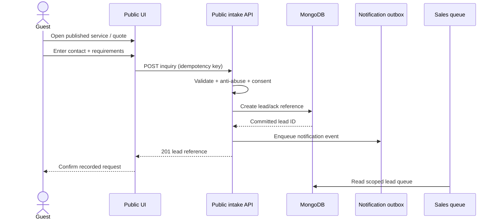

**Negative cases:** spam/rate limit, invalid email, duplicate browser retry, unavailable DB, disabled service, network timeout after possible acceptance. Resolve uncertain intake by request reference or idempotency key rather than creating blind duplicates.

### J-002 — Registration, invitation, and multi-workspace entry (M)
**Actors:** Regular user, invited employee, invited client member. **Linked:** `PTC-IAM-001`–`PTC-IAM-009`.

1. Public signup creates Firebase identity and **Regular User only**, regardless of crafted role fields.
2. User verifies email as required, authenticates, exchanges Firebase ID token through server session route; secure cookie is minted after token verification and account checks.
3. Server creates/links internal user profile; client receives server-authorized workspace list.
4. A company/admin or client admin with correct grants creates an invitation containing target identity, scoped role, expiry and revocation ability.
5. Invitee opens `/auth/accept-invite`; system asks correct identity to authenticate if necessary, validates token **server-side**, checks active invitation, target, inviter authority and scope, then consumes it exactly once.
6. Membership/grant is recorded, actor gets new authorized workspace; prior user account is not replaced.
7. User with multiple scopes chooses/saves eligible workspace. Suspended/deactivated accounts are denied consistently across routes and APIs.

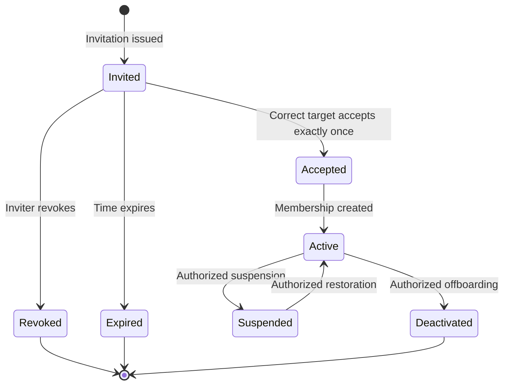

**Security gates:** Cannot accept with different account or bypass MFA; no final active owner removal; invite token never reissued as a permission by itself after acceptance; server permission refresh after grant changes. Login `returnTo` always relative and same-origin; no credential tokens leaked in error banners.

### J-003 — Admin triages a lead and converts to project (M)
**Actor:** Admin or sales delegate. **Entry:** `/admin/leads/[id]`. **Linked:** `PTC-CRM-001`–`PTC-CRM-006`, `PTC-PRJ-001`, `PTC-FIN-001`.

1. Sales queue displays leads according to assigned/granted scope. Admin opens detail, qualifies, assigns, records internal notes and next action.
2. Staff prepares a quotation with server-calculated line items and stored currency; records the appropriate quote stage. MVP does not require a legally binding e-signature.
3. When decision is approved by permitted staff, action **Convert to Client Project** opens a review dialog showing new or linked client organization, contact, project owner/type and proposed members.
4. Server verifies no conflicting previous conversion and uses an idempotent transaction/compensating protocol to create/link client, project, lead and quotation references. It never invents client project access for every client member.
5. Invitation to client admin is generated as needed, but project membership and visibility are explicitly assigned.
6. On completed conversion, UI displays a link to created project and a conversion audit entry; on partial failure, display **pending recovery** without repeating unsafe operations.

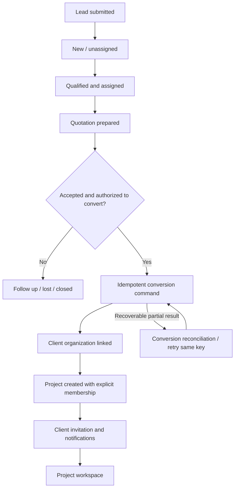

**Expected client view:** Client sees its own permitted project summary only after invitation acceptance plus specific project entitlement. Internal lead notes, sales assessment, and company margin remain absent.

### J-004 — Company admin invites, suspends, and changes staff access (M)
**Actor:** Admin/Owner. **Entry:** `/admin/users`. **Linked:** `PTC-ORG-004`, `PTC-IAM-004`–`PTC-IAM-008`, `PTC-SEC-003`, `PTC-SEC-005`.

1. Admin selects invite user, enters target email, department, permitted role/grant and expiry; server validates delegation boundary.
2. Invitee accepts as J-002; admin can inspect invitation status without seeing secret token.
3. To change access: open user details, choose permitted grant and resource scope; present impact preview; require fresh MFA/reauth for high-risk grants or deactivation.
4. Mutating operation writes audit event and invalidates effective entitlement caches; user's next API request enforces new scope.
5. Suspension immediately prevents unauthorized private requests and relevant background actions; existing cached private data is cleared on the next client update, while server remains authoritative.
6. Last active Owner removal/deactivation always fails with safe explanation and audit record.

**Failure paths:** stale user version, simultaneous administrators, owner-safety invariant, user already suspended, wrong organization. No universal admin impersonation in MVP.

### J-005 — Admin creates and publishes website content (M)
**Actors:** Content editor + authorized CMS publisher. **Entry:** `/admin/cms/[type]/new`. **Linked:** `PTC-CMS-001`–`PTC-CMS-006` (revision diff/scheduling `007` F), `PTC-PUB-004`, `PTC-PRJ-009`.

1. Authorized editor selects content type (service, case study, product, article, team, testimonial, homepage, legal), creates draft and uploads approved media using protected upload intents.
2. Editor supplies slug/title/body/type fields, alt text and metadata; CMS sanitizes rich text and rejects duplicate slug across the defined namespace.
3. Editor saves draft; UI shows saved revision/version and preview link. Preview is authorized and time-limited—never an indexed public draft.
4. Editor submits for review (if policy requires), reviewer inspects exact version and either requests changes or approves.
5. Authorized publisher selects **Publish** with current approved revision; server revalidates fields/visibility, commits `published`, and invalidates affected public caches/sitemap entries.
6. Public route becomes available only after confirmed commit; social content is **not** auto-published as a side effect.
7. Later edit creates new revision/draft under policy; archived/unpublished content is removed from public access without making internal source projects public.

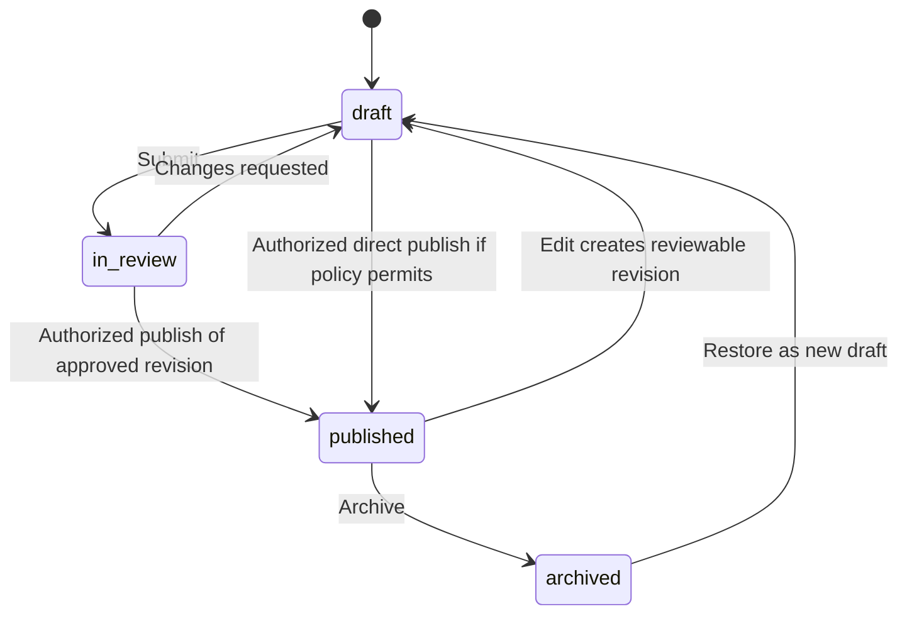

**Gate:** A project manager marking a client deliverable ready does not publish a case study. To showcase private client work, a **separate sanitized CMS record** with approved client/publication rights is required.

### J-006 — Project manager plans and assigns a project (M)
**Actor:** Project Manager with scope. **Entry:** `/workspace/projects/new`. **Linked:** `PTC-PRJ-001`–`PTC-PRJ-005`, `PTC-COM-002`.

1. PM creates project as `client`, `internal_product`, or `internal_operations`; `client` requires authorized canonical client organization ID.
2. Set initial status (`proposed`/`planned`), owner, target dates and one of `internal_only`, `client_summary`, `client_collaborative`.
3. PM adds staff from authorized assignment pool; no automatic visibility of other clients or internal users.
4. PM creates milestones with target date and explicit client visibility; adds tasks with owner/assignee, due date and optional checklist.
5. Assignment creates activity log and recipient-scoped notification via outbox. Assignee opens `/workspace/my-tasks` and sees only assigned work.
6. Staff updates task statuses and comments. Kanban drag-and-drop posts a versioned transition; stale updates revert with conflict message rather than overwriting current state.
7. PM monitors task progress and approved milestone summaries; each project has internal-only activity and separate client-facing communications.

### J-007 — Employee works on task and uploads protected assets (M)
**Actor:** Employee or project member. **Linked:** `PTC-EMP-001`–`PTC-EMP-004`, `PTC-PRJ-002`, `PTC-PRJ-006`.

1. User enters employee landing and picks a task from permitted `my-tasks` query.
2. Task screen shows assigned context, allowed status actions, due date, checklist, activity and file visibility badges.
3. User edits own assignment within permitted workflow; server rejects assignment to someone outside project or edit to locked/archived task.
4. File upload requests server-authenticated intent and approved size/MIME/ownership; finalization verifies uploaded object before linking it.
5. Task event and notification are committed; UI only announces completed work after API acknowledgment.
6. Removed employee loses authorization for task and file even if browser retains an old signed URL or link; short-lived links and revalidation limit exposure.

### J-008 — PM issues deliverable; client reviews and requests revision (M)
**Actors:** Project Manager, Client Admin/Member. **Entry:** staff `/workspace/projects/[id]/deliverables` → client `/client/deliverables/[id]`. **Linked:** `PTC-PRJ-007`, `PTC-CLI-002`–`PTC-CLI-007`, `PTC-COM-001`.

1. PM selects uploaded/verified file, sets version and **explicitly** approves client visibility; private comments and budgets are excluded by serializer.
2. Deliverable becomes `ready_for_client_review`, notifying authorized client recipients.
3. Client authenticates, selects authorized organization/project and opens stable notification link; server checks *both* organization and project membership plus file-level audience.
4. Client views approved metadata, downloads via short-lived scoped signed URL, comments or files a revision request.
5. Server writes client-visible comment/revision and internal follow-up assignment; notification reaches PM.
6. PM fixes issues, uploads next version, reissues for review. Prior version remains in access-controlled history according to retention.
7. A positive feedback or non-binding **reviewed** state may close the MVP review cycle. Legally binding electronic acceptance/signature is F (`PTC-CLI-008`).

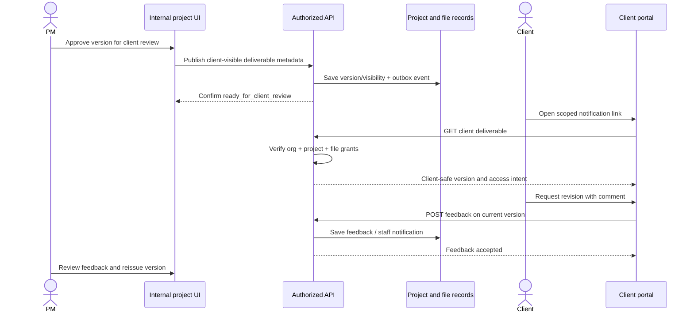

### J-009 — Client Admin manages own organization's members (M)
**Actor:** Client Admin. **Linked:** `PTC-CLI-005`, `PTC-IAM-004`, `PTC-IAM-005`.

1. At `/client/members`, select current valid client organization and invite colleague by target email.
2. Server restricts invite to own organization and the subset of roles/capabilities the client admin is authorized to delegate.
3. Invitation acceptance creates client org membership only; specific project access is **not** inferred from org membership except within explicitly defined per-org read policy.
4. Client Admin can revoke an active member but cannot remove last required client administrator without policy safeguard if adopted in schema.
5. API denies any attempt to create company Admin, Employee, Finance or Marketing membership via client portal.

---
## 5. Social hub: detailed six-platform flow and safety model

### 5.1 Six-platform unified workspace contract
The six platform tiles are present from day one: **Facebook Pages, Instagram professional accounts, LinkedIn Organization Pages, YouTube channels, X accounts, TikTok accounts**. The system shows a separate **capability status** for each connected account and operation, not a single misleading universal “connected/publish-ready” flag. Each operation is available only when current platform approval, scoped OAuth permission, eligible account, quota, media rules, and budget all allow it.

| Network | Supported baseline workflow even without API approval | Automatic operation (C: gated) | Potential limitations UI must disclose |
|---|---|---|---|
| Facebook | Page-targeted drafts, approval, preview, manual instructions | Page post/media publishing, supported metrics | Page access token/roles/scopes, app review, rate limits, eligible endpoints |
| Instagram | Professional-account drafts, media specs, review, manual instructions | Supported image/video/Reels publication/insights | Personal accounts excluded from assumed publish eligibility, approval, media constraints |
| LinkedIn | Company Page drafts, review, manual copy/export | Organization posting and permitted metrics | Organization role, application permissions and versioned API restrictions |
| YouTube | Channel-specific video title/description/thumbnail metadata and approved manual upload checklist | Authorized video upload and supported analytics | Google OAuth, quota, audit/public-visibility restrictions, large-file upload progress |
| X | Account-specific text/media, preview, manual flow | Authorized post/media creation and available metrics | API credits/plan, variable price, media rights, account permissions |
| TikTok | Supported video/photo/caption preparation and official-site posting checklist | Content Posting API when permitted | App/scope review, creator consent, unaudited visibility restrictions, media checks |

**Capability model:** For each `(provider, account, operation)` expose `{mode: 'api_enabled'|'manual_only'|'disabled'|'unknown', reasonCode, checkedAt, restrictions, approvedMediaTypes?}` (illustrative UI DTO; exact field names will be aligned to the TRD adapter/Backend Schema). A successful OAuth connection is **not** proof publishing is enabled. Analytics can be `supported`, `unsupported`, `permission_required`, `pending`, `stale` or `failed` independently. Paid X calls start disabled until owner approves cost envelope.

### J-010 — Connect a provider account safely (M + C)
**Actor:** Marketing Manager with a separate trusted `social.accounts.manage` grant and fresh MFA/step-up. **Entry:** `/marketing/accounts`. **Linked:** `PTC-SOC-001`, `PTC-SOC-002`, `PTC-SOC-015`, `PTC-IAM-007`, `PTC-SEC-004`.

1. Manager sees all six provider cards: **not connected**, **connected**, **needs reauthorization**, **manual only**, **disabled by policy**, or **provider unavailable** with last-checked timestamp.
2. Select provider → read requested permissions, account type requirements, budget/approval warnings and data usage policy. Choosing **Connect** starts OAuth from trusted server using verified `state` and PKCE where supported.
3. The user consents at provider; callback hits server, validates `state`, CSRF binding, redirect allowlist, code exchange and account eligibility. Credentials are encrypted server-side; browser receives only masked account metadata and capabilities.
4. UI displays confirmed account/channel/Page selection and operation flags. No automated publishing until capability preflight and explicit feature flag pass.
5. Permission denial, missing scopes, ineligible account, provider downtime or app not reviewed produces actionable **manual_only** or **needs_reauthorization** status; preserves drafts and scheduled intent without pretending dispatch is possible.
6. **Disconnect** requires trusted grant and confirmation. It stops future provider calls, transitions affected pending jobs to paused/manual/action states, and keeps allowed historical audit records.

```mermaid
sequenceDiagram
  actor Manager
  participant UI as Account manager
  participant Server as Trusted OAuth API
  participant Provider as Social platform
  participant DB as Encrypted account store
  Manager->>UI: Connect provider
  UI->>Server: Start connection (trusted grant + step-up)
  Server->>Server: State/PKCE, callback allowlist
  Server-->>UI: Provider authorization URL
  Manager->>Provider: Consent using provider UI
  Provider->>Server: Redirect with auth code and state
  Server->>Server: Verify state, identity, scope, CSRF
  Server->>Provider: Exchange code; fetch eligible accounts
  Provider-->>Server: Credentials + account metadata
  Server->>DB: Encrypt credentials and store scopes
  Server-->>UI: Safe account metadata / capabilities
  UI-->>Manager: Connect status; API/manual features
```

**Disallowed:** entering a platform password into Part-time Coder; exposing access/refresh tokens; downloading raw OAuth credentials; client users connecting *their* unrelated accounts to company workspace without an approved product change.

### J-011 — Compose one campaign with independent variants (M)
**Actor:** Content Creator. **Entry:** `/marketing/composer`. **Linked:** `PTC-SOC-003`, `PTC-SOC-010`, `PTC-SOC-011`.

1. Creator enters campaign objective/name and selects one or more of six provider accounts, which may be API-enabled or manual-only.
2. System creates a draft master campaign and a **separate variant per selected account**. Each variant has platform-specific text, media, target, accessibility metadata, preview and validation status.
3. Creator writes common message but copies/adapts to each variant; editing Instagram variant cannot change LinkedIn's already-approved snapshot.
4. Uploads use media asset classification and safe metadata; client-confidential source files cannot be repurposed as public marketing assets without a separately authorized publication approval.
5. Per-platform preflight validates known caption/media constraints. Unknown or dynamic constraints are flagged as unverified, not silently guaranteed.
6. Creator saves draft; application confirms persistence and revision identifier. Submit for review freezes the submitted content snapshot (text, media, account, relevant schedule/content identity).
7. A campaign can contain variants in different phases simultaneously. Overview shows each target's independent progress and mode.

**No universal atomic multi-network publish:** Every target is its own approved job and outcome.

### J-012 — Review, approve, revise or reject an exact social revision (M)
**Actors:** Creator, Marketing Manager. **Linked:** `PTC-SOC-004`, `PTC-SEC-005`.

1. Creator submits variant revision with normalized snapshot hash; reviewer sees side-by-side media and content plus account/target details.
2. Reviewer may **Approve**, **Request Changes** (with reason), or **Reject** (with reason); decisions append immutable actor/time/hash audit metadata.
3. Default policy disallows approving your own submitted revision. Owner emergency override is explicit, step-up protected and reason-audited.
4. After approval, edit to approved text/media/target or other material field invalidates approval; variant moves to draft/review-required state with new hash.
5. Scheduling **and worker dispatch** both recheck approved revision/hash. If hash mismatch, do not publish, even when UI once showed Approved.
6. Reviewer opens a stale review link after author revision: server returns 409/412; UI refreshes new content and discards stale approval intent.

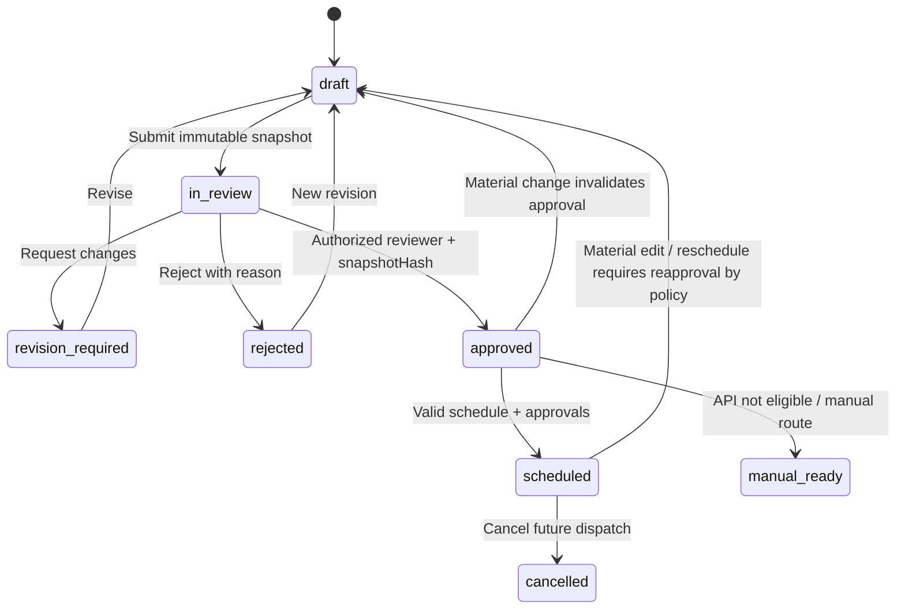

### J-013 — Schedule approved content (M)
**Actors:** Authorized scheduler, Worker. **Linked:** `PTC-SOC-005`, `PTC-SOC-006`, `PTC-SOC-014`, `PTC-NFR-007`.

1. Scheduler opens approved variant (exact revision) and selects local date/time and an **IANA zone**, e.g., `Asia/Riyadh`; system shows corresponding UTC instant and local preview.
2. If local time is ambiguous during DST transition, require explicit choice/offset; nonexistent local time is rejected. Past targets cannot be scheduled.
3. Show per-target eligibility: `api_enabled`, `manual_only`, disabled/reauth required, budget-limited. Never let a disabled account silently create a supposed API job.
4. Scheduler confirms; server revalidates approved snapshot hash, account membership, current capability and schedule, then creates a durable per-variant/per-account operation key/job record.
5. Calendar shows **scheduled** only after commit. Worker supervises dispatch on a separate process, independent of user browser and web-request lifetime.
6. Scheduler can cancel or reschedule a future job within policy. Rescheduling that changes approval-sensitive fields requires reapproval; cancel cannot delete a post already published externally.

### J-014 — Worker dispatch, partial success and ambiguous provider response (M + C)
**Actors:** Background Worker, Marketing Operator. **Linked:** `PTC-SOC-006`, `PTC-SOC-007`, `PTC-SOC-009`, `PTC-SOC-015`.

1. Worker claims due job atomically with a lease; checks global/provider/account kill switch, current grants/account health, actual approval hash, remaining budget and validity.
2. Persist immutable attempt **before** starting external request. Long uploads heartbeat/extend lease and use approved resumable transfer procedures.
3. On explicit provider confirmation, record `api_confirmed_published`, provider ID/URL and audit; never infer success from HTTP timeout.
4. On confirmed non-acceptance due to rate limit/temporary provider failure, schedule bounded exponential retry respecting `Retry-After` and available quota.
5. On revoked credentials, transition to `needs_reauthorization`; do not retry until successful reconnect and fresh preflight.
6. On definitive invalid payload, mark `permanently_failed`; show reason and correction flow requiring new approved revision.
7. If connection drops after request **may have reached provider**, mark `unknown_outcome` and reconcile by any trustworthy external identifier; if no conclusive evidence, queue explicit human investigation. **Never blind-resend.**
8. Successful Facebook posting is not rolled back because Instagram or LinkedIn failed. Each variant retains its own independently auditable outcome.
9. Worker crash after network send is recovered conservatively: lease expiry does not prove non-publication; compare persisted attempt stage/provider evidence before reclaiming.

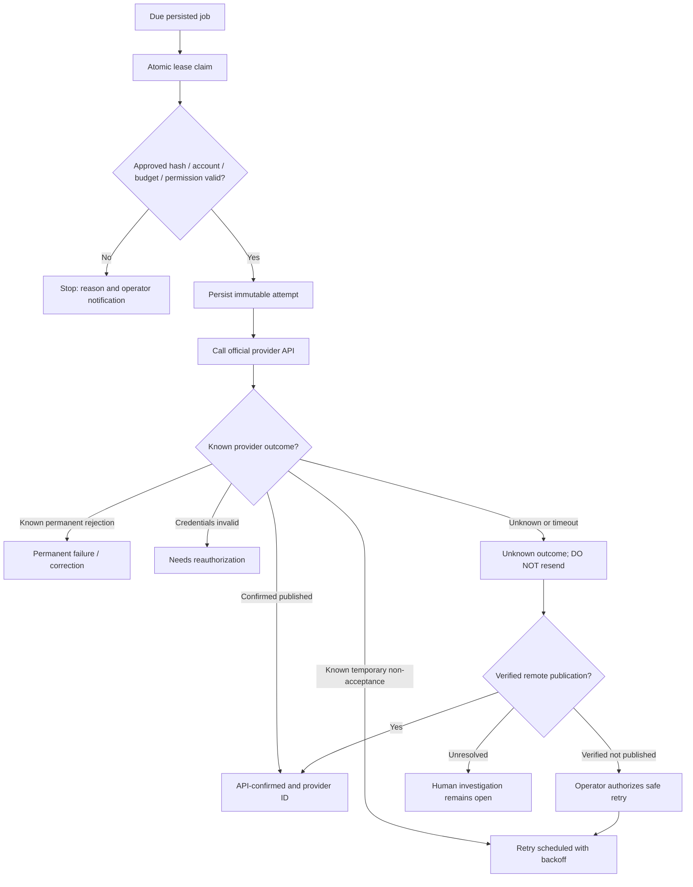

### J-015 — Manual publication when API unsupported or disabled (M)
**Actor:** Authorized marketing publisher. **Linked:** `PTC-SOC-008`, `PTC-SOC-009`.

1. Variant passes editorial review. System displays `manual_ready` with reason, selected official platform link, formatted caption/metadata, downloadable approved public media and account identification.
2. Operator opens the platform's official publishing interface and follows checklist; interface may record **instructions_viewed** and **confirmation_pending**.
3. Operator independently posts through official platform then records **manual published** with actor/time, optional accessible URL and supporting reference.
4. Job moves to `manually_published` (human-reported) and surfaces separately from API-confirmed published count.
5. Operator can cancel/manual-incomplete; if they cannot confirm success, status remains pending/unknown, never fabricated as published.
6. No scraping, password automation or unsupported API bypass is introduced as a fallback.

### J-016 — Social performance and exception review (M)
**Actor:** Marketing Manager, Owner. **Linked:** `PTC-SOC-009`, `PTC-SOC-012`, `PTC-SOC-013`, `PTC-ANA-003`.

1. Open `/marketing` to see drafts pending review, scheduled posts, failed jobs, needs reauthorization, unknown outcomes, API-confirmed published, manually reported published.
2. Select channel/campaign/time period; data queries use permission filters and explain metric source and `asOf` timestamp.
3. A campaign detail shows status per variant; operations can inspect provider ID/URL (when known), attempt history, alert and next allowable action.
4. Metrics marked `unsupported`, `permission_required`, `pending`, `failed` or `stale` are **not numeric zero**. Never sum incomparable network engagement metrics without approved definitions.
5. Worker/provider outage changes only affected metrics/operations, not previously confirmed publication status.

### 5.2 Marketing variant, campaign and job statuses (three distinct aggregates)
| Aggregate | States shown to operator | Ownership and truth source |
|---|---|---|
| Campaign | `draft`, `active`, `completed`, `archived` | Campaign-level rollup, never overrides individual platform statuses |
| Editorial variant | `draft`, `in_review`, `revision_required`, `rejected`, `approved`, `scheduled`, `cancelled`, `manual_ready` | Editorial/approval record with exact snapshot hash |
| Publish job | `scheduled`, `claimed`, `publishing`, `retry_scheduled`, `unknown_outcome`, `needs_reauthorization`, `permanently_failed`, `api_confirmed_published`, `cancelled`, `manual_ready`, `manually_published` | Durable job + persisted attempt; provider evidence vs staff report differentiated |

**Naming reconciliation:** PRD often uses generic labels `pending` / `published` / `failed`; TRD §8.5–8.7 uses more precise job states. The UI may show human-readable labels but MUST retain exact backend distinctions; no lossily mapped `failed`/`published` that hides unknown/manual categories.

### 5.3 Social publishing capability-to-action matrix
| Capability result | Composer | Approval | API schedule | Manual instructions | Analytics | UI message |
|---|---|---|---|---|---|---|
| `api_enabled` with valid scope | Yes | Yes | Yes after preflight | Optional | Where supported | “Automatic publishing available” (for this operation, not whole network) |
| `manual_only` | Yes | Yes | No false API job | Yes | Only if independently supported | “Post manually: API not enabled for this account” |
| `needs_reauthorization` | Read/edit drafts | Yes | No | Yes if policy permits | Stale/limited | “Reconnect account to resume API use” |
| `disabled_by_budget` | Yes | Yes | No paid call | Yes | May be disabled | “Automatic posting paused by cost policy” |
| `provider_unavailable` | Draft and review locally | Yes | Already persisted jobs remain pending/paused | Yes if safe | Stale/unavailable | “Platform temporarily unavailable” |
| `unknown` | Yes | Yes | No until proven eligible | Yes | Unknown | “Capability not verified; no automatic publishing” |
| `invalid_media` | Editable | No final approval until validation | No | Correct media first | N/A | Field-level media problem |

### 5.4 Social time and cross-platform behavior
- All persistence and ordering use UTC instants; UI displays explicit timezone and offset where applicable. A user's stored timezone preference is not used as an implicit replacement for a campaign's persisted scheduling zone.
- Campaign schedule may apply as a batch action, but server issues independent eligible jobs for each platform variant. One `409` or provider denial does not erase other scheduled jobs.
- Calendar badges identify editorial vs job statuses (e.g., **Approved, Not Scheduled** vs **Scheduled for API** vs **Manual Action Needed**). Use accessible text, not color alone.
- Publishing may start within target operational objective under healthy infrastructure (`PTC-NFR-007`) but API processing/visibility may take longer; UI separates queue lag from provider-confirmation lag.
- Analytics fetch is asynchronous and can finish hours later. Never treat incomplete analytics as unsuccessful publication.

---

## 6. Finance, messages, analytics, and cross-cutting journeys

### J-017 — Create quotation and issue invoice (M)
**Actors:** Sales/Finance Manager, Client (read-only for authorized issued docs). **Linked:** `PTC-FIN-001`–`PTC-FIN-006`, `PTC-CRM-003`.

1. Authorized finance staff opens `/finance/quotes/new` and selects authorized lead/client, line items and currency `SAR`, `BDT`, or `USD`. Amounts are integer minor units/exact decimal according to TRD, never JS floating-point totals.
2. Server recalculates subtotal/discount/tax/total and saves quote with version/status. MVP approval/acceptance tracking is an operational record, not a claimed legally binding signature.
3. Finance creates draft invoice associated with permitted client organization/project; system assigns immutable number only according to issuance policy and checks for duplicates.
4. Staff reviews PDF/preview and clicks **Issue**; critical mutation requests step-up where required, confirms client association, issue metadata, immutable fields and authorized recipients.
5. Issued invoice appears to client only if explicitly permitted and belongs to that client org; drafts and internal project margin/expenses are never exposed.
6. Authorized finance staff adds manual payment transaction using idempotency key and exact currency; server recalculates remaining balance and transitions `issued → partially_paid → paid` as rules allow.
7. Invoice status and outstanding KPI update from authoritative records. If email delivery fails, issued status remains correct and notification is retried separately.

```mermaid
stateDiagram-v2
  [*] --> draft
  draft --> issued: Issue with authorization
  issued --> partially_paid: Partial recorded payment
  issued --> paid: Full recorded payment
  partially_paid --> paid: Remaining balance recorded
  issued --> overdue: Due passed with outstanding balance
  partially_paid --> overdue: Due passed with outstanding balance
  overdue --> paid: Balance settled
  overdue --> partially_paid: Partial payment; still due/overdue flag may remain
  draft --> void: Authorized void/cancel
  issued --> void: Authorized void under policy and zero/conflict checks
```

**Modeling clarification:** `overdue` is better treated as a **derived status/flag** layered on top of the ledger-backed payment state where this avoids contradictory transitions. PRD includes it as invoice status and this diagram reflects the visible UX; detailed schema must establish a canonical source of truth (e.g., `paymentState` + derived `isOverdue`) without contradicting PRD reporting.

**Negative paths:** wrong currency, duplicate payment reference, overpayment, issue replay, expired price quote, another client's invoice ID, past due date, concurrent payments, failed PDF/storage provider. An invoice is never optimistically marked issued or paid before the server commits.

### J-018 — User receives scoped notification and follows deep-link (M)
**Actors:** Internal employee, client member, marketing manager, regular user. **Linked:** `PTC-COM-001`–`PTC-COM-004`.

1. An authorized domain change commits, and an outbox event records intended recipients and notification category.
2. Notification worker builds minimal recipient-safe payload and (where configured) sends email and an in-app record with traceable delivery status.
3. User opens notification center, marks a record read, and follows an internal deep link.
4. Destination independently rechecks session, client organization, project membership and record audience; revoked access yields safe 403/404. Cached email notification never grants access.
5. Notification preferences control optional communication; transactional/security notices follow mandatory policy and applicable regulations.
6. Email provider outage does not roll back project/finance/approval transaction; failed messages retry with deduplication according to outbox state.

### J-019 — Dashboard analytics drill-down (M)
**Actors:** Owner/Admin, Employee/PM, Client, Marketing, Finance. **Linked:** `PTC-ANA-001`–`PTC-ANA-006`.

1. User enters workspace; widget queries are explicitly scoped. Admin has company KPIs only where authorized, employee has own tasks, client has approved milestones, marketing has verified job outcomes, finance has ledger-backed outstanding balances.
2. Each tile shows value, definition, timezone/date range and `last refreshed`/`as of`; numeric zero is used only when the source confirms zero.
3. Clicking a metric routes to its corresponding permitted filtered list (leads, overdue tasks, pending approvals, jobs, invoices); server applies same scope to detail list.
4. Partial analytics failure shows stale/unsupported state for affected tile, while other dashboard cards remain usable.
5. Aggregate query, CSV (if subsequently introduced), cached response, and notification summaries all enforce identical client-organization separation.

### J-020 — Privileged revocation and safe session expiry (M)
**Actors:** Security admin, signed-in user. **Linked:** `PTC-IAM-002`, `PTC-IAM-006`–`PTC-IAM-008`, `PTC-SEC-002`, `PTC-SEC-003`.

1. Privileged actor step-up authenticates, revokes a staff/client membership or suspends account with audit reason.
2. Server transaction updates grant and version/validation policy; next access is denied regardless of stale frontend sidebar state.
3. Application clears affected private caches, websocket/poll subscriptions (if any), uploads/download URLs and detail drawer state, then routes to valid remaining workspace or safe access screen.
4. User cannot rehydrate access by editing URL, reusing a revoked invitation or manually replaying API request.
5. Existing signed cookies expire or are revoked consistent with TRD session design. A current Firebase ID token alone does not override company-level suspension.

### J-021 — Degraded providers and operations recovery (M)
**Actors:** Worker, Admin, end user. **Linked:** `PTC-NFR-010`, `PTC-NFR-013`, `PTC-OPS-004`, `PTC-SOC-006`.

1. Client API request receives safe `503` if database unavailable; UI shows request ID and recoverable message, without a fabricated success.
2. Email outage leaves persisted business event and outbox retry; marketing/finance screens show last-known verified status.
3. Social provider failure affects only relevant jobs and metrics; operator can inspect failure and reauthorization/manual alternatives.
4. Worker restarts, resumes lease-safe pending jobs and reconciles any uncertain provider attempts.
5. Operator uses protected health/job dashboards and audit logs to resolve incident. Public health endpoints never expose secrets or client payloads.

---
## 7. State transition contracts for other business domains

All state transitions below are **domain commands**, never arbitrary string assignments sent from the UI. Backend determines allowed transitions from current status, actor grants, resource scope and optimistic revision. Changes are audited where the PRD requires it.

### SM-001 — Lead and sales lifecycle
**MVP proposal:** `new → contacted → qualified → quoted → converted`, with permitted alternatives `on_hold`, `unqualified`, `lost`, `closed`. Exact enum names become canonical in `BACKEND_SCHEMA.md`; do not implement multiple synonymous values inconsistently across clients.

| From | Event | To | Permission / invariant | UI consequence |
|---|---|---|---|---|
| New | Assign/first follow-up | Contacted | CRM write + scoped staff | Show next action |
| New/Contacted | Qualify | Qualified | Staff with CRM qualify grant | Quote CTA enabled |
| Qualified | Create quote | Quoted | Finance/sales grant + valid currency | Link document to lead |
| Quoted | Convert | Converted | Idempotent convert, active client/project link | Link to new project, lock duplicate conversion |
| New/Contacted/Qualified | Put on hold / disqualify | On hold / unqualified | Reason recorded | Hide active CTAs while retaining history |
| Quoted/Qualified | Close lost | Lost | Reason, no accidental project | Close lead follow-up |

Transition from Lost to Qualified/Quoted requires explicit reopen action with audit; converted lead cannot create second active conversion from a repeated request.

### SM-002 — Project lifecycle
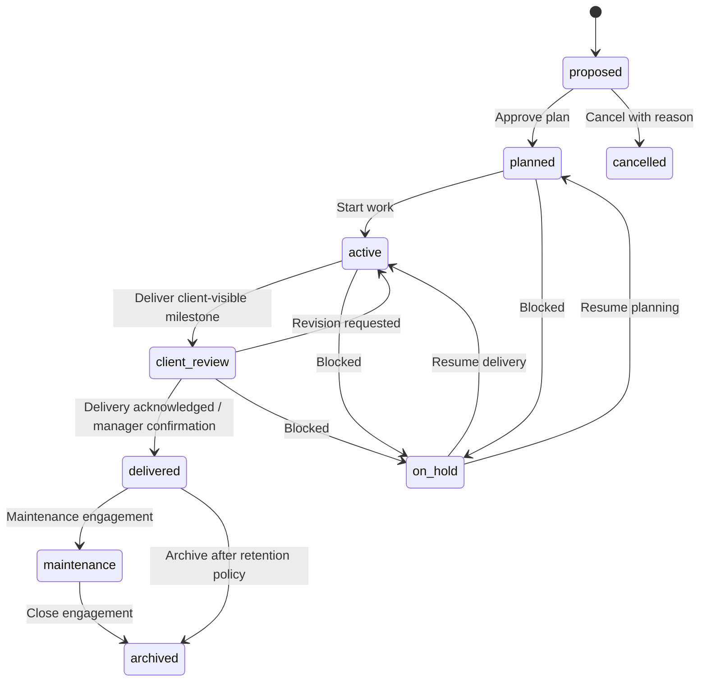

**Invariant:** Internal projects may skip client-review stage when no client exists; they cannot fabricate client approval. Delivered is an operational status, not necessarily a signed acceptance (which is post-MVP). Project status changes may never make previously internal-only records client-visible. Cancel/hold requires reason and notifications to authorized collaborators.

### SM-003 — Task lifecycle
**Canonical proposal (must be confirmed by schema):** `todo → in_progress → in_review → done`, with `blocked` and `cancelled` exceptions. A project manager can reopen `done → in_progress` with reason; worker updates by assignee are limited to allowed transitions. Moving task to `done` does not auto-approve client milestone or publish case study.

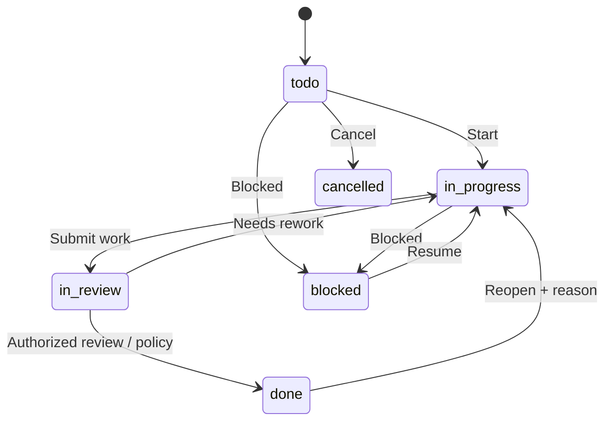

### SM-004 — Deliverable review
**Proposal:** `internal_draft → verified_internal → ready_for_client_review → feedback_received / reviewed → reissued / archived`. Client only receives `ready_for_client_review`, `feedback_received` and relevant `reviewed/reissued` versions through a safe DTO. File verification is a prerequisite for sharing; feedback is scoped to **specific version**. `reviewed` denotes review/feedback cycle completion, **not** e-signature.

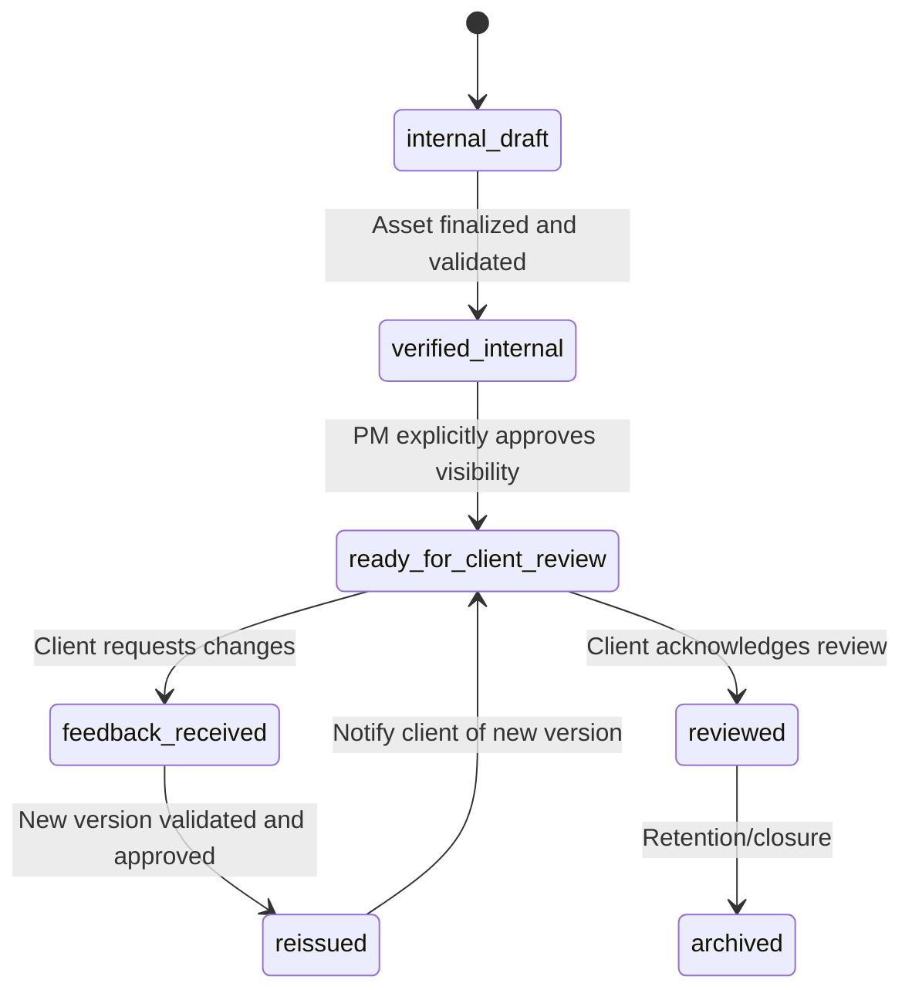

### SM-005 — CMS content
`draft → in_review → published → archived`. Review rejection returns to `draft` with reason. Changing live content may create a new draft revision while a previously approved published version remains visible, subject to an explicit CMS versioning policy. No public access to draft revisions or unlisted private media.

### SM-006 — Finance
- **Quote:** Draft → Prepared/Sent → Accepted/Declined/Expired (operational record, not automatically binding signature); immutable snapshots/revisions according to finance policy.
- **Invoice:** Draft → Issued; financial settlement is determined by exact payment records and remaining balance; `partially_paid` and `paid` represent derived/controlled financial states; `overdue` reflects outstanding issued balance after due date; `void` requires privileged flow and a consistent policy for recorded payments.
- **Payment:** `recorded` and if necessary `reversed` by compensating audited transaction, never silent deletion of history. MVP does not assert bank settlement because entries are manual.

### SM-007 — OAuth connection health
`not_connected → connecting → connected` or `manual_only`; `connected → needs_reauthorization / permission_reduced / suspended / disconnected`. A provider account may remain connected while `publish` operation is disabled by insufficient scope or cost policy. UI stores per-operation capability with freshness and causes.

### SM-008 — Invitation and account
Invitation `issued → accepted` / `expired` / `revoked`; accepting consumed token again is idempotent with the same target (no duplicate grant), never creates additional memberships. User lifecycle: `invited` / `active` / `suspended` / `deactivated`. An expired invite is not a suspended identity. Account suspension overrides apparently valid session/cookie until restored by authorized actor.

### 7.1 Cross-state invariants
| Invariant ID | Non-negotiable transition constraint | Failure handling |
|---|---|---|
| INV-01 | Client role/org membership alone does not imply project/file access | 403/404; audit denied access if risk appropriate |
| INV-02 | Client-visible state requires explicit approved projection | Reject publication and show missing approvals |
| INV-03 | Public CMS state requires separate publish action; client work never automatically goes public | Preview remains protected |
| INV-04 | Approved social revision hash must equal current hash at schedule **and dispatch** | 409/blocked job and renewed review |
| INV-05 | A social job with possible provider acceptance must never be automatically resent without reconciliation | `unknown_outcome`, human investigation |
| INV-06 | Issuing invoice/payment recording requires idempotency and exact currency handling | Stable result or 409 safe conflict |
| INV-07 | A human-reported social publication is not API-confirmed | Different state, analytics counter and source |
| INV-08 | Suspending/revoking user or social account invalidates related future actions | Deny subsequent API / stop pending jobs |
| INV-09 | Last active Owner cannot be removed by ordinary admin operations | Transaction rejected, event audited |
| INV-10 | Unverified media cannot become externally accessible through application publication | Block transition until finalize/scanning policy satisfied |
| INV-11 | An internal comment must never serialize as a client message | Client-safe DTO allowlist enforced |
| INV-12 | A network/API response labeled “accepted” but not “published” must not be counted as confirmed until contract warrants it | Track pending/processing status and reconcile |

---

## 8. Guard strategy, secure routing and API action rules

### 8.1 Authorization decision order
A route guard is **defense-in-depth user experience**. APIs must independently check every operation. Next.js middleware/proxy may perform coarse redirect checks but cannot be the sole control. Every route/API mutating resource follows this order:

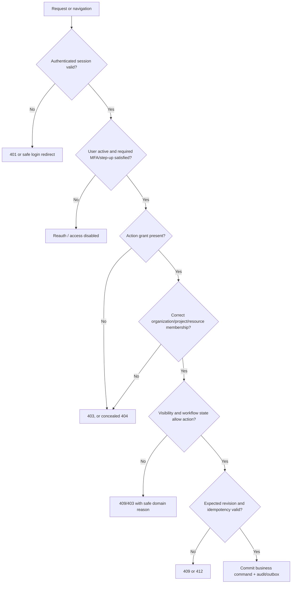

**Privacy-sensitive 404:** For client-scoped unauthorized object IDs, return a non-enumerating 404 where appropriate. A generic 403 can be used for known administrative areas a user cannot enter, but must not expose unrelated client project details.

### 8.2 Route guard table
| Route class | Auth | Additional scope | Failure route/status | Post-auth landing |
|---|---|---|---|---|
| Public published | No | `published` content state only | 404 for missing/private slug | Same page |
| Private account | Yes | Own user/notification scope | Login on 401; 403 on other user | Requested safe path |
| Admin/company | Yes | Matching admin/grant and action | 403; sensitive action reauth | `/admin` if entitled |
| Internal project | Yes | Project membership/assignment + visibility | 404 when concealed | `/workspace` or permitted parent |
| Client portal | Yes | Client-org membership **and** assigned project/file | 404 for wrong client/resource | `/client` or org chooser |
| Marketing | Yes | Social read/edit/review/schedule/trusted accounts grants | 403, 409 for approval stale | `/marketing` |
| Finance | Yes | Finance grants; own issued client view separately | 403/404, step-up on issue | `/finance/invoices` if granted |
| Owner settings | Yes | Owner or narrowly delegated security grant + MFA | 403/reauth | `/admin` |
| Deferred HR/advanced | Yes | Disabled feature flag and future grants | 404 or clearly planned disabled state | Valid MVP workspace |

### 8.3 Route-specific data isolation
- **Account:** `/account/requests/[id]` requires ownership of inquiry, not mere login.
- **Clients:** `/client/projects/[id]`, `/client/deliverables/[id]`, `/client/invoices/[id]` require canonical client-organization association and effective resource membership, not a `?orgId=` value from browser.
- **Staff:** Employees only read projects/tasks they are assigned to or have explicit management grants. Department assignment alone does not expose restricted resources.
- **Marketing:** Social accounts belong to Part-time Coder, and `social.accounts.manage` is independent of `social.draft.edit` or `social.review`.
- **Finance:** Internal profit/rate/expenses never appear in client DTO or ordinary employee responses; an invoice link is not a permission token.
- **Files:** Download endpoint rechecks access before issuing short-lived signed URL; no public object-storage bucket for client-private originals.
- **CMS:** Preview is an authenticated capability; published site pulls only approved/current published revision.

### 8.4 Response and feedback mapping (aligned to TRD §5)
| HTTP | Common UI behavior | Automatic retry? |
|---|---|---|
| `200/201` | Show confirmed read/create, update caches and data freshness | Not needed |
| `202` | Show **accepted/pending**, poll authoritative job/status rather than show success | Status checks yes, command no |
| `204` | Show confirmed completion and remove affected item | Not needed |
| `400/422` | Field-level validation + accessible summary | No until corrected |
| `401` | Clear invalid client state, safe login/retry once after auth | Only read after reauth |
| `403` | Denied action; hide disallowed control, retain no sensitive response | No |
| `404` | Not found / no visible access; no private existence disclosure | No |
| `409` | Duplicate business command/state conflict; show server truth | Only safe status probe |
| `412` | Stale ETag/hash; show compare/reload flow | No blind overwrite |
| `413` | Uploaded file too large; display limit | No |
| `429` | Respect `Retry-After`, show delay | Bounded idempotent reads only |
| `500/502/503` | Safe error with request ID; retain local form without false success | Depends on idempotency and commit uncertainty |

### 8.5 Common event and navigation contracts
| Event ID | Event | Producer | Consumer / destination | Privacy |
|---|---|---|---|---|
| EVT-01 | `lead.created` | Public intake | Staff lead queue/notification | Minimal contact, staff-only |
| EVT-02 | `lead.converted` | CRM | New client/project workspace | Internal/assigned |
| EVT-03 | `user.invited` | Admin/client-admin | Target email + invite acceptance | Target only |
| EVT-04 | `membership.revoked` | Admin/client-admin | Permission cache invalidation | Restricted |
| EVT-05 | `task.assigned` | Project/task service | Assignee notifications | Authorized project context |
| EVT-06 | `deliverable.ready_for_client_review` | Project service | Client-safe link/notification | Client org + project membership |
| EVT-07 | `client.feedback.created` | Client portal | PM/project activity | Project authorized |
| EVT-08 | `cms.content.published` | CMS | Public site/cache invalidation | Published content only |
| EVT-09 | `social.variant.submitted` | Marketing | Review queue | Marketing-only |
| EVT-10 | `social.variant.approved` | Marketing | Schedule eligibility | Marketing-only |
| EVT-11 | `social.job.outcome_changed` | Worker | Marketing job details, alerts, analytics | No raw provider token/error payload |
| EVT-12 | `invoice.issued` | Finance | Client-safe invoice visibility, notifications | Finance/client-authorized |
| EVT-13 | `payment.recorded` | Finance | Invoice status and audit | Finance only; client safe balance if permitted |

Event names are **conceptual**; `BACKEND_SCHEMA.md`/TRD implementation will define canonical event envelopes and outbox schema. Every event consumer is deduplicated by immutable event ID and ownership scope. Notifications may carry path/short summary but never internal project secrets or credentials.

---

## 9. UX patterns, responsive behavior, and localization requirements

### 9.1 Workspace navigation design
- Public header: Services, Projects, Products, Blog, About, Contact, Get Quote; footer Legal/Contact.
- Admin sidebar: Overview, Leads, Clients, Projects, CMS, Media, Users, Invitations, Audit, Settings; only authorized sections.
- Employee sidebar: Overview, My Tasks, Projects, Notifications; privileged PM options appear under project detail, not globally.
- Client sidebar: Overview, Projects, Requests, Deliverables, Invoices, Messages, Members (Client Admin only); org picker when multiple org memberships.
- Marketing sidebar: Overview, Compose, Campaigns, Reviews, Calendar, Posts, Accounts, Media, Analytics.
- Finance sidebar: Quotes, Invoices. HR is deferred, not an empty operational sidebar.
- Shared topbar: Search (scoped), notification count, workspace switcher, user menu, locale/theme preferences, logout.

### 9.2 Responsive and accessibility obligations
| Context | Expected behavior |
|---|---|
| Small phone (~360px) | One-column forms and cards, collapsible filters, drawer navigation, accessible table scroll/summaries |
| Tablet (~768px) | Adaptive split-pane project/marketing details; no essential hidden hover-only actions |
| Desktop (~1280–1920px) | Sidebar and tabular overview, resizable detail if supported, readable maximum widths |
| Keyboard-only | Access every action and list, including move task without drag-and-drop |
| Screen reader | Semantic headings, form relationships, status change announcements, accessible dialogs |
| Reduced motion | Disable decorative transitions and nonessential kinetic effects |
| Localization | English launch; all interface strings use translation keys; locale-aware dates, money, pluralization and zone notation |

`PTC-NFR-001`, `PTC-NFR-002`, `PTC-NFR-008`, `PTC-NFR-013`, and `PTC-NFR-016` govern acceptance. Bangla-ready means copy/formatting is externalized from initial build; full translated content is a future rollout, not a v1.0 launch blocker.

### 9.3 Confirmation and destructive action design
| Operation | Confirmation policy | Undo/recovery |
|---|---|---|
| Delete/disable team member | Explain lost access; step-up where high risk; audit reason | Re-enable by authorized admin subject to policy |
| Remove project membership | Preview loss of task/files; confirm | Explicit regrant, never auto-remain in cache |
| Publish CMS | Confirm public audience, slug, revision and authorized media | Archive/unpublish with retained revision and cache update |
| Approve social variant | Show exact content hash/version and target account | Revoke approval before dispatch; editing creates new revision |
| Schedule social post | Show local time, zone, UTC and API/manual mode | Cancel future job only; cannot undo provider publication |
| Investigate unknown outcome | Warn duplicate-post risk; require verified evidence | Reconciliation and audit, not automatic blind resend |
| Issue/void invoice | Confirm unique issue number, client, totals; step-up | Record credit/void as allowed; never delete issued history |
| Record manual payment | Confirm amount/currency/reference, current balance | Audited reversal/adjustment, not silent deletion |

### 9.4 Search, deep-links and table persistence
- Each route's search parameters must be parsed via an allowlist and revalidated. No client-private entity IDs embedded in public analytics/SEO URLs.
- Route state for `tab`, `status`, `page`, and sorting may be reflected in query string; avoid putting secret tokens or confidential free-text in shareable URLs.
- Back/forward navigation restores list state without reviving revoked grants. Preloading/prefetch should obey authenticated cache isolation.
- External URLs (case studies, GitHub links, manual social links) open with safe `rel` policy where relevant; URL targets are CMS-validated.

---
## 10. Acceptance tests (executable QA catalog)

**Test format:** `Given` a controlled actor, resource ownership, status and environment; `When` a UI action/API command occurs; `Then` assert visible screen, persisted state, permission response, audit event and affected notifications. An E2E passing screenshot alone is insufficient; verify backend records and response projections. Test both client UI and raw API requests where security matters.

### 10.1 Public website, authentication, and admin
| Case | Given / When | Expected UI + backend result | Requirement anchors |
|---|---|---|---|
| AC-AF-001 | Guest on published home clicks quote CTA | Reaches `/get-quote` in <=2 hero interactions; service context retained | `PTC-PUB-001`, `PTC-PUB-007` |
| AC-AF-002 | Guest visits published service, case study, product or article | Public approved revision renders with valid canonical/meta; sitemap correct | `PTC-PUB-003`–`PTC-PUB-006`, `PTC-PUB-009` |
| AC-AF-003 | Guest guesses draft/private CMS slug | No draft body, private media metadata or client name revealed; 404 | `PTC-CMS-002`, `PTC-CMS-005`, `PTC-SEC-002` |
| AC-AF-004 | Valid public quote submitted twice with same idempotency key | One logical lead; stable acknowledgment; staff queue reflects exactly one | `PTC-PUB-007`, `PTC-CRM-001` |
| AC-AF-005 | Public quote has invalid fields or triggers abuse/rate policy | Accessible validation or safe rate-limited response; no fake success or personal info leakage | `PTC-PUB-007`, `PTC-SEC-006` |
| AC-AF-006 | Public registrant injects `admin` role/organization fields | Identity created only as Regular User; crafted grant ignored/rejected | `PTC-IAM-003`, `PTC-IAM-005` |
| AC-AF-007 | Valid employee invite accepted by intended identity | Single-use membership; correct landing workspace and audit event | `PTC-IAM-004`, `PTC-IAM-005` |
| AC-AF-008 | Revoked/expired invitation or wrong target tries acceptance | No elevated grant; safe feedback; token not usable again | `PTC-IAM-004` |
| AC-AF-009 | Signed-out user deep-links to protected route with malicious `returnTo` | Safe login; only validated same-origin authorized path returned; external redirect blocked | `PTC-IAM-001`, `PTC-IAM-009` |
| AC-AF-010 | Admin tries to suspend/deactivate final active owner | Server rejects, owner remains active, audit attempt recorded | `PTC-IAM-008`, `PTC-SEC-005` |
| AC-AF-011 | Suspended user retains previously valid browser token/cookie | All restricted APIs deny; UI purges private scoped cache on refresh | `PTC-IAM-002`, `PTC-IAM-006` |
| AC-AF-012 | Admin without security grant deep-links to audit/security panel | 403/404 safe denial; no audit data fetched or displayed | `PTC-SEC-003`, `PTC-SEC-005` |

### 10.2 CRM, projects, employees, and client portal
| Case | Given / When | Expected UI + backend result | Requirement anchors |
|---|---|---|---|
| AC-AF-013 | Sales user qualifies lead and creates valid quote | Versioned lead updated; internal notes remain staff-only; financial totals exact | `PTC-CRM-002`, `PTC-CRM-003` |
| AC-AF-014 | Same lead conversion retried after timeout | One logical client/project link, stable result, recoverable in-progress UX | `PTC-CRM-004`, `PTC-CRM-005` |
| AC-AF-015 | PM creates client project without valid client organization | Validation denies creation; no orphan client project | `PTC-PRJ-001`, `PTC-SEC-002` |
| AC-AF-016 | PM assigns task and employee opens own task list | Task appears to assignee; audit + permitted notification; other staff not exposed | `PTC-PRJ-002`, `PTC-EMP-001` |
| AC-AF-017 | Employee submits stale task status after another edit | 409/412; latest server version shown; no silent lost update | `PTC-PRJ-002`, `PTC-EMP-002` |
| AC-AF-018 | Project member removed while task/file open | Subsequent mutation/download denied and stale confidential cache cleared | `PTC-PRJ-005`, `PTC-PRJ-006` |
| AC-AF-019 | PM marks unverified/internal file as client-visible | Rejected until verified and explicitly approved; no public storage link | `PTC-PRJ-006`, `PTC-PRJ-007`, `PTC-CLI-004` |
| AC-AF-020 | Client A changes URL/resource ID to Client B project/file/invoice | Non-enumerating denial; no data leakage in body, previews, caches or logs | `PTC-CLI-002`, `PTC-CLI-004`, `PTC-FIN-004`, `PTC-SEC-002` |
| AC-AF-021 | Client member with org membership but no project assignment opens project | No project details or names leaked | `PTC-CLI-001`, `PTC-CLI-002` |
| AC-AF-022 | Authorized client reviews deliverable and submits revision | Feedback tied to correct version, PM notified, original version retained | `PTC-CLI-003`, `PTC-COM-002` |
| AC-AF-023 | Client Admin invites colleague to own organization | Correct client-only membership; cannot grant company role or unassigned project | `PTC-CLI-005`, `PTC-IAM-004` |
| AC-AF-024 | Internal note/expense appears on project in staff UI | Client-safe project endpoint excludes private fields/comments entirely | `PTC-CLI-002`, `PTC-COM-001`, `PTC-FIN-006` |

### 10.3 CMS and social campaigns
| Case | Given / When | Expected UI + backend result | Requirement anchors |
|---|---|---|---|
| AC-AF-025 | Editor saves case study draft and authorized user opens preview | Preview works under safe access; public route/SEO shows no draft | `PTC-CMS-001`, `PTC-CMS-005` |
| AC-AF-026 | CMS publisher submits duplicate slug or stale revision | 409/412; no conflicting publication, user can resolve | `PTC-CMS-003`, `PTC-CMS-002` |
| AC-AF-027 | PM delivers project without publishing case study | Project progresses internally/client; no public CMS case study auto-created | `PTC-PRJ-009`, `PTC-PUB-004` |
| AC-AF-028 | Creator selects all six target accounts | Six independent editable variants/cards with accurate API/manual capabilities | `PTC-SOC-001`, `PTC-SOC-003` |
| AC-AF-029 | Creator edits Instagram while LinkedIn has approved snapshot | LinkedIn revision/hash untouched; editing approved variant invalidates its own approval | `PTC-SOC-003`, `PTC-SOC-004` |
| AC-AF-030 | Creator tries own variant approval without exception | Backend refuses; UI explains review role; audited denied transition | `PTC-SOC-004`, `PTC-SEC-005` |
| AC-AF-031 | Reviewer approves stale variant hash/version | 409/412; no approval granted; latest content shown | `PTC-SOC-003`, `PTC-SOC-004` |
| AC-AF-032 | Scheduler chooses nonexistent/ambiguous DST time | Reject or require explicit offset; persisted job UTC equals verified chosen instant | `PTC-SOC-005`, `PTC-NFR-007` |
| AC-AF-033 | Account is connected but lacks publishing scope | API schedule unavailable; manual workflow offered with specific cause | `PTC-SOC-001`, `PTC-SOC-002`, `PTC-SOC-005` |
| AC-AF-034 | Facebook success + Instagram expired + LinkedIn 429 | Three independent outcomes: confirmed, reauth needed, bounded retry | `PTC-SOC-006`, `PTC-SOC-009` |
| AC-AF-035 | Worker crashes after potential provider acceptance | Lease recovery sets/reconciles `unknown_outcome`; **no automatic duplicate** | `PTC-SOC-006`, `PTC-SOC-009` |
| AC-AF-036 | Provider returns definitive non-acceptance with rate limit | Retry with rate-limit backoff under bounded policy; no excessive calls | `PTC-SOC-006` |
| AC-AF-037 | X paid API disabled by owner budget policy | No billable dispatch; draft/review/manual action remains possible | `PTC-SOC-015`, `PTC-SOC-005` |
| AC-AF-038 | TikTok not approved for direct post | UI describes manual-only, provides official workflow, does not assert API published | `PTC-SOC-007`, `PTC-SOC-005` |
| AC-AF-039 | Authorized operator marks post manually published | Manual reporter/time/proof stored; counted separate from API-confirmed | `PTC-SOC-008`, `PTC-SOC-012` |
| AC-AF-040 | Approved caption changed just before worker dispatch | Worker sees hash mismatch and refuses API call; review required | `PTC-SOC-003`, `PTC-SOC-004` |
| AC-AF-041 | Owner disconnects social account with future posts | Future calls blocked; pending jobs paused/reclassified; history retained | `PTC-SOC-002`, `PTC-SOC-014` |
| AC-AF-042 | Analytics provider lacks metric or reports pending data | UI shows `unsupported`/`pending`, not `0`; date, source, freshness present | `PTC-SOC-012`, `PTC-ANA-006` |
| AC-AF-043 | Social worker app restarts with due jobs | Eligible jobs resume under leases; acceptance start target assessed separately from provider latency | `PTC-SOC-006`, `PTC-NFR-007` |

### 10.4 Finance, notifications, operations, and accessibility
| Case | Given / When | Expected UI + backend result | Requirement anchors |
|---|---|---|---|
| AC-AF-044 | Finance creates SAR/BDT/USD quote with discounts/taxes | Totals calculated exactly with documented currency precision, audit/version retained | `PTC-FIN-001`, `PTC-FIN-005` |
| AC-AF-045 | Authorized finance issues invoice twice with same command key | One immutable issue event/invoice number; second returns stable outcome | `PTC-FIN-002`, `PTC-FIN-006` |
| AC-AF-046 | Finance records partial payment twice; wrong currency / overpay case | No double count; appropriate rejection/review; balance reconciles | `PTC-FIN-003` |
| AC-AF-047 | Client tries accessing draft or other organization's invoice | Client sees only specifically authorized **issued** own records; private fields omitted | `PTC-FIN-004`, `PTC-FIN-006` |
| AC-AF-048 | Email provider fails after client feedback commits | Feedback remains recorded; notification retry state and ops alert visible | `PTC-COM-002`, `PTC-COM-003` |
| AC-AF-049 | Notification recipient loses project access after message creation | Deep-link denied; no private content in notification payload | `PTC-COM-002`, `PTC-SEC-002` |
| AC-AF-050 | Admin KPI widget data fails while tasks/projects healthy | Failed tile shows unavailable + as-of; unaffected tiles render | `PTC-ANA-001`, `PTC-ANA-006` |
| AC-AF-051 | Test keyboard-only navigation at phone and desktop widths | All P0 forms/dialogs/task board actions operable, visible focus and announced errors | `PTC-NFR-001`, `PTC-NFR-002` |
| AC-AF-052 | 401/403/404/409/412/429/503 injected | Appropriate safe state; no forced duplicate sensitive mutation or fabricated success | `PTC-NFR-013`, `PTC-SEC-002` |
| AC-AF-053 | Restore test on isolated infrastructure | Business data and critical job states recover within tested RPO/RTO target; auth boundaries intact | `PTC-NFR-006`, `PTC-DATA-004` |
| AC-AF-054 | Deployment/CI scans plus smoke after release | Gates pass; logs/alerts trace request, worker attempt and audit with no secrets | `PTC-NFR-009`–`PTC-NFR-011`, `PTC-OPS-001` |

### 10.5 Test data fixtures
Create deterministic actors and records for all of the following:

- `ownerA`: active sole owner; `adminA`: company admin without owner-recovery grant; `financeA`: finance-only; `pmA`: PM for Project A only; `employeeA`: assigned Task A; `creatorA`: marketing creator; `approverA`: different reviewer; `marketingTrustedA`: OAuth management grant; `regularA`: ordinary self-registered account.
- Client organizations `clientOrgA` and `clientOrgB`, each with client admin/member, at least two projects and both private/client-facing deliverables. `multiClientUser` has explicitly scoped memberships in both; switching org cannot cross-load cached data.
- One project with a client-safe milestone and private employee comment; one internal product project; one cancelled/archived project; one removed project member.
- CMS drafts/published/archived with conflicting slugs, sensitive file assets and preview links.
- Six social adapters/accounts with states `api_enabled`, `manual_only`, `needs_reauthorization`, `disabled_by_budget`, `unknown`, `provider_unavailable`; fake providers return 200 success, definite 400, 429/503, timeout-after-send, expired token and delayed lookup success.
- A social campaign with three independent outcomes and a stale approved hash; clock fixture covering IANA DST fold/gap; lease-crash fixture where a remote operation may have succeeded.
- Multi-currency invoice fixtures with partial payment, overdue, void-policy candidate, duplicate payment and another client's issued invoice.
- An expired invitation, revoked invitation, suspended staff session, stale ETag, rate-limited public request, malicious upload and delayed email outbox item.

Every negative authorization case must execute at **HTTP API** layer even if UI already hides the action. Use mock adapters during CI; real provider sandbox/live-account verification is a distinct owner-approved integration gate.

---

## 11. Release scopes, milestones, and navigation feature flags

### 11.1 Minimum production-ready v1.0 flows
The MVP is considered useful only when all three business outcomes work:
1. **Lead-to-project:** Public visitor discovers offering → submits inquiry → staff qualifies/quotes → conversion creates scoped client/project → authorized client accesses own project (`J-001`, `J-003`, `J-009`).
2. **Delivery-to-feedback:** PM plans → employee executes task → PM shares verified client-safe deliverable → client reviews and comments → PM reissues (`J-006`, `J-007`, `J-008`).
3. **Draft-to-publication:** Creator drafts per platform → independent manager approves exact revision → authorized schedule/API publish **where verified**, otherwise guided manual publish → status, alerts and metrics truthfully reported (`J-010`–`J-016`).

The first two work without any social API approval. The third must succeed end-to-end in manual mode even if all provider API integrations are disabled. The product must never claim automatic publication on a platform for which credentials, scopes, approvals, budgets or adapters are unavailable.

### 11.2 Deferred (not MVP acceptance blockers)
| Area | F routes / behavior | Later requirement references |
|---|---|---|
| Careers | `/careers`, applicant pipeline | `PTC-PUB-010` |
| Newsletter / full Bangla publishing | Subscribe/unsubscribe, translated CMS editorial workflow | `PTC-PUB-011`, `PTC-PUB-012` |
| Enterprise access | SSO, delegated access reviews | `PTC-IAM-010`, `PTC-SEC-012` |
| Advanced project delivery | GitHub PR/commit sync, sprints, time logs, Gantt, capacity | `PTC-PRJ-010`–`PTC-PRJ-012` |
| Formal client approvals/support | E-signatures, support tickets/SLAs/subscriptions | `PTC-CLI-008`, `PTC-CLI-009` |
| HR | Attendance/leave/recruitment/payroll/performance | `PTC-EMP-005`, `PTC-EMP-006` |
| Advanced finance | Expenses, payment gateway, accounting and payroll integration | `PTC-FIN-007`–`PTC-FIN-009` |
| Advanced marketing | AI drafting, analytics normalization, inbox, experiments | `PTC-SOC-016`–`PTC-SOC-019` |
| Communication | Full internal chat and automated escalation/digests | `PTC-COM-005`, `PTC-COM-006` |
| Advanced analytics | Forecasting/export, scheduled rich reports | `PTC-ANA-007`, `PTC-ANA-008` |

**Implementation policy:** Hidden/not-yet-built features do not appear as broken controls or pretend to function. Display future roadmap only when clearly labeled outside core operational navigation.

### 11.3 Feature-flag and provider gates
| Flag (proposed) | Default | Controls | Security / fallback |
|---|---|---|---|
| `feature.publicCms` | Enabled after CMS quality gate | Authorized publishing | Drafts remain private even if disabled |
| `feature.clientPortal` | Enabled after IDOR tests | Client-facing routes | Disabling never exposes data elsewhere |
| `feature.socialHub` | Enabled after flow tests | Marketing routes | Keeps authored drafts/history |
| `provider.<name>.autoPublish` | **Disabled until certified** | Individual provider automatic dispatch | Manual approved workflow continues |
| `provider.<name>.analytics` | Disabled until supported | Metrics fetch | Show unsupported/stale, not zero |
| `integration.x.paidCallsEnabled` | **Disabled** until budget sign-off | Metered X provider calls | No charge-bearing call without owner policy |
| `feature.hrAdvanced` | Disabled | HR future routes | 404/hidden in MVP |
| `feature.paymentGateway` | Disabled | Online payment processing | Manual invoice/payment record remains |
| `feature.aiMarketing` | Disabled | Generative content features | Human-authored publishing unaffected |

Flags are server-enforced, audited and company-scoped. A client-controlled query parameter cannot enable them. These are **proposed** flag keys subject to canonical naming in TRD/config package.

### 11.4 Phase-aligned UI gates (proposed sequencing)
| Gate | Flows to demonstrate | Required evidence |
|---|---|---|
| G0: Foundation | Navigation shells, design primitives, API envelopes, environment | Route skeletons, lint/typecheck/build, security boundaries documented |
| G1: Identity/RBAC | `J-002`, `J-004`, `J-020` | Auth E2E, invitation single-use, permission matrix/owner safety tests |
| G2: Public & CMS | `J-001`, `J-005` | SEO, contact intake, draft/publish isolation, preview, upload tests |
| G3: CRM & project | `J-003`, `J-006`, `J-007` | Idempotent conversion, task access, lifecycle and activity tests |
| G4: Client portal | `J-008`, `J-009` | Client-safe DTO, cross-org IDOR, file access and feedback tests |
| G5: Social & worker | `J-010`–`J-016` | Six adapter cards, manual fallback, unknown-outcome/crash tests, verified live API provider gates |
| G6: Finance/analytics | `J-017`–`J-019` | Exact monetary arithmetic, invoice issue/idempotency, KPI reconciliation |
| G7: Production hardening | `J-020`, `J-021` | Security/a11y, load, backup restore, host license compliance, monitoring, smoke/rollback evidence |

These gates are a suggested dependency sequence and must be reconciled with the final `IMPLEMENTATION_PLAN.md`; the PRD's release priorities are the binding acceptance standard.

---

## 12. Requirements traceability and handoff matrix

### 12.1 Domain traceability (expanded PRD identifiers, not invented IDs)
The table maps every MVP functional domain to this flow document and concrete QA cases. Some lines list requirement ID sets for **navigation**, not assertions that those requirements are implemented. Work tickets must cite individual stable IDs and link passing test evidence.

| Domain | MVP PRD IDs / important future IDs | App Flow sections / journeys | Representative acceptance tests | Backend/API anchors |
|---|---|---|---|---|
| Governance | `PTC-GOV-001`–`005` | §0, §11, §13 | Owner sign-off, scope gate | ADR/change-control process |
| Public | `PTC-PUB-001`–`009` (`010`–`012` F) | §2.2, AF-001–005, J-001 | AC-AF-001–005 | TRD §7.1, `/api/v1/public/inquiries` |
| CMS | `PTC-CMS-001`–`007` | §2.4, AF-013, J-005, SM-005 | AC-AF-003,025–027 | TRD §7.1, `/api/v1/cms/...` |
| Identity | `PTC-IAM-001`–`009` (`010` F) | §1, §2.2–2.3, J-002/J-004/J-020, SM-008 | AC-AF-006–012 | TRD §4, `/api/v1/auth/session`, `/api/v1/me` |
| Company admin | `PTC-ORG-001`–`005` (`006` F) | §2.4, AF-009–014, J-004 | AC-AF-010–012 | TRD §3, §4, §7 |
| CRM | `PTC-CRM-001`–`006` (`007`–`008` F) | §2.4, AF-012, J-001/J-003, SM-001 | AC-AF-004,013–014 | TRD §7.2, `/api/v1/leads` |
| Project delivery | `PTC-PRJ-001`–`009` (`010`–`012` F) | §2.5, AF-016–019, J-006–008, SM-002/003 | AC-AF-015–019,024 | TRD §7.3, `/api/v1/projects` |
| Employee | `PTC-EMP-001`–`004` (`005`–`006` F) | §1, §2.5, AF-015/017, J-007 | AC-AF-016–018 | TRD §7.3, `/api/v1/tasks` |
| Client | `PTC-CLI-001`–`007` (`008`–`009` F) | §2.6, AF-020–023, J-008–009, SM-004 | AC-AF-019–024 | TRD §7.4, `/api/v1/client/...` |
| Social | `PTC-SOC-001`–`015` (`016`–`019` F) | §2.7, AF-024–030, J-010–016, SM-007 | AC-AF-028–043 | TRD §8, `/api/v1/social/...` |
| Finance | `PTC-FIN-001`–`006` (`007`–`009` F) | §2.8, AF-031–032, J-017, SM-006 | AC-AF-044–047 | TRD §7.5, `/api/v1/invoices` |
| Communication | `PTC-COM-001`–`004` (`005`–`006` F) | §2.3/2.5/2.6, AF-033, J-018 | AC-AF-022,048–049 | TRD §7.6, `/api/v1/notifications` |
| Analytics | `PTC-ANA-001`–`006` (`007`–`008` F) | §3, §5.4, J-016/J-019 | AC-AF-042,050 | TRD §7.6, `/api/v1/analytics/...` |
| Security | `PTC-SEC-001`–`011` (`012` F) | §1, §3.5, §7–8, J-020 | AC-AF-003,010–012,020–024,052 | TRD §4, §10 |
| Data | `PTC-DATA-001`–`004` (`005` F) | §3.4, §8, §13 | AC-AF-019–024,053 | TRD §6, §9, §12 |
| Integrations | `PTC-INT-001`–`015` (release classes per PRD) | §5, J-010–016/J-021 | AC-AF-033–043 | TRD §8, §12; provider policy verification |
| Nonfunctional | `PTC-NFR-001`–`016` | §3.5, §5.4, §9–11 | AC-AF-043,051–054 | TRD §12–15 |
| Operations | `PTC-OPS-001`–`008` | §6, §11.4, §13 | AC-AF-053–054 | TRD §11–15 |

**Source qualification:** The table lists existing requirement ID intervals for indexing. Release classification is **not uniformly MVP** for integration IDs; always read the exact ID's M/F/C classification in the PRD before scheduling a ticket. Social API publication remains conditional (`PTC-SOC-007`).

### 12.2 User journey to requirement crosswalk
| Journey | Product objective | Core proof |
|---|---|---|
| J-001 Guest → quote | OBJ-01, OBJ-02 | Real lead persistence and dedup |
| J-002 Identity/invite | OBJ-06 | Scoped membership and safe session |
| J-003 Lead → client/project | OBJ-02, OBJ-03 | Idempotent conversion |
| J-004 Staff admin/security | OBJ-06 | Safe grants and owner invariant |
| J-005 CMS publish | OBJ-01 | Published-only public content |
| J-006 PM plan/assign | OBJ-03 | Scoped task/milestone progression |
| J-007 Employee delivery | OBJ-03 | Assigned work and secure media |
| J-008 Client review | OBJ-04 | Allowlisted portal + versioned feedback |
| J-009 Client members | OBJ-04 | Delegation limited to own org |
| J-010 Social OAuth | OBJ-05 | Verified permissions/capabilities |
| J-011 Composer | OBJ-05 | Distinct variants and validation |
| J-012 Reviews | OBJ-05 | Exact revision approval / separation of duties |
| J-013 Schedule | OBJ-05 | UTC/IANA + durable per-target jobs |
| J-014 Worker | OBJ-05, OBJ-07 | No duplicate on unknown provider outcome |
| J-015 Manual fallback | OBJ-05 | Human-reported vs API-confirmed distinction |
| J-016 Analytics | OBJ-05, OBJ-06 | Provider-specific truthful metrics |
| J-017 Finance | OBJ-02, OBJ-06 | Exact invoices and scoped documents |
| J-018 Notifications | OBJ-03, OBJ-04 | Minimal recipients and safe deep links |
| J-019 Dashboards | OBJ-06 | Metrics reconcile to filtered authorized data |
| J-020 Revocation | OBJ-06 | Immediate server-side access denial |
| J-021 Degradation | OBJ-07 | Restore/retry without false completion |

---

## 13. Operational dependencies, open issues, and approval gates

### 13.1 External dependencies, not automatic release promises
| Dependency | Pre-production proof | Fallback / blocker |
|---|---|---|
| Meta (Facebook/Instagram) | Eligible Pages/professional accounts, app review/scopes, tested publisher and insights endpoints | Editorial + manual flow; auto provider flag off |
| LinkedIn | Authorized company Page posting access/version compatibility | Manual post instructions |
| YouTube | Authorized channel, project quota/audit, resumable upload proof | Manual video publishing checklist |
| X | Approved API plan/credits, maximum planned cost, paid-calls flag enabled by owner | Manual workflow; no unapproved metered calls |
| TikTok | Content Posting access/audit and target visibility behavior | Manual workflow; no false public upload claims |
| Hosting | Commercial-use rights, supported Node/worker processes, backup and uptime feasibility | Choose compliant alternative; do not ship under prohibited terms |
| MongoDB Atlas | Production environment, indexes, independent restorable backup | Production no-go if recoverability not proven |
| Firebase | Production identity setup, privileged MFA/step-up, revocation semantics | Security gate failure blocks launch |
| Cloud media | Private asset protections, expiring downloads, quotas, malware policy | Avoid exposing confidential media or enabling unverified upload |
| Email | Verified sender/domain and retry behavior | Persist alerts, avoid silent notification loss |

### 13.2 Outstanding decisions — safe engineering defaults
These are **not blockers to documenting flows**, but the engineer/owner must approve them before implementing their dependent contracts:

1. **Production domain and provider:** Domain, email sender, Node-compatible commercial host and dedicated worker deployment remain to be chosen; treat as G7 configuration.
2. **Client-org project membership defaults:** Default is **deny until assigned**. Whether Client Admin sees all org projects or only explicitly granted ones requires an owner authorization policy. This App Flow uses stricter explicit-project assignment until decided.
3. **Invoice `overdue` encoding:** Recommend a derived display property from due date/outstanding balance rather than conflicting stored payment state; final in `BACKEND_SCHEMA.md`.
4. **Quote/lead enumerations and task workflow:** This document provides controlled proposals; finalize canonical enum and allowed transition map with the Backend Schema.
5. **CMS editorial policy:** Direct publishing by trusted CMS publisher versus mandatory dual approval must be approved. Default is review for case studies involving client material; never skip public client-consent requirements.
6. **Social approval-bound scheduling fields:** Conservative default: any material target/content/media edit invalidates approval. Exact schedule change reapproval policy should be explicitly encoded before first worker release.
7. **Contractual deliverable acceptance:** Formal signoff stays F; MVP records feedback/operational review only.
8. **Commercial/legal matters:** Privacy/cookie consent, cross-border transfers, external marketing rights, e-invoicing tax obligations and staff data depend on actual business registration/markets; qualified review is required where applicable.
9. **Brand/UI assets:** Logo, typography, final component theme, and content imagery to be defined in design brief; do not treat this text as approval of a visual design.
10. **Provider-specific platform capabilities:** Reverify supported operations, eligibility, quotas, scopes, access tiers and pricing during actual integration (they are not fixed assumptions in the PRD/TRD).

### 13.3 Release/no-go rules
- **No release** when cross-client IDOR or private-file leakage remains possible.
- **No release** when final Owner recovery/role safety is broken or privileged MFA policy not met.
- **No release** with untested data restore, known high/critical exploitable findings, or commercial-hosting terms incompatible with actual use.
- **No automatic social API enablement** without provider permission/verification, validated media constraints, verified current approval/hash checks, queue crash tests and cost guardrails.
- **No reported publication success** without provider-confirmed evidence or explicitly marked human-reported manual completion.
- **No release** with unsafe invoice issue/payment duplication or client financial disclosure.
- **No release** when core screen keyboard navigation/validation is unusable or essential errors falsely claim success.

### 13.4 AI development agent handoff contract
For every implementation ticket, the agent MUST:
1. Read applicable PRD exact requirement IDs, TRD sections and this App Flow's `AF-`, `J-`, `SM-`, `AC-AF-` IDs.
2. Verify existing repository code/current tests before claiming missing/implemented behavior; do not assume routes/APIs exist merely because they are specified here.
3. Produce a bounded plan listing routes, components, API commands, guards, DTOs, data model dependencies, critical state transitions, negative tests and manual setup.
4. Implement the **smallest coherent vertical slice**: route UI → permission-checked API → persisted action → observable event → E2E test, instead of disconnected visual mocks.
5. Follow modular boundaries; forbid UI authority over permissions, direct client access to provider secrets, and client-org queries without server scope.
6. Add unit, integration, permissions/IDOR, resilience and accessible E2E tests, including unimplemented-capability fallback.
7. Validate typecheck, lint, production build and relevant tests; supply evidence, failing tests and residual risks without overstating status.
8. Update requirement-to-test mapping and related docs when behavior changes; log architectural changes as ADR and request owner sign-off if baseline changes.
9. Commit small, focused changes with clean **Conventional Commit** messages; no secret/check-in of tokens, credentials, production dumps, or real customer data.
10. At each phase end, give a gate report, deployment/rollback notes and **step-by-step manual actions**. Stop dependent implementation until the owner completes required account/provider/budget/security actions and confirms them.

**Suggested ticket template:**
```markdown
### Implementation ticket
- Scope: <screen/workflow>
- PRD IDs: PTC-... (exact)
- TRD references: §...; API...
- App Flow: AF-..., J-..., SM-..., AC-AF-...
- Actor/permission/resource scope:
- UI states/forms/routes:
- Business transitions, concurrency, idempotency:
- Security negatives and client boundary:
- Automated tests and expected evidence:
- External provider dependencies/feature flags:
- Documentation/ADR updates:
- Manual checkpoints:
- Conventional commit(s):
- Gate pass/fail + remaining risks:
```

### 13.5 Sign-off checklist
- [ ] Product owner accepts route IA and MVP/F boundaries.
- [ ] Product owner accepts default strict client-project membership model or provides signed override.
- [ ] Technical lead checks all proposed UI routes/API mappings against TRD and backend schema design.
- [ ] Security lead approves permission matrix, preview/media sharing, OAuth, revocation, IDOR and owner recovery flows.
- [ ] UX lead reviews mobile, accessible interaction contracts, localization and error/conflict states.
- [ ] Marketing lead accepts provider/manual state labels and verified-provider rollout policy.
- [ ] Finance owner approves invoice status derivation and manual payment/reversal handling.
- [ ] QA lead maps P0 requirement IDs to executable tests and provider mocks.
- [ ] Operations owner reviews hosting, job-worker readiness and backup-restore gates.
- [ ] Owner confirms documented open decisions before implementing dependent high-risk features.

**Approval record (fill after human review):**

| Field | Value |
|---|---|
| Document | `PTC-AFLOW-001` |
| Current version | `1.0.0` |
| Prepared | 2026-10-14 |
| Owner approval | Pending |
| Engineering review | Pending |
| Security review | Pending |
| UX review | Pending |
| Change request / ADR references | None at draft creation |

---

## Appendix A. Glossary
- **ACL / RBAC:** Access control list / role-based access control; actual permissions include resource scope.
- **Actor:** Authenticated person or trusted system worker performing an action.
- **Allowlisted DTO:** Server-built response containing only explicitly permitted fields for its audience.
- **Audit event:** Immutable record of sensitive business/security changes and responsible principal.
- **Canonical client organization:** The authoritative external customer org on a client project.
- **Capability gate:** Runtime proof that an authorized account can perform a particular provider operation.
- **Client-safe projection:** Approved project fields/messages/files intended for a particular entitled client user.
- **Concurrency conflict:** Optimistic revision mismatch requiring refresh or explicit merge rather than silent overwrite.
- **Durable outbox:** Persisted business event enabling eventual notification/jobs without rolling back core transaction.
- **Idempotency key:** Scoped unique command token used to avoid duplicate logical local side effects on retries.
- **IANA timezone:** Region/City timezone identifier such as `Asia/Riyadh`; superior to ambiguous abbreviations.
- **Manual published:** User-reported official platform posting, not necessarily machine-confirmed.
- **Provider-confirmed published:** Posting verified through a trusted provider response/resource identifier.
- **Step-up:** Fresh identity assurance/MFA for privileged operations.
- **Unknown outcome:** Remote side effect may have occurred but confirmation is absent; must reconcile before retry.
- **Workspace:** Permission-controlled view of one integrated Part-time Coder application.

## Appendix B. Implementation evidence template
```markdown
# Phase Gate Evidence — <G#>
- Date / commit / branch:
- Target screens and routes:
- Actor fixture matrix:
- PRD IDs / TRD sections / App Flow IDs:
- Unit/integration/E2E and a11y results:
- Cross-client API negative test results:
- Worker crash/idempotency and approval-hash results (when relevant):
- Real provider certification vs mock-only status:
- Rate limits/budget/provider permission verification:
- Screenshots or recorded walkthrough (sanitized):
- Known failures and risk owner:
- Backup/restore and rollback result (as applicable):
- Manual setup required before proceeding:
- Docs updated and conventional commit refs:
- Gate: PASS / FAIL / CONDITIONAL (with explicit owner decision):
```

## Appendix C. Relationship to upcoming documents
| Next artifact | Must inherit from this App Flow | Must not change without approved ADR |
|---|---|---|
| `docs/UI_UX_DESIGN_BRIEF.md` | Workspace navigation, action hierarchy, forms, responsive/empty/loading/errors, social status distinctions | Permission boundaries, publication truth, MVP routes |
| `docs/BACKEND_SCHEMA.md` | Canonical ownership IDs, status transitions, exact approved snapshot semantics, invoice derivation, notification recipient scope | Client isolation, immutable financial/audit behavior, durable jobs |
| `docs/IMPLEMENTATION_PLAN.md` | Gate-aligned vertical slices, traceable acceptance and manual checkpoints | PRD P0/M priorities or conditional provider rollout |
| `AGENTS.md` | Ticket template, evidence requirements, small commits, owner approval on high-risk operations | Governing architecture, human decision authority |

**End of document — PTC-AFLOW-001 v1.0.0.**
