# Part-time Coder — Backend Schema & Data Integrity Specification

> **Document ID:** PTC-BES-001  
> **Version:** 1.0.0  
> **Status:** Implementation specification — proposed schema, subject to migration/owner review gates  
> **Prepared:** 14 October 2026  
> **Product:** Part-time Coder Unified Company Platform  
> **Target repository path:** `docs/BACKEND_SCHEMA.md`  
> **Authoritative sources (in order):** `Part_time_Coder_PRD_v1.0.md` → `docs/TRD.md` → `docs/APP_FLOW.md` → `docs/UI_UX_DESIGN_BRIEF.md`  
> **Intended readers:** Backend engineers, technical lead, security/QA reviewers, AI development agents and the product owner.

---

## 0. Governance, scope and contract conventions

### 0.1 Purpose and precedence
This document defines the production-oriented MongoDB persistence design, Mongoose/TypeScript model contracts, Zod boundary validation, inter-collection relationships, indexes, transactions, privacy, and evolution strategy. It describes **how to persist and protect the data** required by the four authoritative product documents. If an example in this document conflicts with an approved higher-priority requirement, the upstream document wins until an approved ADR updates it. Routes in `APP_FLOW.md` remain canonical for navigation; API contracts in `TRD.md` remain canonical for HTTP. This schema is a **specification**, not evidence of deployed implementation.

**Requirements language:** MUST = MVP-gating when marked M; SHOULD = strongly recommended; MAY = optional. **Scope labels:** `M` MVP, `F` future, `C` third-party capability gated. **Data sensitivity:** `PUBLIC`, `INTERNAL`, `CLIENT_CONFIDENTIAL`, `FINANCIAL`, `PERSONAL`, `CREDENTIAL`, `AUDIT`. **References:** `PTC-<domain>-###` denote exact registered PRD IDs; `BES-###` denotes local backend design decisions; `BS-AT-###` denotes schema acceptance tests. New requirements are **not** created silently by this document.

### 0.2 Non-negotiable invariants
1. **One operating company**, identified by a stable `companyId`. Client organizations are separate customer scopes, not SaaS tenants. Every client-facing record must carry a validated `clientOrganizationId` and/or an explicitly scoped reference and query constraint.
2. **Firebase Auth is identity, not authorization**. `firebaseUid` identifies the principal; app access derives from DB-backed user state, grants and memberships evaluated on every sensitive request.
3. **Deny by default**. A valid ObjectId, project ID, document URL, or hidden UI link never grants access. Client record access must be scoped at query **and** mutation, file, search, export and serialization boundaries.
4. **Public content is a safe projection**: no shared live query of internal project fields is permitted for public case studies.
5. **Money is exact**: integer minor units (or explicit Decimal128 with proven rules); ISO 4217 currency stored for each amount; no JavaScript float arithmetic for ledger logic.
6. **Content approval binds to the exact revision hash**; editing a social post invalidates affected approvals/scheduled dispatch eligibility.
7. **Published is never inferred from a timeout.** An ambiguous external provider response is an explicit `unknown_outcome` requiring safe reconciliation before any new dispatch.
8. **Audit and payment records are append-only in the application service layer**; corrections use compensating entries and explicit reasons.
9. **Cross-collection correctness** uses supported MongoDB transactions with majority write concern for critical commands; business state and related outbox events commit atomically.
10. **No secrets in client responses, analytics, errors, audit metadata or normal logs**. Tokens live in restricted encrypted credential stores.
11. **No production auto-index creation**; indexes are named, reviewed, migrated and verified explicitly. Unique constraints are enforced by MongoDB, not only by Mongoose.
12. **User status changes take effect server-side**; account suspensions and permission removals invalidate effective access according to TRD revocation policy.

### 0.3 Baseline assumptions requiring operational confirmation
| Ref | Assumption | Risk or verification gate |
|---|---|---|
| A-01 | Atlas cluster/configuration supports transactions and unique indexes | G0: run transaction/recovery smoke test before accepting financial/social implementation |
| A-02 | Application begins with a single `companies` record | Enforce singleton in provisioning/operations, not by exposing public company creation |
| A-03 | External uploads are verified asynchronously and privately before release | Choose Cloudinary/S3 provider and validate signed-link revocation/expiration semantics |
| A-04 | Legal retention periods and lawful processing bases are not yet approved | Policy approval before deletion automation or production personal data processing |
| A-05 | Media, OAuth and invoicing are country/provider constrained | Integrations and financial compliance require owner/legal/provider gates |
| A-06 | English first, Bangla-compatible content model | Store locale-specific variants, no hard-coded translatable content strings |
| A-07 | Suggested enum values may be refined at implementation ADR gate | Do not add status variants to APIs without state-machine and UI review |
| A-08 | Financial payment recording is manual at MVP; not a regulated accounting system | Do not represent ledger as statutory accounting, tax engine or payment settlement |

### 0.4 Decision register
| ID | Decision | Why / consequence | Related source |
|---|---|---|---|
| BES-001 | Single MongoDB database with domain ownership and explicit scope fields | Simpler modular monolith, independently evolvable collections | DEC-002, DEC-008 |
| BES-002 | Mongoose models in `packages/database`, services in `packages/core` | Domain logic not buried in routes, schema code shared with worker | TRD §§2–3 |
| BES-003 | ObjectId internal references; opaque string IDs at REST boundary | Validate IDs, avoid treating ID knowledge as authorization | PTC-SEC-001/002 |
| BES-004 | Explicit membership collections and role grants (not role array on user) | Multi-role, multi-project, client-specific access | PTC-IAM-003, PTC-CLI-005 |
| BES-005 | Explicit `version` revision integer on mutable business objects | Optimistic concurrency (`If-Match`/`412`) | TRD §5.4 |
| BES-006 | Denormalize scope keys only as validated consistency fields | Index authorization filters without trusting unvalidated copies | PTC-DATA-001/002 |
| BES-007 | Outbox with local idempotency, lease and recovery | Durable effects across crashes and worker restarts | TRD §§6/11 |
| BES-008 | Credentials stored separately as encrypted envelope records | Minimal blast radius and separation of access | PTC-SEC-004 |
| BES-009 | Exact money minor units and immutable payment/reversal entries | No float drift, reconstructible invoice balances | PTC-FIN-001/003 |
| BES-010 | Client-safe visibility is allowlisted per projection/document | No accidental internal-only field leak | PTC-CLI-002, PTC-SEC-002 |
| BES-011 | Social per-target `postVariants` + `publishJobs`, not one campaign-level published boolean | Partial success, precise retries and attribution | PTC-SOC-003/006/009 |
| BES-012 | Sensitive deletion is lifecycle + retention governed | Invoice/audit preservation, privacy requests and legal hold | PTC-SEC-011 |

---

## 1. Runtime architecture and ownership

### 1.1 Data flow and boundaries
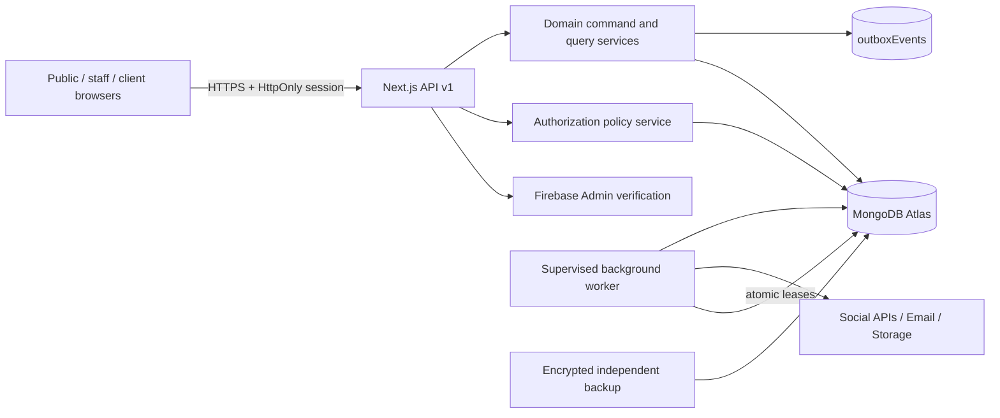
The authenticated web process and worker use distinct MongoDB identities where possible, least-privilege credentials, and explicit service principals. **Background processing does not bypass authorization**: it validates owning company, job origin, scope, approved revision, live account capabilities and revocation status before dispatch.

### 1.2 Reference package organization
```text
packages/
  database/
    src/connection.ts
    src/models/{identity,company,clients,cms,crm,projects,social,finance,ops}/*.model.ts
    src/indexes/*.ts
    src/migrations/*.ts
  core/
    src/domains/*/{commands,queries,policies,events,serializers}
    src/contracts/{dto,schemas,enums,money}.ts
  auth/
    src/{firebase,session,permission-engine,resource-scope}.ts
  integrations/
    src/social/{contracts,adapters,capabilities,oauth}.ts
apps/
  web/src/app/api/v1/*
  worker/src/{pollers,handlers,reconciler,telemetry}.ts
```
`models` own persistence shape, services own invariants, `auth` owns scope decisions, `contracts` own DTO and Zod validation, serializers own outward data shape. No route calls `Model.findById(id)` to return private content without scoped policy evaluation.

### 1.3 Common document conventions
| Field | Type | Required / rules |
|---|---|---|
| `_id` | ObjectId | Immutable MongoDB primary key |
| `companyId` | ObjectId | Required on company operations; points to provisioned operator |
| `clientOrganizationId` | ObjectId or absent | Required for client-facing business records; absent for company-internal content; never null-vs-missing ambiguous |
| `createdAt`, `updatedAt` | BSON Date | UTC, timestamps from controlled server runtime |
| `createdBy`, `updatedBy` | ObjectId/user-service principal | Scoped audited actor where applicable |
| `version` | integer ≥ 1 | On mutable business aggregates; increment through atomic conditional write |
| `deletedAt`, `deletedBy` | Date/ObjectId optional | Only where soft-delete policy is defined; does not override preservation requirements |
| `status` | string enum | Controlled state machine; never freeform and never sole access-control mechanism |
| `visibility` | enum + audience context | Explicit `company_internal`, `client_visible`, `public_approved`, etc. |
| `schemaVersion` | positive integer | On outbox/event snapshots and documents with evolving polymorphism |

**ObjectId vs API:** validate incoming ID shape with Zod, then resolve in *scoped* query. Never serialize a whole hydrated Mongoose object to client UI. `lean()` does not automatically make an unsafe query safe. All timestamps are UTC dates; preserve original IANA timezone separately for scheduling explanation.

### 1.4 Referential integrity choices
MongoDB does not enforce foreign keys. Services MUST validate referenced documents in the same company/scope before writes, including assigned staff membership, client org, project, media, service offering and account. Use transactions for critical linked mutations and a periodic integrity audit for older data. Cross-client references are invalid even when both ObjectIds exist. Hard deletion of parents with live children is blocked until a documented archive/anonymization policy is applied. Choose cascade behavior explicitly per relation (see §11).

---

## 2. Enum registry and domain state policies

| Enum | MVP values | Validity conditions |
|---|---|---|
| `UserStatus` | `invited`, `active`, `suspended`, `disabled` | `suspended/disabled` deny authenticated business access |
| `ScopeType` | `company`, `department`, `client_org`, `project` | `scopeId` must resolve to scope of proper type |
| `RoleKey` | `owner`, `admin`, `department_manager`, `project_manager`, `employee`, `operations_staff`, `hr_manager`, `finance_manager`, `marketing_manager`, `content_creator`, `client_admin`, `client_member`, `registered_user` | Roles are templates, effective permissions remain grant/scope based |
| `InviteStatus` | `pending`, `accepted`, `revoked`, `expired` | Single-use hash token and expiration |
| `LeadStatus` | `new`, `contacted`, `qualified`, `proposal_sent`, `negotiation`, `won`, `lost`, `closed` | Allowed transitions per CRM policy; `won` ≠ paid |
| `QuoteStatus` | `draft`, `sent`, `accepted`, `declined`, `expired`, `cancelled` | Approved immutable versions on sending/acceptance |
| `ProjectKind` | `client_delivery`, `internal_owned_product` | Client kind requires `clientOrganizationId` |
| `ProjectStatus` | `planned`, `active`, `on_hold`, `in_review`, `completed`, `cancelled` | State transition evidence and required gates |
| `TaskStatus` | `todo`, `in_progress`, `blocked`, `in_review`, `done`, `cancelled` | Scoped member updates, conditional version |
| `DeliverableStatus` | `draft`, `ready_for_client`, `changes_requested`, `accepted`, `withdrawn` | Client sees only released/authorized versions; signoff enhancement future |
| `ContentStatus` | `draft`, `in_review`, `published`, `archived` | Only sanitized frozen revisions public |
| `AssetStatus` | `pending_validation`, `available`, `rejected`, `quarantined`, `deleted` | Only available asset may be linked/rendered |
| `SocialProvider` | `facebook`, `instagram`, `linkedin`, `youtube`, `x`, `tiktok` | Lowercase stable provider keys |
| `ConnectionStatus` | `pending`, `connected`, `needs_reauth`, `revoked`, `disconnected`, `disabled` | No dispatch without current capability and credentials |
| `VariantStatus` | `draft`, `in_review`, `changes_requested`, `approved`, `scheduled`, `cancelled` | Publication outcome belongs to `publishJobs`, not variant alone |
| `ApprovalDecision` | `approved`, `rejected`, `changes_requested`, `revoked` | Immutable decision tied to hash/version |
| `PublishJobState` | `scheduled`, `claimed`, `uploading`, `publishing`, `published_api`, `manual_required`, `published_manual_reported`, `retry_wait`, `failed_final`, `unknown_outcome`, `cancelled` | Distinguish **provider-confirmed** vs **human-reported** outcome |
| `PublishAttemptState` | `started`, `provider_confirmed`, `rejected`, `transient_error`, `unknown_outcome` | Crash/network ambiguity never auto-sent twice |
| `MetricAvailability` | `available`, `not_available`, `permission_denied`, `not_supported`, `pending` | No fallback zero that implies measured activity |
| `InvoiceStatus` | `draft`, `issued`, `partially_paid`, `paid`, `void`, `overdue` | `overdue` is time-related reporting state, not an immutable payment event |
| `PaymentEntryType` | `payment`, `reversal`, `adjustment` | Adjustments/reversals need authorization/reason; preserve originals |
| `OutboxState` | `pending`, `claimed`, `retry_wait`, `completed`, `dead_letter` | Deterministic and bounded processing |
| `NotificationStatus` | `unread`, `read`, `archived` | Recipient-scoped always |
| `DataVisibility` | `company_internal`, `client_visible`, `public_approved` | Not a substitute for memberships/ownership checks |

**Transition rules:** Request/command services enforce the App Flow state diagrams (`SM-001` through `SM-008`, and J-010–J-016) and record actor, reason, old/new state and version. Enum membership alone does not authorize transition. `overdue` should be derived from issued/unpaid + due date where practical, or materialized with explicit reconciliation rules; do not inadvertently overwrite `paid` with `overdue`.

---

## 3. Complete collection registry and field contracts

The following is the canonical initial registry. A collection marked `F` is reserved for post-MVP and MUST NOT be mistaken for an MVP deployment requirement. `M` collections may be implemented by phase, not all at once. Security classifications are defaults; individual fields may require stronger protection.

### 3.1 Identity and company
| Collection / release | Fields beyond common metadata | Core constraints and access classification |
|---|---|---|
| `users` M | `firebaseUid:string`, `primaryEmail`, `normalizedEmail`, `displayName`, `avatarAssetId?`, `status`, `locale`, `timezone`, `lastLoginAt?`, `sessionInvalidAfter?`, `authzRevision:int`, `securityFlags` | Unique immutable Firebase UID; normalized email not primary identity; PERSONAL; self read narrow, admins scoped |
| `roleGrants` M | `userId`, `roleKey`, `scopeType`, `scopeId`, `permissionsOverride?`, `active:boolean`, `grantedBy`, `grantedAt`, `revokedAt?`, `reasonCode?` | Active scope reference; no unauthorized scope escalation; INTERNAL/SECURITY |
| `invitations` M | `inviteeEmailNormalized`, `tokenHash`, `scopeType`, `scopeId`, `roleKey`, `status`, `expiresAt`, `acceptedAt?`, `createdBy`, `maxUses=1`, `targetUserId?` | Single-use, hashed token, no plaintext storage, client invites stay within client org; PERSONAL |
| `sessionSecurityEvents` M | `userId`, `firebaseUid`, `eventType`, `occurredAt`, `authzRevision`, `sessionIdHash?`, `ipHash?`, `userAgentSummary?`, `requestId` | Sanitized immutable record for suspicious auth changes; AUDIT |
| `companies` M | `provisioningKey`, `legalName`, `publicName`, `slug`, `branding`, `defaultCurrency`, `defaultLocale`, `timezone`, `status` | Exactly one provisioned operator, locked provisioning; INTERNAL |
| `departments` M | `companyId`, `name`, `code`, `managerIds[]`, `status` | Unique `(companyId,code)` among active; INTERNAL |
| `companySettings` M | `companyId`, `publicConfig`, `securityPolicy`, `financePolicy`, `socialPolicy`, `settingsVersion` | Unique `companyId`, critical changes audited; INTERNAL |

**Active membership semantics:** when access is revoked, atomically set `active=false` and `revokedAt=now`. All effective permission queries filter `active=true` AND verify current parent/user status; this is necessary because partial unique indexes do not encode expiry or other business policy. Historic rows remain for audit and must not be used as active grants.

**Owner preservation:** grant/revoke transactions MUST refuse removal/deactivation of the last effective active owner, including when owner account is suspended. Owner recovery is privileged, documented and independently approved; do not infer ownership from `isAdmin` client claims.

### 3.2 Client organizations, CRM and sales
| Collection / release | Fields beyond common metadata | Core constraints and access classification |
|---|---|---|
| `clientOrganizations` M | `companyId`, `legalName`, `displayName`, `slug`, `status`, `billingEmail?`, `country?`, `primaryContactId?`, `internalNotes?` | Unique `(companyId,slug)` active; client-safe DTO omits internal notes; CLIENT_CONFIDENTIAL |
| `clientMemberships` M | `clientOrganizationId`, `userId`, `memberRole`, `status`, `active:boolean`, `invitedBy`, `joinedAt?`, `revokedAt?` | Unique active membership per user/org; client admin cannot add other org scope |
| `clientContacts` M | `clientOrganizationId?`, `leadId?`, `name`, `email`, `phone?`, `title?`, `preferredContactMethod`, `consent` | Validate reference and marketing consent; PERSONAL |
| `leads` M | `companyId`, `source`, `serviceId?`, `requesterContact`, `normalizedContact`, `subject`, `requirements`, `status`, `ownerId?`, `clientOrganizationId?`, `convertedProjectId?`, `consent`, `idempotencyRef?` | Never auto-merge by email alone; internal CRM permission; PERSONAL |
| `leadActivities` M | `leadId`, `kind`, `summary`, `actorId`, `happenedAt`, `visibility=company_internal`, `linkedDocumentId?` | Append-oriented activity; parent scope verified; INTERNAL |
| `quotations` M | `companyId`, `leadId?`, `clientOrganizationId?`, `projectId?`, `quoteNumber`, `revision`, `status`, `currency`, `lineItems[]`, `subtotalMinor`, `discountMinor`, `taxMinor`, `totalMinor`, `expiresAt?`, `sentAt?`, `acceptedAt?`, `approvedSnapshot?` | Unique `(companyId,quoteNumber,revision)`; quote revisions immutable once sent; FINANCIAL |
| `clientFeedback` M | `clientOrganizationId`, `projectId`, `deliverableId?`, `authorId`, `message`, `attachments[]`, `requestedAction`, `visibility=client_visible`, `createdAt` | Author must be project-authorized client member; CLIENT_CONFIDENTIAL |

**Lead conversion:** one idempotent command verifies lead status, assigns/creates client org, creates a project, links `convertedProjectId`, records audit/outbox and marks `won`; a retry returns the same conversion result. Enforce uniqueness of conversion outcome through a transaction and a stable conversion key. Do not create a second client/project when retries race.

### 3.3 Public CMS, products and media
| Collection / release | Fields beyond common metadata | Core constraints and access classification |
|---|---|---|
| `services` M | `slug`, `titleI18n`, `descriptionI18n`, `offerings[]`, `sortOrder`, `status`, `publishedRevisionId?`, `seo` | Only published approved snapshot public; `slug` unique in company/locale policy; PUBLIC when published |
| `ownedProducts` M | `slug`, `nameI18n`, `summaryI18n`, `type`, `productUrl?`, `releaseNotes?`, `status`, `publishedRevisionId?`, `seo` | Product marketing catalog, not product SaaS tenant provisioning; PUBLIC when published |
| `articles` M | `slug`, `titleI18n`, `excerptI18n`, `authorId`, `tags[]`, `status`, `publishedRevisionId?`, `publishedAt?`, `seo` | Article draft never publicly queryable; PUBLIC only via published snapshot |
| `caseStudies` M | `slug`, `titleI18n`, `summaryI18n`, `technologyTags[]`, `publicProjectUrl?`, `sourceProjectId?`, `status`, `publishedRevisionId?`, `approvalEvidence?`, `seo` | Curated public content separate from internal `projects`; NEVER project auto-serialize |
| `contentRevisions` M | `contentType`, `contentId`, `revision`, `contentBlocks`, `mediaAssetIds[]`, `sanitizedPublicSnapshot?`, `contentHash`, `authorId`, `reviewerId?`, `state`, `createdAt` | Unique `(contentType,contentId,revision)`; immutable after publication; sanitized fields only |
| `mediaAssets` M | `companyId`, `clientOrganizationId?`, `projectId?`, `ownerId`, `purpose`, `audience`, `provider`, `storageKey`, `checksumSha256?`, `mimeType`, `byteSize`, `status`, `scanSummary?`, `derivedAssetIds[]`, `deletedAt?` | Storage key server-only; private by default; no cross-scope sharing without explicit copy/reclassification |

A published content entry points to the frozen `contentRevisions` approved public snapshot. Publishing and cache invalidation intent are written atomically with an outbox event. Locale maps use strict allowlist `en` now and `bn` when populated; missing translations fall back with clear flags, not accidental mixed-language text.

### 3.4 Projects, workspaces, tasks and delivery
| Collection / release | Fields beyond common metadata | Core constraints and access classification |
|---|---|---|
| `projects` M | `kind`, `clientOrganizationId?`, `name`, `code`, `descriptionInternal`, `clientSummary?`, `status`, `managerId`, `startAt?`, `dueAt?`, `budgetMinor?`, `budgetCurrency?`, `progressPolicy`, `version` | Unique `(companyId,code)`; client-safe projection allowlisted; INTERNAL/CLIENT_CONFIDENTIAL |
| `projectMemberships` M | `projectId`, `userId`, `memberType`, `clientOrganizationId?`, `role`, `permissions[]`, `status`, `active:boolean`, `addedBy`, `revokedAt?` | Unique active `(projectId,userId,memberType)`; client member org must match project org |
| `tasks` M | `projectId`, `clientOrganizationId?`, `title`, `description`, `status`, `priority`, `assigneeId?`, `reporterId`, `dueAt?`, `sortOrder`, `visibility`, `version`, `parentTaskId?` | Assigned actor must have project access; no client visibility by default |
| `milestones` M | `projectId`, `clientOrganizationId?`, `title`, `descriptionClientSafe?`, `dueAt?`, `completedAt?`, `status`, `visibility`, `sortOrder` | Publication to client is explicit; no internal scope leak |
| `deliverables` M | `projectId`, `clientOrganizationId?`, `title`, `descriptionClientSafe`, `assetIds[]`, `revision`, `status`, `visibility`, `releasedAt?`, `releasedBy?`, `clientFeedbackIds[]` | Only released revision and approved assets visible to client; immutable release snapshot |
| `comments` M | `projectId`, `taskId?`, `deliverableId?`, `clientOrganizationId?`, `authorId`, `bodySanitized`, `visibility`, `attachments[]`, `editedAt?`, `deletedAt?` | `company_internal` never retrieved via client threads; audit edits |
| `timeEntries` F | `projectId`, `taskId?`, `employeeId`, `startedAt`, `endedAt`, `durationMinutes`, `billable` | Post-MVP advanced employee time tracking |
| `sprints` F | `projectId`, `name`, `startAt`, `endAt`, `goal`, `status` | Post-MVP sprint planning and capacity |

**Task assignment:** do not treat department membership alone as project authorization. `tasks.clientOrganizationId` (if denormalized) must equal its parent `projects.clientOrganizationId`, verified in service and reconciliation test. Client project detail views use `clientSummary`, selected released milestones/deliverables and client-visible comments only; never return `budgetMinor`, `descriptionInternal` or internal task notes.

### 3.5 Social accounts, campaigns, publishing and analytics
| Collection / release | Fields beyond common metadata | Core constraints and access classification |
|---|---|---|
| `socialAccounts` M | `companyId`, `provider`, `providerAccountId`, `displayName`, `accountType`, `status`, `credentialId?`, `permissionCodes[]`, `capabilitySnapshot`, `capabilityCheckedAt?`, `lastErrorCode?`, `connectedBy`, `disconnectedAt?` | Unique `(companyId,provider,providerAccountId)` among connected/managed records; no token in DTO |
| `integrationCredentials` M | `companyId`, `socialAccountId?`, `provider`, `ciphertext`, `encryptedDataKey`, `keyVersion`, `tokenExpiresAt?`, `refreshStatus`, `lastRotatedAt`, `revokedAt?` | CREDENTIAL; separate DB collection with encryption envelope; never populate in REST responses |
| `campaigns` M | `companyId`, `name`, `objective?`, `description?`, `tags[]`, `ownerId`, `status`, `startsAt?`, `endsAt?`, `version` | Campaign is organization of work, not a single provider post state |
| `postVariants` M | `companyId`, `campaignId`, `socialAccountId`, `provider`, `caption`, `mediaAssetIds[]`, `platformMetadata`, `status`, `revision`, `contentHash`, `approvedRevision?`, `approvalId?`, `scheduledAtUtc?`, `requestedTimezone?`, `lastEditedBy` | One independently reviewable target/version; no approval reused after content change |
| `contentApprovals` M | `variantId`, `revision`, `contentHash`, `decision`, `reviewerId`, `reviewedAt`, `reasonCode?`, `comment?`, `emergencyOverride?` | Append-only; reviewer cannot self-approve normally; constrained revocation |
| `publishJobs` M | `variantId`, `socialAccountId`, `approvedRevision`, `approvedHash`, `operationKey`, `state`, `runAt`, `attemptCount`, `maxAttempts`, `leaseOwner?`, `leaseToken?`, `leaseUntil?`, `providerPostId?`, `providerUrl?`, `manualEvidence?`, `lastErrorCode?`, `lastErrorAt?`, `publishedAt?`, `version` | Unique dispatch identity; atomic claims; unknown outcome blocks blind retry |
| `publishAttempts` M | `jobId`, `attemptNumber`, `provider`, `requestFingerprint`, `providerRequestId?`, `startedAt`, `finishedAt?`, `state`, `httpStatus?`, `errorCategory?`, `providerPostId?`, `sanitizedResponse?` | Unique `(jobId,attemptNumber)`; immutable execution evidence with sensitive redaction |
| `metricSnapshots` M/C | `socialAccountId`, `postVariantId?`, `providerPostId?`, `metricKey`, `value?`, `availability`, `collectedAt`, `periodStart?`, `periodEnd?`, `source`, `unit`, `providerRawName?` | Provider-scoped, timestamped, null unavailable ≠ zero; never fabricate comparability |
| `integrationStatus` M | `provider`, `environment`, `feature`, `capabilityStatus`, `approvalState`, `quotaState`, `costGate`, `lastCheckedAt`, `reasonCode?` | Disable unsupported publishing without losing drafts/history |

**Social provider account key:** normalize the provider + account resource ID without treating arbitrary display names/handles as identity. Credentials may map one authorized connection to multiple eligible provider resources; implement explicit credential/account binding and authorization when real provider flows are verified. A single `postVariant` targets **one** account; multi-account posting creates distinct variants. The registry models all six platforms, but automatic publishing is individually gated.

### 3.6 Finance, collaboration, governance and operations
| Collection / release | Fields beyond common metadata | Core constraints and access classification |
|---|---|---|
| `invoices` M | `companyId`, `clientOrganizationId`, `projectId?`, `invoiceNumber?`, `currency`, `lineItems[]`, `subtotalMinor`, `discountMinor`, `taxMinor`, `totalMinor`, `paidMinor`, `balanceMinor`, `status`, `issuedAt?`, `dueAt?`, `issuedSnapshot?`, `version` | Unique `(companyId,invoiceNumber)`; immutable issued snapshot; FINANCIAL |
| `paymentRecords` M | `companyId`, `invoiceId`, `clientOrganizationId`, `entryType`, `amountMinor`, `currency`, `effectiveAt`, `receivedAt`, `reference?`, `relatedPaymentId?`, `reasonCode?`, `recordedBy`, `idempotencyRef` | Append-only; paid balance reconstructed from signed entries; FINANCIAL |
| `exchangeRateSnapshots` M/C | `baseCurrency`, `quoteCurrency`, `rateDecimal`, `source`, `observedAt`, `recordedAt`, `reason?` | Exact decimal, historical rates never silently overwritten; third-party rate feed optional |
| `notifications` M | `recipientUserId`, `kind`, `titleKey`, `safeSummary`, `resourceType?`, `resourceId?`, `scopeType?`, `scopeId?`, `status`, `createdAt`, `readAt?`, `expiresAt?` | Recipient-only; follow-up link rechecks live resource authorization |
| `emailJobs` M | `templateKey`, `recipient`, `locale`, `safeTemplateData`, `state`, `attempts`, `nextRunAt`, `sentAt?`, `providerMessageId?`, `outboxEventId` | No unencrypted sensitive secrets in job payload; retry and dedupe |
| `activityEvents` M | `actorId`, `projectId?`, `clientOrganizationId?`, `kind`, `safeSummary`, `visibility`, `subjectId`, `occurredAt` | Operational UI feed only, not substitute for security audit |
| `auditEvents` M | `actorType`, `actorId`, `action`, `resourceType`, `resourceId?`, `scopeType?`, `scopeId?`, `requestId?`, `reasonCode?`, `outcome`, `sanitizedBefore?`, `sanitizedAfter?`, `occurredAt`, `integrityHash?` | Restricted, append-only application events; AUDIT |
| `outboxEvents` M | `eventId`, `schemaVersion`, `type`, `subjectId`, `payload`, `availableAt`, `state`, `attempts`, `maxAttempts`, `dedupeKey`, `leaseOwner?`, `leaseUntil?`, `lastErrorCode?` | Unique eventId; atomic with business mutation |
| `idempotencyRecords` M | `scope`, `command`, `keyHash`, `requestHash`, `state`, `responseCode?`, `responsePayloadSafe?`, `subjectId?`, `expireAt` | Unique key scope/command/hash; TTL only after safe replay horizon |
| `featureFlags` M | `key`, `environment`, `enabled`, `conditions`, `reason`, `updatedBy`, `version` | Critical publish feature changes require audit and authorization |
| `counters` M | `companyId`, `kind`, `periodKey`, `nextValue` | Atomic invoice/quote sequence allocation |
| `schemaMigrations` M | `name`, `checksum`, `state`, `startedAt`, `completedAt?`, `checkpoint?`, `migrationVersion` | Unique name/checksum; migration runner controlled by deploy process |
| `dataExportRequests` M | `requesterId`, `scope`, `purpose`, `state`, `createdAt`, `approvedBy?`, `completedAt?`, `resultAssetId?`, `expiresAt?` | Authorized export with audit, protected encrypted download |
| `deletionRequests` M | `requesterId`, `subjectType`, `subjectId`, `basis`, `state`, `legalHold?`, `reviewedBy?`, `completedAt?` | Policies decide anonymization, preservation and backup implications |
| `expenses` F | `vendorId?`, `projectId?`, `amountMinor`, `currency`, `category`, `receiptAssetId`, `status` | Deferred expense module |
| `attendanceRecords`, `leaveRequests`, `payrollEntries` F | To be designed under dedicated HR/privacy ADR | NOT MVP; employee privacy/jurisdiction review required |

**Registry implementation note:** some small, low-volume histories can start embedded if they are immutable and bounded, but **not** large feed/audit/attempt collections. Any deviation from named TRD core collections requires an ADR and migration/test update.

---
## 4. Production-oriented Mongoose + TypeScript contracts

The examples in this section are **reference implementations**, not drop-in substitutes for all services. Each production model requires deliberate migrations/indexes, test fixtures, restricted serializers, and explicit authorization in the service layer. Avoid `any`, unbounded `Mixed`, arbitrary dynamic properties, and implicit collection naming. Prefer immutable typed command DTOs and `strict: 'throw'` for unknown persistence fields (validate requests first so user errors return `422`, not raw DB exceptions).

### 4.1 Connection and base schema utilities
```ts
// packages/database/src/connection.ts — illustrative
import mongoose from 'mongoose';

export async function connectDatabase(uri: string) {
  if (!uri.startsWith('mongodb+srv://') && !uri.startsWith('mongodb://')) {
    throw new Error('Invalid database configuration');
  }
  await mongoose.connect(uri, {
    autoIndex: false,              // production migrations own indexes
    serverSelectionTimeoutMS: 8_000,
    maxPoolSize: 20,              // tune by runtime budget
  });
  return mongoose.connection;
}

// packages/database/src/common.ts
import { Schema, Types } from 'mongoose';
export const ObjectIdType = Schema.Types.ObjectId;
export type Id = Types.ObjectId;
export function baseOptions(collection: string) {
  return {
    collection,
    timestamps: true,
    strict: 'throw' as const,
    optimisticConcurrency: false, // business updates use explicit version CAS
    versionKey: false as const,
  };
}
```
**Production boundary:** use transactions only where supported, with bounded retries for transient transaction errors and unique-key collisions handled as business conflicts. The example connection settings are configuration starting points, not observed capacity guarantees. Separate read replicas/caches only after measured need, and never allow stale authorization reads for privileged mutation.

### 4.2 Firebase identity mapping, users and scoped grants
```ts
import { Schema, model, models, Types } from 'mongoose';

export interface UserDoc {
  firebaseUid: string;
  normalizedEmail: string;
  primaryEmail: string;
  displayName: string;
  status: 'invited' | 'active' | 'suspended' | 'disabled';
  locale: 'en' | 'bn';
  timezone: string;
  authzRevision: number;
  sessionInvalidAfter?: Date;
  createdAt: Date;
  updatedAt: Date;
}
const UserSchema = new Schema<UserDoc>({
  firebaseUid: { type: String, required: true, immutable: true, trim: true },
  normalizedEmail: { type: String, required: true, lowercase: true, trim: true },
  primaryEmail: { type: String, required: true, trim: true },
  displayName: { type: String, required: true, maxlength: 160 },
  status: { type: String, required: true,
    enum: ['invited', 'active', 'suspended', 'disabled'] },
  locale: { type: String, enum: ['en', 'bn'], default: 'en' },
  timezone: { type: String, default: 'UTC' },
  authzRevision: { type: Number, min: 1, default: 1 },
  sessionInvalidAfter: Date,
}, { collection: 'users', timestamps: true, strict: 'throw', versionKey: false });
UserSchema.index({ firebaseUid: 1 }, { unique: true, name: 'uq_users_firebase_uid' });
UserSchema.index({ status: 1, updatedAt: -1 }, { name: 'ix_users_status_updated' });
export const User = models.User || model<UserDoc>('User', UserSchema);

export interface RoleGrantDoc {
  userId: Types.ObjectId;
  roleKey: string;
  scopeType: 'company' | 'department' | 'client_org' | 'project';
  scopeId: Types.ObjectId;
  grantedBy: Types.ObjectId;
  grantedAt: Date;
  revokedAt?: Date;
  active: boolean;
  reasonCode?: string;
}
const RoleGrantSchema = new Schema<RoleGrantDoc>({
  userId: { type: Schema.Types.ObjectId, required: true, ref: 'User' },
  roleKey: { type: String, required: true },
  scopeType: { type: String, required: true,
    enum: ['company', 'department', 'client_org', 'project'] },
  scopeId: { type: Schema.Types.ObjectId, required: true },
  grantedBy: { type: Schema.Types.ObjectId, required: true, ref: 'User' },
  grantedAt: { type: Date, required: true },
  revokedAt: Date,
  active: { type: Boolean, required: true, default: true },
  reasonCode: String,
}, { collection: 'roleGrants', timestamps: false, strict: 'throw', versionKey: false });
RoleGrantSchema.index(
  { userId: 1, roleKey: 1, scopeType: 1, scopeId: 1 },
  { unique: true, partialFilterExpression: { active: true },
    name: 'uq_role_grant_active' }
);
RoleGrantSchema.index({ scopeType: 1, scopeId: 1, active: 1 },
  { name: 'ix_role_grant_scope' });
export const RoleGrant = models.RoleGrant || model<RoleGrantDoc>('RoleGrant', RoleGrantSchema);
```
`models.User || ...` is suitable for Next.js development hot reload; implementations must ensure the generic typing of reused model objects is correct for their Mongoose version. Provider email may change; `firebaseUid` remains the immutable identity key. Email changes are verified server-side through Firebase token claims and allowed update workflow; an email match **never** auto-grants an invited role without target/verified-identity checks.

**Authorization evaluation sequence:** verify Firebase-backed server session → read active `users` row by `firebaseUid` → check revocation timestamp/`authzRevision`/step-up → resolve effective role grants and relevant memberships → load target scoped record → authorize command + state → conditionally update by version → safe DTO serialization. Cache of authorization grants, if used, must be short-lived with reliable invalidation; no token custom-claim role as sole authority. An owner safety transaction counts active effective owners before permitting removal.

### 4.3 Scoped projects, tasks and client-visible outputs
```ts
import { Schema, model, models, Types } from 'mongoose';

type ProjectKind = 'client_delivery' | 'internal_owned_product';
type ProjectStatus = 'planned' | 'active' | 'on_hold' |
  'in_review' | 'completed' | 'cancelled';
interface ProjectDoc {
  companyId: Types.ObjectId;
  kind: ProjectKind;
  clientOrganizationId?: Types.ObjectId;
  name: string;
  code: string;
  descriptionInternal?: string;
  clientSummary?: string;
  managerId: Types.ObjectId;
  status: ProjectStatus;
  version: number;
  createdAt: Date;
  updatedAt: Date;
}
const ProjectSchema = new Schema<ProjectDoc>({
  companyId: { type: Schema.Types.ObjectId, required: true, ref: 'Company' },
  kind: { type: String, required: true,
    enum: ['client_delivery', 'internal_owned_product'] },
  clientOrganizationId: { type: Schema.Types.ObjectId, ref: 'ClientOrganization' },
  name: { type: String, required: true, maxlength: 240 },
  code: { type: String, required: true, maxlength: 48 },
  descriptionInternal: { type: String, maxlength: 100_000 },
  clientSummary: { type: String, maxlength: 12_000 },
  managerId: { type: Schema.Types.ObjectId, required: true, ref: 'User' },
  status: { type: String, required: true, enum: [
    'planned', 'active', 'on_hold', 'in_review', 'completed', 'cancelled' ] },
  version: { type: Number, required: true, default: 1, min: 1 },
}, { collection: 'projects', timestamps: true, strict: 'throw', versionKey: false });
ProjectSchema.index({ companyId: 1, code: 1 },
  { unique: true, name: 'uq_projects_company_code' });
ProjectSchema.index({ clientOrganizationId: 1, status: 1, updatedAt: -1 },
  { name: 'ix_projects_client_status' });
export const Project = models.Project || model<ProjectDoc>('Project', ProjectSchema);

// A service must apply both the scope predicate and expected version:
const updated = await Project.findOneAndUpdate(
  { _id: projectId, companyId, clientOrganizationId, version: expectedVersion },
  { $set: { clientSummary: nextSummary, updatedAt: new Date() }, $inc: { version: 1 } },
  { new: true, runValidators: true, session }
).lean();
if (!updated) throw new StaleOrUnauthorizedResourceError();
```
The last snippet is for a **client-scoped** action. Do not reuse it to infer that all company-internal projects have `clientOrganizationId`. `StaleOrUnauthorizedResourceError` must map to safe `404`/`412` only after an authorized non-enumerating decision; avoid revealing whether a foreign record exists. The update still requires prior policy evaluation and a re-check within the transaction.

**Client serializer (allowlist, not subtractive filtering):**
```ts
export type ClientProjectDTO = {
  id: string;
  name: string;
  status: ProjectStatus;
  summary: string | null;
  publishedMilestones: Array<{ id: string; title: string; dueAt: string | null }>;
};
export function toClientProjectDTO(p: ProjectDoc & { _id: Types.ObjectId }):
    Omit<ClientProjectDTO, 'publishedMilestones'> {
  return { id: String(p._id), name: p.name, status: p.status,
    summary: p.clientSummary ?? null };
}
```
Do not add internal `budgetMinor`, raw file keys, internal comments, staff-only `descriptionInternal`, or hidden milestones to this DTO. Milestones require a **separate scoped query** for released rows.

### 4.4 Exact money, invoice issuance and payment ledger
```ts
import { z } from 'zod';
export const CurrencySchema = z.enum(['SAR', 'BDT', 'USD']);
export const MinorMoneySchema = z.number().int().safe().nonnegative().max(9_000_000_000_000);
export const LineItemSchema = z.object({
  description: z.string().trim().min(1).max(500),
  quantityMilli: z.number().int().positive().max(1_000_000_000),
  unitPriceMinor: MinorMoneySchema,
  lineTotalMinor: MinorMoneySchema,
}).strict();
export const InvoiceIssueSchema = z.object({
  invoiceId: z.string().regex(/^[a-f\d]{24}$/i),
  expectedVersion: z.number().int().positive(),
  idempotencyKey: z.string().min(16).max(200),
}).strict();
```
**Money policy:** store amounts as integer minor units; currencies supported at launch have two decimal places, but implement currency exponent from reviewed ISO 4217 metadata rather than globally hardcoding `2` for future currencies. `quantityMilli` represents fixed-point quantity in thousandths for item calculations; compute using decimal/integer algorithms, then apply an approved per-line rounding method. Do not calculate `lineTotalMinor` with floating-point multiplication. Validate line totals **server-side**, do not trust submitted totals; line discounts/taxes must be separately defined and reconciled. For amounts that cannot fit safely into JS integers, an ADR must migrate to BSON Long/Decimal128 plus safe codecs before accepting them.

**Issue transaction:** authenticate privileged actor; verify invoice is `draft` + expected version and client reference; allocate `(companyId,periodKey,kind=invoice)` sequential number using `counters` in the transaction; create immutable `issuedSnapshot` of lines, totals, recipient and currency; atomically set `issuedAt`, `invoiceNumber`, `status=issued`, add audit/outbox; commit with majority write concern. Record a valid manual payment through a unique idempotency command, append `paymentRecords`, recompute `paidMinor` and `balanceMinor` in the same transaction, reject overpayment unless specifically approved, and derive `paid`/`partially_paid` state. Reverse erroneous entries with signed offsets linked to originals—not in-place mutation. Client access to issued invoice is separately checked against membership and explicit finance-document visibility policy.

### 4.5 Social campaign, revision and publish job model
```ts
import { Schema, model, models, Types } from 'mongoose';
interface PublishJobDoc {
  companyId: Types.ObjectId;
  variantId: Types.ObjectId;
  socialAccountId: Types.ObjectId;
  approvedRevision: number;
  approvedHash: string;
  operationKey: string;
  state: 'scheduled' | 'claimed' | 'uploading' | 'publishing' |
    'published_api' | 'manual_required' | 'published_manual_reported' |
    'retry_wait' | 'failed_final' | 'unknown_outcome' | 'cancelled';
  runAt: Date;
  attemptCount: number;
  maxAttempts: number;
  leaseOwner?: string;
  leaseToken?: string;
  leaseUntil?: Date;
  providerPostId?: string;
  providerUrl?: string;
  lastErrorCode?: string;
  version: number;
  createdAt: Date;
  updatedAt: Date;
}
const PublishJobSchema = new Schema<PublishJobDoc>({
  companyId: { type: Schema.Types.ObjectId, required: true, ref: 'Company' },
  variantId: { type: Schema.Types.ObjectId, required: true, ref: 'PostVariant' },
  socialAccountId: { type: Schema.Types.ObjectId, required: true, ref: 'SocialAccount' },
  approvedRevision: { type: Number, required: true, min: 1 },
  approvedHash: { type: String, required: true, minlength: 64, maxlength: 128 },
  operationKey: { type: String, required: true },
  state: { type: String, required: true, enum: [
    'scheduled', 'claimed', 'uploading', 'publishing', 'published_api',
    'manual_required', 'published_manual_reported', 'retry_wait',
    'failed_final', 'unknown_outcome', 'cancelled' ] },
  runAt: { type: Date, required: true },
  attemptCount: { type: Number, default: 0, min: 0 },
  maxAttempts: { type: Number, default: 3, min: 0, max: 20 },
  leaseOwner: String, leaseToken: String, leaseUntil: Date,
  providerPostId: String, providerUrl: String, lastErrorCode: String,
  version: { type: Number, default: 1, min: 1 },
}, { collection: 'publishJobs', timestamps: true, strict: 'throw', versionKey: false });
PublishJobSchema.index(
  { variantId: 1, approvedRevision: 1, socialAccountId: 1, operationKey: 1 },
  { unique: true, name: 'uq_publish_job_operation' }
);
PublishJobSchema.index({ state: 1, runAt: 1, _id: 1 },
  { name: 'ix_publish_jobs_due' });
PublishJobSchema.index({ state: 1, leaseUntil: 1 },
  { name: 'ix_publish_jobs_lease' });
export const PublishJob = models.PublishJob || model<PublishJobDoc>('PublishJob', PublishJobSchema);
```
**Lease algorithm (logical specification):**
1. Atomically claim one due `scheduled`/`retry_wait` job where `runAt <= now`, or an **explicitly safe** expired lease that is proven not to have reached provider submission. Set `state=claimed`, random `leaseToken`, `leaseOwner`, `leaseUntil`, increment `attemptCount` and `version`.
2. Load variant/account/approval live. Check matching `approvedHash`, account eligibility, budget flag and approved scope, and ensure media is available. If changed or revoked, cancel/block and emit audit; never publish stale content.
3. Write `publishAttempts` **before** external call. Mark preflight vs provider-submission boundary. Provider-specific idempotency tokens are used only if officially supported.
4. On explicit confirmation, set `published_api` with provider ID/URL/timestamp; on definitive error, `retry_wait` or `failed_final`; on timeout/crash after possibly submitting, `unknown_outcome` with reconciliation task.
5. Any state write from a worker MUST include the matching `leaseToken` as fencing token. A stale worker cannot overwrite a job reclaimed by another worker.
6. If reconciliation cannot prove non-publication, require operator review; do not auto-repeat. Manual evidence sets `published_manual_reported` **only**, not `published_api`.
7. Publishing one provider does not change the independent outcome of other variants in the campaign.

**Revision hashing:** build a canonical serialization of provider, account target, caption, media checksums/order, platform metadata and intended targeting. Hash with SHA-256 and persist `contentHash`. On any semantic change, increment `revision`, invalidate/revoke approval linkage and future schedule eligibility. Approval is append-only and contains the hash; scheduling validates the exact approved revision inside a transaction. Always record scheduled instant (`runAt` UTC), IANA zone and resolved local wall-time in the variant or scheduling audit.

**Provider metrics:** `metricSnapshots.value = null` plus `availability=not_available` means no metric; a stored numeric `0` plus `availability=available` means measured zero. Define provider source, unit, collection date, and reporting period. Do not add unlike engagement metrics together without a documented cross-network normalization formula.

### 4.6 Outbox and idempotency schema example
```ts
interface OutboxEvent {
  eventId: string;              // UUIDv7 or equivalent
  schemaVersion: number;
  type: string;                 // e.g., crm.lead.converted.v1
  subjectId: string;
  dedupeKey: string;
  payload: Record<string, string | number | boolean | null>;
  availableAt: Date;
  state: 'pending' | 'claimed' | 'retry_wait' | 'completed' | 'dead_letter';
  attempts: number;
  leaseUntil?: Date;
}
// The producer persists the domain change AND outbox event in one MongoDB transaction.
// Consumers record deduplication by stable eventId / business key; delivery is at-least-once.
```
For local `Idempotency-Key`, hash the opaque incoming value before storage. Key uniqueness includes authenticated actor or company/client scope **and** command. Store a stable canonical request fingerprint and only a sanitized replayable response. Same hash + different request = `409`. Do not TTL-delete idempotency evidence before external publishing's recovery/reconciliation window. `outboxEvents` and `publishJobs` share durability principles but serve different purposes; do not collapse audit evidence into expiring queue payloads.

---

## 5. Zod validation, API contracts and serializing safely

### 5.1 Boundary policy
Each command has at least: `(1)` HTTP Zod input DTO; `(2)` authenticated `ActorContext` with verified grants; `(3)` domain invariant validation; `(4)` persistence checks/transactions; `(5)` restricted output schema. `strict()` input schemas reject unknown keys; API returns TRD §5 safe `422 VALIDATION_ERROR` with field paths but without secrets or raw data. Mongoose schemas are a second defense, **not** a replacement for request validation. Webhooks validate raw-body signatures and replay windows before any database write.

### 5.2 Reusable Zod primitives
```ts
import { z } from 'zod';
export const ObjectIdString = z.string().regex(/^[0-9a-f]{24}$/i);
export const UtcISOString = z.string().datetime({ offset: true });
export const Locale = z.enum(['en', 'bn']);
export const SocialProvider = z.enum([
  'facebook', 'instagram', 'linkedin', 'youtube', 'x', 'tiktok'
]);
export const LimitedText = (max: number) => z.string().trim().min(1).max(max);
export const PageQuery = z.object({
  cursor: z.string().max(2048).optional(),
  limit: z.coerce.number().int().min(1).max(100).default(20),
}).strict();
export const LeadIntakeInput = z.object({
  name: LimitedText(160),
  email: z.email().max(254),
  serviceId: ObjectIdString.optional(),
  subject: LimitedText(240),
  requirements: LimitedText(12_000),
  consent: z.object({ provided: z.literal(true), policyVersion: z.string().min(1) }).strict(),
  antiBotToken: z.string().max(8000).optional(),
}).strict();
export const CreateTaskInput = z.object({
  projectId: ObjectIdString,
  title: LimitedText(240),
  description: z.string().max(20_000).optional(),
  assigneeId: ObjectIdString.optional(),
  priority: z.enum(['low','normal','high','urgent']).default('normal'),
  dueAt: UtcISOString.optional(),
}).strict();
```
`z.email()` requires a compatible Zod version (or use reviewed `z.string().email()` according to installed version). Validate IANA zones with a real timezone library/`Intl.supportedValuesOf('timeZone')` where available, rejecting ambiguous or nonexistent local wall times unless the user resolves them. Never derive `clientOrganizationId`, `companyId`, `roleKey`, `createdBy` or `status=published` from untrusted client payload when the server must own them.

### 5.3 Example social campaign validation
```ts
export const SocialVariantDraft = z.object({
  campaignId: ObjectIdString,
  socialAccountId: ObjectIdString,
  provider: SocialProvider,
  caption: z.string().max(10_000),
  mediaAssetIds: z.array(ObjectIdString).max(20),
  platformMetadata: z.record(z.string(), z.unknown()).default({}),
}).strict().superRefine((v, ctx) => {
  if (!v.caption.trim() && v.mediaAssetIds.length === 0) {
    ctx.addIssue({ code: 'custom', path: ['caption'],
      message: 'A caption or supported media is required' });
  }
});
```
`platformMetadata` above is an **input parsing envelope only**; validate with a discriminated provider-specific schema and allowlisted keys **before persistence**. Provider media requirements can change; adapter capability checks at schedule and dispatch time take precedence over a static hard-coded value. Unknown provider feature support yields an actionable `manual_required` or integration-unavailable state, not silent acceptance.

### 5.4 API resource boundaries
| Operation | Mandatory preconditions | Response projection |
|---|---|---|
| `GET /api/v1/me` | Valid session + active DB user | Own profile and permitted workspaces only |
| `POST /api/v1/public/inquiries` | Abuse protection, consent/size validation | Receipt reference; no internal lead routing |
| `GET /api/v1/client/projects` | Active membership to selected client org + project entitlement | `ClientProjectDTO[]` only |
| `PATCH /api/v1/tasks/{id}` | Project membership + action policy + exact version | Scoped task DTO; `412` on stale version |
| `POST /api/v1/leads/{id}/convert` | CRM conversion grant + idempotency key | Existing/new conversion reference, audit/outbox |
| `POST /api/v1/social/variants/{id}/approve` | Reviewer grant, not same author normally, exact hash | Approval decision and revision, no secrets |
| `POST /api/v1/social/variants/{id}/schedule` | Valid approval + target capability/manual choice + timezone | Job ID/state, not a promise of successful external publish |
| `GET /api/v1/social/jobs` | Marketing scope and restricted fields | Safe job status and next action; never credentials |
| `POST /api/v1/invoices/{id}/issue` | Finance grant + MFA step-up + expected version + idempotency | Issued immutable summary |
| `GET /api/v1/client/invoices` | Client org and financial-document grant | Own issued invoice safe DTO only |
| `GET /api/v1/media/{id}/access` | Current owner/assigned project/client scope | Expiring signed URL/private proxy only |

**Input/output versioning:** HTTP v1 contracts remain additive; changes to enum semantics, client visibility or public data shape require contract review, update to App Flow and UI UX, and versioned migration if breaking. Private endpoints `Cache-Control: private, no-store`; public endpoint caches must exclude any internal content and honor publication changes.

---

## 6. Scoped authorization model and permission evaluation

### 6.1 Scope hierarchy
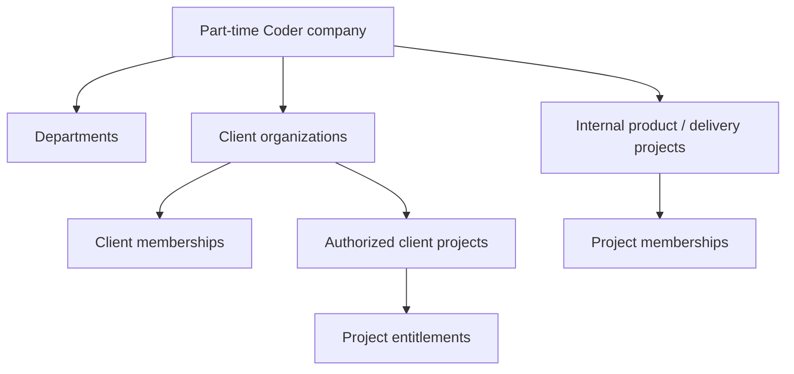
This is an access graph, not an implication that a client org member sees every project. A company employee may work on several projects; a client user may belong to multiple client organizations, but explicit selection/entitlement applies to every access. Switching workspace changes UI context, not privileges.

### 6.2 Effective-access pseudocode
```ts
async function mayReadClientDeliverable(actor: ActorContext, deliverableId: string) {
  requireActiveUser(actor);
  const memberships = await membershipRepo.activeClientMemberships(actor.userId);
  const allowedOrgIds = memberships.map(m => m.clientOrganizationId);
  const deliverable = await deliverableRepo.findOne({
    _id: deliverableId,
    clientOrganizationId: { $in: allowedOrgIds },
    visibility: 'client_visible',
    status: { $in: ['ready_for_client', 'changes_requested', 'accepted'] },
  });
  if (!deliverable) return { allowed: false as const };
  const projectAllowed = await projectAccess.mayReadClientProject(
    actor, deliverable.projectId, deliverable.clientOrganizationId
  );
  return projectAllowed ? { allowed: true as const, deliverable }
    : { allowed: false as const };
}
```
Do not return data based on role string alone. `projectAccess` verifies the selected org *and* project's explicit client access policy or project membership. Similar scoping applies to `comments`, `clientFeedback`, `mediaAssets`, `invoices`, `notifications`, search, exports and analytics. An ID from another organization must return non-enumerating denial and never reveal title/filename/billing amount through errors or timing-sensitive listings.

### 6.3 Permission matrix (illustrative resource actions)
| Actor | Company config | Leads | Projects/tasks | Client deliverables | Finance | Social drafts | Social approve/publish |
|---|---|---|---|---|---|---|---|
| Owner | Full, protected | Company-wide | Company-wide | Full (authorized) | Full | Full | Full with step-up/policy |
| Admin | Delegated | Delegated | Delegated | Scoped | Explicit finance grant only | Delegated | Explicit social permission |
| Project Manager | None | Assigned intake when granted | Assigned projects | Release assigned deliverables | Limited quotes if granted | Optional creator | No default approval |
| Employee/Staff | None | None by default | Assigned tasks/projects | Upload only as assigned | None by default | Optional creator | No default approval |
| Finance Manager | None | Quote context | Linked projects metadata | None by default | Delegated | None by default | None |
| Marketing Manager | None | None by default | Public case-study-approved data | No internal client file access by default | None | Campaigns/accounts | Approved reviewer/publisher role |
| Content Creator | None | None | No automatic project access | None | None | Own/assigned drafts | Cannot self-approve by default |
| Client Admin | None | Own request summaries | Authorized own projects | Own released deliverables | Own issued allowed docs | None | None |
| Client Member | None | Own permitted requests | Explicit project grants | Own released deliverables | Own permitted docs only | None | None |
| Registered User | None | Own inquiry status if feature enabled | None | None | None | None | None |
| Guest | None | Public inquiry submit | None | None | None | None | None |

Access checks must also consider **object state** and step-up freshness. Social account connection and privileged role grants require stronger authentication and audit. Client admin's grant scope cannot be broader than own client organization; owner protections prevent zero remaining active owners.

### 6.4 Data-leak prevention controls
- Query builders REQUIRE a scope object; never accept a bare collection-wide query from client/employee controllers unless grant permits it.
- Safe serializers are positive allowlists per actor/audience; no spread of Mongoose documents into DTOs.
- No unscoped `.populate()` on references that reveal other client records. Resolve child records through scoped queries or review population match/filter rules carefully.
- Search and analytics filters prepend mandatory tenant/project membership and visibility predicates; user-provided filters can narrow, not widen scope.
- Short-lived signed URLs are issued only after fresh access check, with restricted object key and expiration. Provider URL alone must not grant indefinite access.
- On staff/client revocation, cached grants/session permissions and active upload intents must be invalidated or constrained according to immediate revocation policy.
- Background worker jobs validate current account state, integration permission and ownership before external side effects.

---
## 7. Index catalog, partial uniqueness and TTL rules

All indexes must be installed by controlled migration and verified with MongoDB `listIndexes`; Mongoose `schema.index()` is documentation/code declaration but is **not** authorization to auto-build in production. Query profiling with representative **scoped** fixtures should validate chosen key order. Keep `_id` implicit primary indexes.

### 7.1 Uniqueness and primary query indexes
| Collection | Index name | Key pattern | Unique / partial | Purpose |
|---|---|---|---|---|
| `users` | `uq_users_firebase_uid` | `{firebaseUid:1}` | Unique | Immutable Firebase identity |
| `users` | `ix_users_status_updated` | `{status:1,updatedAt:-1}` | No | Admin review |
| `roleGrants` | `uq_role_grant_active` | `{userId:1,roleKey:1,scopeType:1,scopeId:1}` | Unique, `active:true` | At most one active matching grant |
| `roleGrants` | `ix_role_grants_scope` | `{scopeType:1,scopeId:1,revokedAt:1}` | No | Scope grant enumeration |
| `invitations` | `uq_invite_token_hash` | `{tokenHash:1}` | Unique | Invitation collision/replay safety |
| `invitations` | `ix_invite_target_status` | `{inviteeEmailNormalized:1,status:1,expiresAt:1}` | No | Controlled lookup; expiry not permission |
| `companies` | `uq_company_provisioning_key` | `{provisioningKey:1}` | Unique | Single operator provision; do not expose create API |
| `departments` | `uq_department_code_active` | `{companyId:1,code:1}` | Unique | Stable department code; archived codes reserved |
| `companySettings` | `uq_settings_company` | `{companyId:1}` | Unique | Exactly one settings document |
| `clientOrganizations` | `uq_client_org_slug_active` | `{companyId:1,slug:1}` | Unique | Client org slugs reserved, even if archived |
| `clientMemberships` | `uq_client_member_active` | `{clientOrganizationId:1,userId:1}` | Unique, `active:true` | At most one active membership |
| `clientMemberships` | `ix_membership_user_active` | `{userId:1,status:1,clientOrganizationId:1}` | No | User's available client orgs |
| `leads` | `ix_lead_status_owner` | `{companyId:1,status:1,ownerId:1,createdAt:-1}` | No | CRM work queue |
| `leads` | `ix_lead_contact_recent` | `{companyId:1,normalizedContact:1,createdAt:-1}` | No | Flag *possible* duplicates, never force merge |
| `leads` | `uq_converted_project` | `{convertedProjectId:1}` | Unique, partial `{convertedProjectId:{$type:"objectId"}}` | Prevent one project linked to multiple leads when policy prohibits |
| `leadActivities` | `ix_lead_activity` | `{leadId:1,happenedAt:-1}` | No | Paginated lead history |
| `quotations` | `uq_quote_revision` | `{companyId:1,quoteNumber:1,revision:1}` | Unique | Stable legal quote versions |
| `projects` | `uq_project_code` | `{companyId:1,code:1}` | Unique | Internal project reference |
| `projects` | `ix_project_client_status` | `{clientOrganizationId:1,status:1,updatedAt:-1,_id:1}` | No | Client project list |
| `projects` | `ix_project_manager_status` | `{managerId:1,status:1,updatedAt:-1}` | No | PM dashboard |
| `projectMemberships` | `uq_project_member_active` | `{projectId:1,userId:1,memberType:1}` | Unique, `active:true` | Explicit project authorization |
| `projectMemberships` | `ix_project_member_user` | `{userId:1,status:1,projectId:1}` | No | Employee/client accessible project IDs |
| `tasks` | `ix_task_project_status` | `{projectId:1,status:1,dueAt:1,_id:1}` | No | Task board / stable cursor |
| `tasks` | `ix_task_assignee_due` | `{assigneeId:1,status:1,dueAt:1,_id:1}` | No | My tasks |
| `milestones` | `ix_milestone_project_order` | `{projectId:1,sortOrder:1,_id:1}` | No | Project timeline |
| `deliverables` | `ix_deliverable_client_release` | `{clientOrganizationId:1,projectId:1,status:1,releasedAt:-1}` | No | Client-safe published deliverables |
| `comments` | `ix_comment_thread_visibility` | `{projectId:1,deliverableId:1,visibility:1,createdAt:1}` | No | Authorized thread retrieval |
| `services` / `ownedProducts` / `articles` / `caseStudies` | `uq_<type>_slug_active` | `{companyId:1,slug:1}` | Unique | Stable reserved slugs; archived URLs do not get silently reassigned |
| `contentRevisions` | `uq_content_revision` | `{contentType:1,contentId:1,revision:1}` | Unique | Immutable content snapshots |
| `mediaAssets` | `ix_media_scope_status` | `{clientOrganizationId:1,projectId:1,status:1,createdAt:-1}` | No | Authorized media browsing |
| `mediaAssets` | `uq_storage_object` | `{provider:1,storageKey:1}` | Unique | Storage object identity |
| `socialAccounts` | `uq_social_account_provider_identity` | `{companyId:1,provider:1,providerAccountId:1}` | Unique | Prevent duplicate account onboarding |
| `integrationCredentials` | `ix_credential_account` | `{socialAccountId:1,revokedAt:1}` | No; add unique active when one-to-one topology approved | Secret lookup under worker-only policy |
| `campaigns` | `ix_campaign_owner_updated` | `{companyId:1,ownerId:1,updatedAt:-1}` | No | Marketing dashboard |
| `postVariants` | `ix_variant_campaign_target` | `{campaignId:1,socialAccountId:1,updatedAt:-1}` | No | Target variants/history; no blanket uniqueness since revisions/drafts may coexist |
| `postVariants` | `ix_variant_review_queue` | `{companyId:1,status:1,updatedAt:1}` | No | Review queue |
| `contentApprovals` | `ix_approval_variant_revision` | `{variantId:1,revision:-1,reviewedAt:-1}` | No | Audit review history |
| `publishJobs` | `uq_publish_job_operation` | `{variantId:1,approvedRevision:1,socialAccountId:1,operationKey:1}` | Unique | Local dispatch idempotency |
| `publishJobs` | `ix_publish_jobs_due` | `{state:1,runAt:1,_id:1}` | No | Due job claim |
| `publishJobs` | `ix_publish_jobs_lease` | `{state:1,leaseUntil:1}` | No | Recovery monitoring |
| `publishAttempts` | `uq_publish_attempt_number` | `{jobId:1,attemptNumber:1}` | Unique | One numbered attempt per job |
| `publishAttempts` | `ix_publish_attempt_provider_id` | `{provider:1,providerRequestId:1}` | Partial `{providerRequestId:{$type:"string"}}` | Reconciliation by provider request ID |
| `metricSnapshots` | `ix_metric_post_period` | `{socialAccountId:1,postVariantId:1,metricKey:1,collectedAt:-1}` | No | Historical analytics |
| `invoices` | `uq_invoice_number_company` | `{companyId:1,invoiceNumber:1}` | Unique, partial `{invoiceNumber:{$type:"string"}}`; see note | No collision under concurrent issue |
| `invoices` | `ix_invoice_client_status` | `{clientOrganizationId:1,status:1,issuedAt:-1,_id:1}` | No | Client invoice listing |
| `paymentRecords` | `ix_payment_invoice_time` | `{invoiceId:1,effectiveAt:1,_id:1}` | No | Reconstruct balances |
| `paymentRecords` | `uq_payment_command` | `{companyId:1,idempotencyRef:1}` | Unique, partial `{idempotencyRef:{$type:"string"}}` | No double recording |
| `notifications` | `ix_notification_user_read` | `{recipientUserId:1,status:1,createdAt:-1,_id:1}` | No | Private notification inbox |
| `auditEvents` | `ix_audit_actor_time` | `{actorId:1,occurredAt:-1}` | No | Incident audit |
| `auditEvents` | `ix_audit_subject_time` | `{resourceType:1,resourceId:1,occurredAt:-1}` | No | Resource history |
| `outboxEvents` | `uq_outbox_event_id` | `{eventId:1}` | Unique | Exactly one event identity |
| `outboxEvents` | `ix_outbox_due` | `{state:1,availableAt:1,_id:1}` | No | Background queue |
| `idempotencyRecords` | `uq_idempotency_scope_command` | `{scope:1,command:1,keyHash:1}` | Unique | Response replay safety |
| `featureFlags` | `uq_feature_flag_env` | `{environment:1,key:1}` | Unique | Separate staging/production toggles |
| `counters` | `uq_counter_scope_kind_period` | `{companyId:1,kind:1,periodKey:1}` | Unique | Atomic sequence allocation |
| `schemaMigrations` | `uq_migration_name` | `{name:1}` | Unique | Applied migrations registry |

**Index clarification:** conditional `invoiceNumber` uniqueness should use a partial index restricted to BSON string type, or allocate invoice number at invoice creation if all invoices always have a number. Choose and test one consistent approach; never rely on `unique` across many absent draft invoice numbers. Similarly, `companies.provisioningKey`, `postVariants.companyId` and `paymentRecords.companyId` must be included in finalized model definitions if the listed indexes are adopted. The field registry is the complete source of intended data; code examples show selected slices only. Apply MongoDB-supported partial filter operators (`$exists:true`, `$type`, equality) in exact syntax appropriate to the selected server version; **`$exists:false` is not supported in partialFilterExpression**; do **not** assume a partial index combining all desired predicates can always be expressed.

### 7.2 TTL, retention and soft-delete policy
| Collection / field | TTL treatment | Reason / guard |
|---|---|---|
| `invitations.expiresAt` | Do **not** auto-delete if acceptance/revocation audit evidence must persist; optionally TTL separate ephemeral invite tokens | Expiration checked in business logic regardless of TTL lag |
| `idempotencyRecords.expireAt` | Candidate TTL `{ expireAt:1 }` with `expireAfterSeconds:0` | Retain longer than longest valid replay and provider reconciliation window; confirm policy first |
| `sessionSecurityEvents` | Retention policy and legal review before TTL | Security investigations and account revocation evidence |
| `notifications.expiresAt` | Candidate TTL after product/legal approval, excluding retention-required records | User read status not security source of truth |
| `emailJobs` | Lifecycle purge after terminal state, retention/export review | Never purge unprocessed/retry work by time alone |
| `publishAttempts`, `publishJobs` | **No automatic TTL in MVP** | Proven publication history and dispute recovery |
| `auditEvents`, `paymentRecords`, `issued invoices` | **Never automatic TTL without approved retention/legal policy** | Integrity, finance, forensic requirements |
| `mediaAssets` | Lifecycle-managed delete in storage **and** DB | Must check references, backups and release state |
| `outboxEvents` | No TTL for unfinished/dead-letter; completed records can archive under approved policy | Avoid losing required delivery evidence |
| `leads`, `clientContacts` | Deletion/anonymization request workflow, not default TTL | Consent, legal hold and relationship history |

**TTL facts:** TTL deletion is asynchronous and is not an authorization enforcement mechanism. Invitation/session expiry must be checked **on every use**. Unique indexes are still needed even if TTL index exists. A `deletedAt` filter is mandatory for soft-deletable resources; soft deletion does not automatically hide records from company forensic exports or audit reviewers.

### 7.3 Index migration guardrails
Before applying unique constraints: detect duplicates (including normalized names, active vs revoked, missing fields), resolve them through approved remediation, create index in staging, run concurrency tests, inspect query plans, then deploy with rollback. Avoid building a duplicate `unique` index in code and migration with conflicting names/options. On Atlas Free, observe collection/index storage quotas and do not add speculative indexes to every field.

---

## 8. Transactions, consistency, idempotency, and external side effects

### 8.1 Transaction boundaries
| Command | Atomic documents | Failure behavior | Required identifiers |
|---|---|---|---|
| Register/invite accept | `users`, `invitations`, scoped grant/membership, `auditEvents`, `outboxEvents` | Invite remains usable or marks accepted exactly once; no partial grant | invitation ID + token hash, actor |
| Grant/revoke role | `roleGrants`, `users.authzRevision`, `auditEvents`, `outboxEvents` | No silent stale privilege; prevent last-owner deletion | affected principal + scope + command ID |
| Convert lead | `leads`, `clientOrganizations` (if new), `projects`, `auditEvents`, `outboxEvents`, idempotency | Retry returns same conversion; no orphaned project | lead + operation key |
| Publish CMS revision | `contentRevisions`, CMS root record, `auditEvents`, `outboxEvents` | Draft remains draft or published snapshot consistent | content revision + expected version |
| Release deliverable | `deliverables`, authorized asset linkage, `activityEvents`, `auditEvents`, `outboxEvents` | Client never sees partially published private file | project + release revision |
| Approve social variant | `contentApprovals`, `postVariants`, audit/outbox | Exact hash/revision approved; stale conflict | variant+revision+reviewer |
| Schedule social job | `postVariants`, `publishJobs`, audit/outbox, idempotency | No orphaned approved schedule or duplicate job | variant+hash+target+operation key |
| Issue invoice | `counters`, `invoices`, audit/outbox, idempotency | No double number or partially issued document | company + invoice ID + issue key |
| Record payment/reversal | `paymentRecords`, `invoices` aggregate, audit/outbox, idempotency | Balance matches ledger or transaction rolls back | invoice + payment command key |
| Request protected export | `dataExportRequests`, audit/outbox | No export without recorded authorization/approval | actor+scope+export key |

**MongoDB transaction example:**
```ts
await mongoose.connection.transaction(async session => {
  const invoice = await Invoice.findOne({
    _id: invoiceId, companyId, status: 'draft', version: expectedVersion,
  }).session(session);
  if (!invoice) throw new ConflictOrNotFoundError();
  await financePolicy.requireIssuePermission(actor, invoice, { session });

  const number = await invoiceNumberService.allocate({ companyId, session });
  const snapshot = financeService.buildValidatedIssuedSnapshot(invoice, number);
  const updated = await Invoice.findOneAndUpdate(
    { _id: invoiceId, companyId, version: expectedVersion, status: 'draft' },
    { $set: snapshot, $inc: { version: 1 } },
    { session, new: true, runValidators: true }
  );
  if (!updated) throw new StaleVersionError();
  await AuditEvent.create([auditForInvoiceIssue(actor, updated)], { session });
  await OutboxEvent.create([outboxForInvoiceIssued(updated)], { session });
  // Idempotency completion belongs to this consistency boundary.
}, { readPreference: 'primary', writeConcern: { w: 'majority' } });
```
The example omits idempotency record acquisition/commit code, preflight checks and retry orchestration for readability; a production command MUST include them. **Do not perform external network calls within a MongoDB transaction.** Transaction retries must not regenerate external side effects. Use the outbox for mail, social dispatch, search indexing and cache invalidation.

### 8.2 Local idempotency protocol
1. Client or service sends a high-entropy key; server computes hash and canonical request fingerprint.
2. Scope key to actor/organization and command; acquire unique record atomically.
3. If key exists with same fingerprint and completed status, return saved safe result (or stable created resource pointer); if processing, return controlled `409`/`202`; if fingerprint differs, `409`.
4. Execute domain transaction and finalize record in same logical consistency boundary; a crash before commit must be retryable without duplicate business effects.
5. Purge only after applicable policy window; idempotent operational events may require permanent business key regardless of TTL record.

### 8.3 Concurrency controls and update strategy
- Every user-editable aggregate has an explicit integer `version`. `PATCH` actions supply `If-Match` or expected version; update filter includes `_id`, required authorization scope, state and expected version; `$inc: {version:1}` on success.
- Approval records refer to **content revision + hash**. A stale edit must not mutate content that has already been approved and scheduled without invalidating approval and canceling/quarantining the job.
- For invoice issuance, numbering and payments, no blind last-write-wins behavior. Unique indexes catch races; service classifies duplicate conflicts safely and retries boundedly.
- Worker lease fields are fenced with `leaseToken` to prevent stale state writes; old workers cannot finalize after lease theft/reassignment.
- Paged queries use stable `(updatedAt,_id)` or `(dueAt,_id)` sort and scoped cursor; no unbounded `find`/`skip` on growing collections.
- Request-scoped DB session and permission evaluation should not rely on stale replicas for sensitive mutation decisions.

### 8.4 External side-effect consistency
An accepted HTTP `202` means **queued**, not completed. Social dispatch, email and analytics are at-least-once attempted under bounded/reconciled delivery semantics. A successful DB transaction cannot atomically commit with YouTube/X/Meta/TikTok; therefore third-party idempotency support, durable attempts, unknown-outcome states, and human reconciliation are required. Publication records must preserve: `requestedAt`, `sentAt?`, `providerConfirmedAt?`, `providerId?`, `manualReportedAt?`, sanitized error codes and retry/reconciliation action. Never equate manual reported publication to API verification.

### 8.5 Outbox architecture
```mermaid
sequenceDiagram
  autonumber
  participant U as API actor
  participant A as API service
  participant D as MongoDB transaction
  participant W as Worker
  participant P as External provider
  U->>A: Command with idempotency key
  A->>D: Persist domain state, audit and outbox atomically
  D-->>A: Commit
  A-->>U: 201/202 + stable reference
  loop Controlled polling
    W->>D: Claim pending event/job (lease token)
  end
  W->>P: Call approved external API if safe
  alt Definitive success
    P-->>W: Provider ID / success
    W->>D: Persist confirmed outcome + attempt
  else Explicit failure
    P-->>W: Validation, permission or rate-limit failure
    W->>D: Retry wait/manual required/final error
  else Ambiguous timeout
    W->>D: unknown_outcome; reconciliation required
  end
```

---

## 9. Social publishing state machines and provider capability schema

### 9.1 Per-variant review state
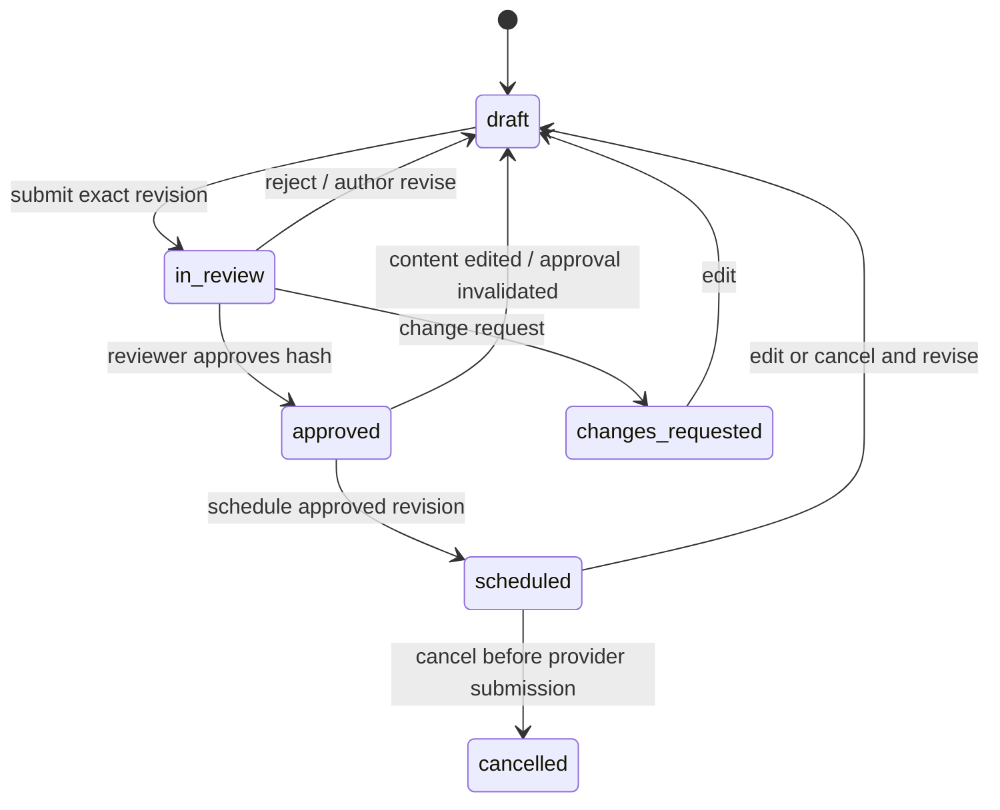
`cancelled` here means scheduling eligibility ended, not that a previously published external post was deleted. Variant status is about preparation/approval; `publishJobs` capture actual provider-facing outcomes.

### 9.2 Publish job state
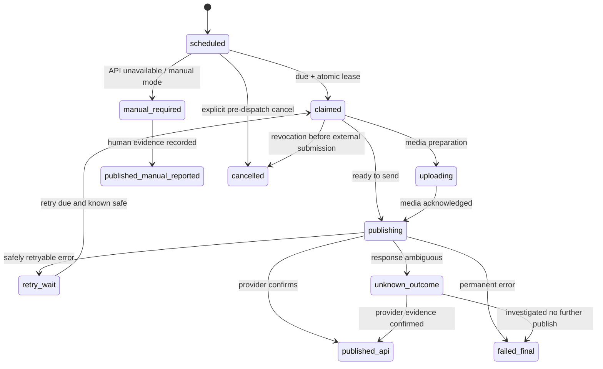
A failed reconciliation may transition `unknown_outcome` to an explicitly reviewed safe retry path only after documented evidence that no provider post exists. Do not implement such a transition as an automatic timeout policy. Each transition is performed with state+version+lease predicates as applicable and emits structured audit/action history.

### 9.3 Provider capability record
```ts
type ProviderCapability = {
  provider: 'facebook'|'instagram'|'linkedin'|'youtube'|'x'|'tiktok';
  accountId: string;
  actions: {
    textPost: 'supported'|'unsupported'|'unknown';
    imagePost: 'supported'|'unsupported'|'unknown';
    videoPost: 'supported'|'unsupported'|'unknown';
    schedule: 'supported'|'unsupported'|'unknown';
    analytics: 'supported'|'unsupported'|'unknown';
  };
  permissionCodes: string[];
  approvalState: 'approved'|'pending_review'|'denied'|'unknown';
  checkedAt: Date;
  expiresAt?: Date;
  reasonCode?: string;
  budgetAllowed: boolean;
};
```
**Capability computation:** global integration gate ∩ provider app approval ∩ account type ∩ granted scopes ∩ actual supported media/format ∩ account health ∩ budget/quota gate ∩ environment flag. This result is rechecked at schedule AND execution. UI uses same surfaced reason codes, but server is authoritative. If provider API changes invalidate a previously valid post, mark affected schedule `manual_required` or hold for review; do not silently drop it.

### 9.4 Credential encryption and OAuth records
- OAuth connect flow uses verified authorization request state, PKCE where applicable, allowlisted callback URL, strict environment matching and short-lived one-time server-side initiation record.
- Store refresh/access material only as authenticated encryption ciphertext with key ID/version and associated data binding to company/provider/account/credential purpose; keys live outside MongoDB in server secret/KMS capability.
- Minimize database roles able to read `integrationCredentials`; web response serializers never select ciphertext, encrypted keys or refresh material.
- Token refresh executes with per-account coordination to avoid concurrent refresh races; rotation records old credentials securely retired, and failure updates `needs_reauth` with safe reason.
- Disconnect/revoke should stop eligible future jobs or move them to manual/blocked mode, invalidate cached capabilities and record audited action.
- Never claim API publishing for personal Facebook profiles or other unsupported account classes. Specific providers' requirements are gated by tested official API access and owner acceptance.

### 9.5 Social outcome truth table
| DB state | What UI may say | May retry automatically? | Evidence |
|---|---|---|---|
| `scheduled` | Scheduled, not yet published | Not a retry; initial eligible run | Approved hash + due time |
| `claimed` / `publishing` | Processing | Only through fenced recovery | Lease + attempt preflight |
| `published_api` | Published — verified via platform API | No | Provider ID/result |
| `published_manual_reported` | Manually marked published; not API-verified | No | Actor, timestamp, link/evidence |
| `manual_required` | Requires manual publishing | No API retry until newly approved flow | Capability reason |
| `retry_wait` | Failed temporarily; retry scheduled | Yes, **only known non-publication** | Explicit retryable failure |
| `unknown_outcome` | Publication outcome unconfirmed; action required | **No** blind retry | Timeout/ambiguous attempt trace |
| `failed_final` | Could not publish; review error | No without new operator action | Error reason, attempt history |
| `cancelled` | Cancelled before publish | No | Cancellation actor and safe cutoff |

---

## 10. Finance, CMS and delivery lifecycle integrity

### 10.1 Lead and client conversion
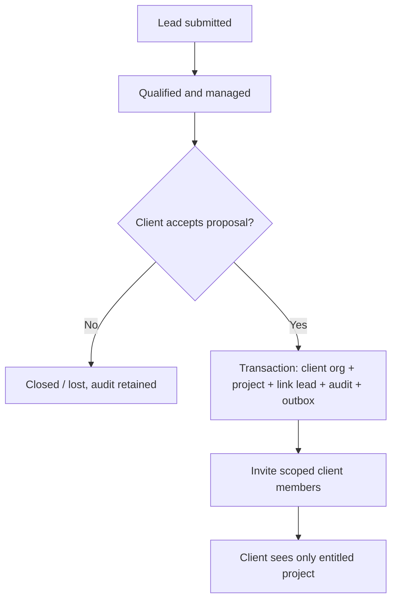
A lead may be linked to an existing client organization only after authorized user chooses and validates it; email similarity is only a signal, never automatic proof. Conversions honor consistent client/user identity without cross-org data merges.

### 10.2 Project / deliverable visibility
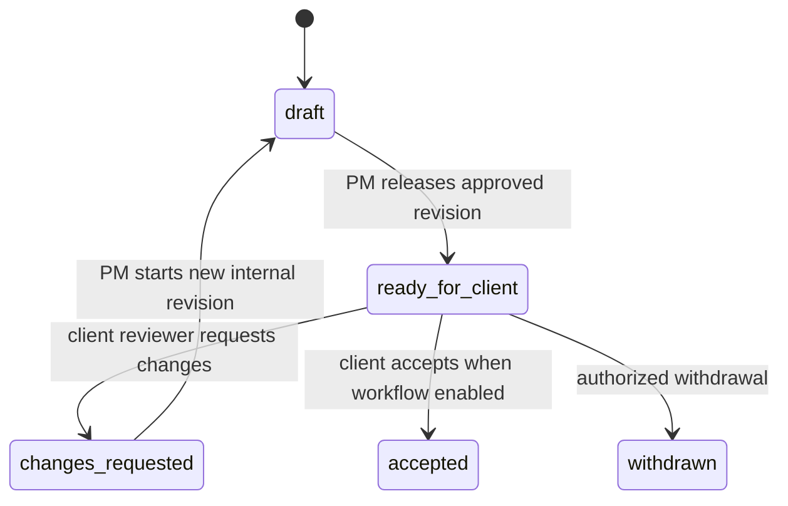
If formal client signoff is post-MVP, `accepted` is a tracked feedback/acknowledgment status only when the actual workflow has been implemented and approved; never misrepresent it as a legally binding e-signature. Attachment references are frozen at released revision. Draft revisions never become visible simply because the client knows the `_id`. Client feedback is a separate resource referencing the released deliverable and triggers internal notifications through outbox.

### 10.3 CMS release and privacy
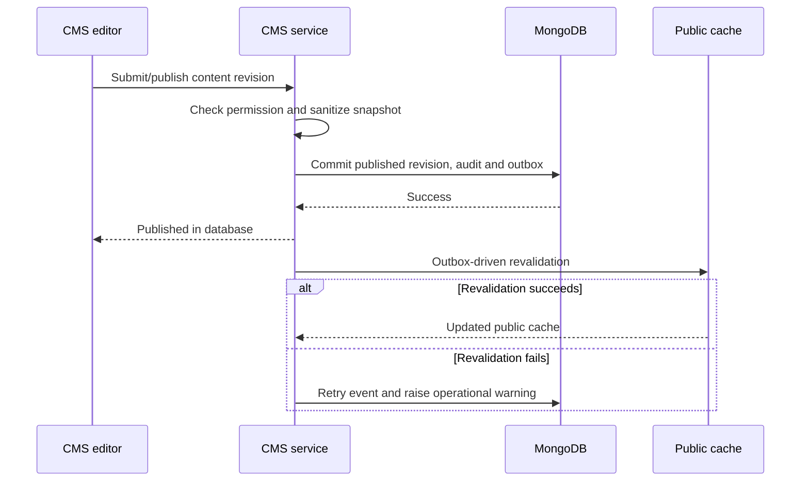
Index only published snapshots in the public search/sitemap. Sensitive CMS previews are authorized per request and not stored in public cache. A public case study can reference an internal project ID for editorial traceability, but public renderer **never** populates the internal project and spreads all fields.

### 10.4 Finance balance rules and reversal
```text
issued_total_minor = sum(verified_line_minor) - discount_minor + tax_minor
net_received_minor = sum(payment_entries) - sum(reversal_entries)
balance_minor = issued_total_minor - net_received_minor

INVARIANTS:
  issued_total_minor >= 0
  balance_minor >= 0 unless approved credit/overpayment policy exists
  payment_entry.currency == invoice.currency (or explicit FX settlement policy)
  invoice.issuedSnapshot immutable after issue
  voided invoice cannot accept new payment
  all reconciliation uses exact integer/decimal arithmetic
```
Credit notes, refund workflows, gateway settlements and regulated tax calculations are future requirements unless an approved change introduces them. `rateDecimal` should use BSON Decimal128 with unambiguous rounding conventions and preserve rate source/time. Never silently convert an already issued SAR invoice to USD with today's exchange rate.

---

## 11. Data classification, lifecycle and reference cleanup

### 11.1 Classification and scope matrix
| Data | Default class | Visible to | Key prohibition |
|---|---|---|---|
| Service/product/articles public snapshot | PUBLIC | All visitors | Draft/private revisions excluded |
| Staff user directory and project work | INTERNAL | Explicit employees/managers/admins | Client access forbidden by default |
| Lead contact details | PERSONAL | Authorized CRM personnel | No global employee browse |
| Client org/project/deliverable | CLIENT_CONFIDENTIAL | Assigned staff and authorized client users | No cross-org list/search/export |
| Quotation/invoice/payment | FINANCIAL | Finance-authorized staff, explicitly permitted client views | Internal margins, costs and payments protected |
| Firebase UID/session revision | PERSONAL / SECURITY | Identity/auth service, authorized admins | Never use frontend-only role enforcement |
| Social credential ciphertext | CREDENTIAL | Integration service principal only | Never log or deliver to browser |
| Audit trail | AUDIT | Owner/security auditors | No silent editing or arbitrary purge |
| Pending media | CLIENT_CONFIDENTIAL or INTERNAL | Uploader and authorized verifier | Never publish before validation |

### 11.2 Deletion, archival and orphan rules
| Parent | Child / reference handling | Deletion or retention policy |
|---|---|---|
| User | Grants, memberships, comments, invoices, audit | Suspend/revoke first; personal data export/anonymization review; preserve legally required authored events |
| Client organization | Projects, invoices, files, members, contacts | Block hard delete while active; archive and apply retention/legal hold |
| Project | Tasks, milestones, deliverables, files, comments | Soft archive; do not cascade-delete active financial or client release evidence |
| Social account | Credentials, variants, jobs, metrics | Revoke credentials; block due jobs; retain sanitized publication history per approved policy |
| Campaign | Variants, approvals, jobs, metrics | Archive; block deletion if in-flight or history required |
| Post variant | Approvals, publish jobs | Preserve revision/approval linkage; new edits append/increment rather than rewrite approved history |
| CMS item | Revisions, assets, sitemaps | Unpublish first; purge only after reference check and cache revalidation |
| Media asset | Project/deliverable/CMS/social usage | Remove all eligible links and storage object after lifecycle/hold gate |
| Invoice | Payments and issued snapshot | No hard delete during statutory retention; void/correct with evidence |
| Notification | Scoped deep-link | Can expire, but underlying resource authorization evaluated again |

### 11.3 Retention decision worksheet (policy approval required)
| Category | Suggested operational strategy (NOT a legal retention period) | Owner decision needed |
|---|---|---|
| Public inquiries | Consent-aware minimization and aging review | Applicable privacy law, lead retention duration |
| Client files | Access-controlled lifecycle with backups and legal holds | Contract period, deletion entitlement and notice |
| Staff account data | Retain only necessary employment/admin data | Jurisdiction, offboarding duration |
| Social credentials | Revoke/delete on disconnect and token rotation | Security operational window |
| Social publishing history | Preserve provider outcome records for disputes/reconciliation | Retention, audit and reporting expectations |
| Financial records | Immutable and retained until lawful removal allowed | Company registration country, tax/accounting law |
| Audit and security events | Integrity-protected, restricted archive | Legal retention, security investigations |
| Notifications | Expire safely after chosen product window | Customer preference and privacy policy |
| Idempotency/retry records | Retain beyond maximum retry/dispute window | Business TTL based on provider semantics |

**Important:** No specific deletion interval should be marked as legally compliant merely because it appears reasonable. Saudi, Bangladeshi or other applicable rules require qualified jurisdiction-specific review. Backups require separate policies for deletion requests, restore contamination prevention, encryption, and operational expiration. Users must not be promised deletion from third-party platforms when the app only deletes its own local records.

### 11.4 Export and privacy requests
Verify requester identity and purpose, evaluate permitted scope, create audited `dataExportRequests`, queue encrypted export generation, store result as protected short-lived asset, and notify only authorized requester. Handle deletion requests with review/legal-hold states and recorded disposition. Exports must not include decrypted social tokens, internal-only client remarks, other organizations' files, or privileged internal logs by default. Large exports must be paginated/streamed through supervised worker, not materialized inside one HTTP request.

---

## 12. Schema migrations, versioning and deployment safeguards

### 12.1 Migration discipline
1. Name each migration `YYYYMMDDHHMM_descriptive_slug`, stored in Git with hash in `schemaMigrations`.
2. Design additive rollout: **add new optional field/index → dual-read or dual-write if needed → backfill in bounded batches → switch consumers → only then remove old field in later release**.
3. Migration code must be idempotent or resumable with checkpoints, count summaries, no secrets or PII in logs, and explicit expected pre/post conditions.
4. Production index creation and validation are separate deploy gates; `autoIndex=false` in production.
5. Before destructive operations, record backup ID and rehearse restoration in isolation. If replica set, transactions, index or quota capabilities differ from expectation, **stop** and use a documented ADR—not a silent correctness downgrade.
6. Update `/api/v1` contracts, serializers, Zod, DTOs, fixtures, diagrams, PRD trace entries and UI state behavior for each breaking semantic change.
7. Rollback includes both application and schema compatibility; do not roll back into code unable to read newly written records.

### 12.2 Migration example (illustrative)
```ts
// 202610140001_add_deliverable_release_revision.ts
export async function up(db: Db) {
  const col = db.collection('deliverables');
  const cursor = col.find({ releaseRevision: { $exists: false } },
    { projection: { _id: 1, revision: 1 } }).batchSize(200);
  for await (const row of cursor) {
    await col.updateOne(
      { _id: row._id, releaseRevision: { $exists: false } },
      { $set: { releaseRevision: row.revision ?? 1 } }
    );
  }
  await col.createIndex({ projectId: 1, releaseRevision: -1 },
    { name: 'ix_deliverable_release_revision' });
}
```
Production code must import concrete types/driver versions, log bounded checkpoints, apply retry safely and use an approved operations window. `down()` may be intentionally unsupported for destructive schema changes; document rollback as forward-compatible compensating migration.

### 12.3 Version boundaries
- REST major: `/api/v1`.
- MongoDB document `schemaVersion`: applied to outbox/events, polymorphic content and provider payload snapshots.
- Mutable aggregate `version`: optimistic edit counter, not document schema version.
- Social `revision`: semantic content version; `approvedHash` is exact approval identity.
- Provider adapter version: record for deterministic post validation/troubleshooting when constraints change.
- `auditEvents.action` and outbox event `type` are versioned semantic event names such as `social.variant.approved.v1`.

### 12.4 Database portability and scale
Use named repositories/adapters to isolate Mongoose details from domain services but do not build a general SQL abstraction in MVP. Monitor storage/index growth (especially audit and publishing history), slow scoped queries, worker lease contention, and Atlas capacity. Redis/BullMQ migration requires equivalent job history, fencing, state trace, and an ADR; a queue change must not erase business evidence.

---

## 13. Security threat controls and observability contracts

| Threat | Data control | Required evidence |
|---|---|---|
| Client A guesses Client B IDs | Scope keys + memberships + response DTO allowlists | Cross-org read/write/search/file/export tests |
| Staff self-grants owner permission | Server-controlled grant service, owner preservation + step-up | Negative privilege escalation tests |
| Stolen session after suspension | Server checks current account state/revocation | Revoked-session integration tests |
| OAuth token leak | Encrypted credential collection, secret redaction, least-privilege workers | Secret-scanner/log redaction tests |
| Upload malware or forged MIME | Upload intent, checksum verification, async validation, quarantine | Invalid type/oversize/unauthorized upload tests |
| Duplicate social post after timeout | `unknown_outcome`, provider reconciliation, fenced lease and attempt evidence | Inject network timeout after possible provider acceptance |
| Duplicate invoice issue/payment | Unique invoice sequence, transaction, idempotency records | Concurrent command tests |
| Stale content approval | Exact hash/revision check at schedule **and dispatch** | Edit-after-approval test |
| Forged provider webhook | Signature, timestamp/replay validation, scoped event idempotency | Bad signature/replay tests |
| Audit tampering | Restricted append-only application layer and independent backup | Authorized access checks / tamper alert drill |
| Unsafe public CMS content | Sanitized, allowlisted snapshot; draft-private cache | XSS and draft leak tests |

### 13.1 Audit event specification
Audit all auth/role changes, data access denials of interest, leads conversions, project client-visibility changes, deliverable releases, invoice issue/payment/void, social account connects/disconnects, approvals, reschedules, manual reported publication, provider unknown outcomes, deletions/exports, budget integration flag changes and critical configuration updates. Event fields follow TRD §10.3. Audit before/after snapshots are **redacted selections**, not full documents. An `integrityHash` or append-only external sink is recommended when feasible; absent that, do not claim cryptographic tamper-proofing.

### 13.2 Monitoring without PII leaks
Safe log fields: requestId, route template, action name, actor pseudonymous ID, company/org/project opaque IDs as needed, jobId, provider, elapsed time, outcome, sanitized error code, retry count. Do not log raw query bodies, client messages, social captions without purpose, emails, credential values, payment references containing secrets, upload access links or full provider responses. Operational dashboards expose job lag, eligible scheduled count, last worker heartbeat, dead letters, provider error rates, token-refresh failures, backup status, storage growth and bounded external API spend (PTC-OPS-004/007/008).

### 13.3 Production access separation
Distinct environment credentials, no staging/prod callback interchange, least-privilege MongoDB accounts, separate application/worker runtime secrets, manual owner-approved protected env changes, rotation playbooks, encrypted offsite restore, and tested emergency provider-token revocation. No commercial deployment on hosting terms prohibiting commercial use.

---

## 14. Mermaid entity-relationship diagrams

Mermaid ER notation here is conceptual; it does **not** enforce MongoDB foreign keys. Scope and business references must be validated through services and transactions.

### 14.1 Identity, organization and access
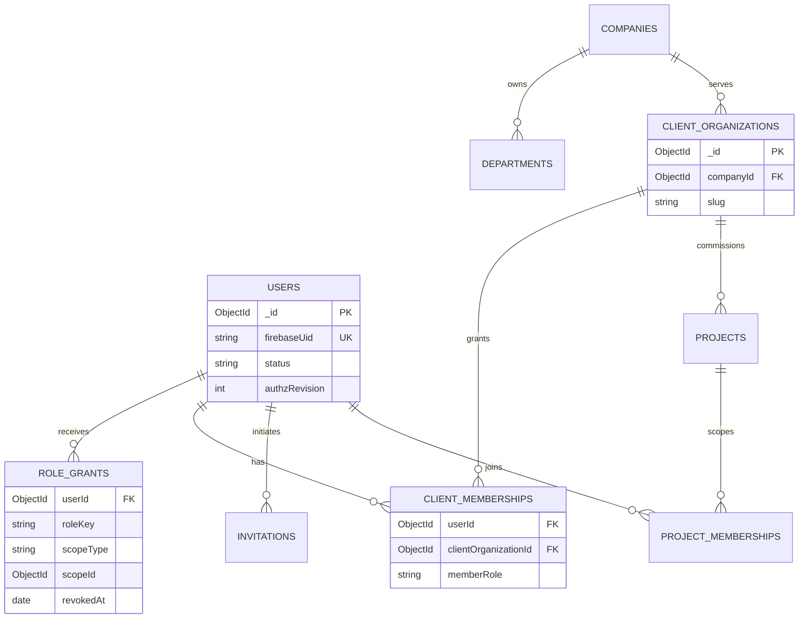

### 14.2 CRM, delivery, CMS and media
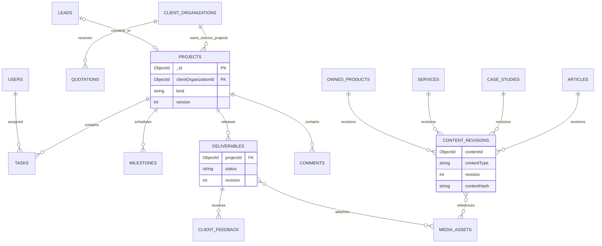

### 14.3 Social publishing and reporting
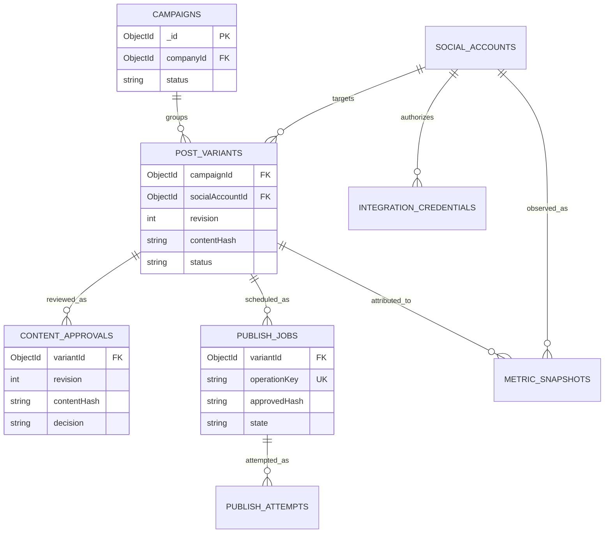

### 14.4 Finance, notifications and governance
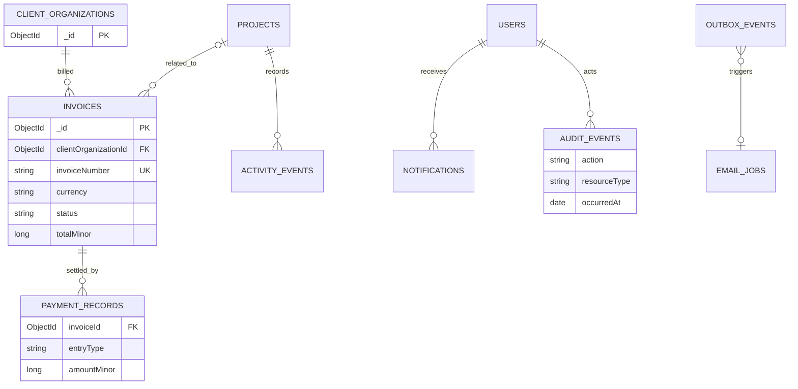

---
## 15. Backend acceptance test catalog

`BS-AT-###` cases below are proposed executable tests; this document does not claim they have run. Each test must be implemented with synthetic fixtures and recorded CI evidence. Cross-reference App Flow test IDs (AF acceptance catalog) and TRD domain contracts when the test suite is written. Unless noted otherwise, these tests are required by the MVP module gate when that module is in release scope.

### 15.1 Identity, roles and client isolation
| Test ID | Scenario | Expected result | Requirements |
|---|---|---|---|
| BS-AT-001 | Two users race to claim same verified Firebase UID | One `users` identity, unique index rejects duplicate; recovery returns existing profile | PTC-IAM-001/002 |
| BS-AT-002 | User changes email in Firebase | UID remains stable; no unauthorized invitation/role transfer | PTC-IAM-002/004 |
| BS-AT-003 | Suspended user sends previously valid cookie | Business query/mutation denied; revocation recorded | PTC-IAM-006, PTC-SEC-003 |
| BS-AT-004 | Staff attempts to grant self owner | Policy denies; no grant or partial audit event falsely claims success | PTC-IAM-003, PTC-SEC-001 |
| BS-AT-005 | Revoke last active owner | Transaction rejects and preserves one effective owner | PTC-IAM-010 |
| BS-AT-006 | Client A guesses Client B project `_id` | Non-enumerating denial; no fields, attachments or existence metadata | PTC-CLI-001/002, PTC-SEC-002 |
| BS-AT-007 | Client Admin invites member to foreign org | Denied before insert; no email job or grant | PTC-CLI-005, PTC-SEC-001 |
| BS-AT-008 | Client member belongs to two orgs | Selected org and project entitlement enforced independently | PTC-CLI-001/005 |
| BS-AT-009 | Removed project member uses old file URL | New private access denied; signed URL TTL restricted and revocation exposure documented | PTC-CLI-004, PTC-SEC-008 |
| BS-AT-010 | User probes foreign resource via search/export | Scope filters applied; zero leak in counts, hints, pagination and exports | PTC-SEC-002/011 |
| BS-AT-011 | `.populate()` includes internal project comment for client | Client serializer excludes; test fails on forbidden field | PTC-CLI-002/007, PTC-SEC-002 |
| BS-AT-012 | Concurrent invitation acceptance and revocation | Single winner, no duplicate active membership, audit/outbox consistent | PTC-IAM-004/006 |

### 15.2 CRM, projects, CMS, and media
| Test ID | Scenario | Expected result | Requirements |
|---|---|---|---|
| BS-AT-013 | Repeat lead form request using same idempotency key | One persisted lead; same stable confirmation | PTC-CRM-001, PTC-SEC-007 |
| BS-AT-014 | Two leads share email | Kept distinct; possible duplicate flag, never automatically merged | PTC-CRM-002, PTC-DATA-002 |
| BS-AT-015 | Parallel lead conversion retries | Exactly one linked client/project conversion outcome; correct activity/outbox | PTC-CRM-005/006 |
| BS-AT-016 | Project kind is internal product but linked to arbitrary client | Reject inconsistent kind/org fields | PTC-PRJ-001, PTC-DATA-001 |
| BS-AT-017 | Task assignee lacks active project membership | Reject assignment; no orphan notification | PTC-PRJ-003/004 |
| BS-AT-018 | Two staff update task same version | One succeeds, other gets stale-precondition failure | PTC-PRJ-004, PTC-NFR-011 |
| BS-AT-019 | Client requests draft deliverable by direct ID | Deny until authorized release; no associated media access | PTC-CLI-002/004 |
| BS-AT-020 | Client feedback against foreign deliverable | Reject; no internal PM notification for unauthorized action | PTC-CLI-003/007 |
| BS-AT-021 | Publish CMS content derived from internal confidential project | Only curated sanitized revision public; no internal budget/notes/files | PTC-CMS-002/003, PTC-SEC-002 |
| BS-AT-022 | CMS draft public slug direct request | No unpublished content/sitemap/index data disclosed | PTC-CMS-001/006 |
| BS-AT-023 | Media upload finalization with forged MIME or wrong hash | Asset quarantined/rejected, never publicly served | PTC-CMS-004, PTC-SEC-007/008 |
| BS-AT-024 | CMS publish succeeds but revalidation worker crashes | Published DB state consistent; durable retry raises cache warning | PTC-CMS-006, PTC-OPS-004 |

### 15.3 Six-provider social content and worker
| Test ID | Scenario | Expected result | Requirements |
|---|---|---|---|
| BS-AT-025 | Provider capability is unapproved/unknown | Draft remains usable; auto publish disabled; manual path visible | PTC-SOC-001/007/008 |
| BS-AT-026 | Post variant edited after approval | Hash/revision changes; approval invalid; eligible schedule blocked | PTC-SOC-003/004 |
| BS-AT-027 | Creator attempts self-approval | Denied by default; only audited explicit authorized override if enabled | PTC-SOC-004, PTC-SEC-005 |
| BS-AT-028 | Duplicate schedule command/key | One `publishJob` with exact target/revision, stable response | PTC-SOC-005/006 |
| BS-AT-029 | Worker crashes before provider submission | Lease recovery resumes if demonstrably safe, no duplicate outward post | PTC-SOC-006 |
| BS-AT-030 | Worker crashes after possible provider acceptance | Job `unknown_outcome`; no blind automatic retry | PTC-SOC-006/009 |
| BS-AT-031 | Two workers claim same due job simultaneously | One valid fenced lease; stale worker cannot finalize | PTC-SOC-006, PTC-OPS-004 |
| BS-AT-032 | Meta variant succeeds; LinkedIn is revoked; X costs exceed gate | Independent per-variant outcomes, actionable errors/manual mode, no lost drafts | PTC-SOC-007/009/015 |
| BS-AT-033 | Human marks TikTok video published | `published_manual_reported`, actor/evidence stored; NOT API-confirmed | PTC-SOC-008/009 |
| BS-AT-034 | `metricSnapshots` provider returns no metric | `not_available` and null; never display measured zero | PTC-SOC-012, PTC-ANA-006 |
| BS-AT-035 | OAuth state replay or cross-environment callback | Reject; no credential/account mutation | PTC-SOC-002, PTC-SEC-004 |
| BS-AT-036 | Secret/token appears in mocked provider error | No secret in audit, logs or HTTP response; redaction verified | PTC-SEC-004/009 |
| BS-AT-037 | Revoked credential while post is scheduled | Worker rechecks state and blocks, requests reauth/manual | PTC-SOC-002/006 |
| BS-AT-038 | Explicit cancellation races worker dispatch | State fencing prevents false cancellation after provider send; truthful outcome | PTC-SOC-014 |
| BS-AT-039 | Same caption distributed to six accounts | Six independently approved variants/jobs, no shared published boolean | PTC-SOC-003/009 |
| BS-AT-040 | DST-invalid/ambiguous local schedule | Explicit user resolution; immutable UTC instant stored | PTC-SOC-005, PTC-NFR-007 |

### 15.4 Finance, notifications, privacy and operations
| Test ID | Scenario | Expected result | Requirements |
|---|---|---|---|
| BS-AT-041 | Concurrent invoice issue requests | Unique invoice number; one immutable issue snapshot | PTC-FIN-002 |
| BS-AT-042 | Replayed manual payment | One valid entry; outstanding balance unchanged on retry | PTC-FIN-003 |
| BS-AT-043 | Payment reversal submitted with missing parent entry | Reject invalid relationship or over-reversal | PTC-FIN-003, PTC-SEC-005 |
| BS-AT-044 | SAR/BDT/USD rounding and FX historical snapshots | Integer/decimal exactness, preserved source and timestamp | PTC-FIN-001/005 |
| BS-AT-045 | Client tries own internal costs or foreign invoice | Only permitted issued-document DTO; no costs/margins | PTC-FIN-004/006 |
| BS-AT-046 | Notification recipient revoked from project | Notification deep link re-authorizes, denies stale access | PTC-COM-002/004 |
| BS-AT-047 | Outbox handler receives same event twice | Effect is idempotent; no duplicate invitation/project notice beyond policy | PTC-COM-003, PTC-OPS-004 |
| BS-AT-048 | TTL monitor delay after invitation expiry | App still refuses expired token immediately | PTC-IAM-004, PTC-SEC-003 |
| BS-AT-049 | Restore encrypted DB/media backup to isolated environment | No prod credentials leaked; RPO/RTO measured vs release target | PTC-OPS-005, PTC-NFR-006 |
| BS-AT-050 | Migration interrupted midway | Re-run finishes from checkpoint; no data duplication/loss | PTC-DATA-004, PTC-OPS-003 |
| BS-AT-051 | Migration unique index meets historical duplicates | Deployment aborts with remediation report before data mutations | PTC-DATA-001/004 |
| BS-AT-052 | Approved deletion request with financial legal hold | Non-required PII minimized; finance/audit retained per approved policy | PTC-SEC-011, PTC-DATA-005 |
| BS-AT-053 | Unauthorized export enumerates client files | Scope and authorization denied, logged safely | PTC-SEC-002/011 |
| BS-AT-054 | Worker stalled longer than healthy lag threshold | Alert fired, job remains durable, safe supervised recovery | PTC-OPS-004, PTC-NFR-007/010 |
| BS-AT-055 | Cost gate reached for metered API | Pause provider dispatch but preserve campaign drafts and pending evidence | PTC-SOC-015, PTC-OPS-007 |
| BS-AT-056 | Security incidents require event reconstruction | Time-ordered sanitized audit references and outbox/attempt evidence available | PTC-SEC-005/010 |

### 15.5 Test fixture and quality gates
Provide at least: one owner, two company managers with distinct grants, one marketing creator/reviewer pair, one finance operator, two independent client organizations with client admins/members, one multi-client user, three project types/states, private/internal/public media, six social account records (each with different capability health), a simulated social API acceptance timeout, invoice with partial payment and reversal, and an expired invitation. Use isolated ephemeral MongoDB replica-set-compatible test infrastructure for transactional tests; a standalone mock that does not support transactions is insufficient for financial/social gate evidence. Unit mocks must not replace DB uniqueness/concurrency tests.

**Release gates:**
- **G0 architecture:** transaction/unique-index capability verified; reference schema approved and initial retention/security decisions recorded.
- **G1 identity:** deny-by-default and owner preservation; tests 001–012.
- **G2 CMS/CRM:** publication privacy, lead conversion and media integrity; tests 013–024.
- **G3 delivery/client:** cross-org isolation, assignments and releases; tests 016–020.
- **G4 social:** approvals, unknown outcomes, worker recovery and manual fallback; tests 025–040.
- **G5 finance/operations:** exact money, invoices, notifications; tests 041–048.
- **G6 hardening:** migrations, recovery and cost/security drills; tests 049–056.
- **G7 production:** owner signoff on lawful hosting, provider gates, backup/restore, security report and operational readiness. Phase names are **proposed alignment**, not an alteration to a future implementation plan's final gate numbering.

---

## 16. Requirement traceability approach

### 16.1 Source-of-truth mapping
The PRD's 173 functional/nonfunctional requirement IDs are transcribed into §16.3 from the source PRD file, not invented. Domain-specific schema collections and tests implement supporting aspects of requirements, but the presence of a row in this document **does not** assert that the requirement is implemented. A requirement can require frontend, operational, policy or integration work beyond schema design.

| PRD area | Persistence and contract sections | Test evidence family |
|---|---|---|
| PTC-GOV | §§0–1, 12 | Governance change control and deployment reviews |
| PTC-PUB | §§3.2–3.3, 5, 10 | BS-AT-013, 021–024 |
| PTC-CMS | §§3.3, 5, 10 | BS-AT-021–024 |
| PTC-IAM / PTC-ORG | §§3.1, 4.2, 6, 7 | BS-AT-001–012 |
| PTC-CRM | §§3.2, 8, 10 | BS-AT-013–015 |
| PTC-PRJ / PTC-EMP | §§3.4, 4.3, 6 | BS-AT-016–020 |
| PTC-CLI | §§3.2, 3.4, 6, 11 | BS-AT-006–011, 019–020 |
| PTC-SOC / PTC-INT | §§3.5, 4.5, 9 | BS-AT-025–040 |
| PTC-FIN | §§3.6, 4.4, 8, 10 | BS-AT-041–045 |
| PTC-COM / PTC-ANA | §§3.6, 5, 13 | BS-AT-034, 046–047 |
| PTC-SEC / PTC-DATA | §§0, 6–8, 11–13 | All negative tests, esp. 006–012, 049–056 |
| PTC-NFR / PTC-OPS | §§7–8, 12–15 | Load, recovery, alert, migration and CI gates |

### 16.2 Per-requirement status vocabulary
- `Specified`: this backend document contains relevant data/schema design. Does **not** mean coded.
- `Supporting`: primarily UI, business policy, provider or operational requirement; backend design is an enabler.
- `Deferred`: explicitly post-MVP (`P1/F`, `P2/F`) unless owner-approved change.
- `Conditional`: third-party approved capability required; manual fallback may satisfy MVP.

**Engineering trace rule:** implementation PRs must list exact PRD IDs + backend sections + tests actually run; avoid blanket claims like “PTC-SOC-001–019 all complete” when only drafted/implemented partial functionality.

### 16.3 Exhaustive PRD-to-backend register

This appendix is generated from the current PRD requirement register; short statements are abbreviated to avoid duplicating the authoritative PRD prose. Complete priority, release classification and exact acceptance criteria remain in the PRD. Every listed ID is unique; additions/removals must be intentionally reconciled and reviewed.

| Requirement | PRD requirement summary | Backend coverage | Applicability |
|---|---|---|---|
| `PTC-ANA-001` | Admin overview: new/open leads, projects by status, overdue tasks, pending approvals, publishing failures / Widget numbers reconcile to scoped… | §§3.5–3.6, 9, 13 | MVP specification (not implemented) |
| `PTC-ANA-002` | Project workspace: my tasks, due soon, milestone completion, project activity / Data excludes unassigned/unauthorized work | §§3.5–3.6, 9, 13 | MVP specification (not implemented) |
| `PTC-ANA-003` | Marketing metrics: planned, approved, attempted, API-confirmed, manually reported and failed posts / Publish counts never collapse unknown… | §§3.5–3.6, 9, 13 | MVP specification (not implemented) |
| `PTC-ANA-004` | Client dashboard: approved milestone progress, open client feedback, deliverables / Data derived only from client-visible records | §§3.5–3.6, 9, 13 | MVP specification (not implemented) |
| `PTC-ANA-005` | Finance: invoices by status and outstanding balances for authorized finance users / Reports reconcile to financial records | §§3.5–3.6, 9, 13 | MVP specification (not implemented) |
| `PTC-ANA-006` | Instrument analytics/data quality diagnostics and metric timestamps / Empty/unsupported/late data shown distinctly from numeric zero | §§3.5–3.6, 9, 13 | MVP specification (not implemented) |
| `PTC-ANA-007` | Scheduled exports, campaign charts, lead conversion funnel, project profitability reports / Export follows identical authorization filters | §§3.5–3.6, 9, 13 | Deferred / supporting |
| `PTC-ANA-008` | AI-generated management summaries and forecasts with source attribution / No fabricated company figures; reviewable inputs | §§3.5–3.6, 9, 13 | Deferred / supporting |
| `PTC-CLI-001` | Client landing page with authorized project list, current milestones and recent relevant messages / Client with two organizations sees only… | §§3.2, 3.4, 6 | MVP specification (not implemented) |
| `PTC-CLI-002` | Project overview displays approved progress, due dates, deliverables and contact/PM reference / Internal comments/budgets and other projects excluded | §§3.2, 3.4, 6 | MVP specification (not implemented) |
| `PTC-CLI-003` | Client may submit structured feedback/revision request on a visible deliverable / Feedback linked to project/deliverable and assigned for… | §§3.2, 3.4, 6 | MVP specification (not implemented) |
| `PTC-CLI-004` | Client may download/upload approved file types only through scoped access checks / Cross-client and expired download links denied | §§3.2, 3.4, 6 | MVP specification (not implemented) |
| `PTC-CLI-005` | Client Admin may invite/revoke its own members within configured policy, not expand resource access beyond admin's organization / Client Admin… | §§3.2, 3.4, 6 | MVP specification (not implemented) |
| `PTC-CLI-006` | Client sees own service requests, quotation summaries, and applicable invoice statuses / Any detailed financial document is served with explicit… | §§3.2, 3.4, 6 | MVP specification (not implemented) |
| `PTC-CLI-007` | Project-linked client communications and relevant notification preferences / Confidential internal messages never included in client thread | §§3.2, 3.4, 6 | MVP specification (not implemented) |
| `PTC-CLI-008` | Client approval/signoff forms with immutable accepted version and timestamp / Client identity, document version, and approval evidence captured | §§3.2, 3.4, 6 | Deferred / supporting |
| `PTC-CLI-009` | Maintenance tickets, SLAs, recurring support subscriptions / Client sees only own support cases and entitlements | §§3.2, 3.4, 6 | Deferred / supporting |
| `PTC-CMS-001` | Authorized CMS management of services, case studies, products, articles, team/public details, homepage sections, testimonials / Content editor… | §§3.3, 5, 10 | MVP specification (not implemented) |
| `PTC-CMS-002` | Content states draft → in_review → published → archived with explicit permissions / Unpublished content is never served publicly; transitions logged | §§3.3, 5, 10 | MVP specification (not implemented) |
| `PTC-CMS-003` | Slug uniqueness, revision metadata, scheduled publish optional only if worker safely supports it / Concurrent conflicting slugs rejected; change… | §§3.3, 5, 10 | MVP specification (not implemented) |
| `PTC-CMS-004` | Media library with safe uploads, alt text, ownership, and allowed media types / Disallowed file rejected; published media accessible via intended… | §§3.3, 5, 10 | MVP specification (not implemented) |
| `PTC-CMS-005` | Preview unpublished content for authorized editors via access-controlled preview / Guessing preview URL without authorization reveals nothing | §§3.3, 5, 10 | MVP specification (not implemented) |
| `PTC-CMS-006` | Public project publication requires explicit selection of sanitized case-study fields rather than exposing project database records / Internal… | §§3.3, 5, 10 | MVP specification (not implemented) |
| `PTC-CMS-007` | Rich revision diff, rollback, editorial scheduling, multi-language content workflows / Prior revision can be restored with audit trail | §§3.3, 5, 10 | Deferred / supporting |
| `PTC-COM-001` | Project/task comments with explicit visibility and author/time / Client-visible and internal-only threads separated in API serialization | §§3.6, 8, 13 | MVP specification (not implemented) |
| `PTC-COM-002` | In-app notifications for invitations, task assignments, client feedback, review approvals and social publish failures / Notifications delivered… | §§3.6, 8, 13 | MVP specification (not implemented) |
| `PTC-COM-003` | Email notifications for high-value events with templates, rate limits and retry monitoring / Delivery failure logged and does not corrupt… | §§3.6, 8, 13 | MVP specification (not implemented) |
| `PTC-COM-004` | Per-user read/unread and basic opt-out preferences for non-essential messages / Security/transactional notifications follow applicable policy | §§3.6, 8, 13 | MVP specification (not implemented) |
| `PTC-COM-005` | Digest emails, mentions, escalation reminders and configurable notification rules / Duplicate prevention and consent policy respected | §§3.6, 8, 13 | Deferred / supporting |
| `PTC-COM-006` | Full live internal chat or video meetings integration / Independent privacy and cost assessment | §§3.6, 8, 13 | Deferred / supporting |
| `PTC-CRM-001` | Public inquiry/quote request stored with selected service, contact, requirements, consent and source / New lead visible to authorized operator only | §§3.2, 8, 10 | MVP specification (not implemented) |
| `PTC-CRM-002` | Lead dashboard with status, assignee, notes, filters, and last contact activity / Assigned staff updates stage with timestamp; history preserved | §§3.2, 8, 10 | MVP specification (not implemented) |
| `PTC-CRM-003` | Basic quotation creation with line items, currency, expiration, notes, status / Quotation values calculate consistently and cannot be edited by client | §§3.2, 8, 10 | MVP specification (not implemented) |
| `PTC-CRM-004` | Convert qualified lead to client organization and project, without duplicate creation / Conversion is idempotent; origin lead remains linked | §§3.2, 8, 10 | MVP specification (not implemented) |
| `PTC-CRM-005` | Client organization profile, authorized contacts, access invitations / Contacts cannot see a project until explicit project access is granted | §§3.2, 8, 10 | MVP specification (not implemented) |
| `PTC-CRM-006` | Record key client communications and next action / Internal-only notes never appear in client-facing response | §§3.2, 8, 10 | MVP specification (not implemented) |
| `PTC-CRM-007` | Versioned proposals, e-signatures, sales pipeline forecasting and reminder automation / Signed version bound to offer and immutable record | §§3.2, 8, 10 | Deferred / supporting |
| `PTC-CRM-008` | Marketing attribution and multi-touch lead scoring / Report methodology documented | §§3.2, 8, 10 | Deferred / supporting |
| `PTC-DATA-001` | Data correctness, retention, migrations | §§1–3, 7–8, 11–12 | MVP specification (not implemented) |
| `PTC-DATA-002` | Data correctness, retention, migrations | §§1–3, 7–8, 11–12 | MVP specification (not implemented) |
| `PTC-DATA-003` | Data correctness, retention, migrations | §§1–3, 7–8, 11–12 | MVP specification (not implemented) |
| `PTC-DATA-004` | Data correctness, retention, migrations | §§1–3, 7–8, 11–12 | MVP specification (not implemented) |
| `PTC-DATA-005` | Data correctness, retention, migrations | §§1–3, 7–8, 11–12 | MVP specification (not implemented) |
| `PTC-EMP-001` | Personalized dashboard of own tasks, upcoming due dates, assigned projects and notifications / Another employee's sensitive work does not appear | §§3.4, 6 | MVP specification (not implemented) |
| `PTC-EMP-002` | Employee can update permitted task status, comments, and assigned attachments / Unauthorized task mutation rejected | §§3.4, 6 | MVP specification (not implemented) |
| `PTC-EMP-003` | Employee profile with limited job/skill info and editable preferences / Private personal information not in public team pages | §§3.4, 6 | MVP specification (not implemented) |
| `PTC-EMP-004` | Task/project activity and mention notifications / Message links honor authorization on open | §§3.4, 6 | MVP specification (not implemented) |
| `PTC-EMP-005` | Timesheets, leave requests, attendance, holidays and approvals / Sensitive HR access separated from PM access | §§3.4, 6 | Deferred / supporting |
| `PTC-EMP-006` | Recruitment, onboarding/offboarding checklists, performance reviews and payroll / HR retention, policy and compliance review completed first | §§3.4, 6 | Deferred / supporting |
| `PTC-FIN-001` | Currency-aware quotation records including subtotal, optional discount/tax fields, total, status, expiry and owner / Money stored in integer… | §§3.6, 4.4, 10 | MVP specification (not implemented) |
| `PTC-FIN-002` | Basic invoice records linked to client/project, invoice number, issue/due dates, currency and statuses (draft, issued, partially_paid, paid,… | §§3.6, 4.4, 10 | MVP specification (not implemented) |
| `PTC-FIN-003` | Record manual payments and remaining invoice balance with audit trail / Overpayment/duplicate payment handling explicit; balance reconciles with… | §§3.6, 4.4, 10 | MVP specification (not implemented) |
| `PTC-FIN-004` | Client can view/download only its own issued financial documents when explicitly allowed / Another client's invoice ID yields no content | §§3.6, 4.4, 10 | MVP specification (not implemented) |
| `PTC-FIN-005` | Support SAR, BDT, USD; store transaction currency, exchange-rate source and timestamp if conversion used / Historical totals not silently… | §§3.6, 4.4, 10 | MVP specification (not implemented) |
| `PTC-FIN-006` | Financial views require dedicated grants; internal costs/margins not shown to client or general employee / Permission matrix tests pass | §§3.6, 4.4, 10 | MVP specification (not implemented) |
| `PTC-FIN-007` | Business expenses, cost categories, vendor registry, profit-margin reporting / Expense attachments protected and balances reproducible | §§3.6, 4.4, 10 | Deferred / supporting |
| `PTC-FIN-008` | Payment-gateway integration, webhook verification, refunds, recurring billing / Provider settlement reconciliation and secure webhook processing | §§3.6, 4.4, 10 | Deferred / supporting |
| `PTC-FIN-009` | Payroll, taxation, accounting exports, jurisdiction-specific compliant invoicing / Requires qualified legal/accounting review and approval | §§3.6, 4.4, 10 | Deferred / supporting |
| `PTC-GOV-001` | Governance, approvals, change control | §§0–1, 12 | Supporting / release gate |
| `PTC-GOV-002` | Governance, approvals, change control | §§0–1, 12 | Supporting / release gate |
| `PTC-GOV-003` | Governance, approvals, change control | §§0–1, 12 | Supporting / release gate |
| `PTC-GOV-004` | Governance, approvals, change control | §§0–1, 12 | Supporting / release gate |
| `PTC-GOV-005` | Governance, approvals, change control | §§0–1, 12 | Supporting / release gate |
| `PTC-IAM-001` | Firebase Authentication sign-up/sign-in, email verification, password reset, logout, and session expiry / Authenticated server session tied to… | §§3.1, 4.2, 6–7 | MVP specification (not implemented) |
| `PTC-IAM-002` | Server-side verification of identity and app authorization on all private APIs / Forged/stale client claims cannot bypass access rules | §§3.1, 4.2, 6–7 | MVP specification (not implemented) |
| `PTC-IAM-003` | Public registration defaults exclusively to Regular User / Crafted signup payload cannot self-assign admin/client/staff role | §§3.1, 4.2, 6–7 | MVP specification (not implemented) |
| `PTC-IAM-004` | Authorized staff/client invitation and acceptance with expiry and single-use semantics / Revoked/expired invitations unusable; membership created… | §§3.1, 4.2, 6–7 | MVP specification (not implemented) |
| `PTC-IAM-005` | Many roles per user; explicit scoped grants and project/department/client membership / UI reflects changes; server immediately enforces… | §§3.1, 4.2, 6–7 | MVP specification (not implemented) |
| `PTC-IAM-006` | Account states invited, active, suspended, deactivated / Suspended users cannot access private APIs or active background operations | §§3.1, 4.2, 6–7 | MVP specification (not implemented) |
| `PTC-IAM-007` | Privileged account MFA and reauthentication for critical operations / Privileged action denied unless verification meets policy | §§3.1, 4.2, 6–7 | MVP specification (not implemented) |
| `PTC-IAM-008` | Owner safety invariant: cannot remove/deactivate last active owner via ordinary administration / Attempt blocked and audited | §§3.1, 4.2, 6–7 | MVP specification (not implemented) |
| `PTC-IAM-009` | Secure login redirect and profile settings; notification preferences / Open redirects prevented; users can manage own public profile/preferences | §§3.1, 4.2, 6–7 | MVP specification (not implemented) |
| `PTC-IAM-010` | Optional organizational SSO and delegated access-review workflow / Owner-approved enterprise integration tested | §§3.1, 4.2, 6–7 | Deferred / supporting |
| `PTC-INT-001` | Firebase Authentication / Identity, login, account verification | §§3.5, 4.5, 8–9 | Conditional where provider-gated |
| `PTC-INT-002` | MongoDB Atlas / Primary business database | §§3.5, 4.5, 8–9 | Conditional where provider-gated |
| `PTC-INT-003` | Commercial-use-compatible Node host / Next.js web and independently supervised worker | §§3.5, 4.5, 8–9 | Conditional where provider-gated |
| `PTC-INT-004` | Media storage provider / Public and protected images/files/video references | §§3.5, 4.5, 8–9 | Conditional where provider-gated |
| `PTC-INT-005` | Email provider (SMTP/transactional) / Invitations, lead acknowledgments, important notifications | §§3.5, 4.5, 8–9 | Conditional where provider-gated |
| `PTC-INT-006` | Meta — Facebook / Page posts and available insights | §§3.5, 4.5, 8–9 | Conditional where provider-gated |
| `PTC-INT-007` | Meta — Instagram / Professional account publishing/insights | §§3.5, 4.5, 8–9 | Conditional where provider-gated |
| `PTC-INT-008` | LinkedIn API / Organization posts, available metrics | §§3.5, 4.5, 8–9 | Conditional where provider-gated |
| `PTC-INT-009` | YouTube Data/Analytics APIs / Upload metadata/video and metrics when approved | §§3.5, 4.5, 8–9 | Conditional where provider-gated |
| `PTC-INT-010` | X API / Posts/media and selected metrics when funded/authorized | §§3.5, 4.5, 8–9 | Conditional where provider-gated |
| `PTC-INT-011` | TikTok Content Posting API / Authorized photo/video sharing or direct posting | §§3.5, 4.5, 8–9 | Conditional where provider-gated |
| `PTC-INT-012` | GitHub / Source control, CI/CD, optional public repo links | §§3.5, 4.5, 8–9 | Conditional where provider-gated |
| `PTC-INT-013` | Error monitoring / Operational error tracking | §§3.5, 4.5, 8–9 | Conditional where provider-gated |
| `PTC-INT-014` | AI provider / Post drafting/summarization (future) | §§3.5, 4.5, 8–9 | Conditional where provider-gated |
| `PTC-INT-015` | Payment gateway / Online collections (future) | §§3.5, 4.5, 8–9 | Conditional where provider-gated |
| `PTC-NFR-001` | Responsiveness / Mobile-first public pages; all critical dashboards usable on modern phones/tablets/desktops | §§7–8, 12–15 | Supporting / release gate |
| `PTC-NFR-002` | Accessibility / WCAG 2.2 AA target across core routes: keyboard operability, focus, contrast, semantics, labels, error states and reduced motion | §§7–8, 12–15 | Supporting / release gate |
| `PTC-NFR-003` | Public performance / Target Core Web Vitals at the 75th percentile: LCP ≤ 2.5 s, INP ≤ 200 ms, CLS ≤ 0.1 on supported real-user conditions | §§7–8, 12–15 | Supporting / release gate |
| `PTC-NFR-004` | API latency / At expected initial traffic, p95 non-upload interactive reads ≤ 500 ms, non-upload mutations ≤ 1 s excluding known third-party waits | §§7–8, 12–15 | Supporting / release gate |
| `PTC-NFR-005` | Availability / Initial operational objective ≥ 99.5% monthly for app-owned availability, excluding defined provider outages/maintenance | §§7–8, 12–15 | Supporting / release gate |
| `PTC-NFR-006` | Data durability / Recoverable business data with proposed RPO ≤ 24 h and RTO ≤ 8 h at launch, subject to tested backup infrastructure | §§7–8, 12–15 | Supporting / release gate |
| `PTC-NFR-007` | Scheduling / Persist posts across restarts; eligible scheduled job begins within 5 minutes of target time in healthy infrastructure | §§7–8, 12–15 | Supporting / release gate |
| `PTC-NFR-008` | Internationalization / All UI text externalized, locale-aware dates/numbers/currency, language config prepared for en and bn | §§7–8, 12–15 | Supporting / release gate |
| `PTC-NFR-009` | Security quality / No unresolved Critical/High security vulnerability judged exploitable in production; dependency and secret scanning enabled | §§7–8, 12–15 | Supporting / release gate |
| `PTC-NFR-010` | Observability / Central structured app/worker logs; correlation IDs; health and publish-job dashboards; alerting for critical failures | §§7–8, 12–15 | Supporting / release gate |
| `PTC-NFR-011` | Testability / Unit, integration, permission/negative-path and E2E tests for P0 workflows; no dependency on real paid external APIs for CI | §§7–8, 12–15 | Supporting / release gate |
| `PTC-NFR-012` | Portability / No permanent commitment to one deployment vendor; documented environment variables, build and restore | §§7–8, 12–15 | Supporting / release gate |
| `PTC-NFR-013` | Accessibility of data / Loading, empty, error and unauthorized states distinct; pending work not silently lost | §§7–8, 12–15 | Supporting / release gate |
| `PTC-NFR-014` | SEO/discoverability / Public pages have crawl policy, metadata and fast structured navigation | §§7–8, 12–15 | Supporting / release gate |
| `PTC-NFR-015` | Cost sustainability / Deployment budget, API usage and storage consumption observable; configurable integration disable switches | §§7–8, 12–15 | Supporting / release gate |
| `PTC-NFR-016` | Browser support / Current stable Chrome, Firefox, Safari and Edge, plus modern iOS/Android browsers | §§7–8, 12–15 | Supporting / release gate |
| `PTC-OPS-001` | Maintain separate development, test/staging and production configurations, with independently restricted secrets / Production credentials absent… | §§8, 12–15 | Supporting / release gate |
| `PTC-OPS-002` | Automated CI gates for lint, TypeScript type checks, unit/integration tests, build, secret detection and dependency checks / Pull request fails… | §§8, 12–15 | Supporting / release gate |
| `PTC-OPS-003` | Production deployment and rollback playbook, with migration execution/verification procedures / Operator can restore previous release without… | §§8, 12–15 | Supporting / release gate |
| `PTC-OPS-004` | Worker liveness/readiness, queue lag alerts, failed-job dashboard and supervised automatic restart / Kill worker during test; alert fires and… | §§8, 12–15 | Supporting / release gate |
| `PTC-OPS-005` | Database and media backup/export schedule with independent offsite destination and tested recovery / Restore rehearsal results logged with actual… | §§8, 12–15 | Supporting / release gate |
| `PTC-OPS-006` | Incident severity policy, incident owner, emergency contact path and documented response steps / Tabletop exercise and postmortem template completed | §§8, 12–15 | Supporting / release gate |
| `PTC-OPS-007` | Cost guardrails for hosting, API calls, messaging and storage with disabled/paused behavior when limits are reached / Artificial threshold… | §§8, 12–15 | Supporting / release gate |
| `PTC-OPS-008` | Operational runbooks for OAuth reauthorization, failed publishes, account offboarding, credential rotation and client data requests / Authorized… | §§8, 12–15 | Supporting / release gate |
| `PTC-ORG-001` | One company record with brand, logo, services, approved contacts, locale and currencies / Authorized admins update settings; public/private… | §§3.1, 6 | MVP specification (not implemented) |
| `PTC-ORG-002` | Departments and internal membership registry / Department membership does not itself expose confidential cross-department data | §§3.1, 6 | MVP specification (not implemented) |
| `PTC-ORG-003` | Admin dashboard with counts for leads, projects, pending reviews, publishing issues, and assigned activity / Counts align with authorized query… | §§3.1, 6 | MVP specification (not implemented) |
| `PTC-ORG-004` | User search, invite, suspend, assign/revoke permitted roles, and view restricted activity / Every access change creates audit event | §§3.1, 6 | MVP specification (not implemented) |
| `PTC-ORG-005` | Feature/integration settings with safe configuration validation / Invalid config rejected; secrets never returned to frontend | §§3.1, 6 | MVP specification (not implemented) |
| `PTC-ORG-006` | Employee asset inventory, policy acknowledgments, advanced directory / Staff can view own asset assignments without seeing other staff private details | §§3.1, 6 | Deferred / supporting |
| `PTC-PRJ-001` | Project record: name, description, type, owner, client link when relevant, team, visibility, dates, status / Project visible only to authorized… | §§3.4, 4.3, 6 | MVP specification (not implemented) |
| `PTC-PRJ-002` | Tasks with title, assignee(s), priority, due date, status, optional checklist and comments / Assignment and status changes traceable | §§3.4, 4.3, 6 | MVP specification (not implemented) |
| `PTC-PRJ-003` | Milestones with target date, status, and client-facing summary / Client progress computed from approved visibility rules, not arbitrary internal data | §§3.4, 4.3, 6 | MVP specification (not implemented) |
| `PTC-PRJ-004` | List and Kanban views for permitted projects/tasks / Filters do not bypass authorization; keyboard access works | §§3.4, 4.3, 6 | MVP specification (not implemented) |
| `PTC-PRJ-005` | Scoped project membership, invite/assign/revoke team members / Revoked team member cannot read files/tasks afterward | §§3.4, 4.3, 6 | MVP specification (not implemented) |
| `PTC-PRJ-006` | Secure project document attachment and access policies / No client access to internal-only file through direct storage URL | §§3.4, 4.3, 6 | MVP specification (not implemented) |
| `PTC-PRJ-007` | Client-visible status summaries and deliverables are explicitly marked/approved / Internal task comments do not leak into client views | §§3.4, 4.3, 6 | MVP specification (not implemented) |
| `PTC-PRJ-008` | Project activity log, change timestamps and notification triggers / Assignee sees relevant update and activity record is retained | §§3.4, 4.3, 6 | MVP specification (not implemented) |
| `PTC-PRJ-009` | Owner/admin can associate public showcase content through sanitized CMS publishing workflow / Client delivery records are never directly mapped… | §§3.4, 4.3, 6 | MVP specification (not implemented) |
| `PTC-PRJ-010` | GitHub issues/commits/PR status linkage and deployment status / Authorized project integrates selected repository with minimum required scope | §§3.4, 4.3, 6 | Deferred / supporting |
| `PTC-PRJ-011` | Sprint planning, dependencies, time logs, advanced reporting, QA signoff, release workflow / Defined workflow and test evidence for each feature | §§3.4, 4.3, 6 | Deferred / supporting |
| `PTC-PRJ-012` | Resource capacity, Gantt/critical path, multi-project portfolio management / Capacity aggregates correct project membership | §§3.4, 4.3, 6 | Deferred / supporting |
| `PTC-PUB-001` | Responsive company homepage with purpose, services, featured projects/products, recent updates, trust signals, and clear CTA / Guest understands… | §§3.2–3.3, 5, 10 | MVP specification (not implemented) |
| `PTC-PUB-002` | About and team/public company information controlled by CMS / Only approved/published team data visible; no automatic exposure of employee directory | §§3.2–3.3, 5, 10 | MVP specification (not implemented) |
| `PTC-PUB-003` | Service catalog with slug, summary, scope, deliverables, and quote CTA / Published service appears at stable route and is searchable | §§3.2–3.3, 5, 10 | MVP specification (not implemented) |
| `PTC-PUB-004` | Portfolio/case studies with categories, tech stacks, approved media, outcome and external links / Draft/private project not discoverable; no… | §§3.2–3.3, 5, 10 | MVP specification (not implemented) |
| `PTC-PUB-005` | Owned-product showcase separate from client case studies / Public product shows description, lifecycle label, release link if present | §§3.2–3.3, 5, 10 | MVP specification (not implemented) |
| `PTC-PUB-006` | Technical blog/news/updates with categories, author attribution policy, and timestamps / Published article available via canonical URL and public… | §§3.2–3.3, 5, 10 | MVP specification (not implemented) |
| `PTC-PUB-007` | Contact, service inquiry, and quote request forms with validation and anti-abuse measures / Submission creates traceable lead/request; duplicate… | §§3.2–3.3, 5, 10 | MVP specification (not implemented) |
| `PTC-PUB-008` | Legal pages and cookie/consent handling where required / Owner can publish policies; tracking/consent implementation matches approved legal policy | §§3.2–3.3, 5, 10 | MVP specification (not implemented) |
| `PTC-PUB-009` | SEO essentials: title, description, Open Graph, sitemap, robots, canonical URLs, structured markup where appropriate / Indexable pages pass… | §§3.2–3.3, 5, 10 | MVP specification (not implemented) |
| `PTC-PUB-010` | Careers board and applicant workflow / Applicants can submit securely and staff can triage | §§3.2–3.3, 5, 10 | Deferred / supporting |
| `PTC-PUB-011` | Newsletter opt-in and campaign subscriptions / Explicit subscription preferences and unsubscribe flow | §§3.2–3.3, 5, 10 | Deferred / supporting |
| `PTC-PUB-012` | Bangla translation of public routes / Supported content and UI locale correctly switch | §§3.2–3.3, 5, 10 | Deferred / supporting |
| `PTC-SEC-001` | Deny-by-default authorization enforced server-side on every private route/action and on background jobs / Horizontal/vertical privilege… | §§0, 6–8, 11–13 | MVP specification (not implemented) |
| `PTC-SEC-002` | Client-org, project, department and record visibility checks at query, service and serialization boundaries / Cross-tenant/client access tests… | §§0, 6–8, 11–13 | MVP specification (not implemented) |
| `PTC-SEC-003` | MFA for privileged identities, limited sessions, verified logout/session invalidation policy / Lost/expired/suspended account cannot perform… | §§0, 6–8, 11–13 | MVP specification (not implemented) |
| `PTC-SEC-004` | Secrets and OAuth tokens encrypted at rest, restricted in memory/access, redacted from logs, rotated where possible / Secret-scanning and… | §§0, 6–8, 11–13 | MVP specification (not implemented) |
| `PTC-SEC-005` | Structured audit log for authentication changes, permission grants, financial changes, publication approvals, social account changes, client… | §§0, 6–8, 11–13 | MVP specification (not implemented) |
| `PTC-SEC-006` | Input validation, safe HTML rendering, CSRF/session protection appropriate to architecture, secure headers and output encoding / XSS, injection,… | §§0, 6–8, 11–13 | MVP specification (not implemented) |
| `PTC-SEC-007` | Rate limits, abuse prevention, file type/size validation and server-side upload authorization / Excessive/invalid submissions safely rejected… | §§0, 6–8, 11–13 | MVP specification (not implemented) |
| `PTC-SEC-008` | Protected storage access with expiring signed URLs or proxy authorization for private files / Direct stale/cross-client URLs unusable | §§0, 6–8, 11–13 | MVP specification (not implemented) |
| `PTC-SEC-009` | Logging and observability redact PII, client files, passwords, access tokens and sensitive payloads / Automated checks plus manual inspection of… | §§0, 6–8, 11–13 | MVP specification (not implemented) |
| `PTC-SEC-010` | Documented incident response, emergency account/token revocation, backup recovery and owner access restoration / Tabletop or drill evidence… | §§0, 6–8, 11–13 | MVP specification (not implemented) |
| `PTC-SEC-011` | Controlled data export/deletion and documented retention policy / Only authorized export can access protected data; deletion audited | §§0, 6–8, 11–13 | MVP specification (not implemented) |
| `PTC-SEC-012` | Periodic delegated access reviews, advanced anomaly detection, security event automation / Access reports support approval and revocation | §§0, 6–8, 11–13 | Deferred / supporting |
| `PTC-SOC-001` | Represent all six networks via adapter registry with capabilities and support matrix / Dashboard shows supported/disabled/manual modes truthfully | §§3.5, 4.5, 9 | MVP specification (not implemented) |
| `PTC-SOC-002` | Authorized OAuth connection where approved, account inventory, token/permission health, safe disconnect / Expired/revoked credentials detected;… | §§3.5, 4.5, 9 | MVP specification (not implemented) |
| `PTC-SOC-003` | Unified composer creates a campaign and one or more independently editable platform variants / Editing Instagram caption does not mutate approved… | §§3.5, 4.5, 9 | MVP specification (not implemented) |
| `PTC-SOC-004` | Support draft, submit-for-review, approve, reject, request-change, and audit of content decisions / Creator cannot self-approve by default;… | §§3.5, 4.5, 9 | MVP specification (not implemented) |
| `PTC-SOC-005` | Calendar supports timezone-aware scheduled content, status filters, and conflict visibility / Local time converted to UTC; DST ambiguity handled… | §§3.5, 4.5, 9 | MVP specification (not implemented) |
| `PTC-SOC-006` | Durable scheduled jobs with deterministic identifiers, atomic claiming, capped retries, exponential backoff/jitter and reconciliation / Worker… | §§3.5, 4.5, 9 | MVP specification (not implemented) |
| `PTC-SOC-007` | Official API publishing for each platform only when required scope, app approval, quota and account eligibility pass / Certified integration… | §§3.5, 4.5, 9 | Conditional where provider-gated |
| `PTC-SOC-008` | Human-guided fallback with platform-ready text/media, instructions and explicit completion record / Operator can complete campaign even when API… | §§3.5, 4.5, 9 | MVP specification (not implemented) |
| `PTC-SOC-009` | Post-by-platform status and publication log with provider ID/URL when available, attempts, errors and next actions / One network's failure does… | §§3.5, 4.5, 9 | MVP specification (not implemented) |
| `PTC-SOC-010` | Content validations based on dynamically maintained account/platform media and caption constraints / Invalid media rejected before scheduling… | §§3.5, 4.5, 9 | MVP specification (not implemented) |
| `PTC-SOC-011` | Secure media upload and reusable asset library with platform-specific derivatives when needed / User authorized to access original/derived asset… | §§3.5, 4.5, 9 | MVP specification (not implemented) |
| `PTC-SOC-012` | Basic analytics display for provider-supported verified metrics; unavailable metrics marked not_available not zero / Correct attribution of… | §§3.5, 4.5, 9 | MVP specification (not implemented) |
| `PTC-SOC-013` | Marketing dashboard: drafts awaiting review, upcoming posts, failed jobs, accounts requiring action, published totals / Each tile links to… | §§3.5, 4.5, 9 | MVP specification (not implemented) |
| `PTC-SOC-014` | Approvers can override a schedule/cancel future posts based on policy, with history / Already-published posts not represented as cancellable;… | §§3.5, 4.5, 9 | MVP specification (not implemented) |
| `PTC-SOC-015` | Budget guardrails and optional cost-warning for metered integrations / Integration can be disabled without breaking campaign drafting/history | §§3.5, 4.5, 9 | MVP specification (not implemented) |
| `PTC-SOC-016` | Advanced campaign analytics, cross-channel performance normalization with explicit formulas, reports/export / Metric definitions documented;… | §§3.5, 4.5, 9 | Deferred / supporting |
| `PTC-SOC-017` | AI-assisted caption ideation, translation, alt text, hashtag suggestions under human review / AI content always editable and never self-publishes | §§3.5, 4.5, 9 | Deferred / supporting |
| `PTC-SOC-018` | Unified inbox, comment moderation, social listening and automated response suggestions / Subject to specific API permissions and privacy controls | §§3.5, 4.5, 9 | Deferred / supporting |
| `PTC-SOC-019` | Automatic A/B optimization and marketing attribution / Measured experiment methods and opt-in approved | §§3.5, 4.5, 9 | Deferred / supporting |

**Trace completeness target:** 173 registered PRD IDs; schema-specific test IDs are a separate series. Review table against any later PRD amendment.

---

## 17. Implementation order, open questions and engineering handoff

### 17.1 Recommended schema implementation sequence
| Increment | Implement models / services | Ready-to-exit evidence |
|---|---|---|
| D0 — Foundation | `companies`, `companySettings`, `users`, `roleGrants`, `invitations`, `auditEvents`, `idempotencyRecords`, `outboxEvents`, migrations | Provisioning idempotent; access revocation and owner safety verified |
| D1 — Public/CMS | `services`, `ownedProducts`, `articles`, `caseStudies`, `contentRevisions`, `mediaAssets`, public lead intake | Public snapshot cannot expose drafts/internal files; upload guardrails tested |
| D2 — Sales and clients | `leads`, `leadActivities`, `clientOrganizations`, `clientMemberships`, `clientContacts`, `quotations` | Idempotent lead conversion and multi-org access tests |
| D3 — Projects/delivery | `projects`, `projectMemberships`, `tasks`, `milestones`, `deliverables`, `comments`, `clientFeedback`, `activityEvents` | Employee/client separation and released-deliverable tests |
| D4 — Social draft/review | `socialAccounts`, `integrationCredentials`, `campaigns`, `postVariants`, `contentApprovals`, `integrationStatus`, capability policy | Exact revision approvals, six account types modeled, credentials never exposed |
| D5 — Social worker | `publishJobs`, `publishAttempts`, `metricSnapshots`, durable worker handlers | Lease safety, unknown outcome, manual reporting and recovery proven |
| D6 — Finance/collaboration | `invoices`, `paymentRecords`, `exchangeRateSnapshots`, `counters`, `notifications`, `emailJobs` | Exact money, unique numbering, replay-proof manual payments, scoped notifications |
| D7 — Production operations | `schemaMigrations`, `featureFlags`, privacy/export requests, backup jobs and alerting | Full restore drill, cost gates, migrations/rollback tested, owner signoff |

Actual project phases and gate names will be finalized in `docs/IMPLEMENTATION_PLAN.md`; this is the schema-domain dependency order. Deliver database changes in **small reviewable migrations and conventional commits**; do not commit secret material or add production data fixtures.

### 17.2 Open decisions / manual configuration checkpoints
| Ref | Decision needed before live rollout | Default until resolved |
|---|---|---|
| OQ-01 | Legal entity country, retention schedule, invoice legal requirements | No assumption of tax/regulatory compliance; retention policies disabled pending approval |
| OQ-02 | Commercial host, MongoDB cluster tier/transaction behavior and restore storage | Stage and test on provider satisfying requirements; production blocked until verified |
| OQ-03 | Actual Firebase MFA/session requirements and reauthentication implementation | Privileged operations require fresh secure proof; test revocation |
| OQ-04 | Media provider privacy, data location, file scanning and signed link rules | Private-by-default, do not enable unsafe upload/public delivery |
| OQ-05 | Platform account types, API scopes, app audits, prices and publishing quotas | Capability `unknown`, manual mode offered; no automated claims |
| OQ-06 | Exact initial per-network media limits and metadata schemas | Adapter validates provider-confirmed constraints; keep dynamic capability registry |
| OQ-07 | Finance invoice numbering prefix/year boundary, quantity/tax rounding and approved quote revisions | Preserve integer exactness; block issuance until policy chosen |
| OQ-08 | Domain slugs, translations, client portal document sharing approvals | Default English and explicit approval, not automatic publishing |
| OQ-09 | Notification delivery preferences and consent | In-app scope required; external email opt-in/legal rules checked |
| OQ-10 | Database/index migration tooling choice and audit backup immutability option | Versioned migrations with `autoIndex=false`, append-only application records |

These are **implementation gates**, not missing product choices requiring another discovery round. Work can begin in isolated development with documented safe defaults and mock provider adapters.

### 17.3 AI engineer / code review rules for this schema
1. Read current PRD, TRD, App Flow and UI/UX brief first; quote exact relevant `PTC-...` IDs in plan/PR.
2. Before editing a model, list collection, indexes, permissions, lifecycle transitions, migration/rollback and negative tests it impacts.
3. Define types/Zod DTOs → Mongoose model/index declarations → service/policy methods → scoped DTO serializers → API wiring → deterministic tests → migration → docs update.
4. Never use an unscoped `findById` result directly for client-facing output; always pass through scoped repository and allowlisted serializer.
5. No automatic escalation from Firebase verified email, UI role switch, or social connected account status.
6. Never infer successful publication from an HTTP timeout. Preserve unknown-outcome reconciliation and independent target status.
7. No financial float calculations; payment corrections append compensating records.
8. No destructive database mutation without owner-approved migration plan, backup ID, reconciliation counts and rollback path.
9. Respect `M/F/C` boundaries. Post-MVP collections are design reservations, not authorization to implement advanced features without approval.
10. Use conventional commits (`feat(db): ...`, `test(auth): ...`, `docs(schema): ...`, `fix(social): ...`) and report remaining manual actions **before** subsequent dependent phase.
11. Record test commands and outcomes. **Do not call a requirement complete because a schema document exists or TypeScript compiled.**
12. Keep this document, route/API contracts and decision ADRs synchronized; update trace table when the PRD changes.

### 17.4 Definition of database-schema-ready
- Every MVP collection needed for its release gate has a typed model and Zod input/output schema.
- Every required unique and authorization-critical compound index is migrated, named and tested against actual Atlas/MongoDB behavior.
- Transactional commands include audit/outbox and idempotency consistent with their threat model.
- No client data can escape via relation expansion, signed URLs, notifications, aggregate counts, search, exports or exceptions.
- Provider tokens remain encrypted and redacted; all six networks are modeled and appropriately capability-gated.
- Publishing ambiguous outcomes and lease races have executable negative tests.
- Money rounding and currency rules are explicitly approved and proven by arithmetic fixtures.
- Migration and restore evidence is recorded; risk/retention gaps have owner decisions or documented launch blockers.
- Traceability links each implemented command/test to its actual `PTC-...` requirements.

---

## 18. Companion documents and references

1. `Part_time_Coder_PRD_v1.0.md` — product scope, requirement IDs, priorities, release constraints and acceptance criteria.
2. `docs/TRD.md` — authoritative stack, runtime/worker architecture, API envelopes, security and operational quality gates.
3. `docs/APP_FLOW.md` — screen routes, actor journeys, domain state machines, authorization redirections and UX recovery states.
4. `docs/UI_UX_DESIGN_BRIEF.md` — proposed design tokens, 35 screen families, approval and client visibility truth model, UX test expectations.
5. `docs/IMPLEMENTATION_PLAN.md` — **next planned document**, will define phase-by-phase code sequence and verification gates.
6. `AGENTS.md` — **future project AI rules**, must prohibit unreviewed data access broadening, untested migrations and unverified publishing claims.

### Final specification statement
The schema is designed to make **data ownership explicit, approvals auditable, finance exact, and publishing truthful**. Models are not security boundaries by themselves: correct production behavior depends on validated input, scoped service queries, safe serializers, business transactions, restricted secrets, durable workers, migration discipline, and tests that prove negative cases. Third-party API publishing remains capability- and budget-gated; the MVP manual fallback is a supported outcome, not a failure of the platform architecture.

