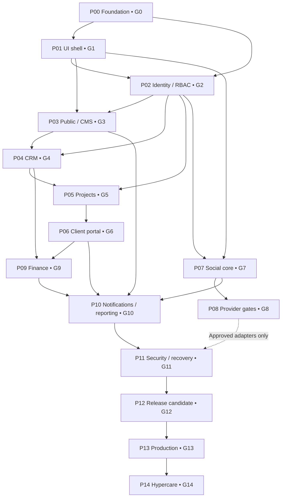
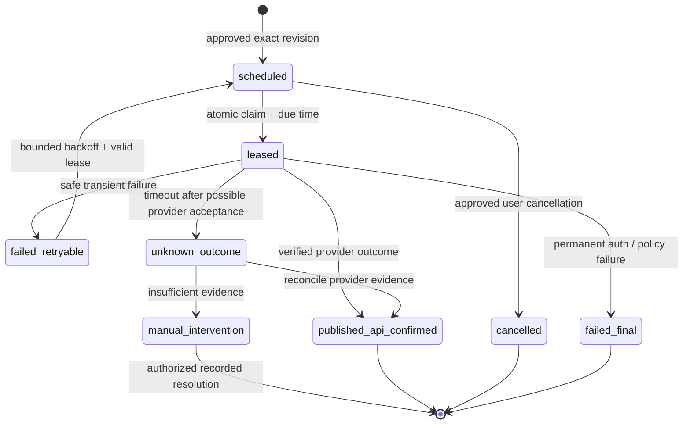

# Part-time Coder — Production Implementation Plan

> **Document ID:** PTC-IMP-001  
> **Version:** 1.0.0  
> **Status:** Engineering execution baseline — proposed for Owner approval; no implementation or external-platform approvals implied  
> **Prepared:** 14 October 2026  
> **Repository destination:** `docs/IMPLEMENTATION_PLAN.md`  
> **Product:** Part-time Coder Unified Company Platform  
> **Scope:** First commercially deployable MVP v1.0, subsequent stabilization, and explicitly deferred capabilities  
> **Audience:** Owner, Tech Lead, PM, design, QA, security, operations, and AI coding agents  
> **Required companion:** `AGENTS.md` (to be prepared after this document)

---

## 0. Governance, document authority, and execution contract

### 0.1 Purpose and use

This document translates Part-time Coder's approved product, technical, experience, and data specifications into a **dependency-ordered, verifiable delivery program**. A task is not completed by generating code, writing a report, rendering a screenshot, or passing mocks alone. It is completed when the code and tests are in the correct environment, security and accessibility obligations pass, required documentation is updated, and the phase's evidence is reviewed.

**Authority hierarchy:**
1. Owner-confirmed PRD decisions, approved scope changes, and signed architecture decision records (ADRs).
2. `docs/PRD.md` (source delivered as `Part_time_Coder_PRD_v1.0.md`) — **what** and launch acceptance.
3. `docs/TRD.md` — implementation boundaries, APIs, security and operations.
4. `docs/APP_FLOW.md` — routes, journeys, state machines and authorization guards.
5. `docs/UI_UX_DESIGN_BRIEF.md` — proposed brand system, interaction requirements and WCAG target.
6. `docs/BACKEND_SCHEMA.md` — MongoDB collections, invariants, indexes and migration discipline.
7. `docs/IMPLEMENTATION_PLAN.md` — build order, work breakdown, readiness gates and evidence requirements.
8. `AGENTS.md` — agent operating constraints. Its rules cannot silently change the product baseline.

**Conflict procedure:** stop the conflicting operation, identify the exact document passages/IDs, propose a minimal resolution, record an ADR and Owner decision when scope/security/financial/external commitment changes, update all impacted documents and tests, then resume. Do not guess to resolve a conflict.

### 0.2 Immutable product decisions

| Decision | Binding implementation effect |
|---|---|
| Hybrid agency + owned products | Separate services, company product catalog, public projects and internal development projects. No SaaS subscriber billing at MVP. |
| Single Part-time Coder company | One internal operating organization; many isolated client organizations and client members. No multi-company white-label platform. |
| Six networks | Facebook, Instagram, LinkedIn, YouTube, X and TikTok represented in adapter registry and campaign UI. Automated posting is capability- and provider-approval-gated. |
| Balanced MVP | All three end-to-end pillars required: public lead acquisition/CMS, internal delivery/client portal, and auditable social campaign management. |
| Budget sensitivity | Prefer free/low-cost development resources, but **production hosting must permit commercial use**, with reliable worker and independent recovery. |
| Internationalization | English MVP, localization-ready English/Bangla infrastructure; do not claim full Bangla translation in MVP. |
| Architecture | TypeScript monorepo; Next.js App Router modular monolith; Firebase identity; MongoDB Atlas/Mongoose; Zod; independently supervised Node worker; versioned REST `/api/v1`. |
| Access/security | Default-deny server permission checks, resource-scoped grants, no cross-client visibility, encrypted provider credentials, explicit audit, finance integrity. |

### 0.3 Requirement and ticket conventions

- **PRD identifiers:** `PTC-<DOMAIN>-###` are stable. PRD content contains **173 functional/nonfunctional requirement IDs**, not counting the document's own identifier `PTC-PRD-001`. Preserve existing priority/release markers (`P0/M`, `P1/F`, `P2/F`, and `C` conditional).
- **Implementation tasks:** `IMP-PP-TT`, where `PP` is phase `00`–`14` and `TT` is the task ordinal. Each task includes required inputs, outputs and review proof.
- **Gates:** `G0`–`G14`. Gate approval is independent of passing a build.
- **Acceptance tests:** Reference the authoritative catalogs (PRD `AT-001`–`AT-022`, App Flow `AC-AF-001` onward, Backend Schema `BS-AT-001`–`BS-AT-056`) and additional plan tests `IMP-AT-###` defined in §13. Do not invent success evidence for any catalog.
- **Workflow evidence:** Linked issue → requirement IDs → PR → code/test outputs → deployment (if applicable) → reviewer decision → commit SHA. Coverage status: `not_started`, `in_progress`, `implemented`, `verified`, `blocked_external`, `deferred`.
- **Release condition:** all applicable `P0/M` requirements must be verified; for `P0/M/C` integrations, approved auto-publishing may remain disabled only when the documented manual workflow and transparent statuses work.

### 0.4 Definition of Ready (DoR) for a task

Before an AI agent or engineer starts a task, its ticket must contain: stable requirement IDs, exact owner/role, phase and dependency IDs, user flow and route, domain/schema entities, API/permission policy, positive and abuse-case acceptance criteria, affected components, migration impact, privacy/retention consideration, test plan and manual/provider prerequisites. Undefined items are resolved in a short design review, not guessed in code.

### 0.5 Definition of Done (DoD) for a task

A task is **Done** only if: (1) implemented against authoritative contracts, (2) appropriate unit/integration/authorization/E2E tests pass, (3) failure/empty/loading states and keyboard accessibility verified where UI exists, (4) validation, scoped queries, safe errors and audit apply as relevant, (5) migrations/index changes reproducible and rollback considered, (6) secrets and lint/type/build checks pass, (7) docs, evidence and runbooks updated, (8) reviewed in a focused PR, (9) clean conventional commit(s) recorded, and (10) no external integration is labeled production-ready without real entitlement and provider test evidence.

### 0.6 Responsibilities and separation of duties

| Role | Accountable decisions / evidence |
|---|---|
| Owner / product approver | Scope, brand approval, legal/hosting expenditure, domain, external-app terms, policy consent, production authorization and final gates |
| Tech lead / architect | ADRs, interfaces, secure implementation, migrations, release/rollback design, acceptance of technical debt |
| Engineer / AI coding agent | Scoped implementation, tests, documentation, small commits; cannot authorize spending, publish to live social accounts or independently claim provider approval |
| UX owner / designer | Design tokens and screens, responsive states, keyboard/screen-reader UX, content/microcopy sign-off |
| QA / security reviewer | Negative permission tests, E2E evidence, vulnerability triage, restore and failure-injection proofs |
| Operations owner | Secrets, provider account inventory, deploy/worker health, alerts, backups and incident drills |
| Marketing approver | Social account ownership, content review policy, approved revisions and live-post authorization |
| Client pilot representative | Consensual validation of client-facing screens and confidentiality boundaries, without privileged development access |

For a solo Founder/Developer, one person may fill several roles, but each sign-off must be a separate recorded decision with supporting evidence; review checklists are not skipped.

---

## 1. Delivery topology, phase map, and critical path

### 1.1 Phases and hard dependencies

| Phase / gate | Workstream | Hard predecessors | Result / MVP role |
|---|---|---|---|
| `P00 / G0` | Discovery, repo, CI, technical feasibility | Owner baseline | Verified architecture foundation and budget/approval register |
| `P01 / G1` | Shared design system, routing and shells | G0 | Responsive, accessible app skeleton |
| `P02 / G2` | Identity, RBAC, client scopes and invitations | G0, G1 | Trust boundary for every private module |
| `P03 / G3` | Public website, product catalog, CMS, assets | G1, G2 for CMS | Discoverability and editable public content |
| `P04 / G4` | CRM, quote requests, lead conversion | G2, G3 forms | Visitor → lead → proposal → client/project seed |
| `P05 / G5` | Internal projects, tasks, employee workspace | G2, G4 client model | Work allocation and delivery tracking |
| `P06 / G6` | Client portal and deliverable approvals | G2, G5 | Scoped self-service for invited clients |
| `P07 / G7` | Social hub core and durable worker | G2, G1, media basics | Six-network content planning/review/scheduling/manual fallback |
| `P08 / G8` | Social provider connections and authorized publishing | G7, provider approvals | Independently gated live adapters; no forced six-network launch dependency |
| `P09 / G9` | Finance records and operational quotations/invoices | G2, G4, G6 | Exact-money, scoped invoice and manual payment recording |
| `P10 / G10` | Notifications, analytics, user operational UX | G3–G9 as data sources | Scoped activity, metrics and actionable dashboards |
| `P11 / G11` | Security, privacy, reliability and restoration hardening | All core domains; controls started at G0 | Rehearsed threat/retention/recovery guarantees |
| `P12 / G12` | End-to-end staging, performance, UAT, migration rehearsal | G3–G11 | Release candidate with signed test evidence |
| `P13 / G13` | Commercial production deploy, cutover and sign-off | G12, provider/legal approvals | Operational v1.0 with rollback/monitoring |
| `P14 / G14` | Hypercare and 30/60/90-day learning | G13 | Stabilization and explicit post-MVP planning |

**Not a license to defer security:** security primitives, access tests, monitoring hooks and migration discipline are embedded in their first dependent phase. P11 is the **independent validation and hardening** gate, not the first time those concerns are addressed. P08 adapter work may run in parallel with P09 after G7; provider approvals must never hold up manual social MVP. P03 public-only pages can run alongside P02 after shared shell exists, but CMS mutations remain blocked until verified role enforcement. P10 notification infrastructure begins with earlier domain events, while its aggregate validation occurs at G10.

### 1.2 Dependency graph



### 1.3 Parallel streams and limits

- **Architecture/quality (continuous):** contracts, fixture builders, tests, dependency scans, documentation and release evidence.
- **Public and commercial:** CMS/public → inquiries → CRM → quotations → project creation.
- **Delivery/client:** project memberships/tasks → client-safe milestones/deliverables → client feedback.
- **Marketing:** provider capability registry → revisions/approvals → durable jobs/manual fallback → per-provider activation.
- **Operations/finance:** durable events → notifications, audit → invoice/payment records → reports.
- **Provider approval stream:** Meta/Google/LinkedIn/X/TikTok developer setup and app review can begin administratively at G0, but real tokens/posting MUST NOT be used without consent, permissions and targeted tests.

**Release slices:** first release candidate must complete three vertical slices end to end, not merely display a module menu. Provider-unavailable automated dispatch is conditionally scoped, but a working **manual completion path** remains mandatory.

### 1.4 Estimation and prioritization policy

This document intentionally does not promise calendar durations before repo access, provider permissions, staffing and environment are verified. For planning, assign each ticket a complexity band `XS/S/M/L`, explicit blockers, role availability and measured cycle time after first sprint. Do not encode an invented launch date or fictitious velocity. Critical path prioritization: **security foundation → public/CRM → project/client delivery → social safe publishing → finance/operations → staging/release**. Maintenance and provider review remain ongoing.

---

## 2. Engineering foundation and repository conventions

### 2.1 Proposed deployable layout

```text
part-time-coder/
├─ apps/
│  ├─ web/                         # Next.js App Router; public/private screens; API v1
│  │  └─ src/app/{(public),(auth),(dashboard),api/v1}/
│  └─ worker/                      # supervised Node process; durable jobs/outbox
├─ packages/
│  ├─ core/                        # domain commands, queries, scoped policies
│  ├─ database/                    # Mongoose models, repositories, indexes, migrations
│  ├─ auth/                        # Firebase verification, session revocation, RBAC
│  ├─ integrations/                # social provider adapters, email, storage
│  ├─ ui/                          # semantic components, design tokens
│  └─ config/                      # shared lint/TS/build settings
├─ docs/
│  ├─ PRD.md
│  ├─ TRD.md
│  ├─ APP_FLOW.md
│  ├─ UI_UX_DESIGN_BRIEF.md
│  ├─ BACKEND_SCHEMA.md
│  ├─ IMPLEMENTATION_PLAN.md
│  ├─ ADR/
│  ├─ RUNBOOKS/
│  ├─ PHASE_STATUS.md
│  ├─ TEST_MATRIX.md
│  └─ RELEASES/
├─ .github/workflows/
├─ AGENTS.md
├─ pnpm-workspace.yaml
└─ package.json
```

Target layout is a template, **not proof that these files already exist**. Package extraction is incremental; avoid circular dependencies and premature over-abstraction. `/api/v1` is externally versioned, and domain modules must not import UI internals.

### 2.2 Layer/ownership contract

| Layer | Responsibilities | Forbidden pattern |
|---|---|---|
| Route/UI | Screens, loading/empty/error states, accessible workflows, permission-derived navigation | UI-only authorization, token/key access, unscoped DB queries |
| API boundary | Firebase session, CSRF/origin protection, Zod validation, correlation IDs, DTO serialization | Business mutations inline in handlers |
| Domain service | Transaction boundaries, state machine, authorization checks, audit/outbox commands | Trusting request `orgId`, mutable financial math with floats |
| Repository/model | Scoped indexes, Mongoose types, migrations, optimistic versions | Automatically creating production indexes at app startup |
| Integrations | Provider-specific scopes, quota, capabilities, OAuth tokens, API calls | Leaking raw tokens or treating timeout as success |
| Worker | Poll/lease jobs, retry, reconciliation, notification and telemetry | Unbounded retries, processing unapproved/revoked revisions |

### 2.3 Quality commands as **required package script contracts**

Implement equivalent actual scripts, then record real command paths in CI and `AGENTS.md`:

```bash
pnpm install --frozen-lockfile
pnpm lint
pnpm typecheck
pnpm test:unit
pnpm test:integration
pnpm build
pnpm test:e2e             # against an isolated, seeded test environment
pnpm security:scan        # secret/dependency/static checks (scripts defined in P00)
pnpm db:index:verify      # read-only production-safe index comparison
```

**No script is presumed to exist** until P00 creates it. CI must be reproducible and fail closed on required test failures; never replace a failed check with `|| true`, disabled assertions or screenshot-only proof. Maintain separate smoke/sandbox/live-provider checks outside standard PR CI.

### 2.4 Branching, Git and PR discipline

- Protect `main` as production source; use `dev`/staging branch only if the team actually needs it. Feature branches: `feat/imp-05-03-task-board`, `fix/imp-07-06-job-recovery`.
- Commit after each **small, coherent verified change** using Conventional Commits; never batch unrelated architecture, UI and database changes. Suggested format: `feat(projects): enforce scoped task assignment` or `test(auth): cover client cross-org access`.
- Keep separate commits for migration, tests and documentation when that helps review; never force a commit in the middle of known broken repository state unless explicitly a WIP branch.
- Require PR title, issue/requirement references, what changed, database/API changes, test commands and real results, security implications, screenshots for UI, manual steps, rollback, commit list and phase status.
- Mandatory pre-merge checks: lint, typecheck, unit tests, relevant integration/negative tests, clean build, secret/dependency scan, and affected a11y tests. E2E smoke on protected preview/staging where feasible.
- No direct pushes to protected production branch, no unsafe force-push, no committing `.env`, credential JSON, access tokens, client files, private keys or protected asset URLs.
- Documentation updates are part of the same change: affected source spec or ADR, test matrix, status tracker, README/runbook, and migration record if data changes.
- **Suggested phase-gate commit:** `docs(progress): record phase 05 gate G5 verification` only after evidence exists; a gate commit is not evidence by itself.

### 2.5 Phase evidence packet (mandatory standardized template)

```yaml
phase: P05
execution_status: not_started | in_progress | blocked | ready_for_review | approved
requirement_ids: [PTC-PRJ-001]
tickets: [IMP-05-01]
changes:
  commits: []
  pull_requests: []
  migrations: []
checks:
  lint: {status: not_run, evidence: null}
  typecheck: {status: not_run, evidence: null}
  unit: {status: not_run, evidence: null}
  integration: {status: not_run, evidence: null}
  e2e: {status: not_run, evidence: null}
  accessibility: {status: not_run, evidence: null}
  security: {status: not_run, evidence: null}
manual_prerequisites: []
known_gaps: []
rollback: not_yet_documented
reviewed_by: null
approved_at: null
```

Never autofill pass statuses, dates, signatures, or commits. Supply actual commit SHAs and logs or references when known. Gate reviewer must distinguish implemented/mock-tested/provider-verified/production-enabled.

---

## 3. Phase P00 — Discovery, environment, CI and feasibility (Gate G0)

**Purpose:** Prevent downstream AI execution against invented repo, undocumented permissions, noncommercial hosting or untestable dependencies. **Requirements:** `PTC-GOV-001`–`005`, `PTC-OPS-001`–`003`, `PTC-INT-001`–`005`, `PTC-NFR-011/012/015`.

| Ticket | Deliverable and granular action | Required evidence / test |
|---|---|---|
| IMP-00-01 | Repository audit: confirm starting code, Node/package versions, scripts, remotes, dirty files, service credentials presence; record baseline without modifying secrets | `docs/AUDIT.md`, file inventory, safe `git status`, dependency inventory and baseline build outcome |
| IMP-00-02 | Confirm architecture ADRs: modular monolith, package layout, company singleton, scoped client organizations, deployment and worker isolation | ADRs with owner-reviewed alternatives/risks and reference IDs; conflicts resolved |
| IMP-00-03 | Initialize pnpm workspace, Next.js/TS strict compilation, worker entry, shared configs, lint/format conventions | Clean install and reproducible minimal build; no cross-package import cycles |
| IMP-00-04 | Define env contract and secret management: local/staging/prod, variable names, typed server-side validation, encrypted credential policy | Placeholder `.env.example` only; process fails closed on missing required settings; secret scanner clean |
| IMP-00-05 | Create GitHub Actions: lint, TS checks, tests, build, dependency/secret checks and PR protections | Deliberately failing test blocks merge; PR status and retained logs |
| IMP-00-06 | Provision local disposable test DB/fixtures; transaction capability, uniqueness and index smoke tests; baseline migrations ledger | Atlas-equivalent transaction probe, rollback test, unique constraint test, seeded fixture script |
| IMP-00-07 | Assess commercial production hosting and persistent worker options; document budget caps and operational owner | Written provider-terms verification, TLS/job/restart support matrix and proposed monthly cost ceiling approved by Owner |
| IMP-00-08 | Create initial execution registry: issue template, docs/PHASE_STATUS.md, TEST_MATRIX.md, ADR template, gate packet, ownership list | One sample issue traces PRD ID → task → acceptance evidence; empty gate records not marked passed |
| IMP-00-09 | Establish identity/provider application feasibility register for Firebase, Meta, Google/YouTube, LinkedIn, X, TikTok, email/storage | Provider accounts and pending approvals documented without storing secrets; no promises of unrestricted publishing |
| IMP-00-10 | Security baseline: threat model, trust boundaries, dependency policy, protected branch, log-redaction policy, backup candidate | Initial abuse case matrix, secret scan, remediation owner and retention review backlog |

**G0 exit, all required:** repo builds from clean checkout; mandatory CI blocks a deliberate failure; typed environment validation; transaction/unique-index feasibility actually verified; proposed production host permits commercial use; independent worker deployment feasible; owner has reviewed unresolved legal, API and budget dependencies; P01–P02 can run without unavailable provider credentials. **STOP** if production credentials are necessary for local tests or chosen datastore cannot support required correctness semantics. No social production app approval required for G0.

**Owner manual checklist:** create/control GitHub repository and branch protections; select billing authority and cost cap; create separate development Firebase/Atlas projects if desired; protect credentials; approve baseline deployment shortlist. See §10 for detailed safe setup steps.

---

## 4. Phase P01 — Design system, public/private shells and interaction foundations (Gate G1)

**Purpose:** One cohesive platform, not seven disconnected dashboards. **Requirements:** `PTC-NFR-001/002/008/013/016`, relevant `PTC-PUB-*`, UI/UX brief §§1–5, 12–16, and App Flow §§1–3.

| Ticket | Deliverable and granular action | Evidence / acceptance |
|---|---|---|
| IMP-01-01 | Capture Owner decision on provisional brand palette/typography/logo; record semantic light/dark tokens | Approved token decision or explicitly labeled provisional staging skin; no claim branding is final |
| IMP-01-02 | Build accessible primitives: buttons, links, field control, validation, dialogs, toasts, breadcrumbs, tabs, tables, pagination | Component tests for accessible label/focus/escape/keyboard/error; visual baseline snapshots |
| IMP-01-03 | Public shell: header, footer, mobile menu, responsive typography/spacing, CTA and legal placement | 360/768/1280/1920px checks, no critical overflow, keyboard/mobile navigation |
| IMP-01-04 | Auth shell and workspace shell: nav/sidebar, protected placeholder routes, organization/workspace selector, permission-derived menu | Empty/unauthorized states; no privileged content rendered until session/permissions verified |
| IMP-01-05 | Universal UI state system: loading, skeleton, empty, validation failure, forbidden, not-found, offline/provider-degraded, unsaved changes | Screenshot/story fixture for each critical state, screen-reader notification behavior |
| IMP-01-06 | Locale framework (`en`, `bn` ready), accessible theme persistence, UTC display helpers, currency number formatting | All tested UI strings externalized, English working, locale-ready formatting, reduced motion respected |
| IMP-01-07 | Shared form/layout templates and responsive data table → mobile card patterns, accessible no-drag fallback for Kanban/calendar | Viewport/keyboard/screen-reader checks, no hidden primary action on touch |
| IMP-01-08 | UX route coverage map tied to App Flow 35 screen families; establish visual regression fixtures and screenshot review procedure | Coverage matrix includes deferred flags; pending surfaces don't falsely appear production-ready |

**G1 exit:** owner-approved or clearly provisional theme; reusable primitives and shells; mobile/desktop, keyboard and axe-based checks pass for shared patterns; no fake active links or inaccessible icon-only controls. **Human gate:** approve actual public-facing brand assets before P03 launch publication; token scaffolding may proceed while approval is pending.

---

## 5. Phase P02 — Firebase sessions, scoped authorization, invitation and owner safety (Gate G2)

**Purpose:** Establish the trustworthy access model before exposing client/company information. **Requirements:** `PTC-IAM-001`–`010`, `PTC-ORG-001`–`006`, `PTC-SEC-001`–`005`, `PTC-GOV-001`–`003`, `PTC-DATA-001`.

| Ticket | Deliverable and granular action | Evidence / acceptance |
|---|---|---|
| IMP-02-01 | Firebase client login/registration/reset, server ID-token validation and server-controlled secure session cookie; CSRF/origin defense | Expired, altered, absent, replayed or revoked credentials rejected; HttpOnly/Secure/SameSite policy inspected |
| IMP-02-02 | Canonical app `users` mapping Firebase `uid`, status, profile and safe enrollment; user is not authoritative source of roles | Duplicate UID collision and suspended user sign-in paths tested |
| IMP-02-03 | Membership and scoped role grant collections: company/department/client/project; deny-by-default permission evaluator in `packages/auth` | Same user receives different permitted actions in multiple scopes; negative tests for privilege escalation |
| IMP-02-04 | Route/API guard and client-safe DTO serializer infrastructure; grant checks before read, write, search, export and private signed media issuance | Adversarial ID swapping across client organizations yields no data or actionable leaks |
| IMP-02-05 | Invitation lifecycle: create, expire, accept once, reject, revoke; staff elevation cannot originate from public registration | Token enumeration/expired/replay tests, role change audit, safe invitation UX |
| IMP-02-06 | MFA policy for privileged accounts; session/grant revocation on role removal, suspension and offboarding | Real revocation test against active session, privileged step-up enforced where required |
| IMP-02-07 | Last-owner protection and audited recovery path; single-company bootstrap with explicit owner identity | Removal/demotion of last owner blocked; emergency recovery drill and audit preserved |
| IMP-02-08 | Audit event schema and logging service with correlation ID and PII/token redaction | Representative role change/log-in failure/owner recovery trace contains no secrets |
| IMP-02-09 | Account profile, workspace-switch UI, graceful 401/403/404, reauthentication and deep-link redirects | Switching workspace never expands permissions; forbidden routes do not leak resource existence |
| IMP-02-10 | Abuse suite: anonymous, staff, PM, marketing, finance, client admins/members, suspended users; scoped fixtures across 2+ client orgs | Automated matrix passes read/write/search/file/export tests; CI enforces it |

**G2 exit:** valid Firebase identity is never mistaken for permission; cross-client and cross-role negative tests pass; privileged MFA and owner recovery rehearsed; protected API routes default deny; no `clientOrganizationId` received from browser grants access by itself. **STOP** all dependent private work if isolation fails. **Human gate:** secure Firebase keys/authorized domains, privileged test accounts and recovery method; never paste service-account JSON into AI prompts or commits.

---

## 6. Phase P03 — Public site, product/service catalog, CMS and media (Gate G3)

**Requirements:** `PTC-PUB-001`–`012`, `PTC-CMS-001`–`007`, `PTC-SEC-006`–`009`, `PTC-NFR-003/014`.

| Ticket | Deliverable and granular action | Evidence / acceptance |
|---|---|---|
| IMP-03-01 | Public homepage/about/team/service pages and reusable responsive templates with structured CTA | No fabricated projects/reviews/statistics; approved public content and contact details only |
| IMP-03-02 | Services and owned-product catalog (`/services`, `/products`, slug detail); link products to releases and public project highlights appropriately | Published, authorized and indexable content only; unpublished products remain private |
| IMP-03-03 | Case studies/portfolio and article/blog list/detail with pagination, filters, metadata and accessible reading states | Draft/archived projects invisible, links valid, duplicate slug rejected |
| IMP-03-04 | CMS schemas, editor and revision workflow (draft → review → published/archived); preview restricted to authorized staff | Unauthorized preview denied, revision conflicts surfaced (`409`/`412` per contract) |
| IMP-03-05 | Media domain: signed upload intent, validated type/size, scanning/review/quarantine as designed, ownership/visibility and derived variants | Cross-client/anonymous protected file URL fails; access/expiry tested; dangerous type rejected |
| IMP-03-06 | Public contact/quotation entry UI with rate limiting, anti-spam, consent/privacy notices and safe acknowledgments | Valid inquiry persists exactly once with idempotency; spam/invalid data rejected; errors recoverable |
| IMP-03-07 | SEO pipeline: sitemap, robots, canonical URLs, Open Graph, schema as appropriate, CMS-driven previews, performance optimization | Published routes indexed as intended; private/client routes never indexed; Lighthouse and RUM plan recorded |
| IMP-03-08 | Content migration/seed policy: categorize old Part-time Coder posts/projects as verified or unpublished drafts | Only Owner-approved content published; migration checkpoint and rollback manifest recorded |
| IMP-03-09 | Accessibility/visual QA across current browsers, reduced-motion and responsive breakpoint matrix | WCAG issues resolved for core pages; mobile CWV measurements labeled lab vs field |

**G3 exit:** editor can publish approved company content without code; an unpublished case study cannot appear in public queries; contact/quote form validates safely; media access is enforced; legal/contact/branding items explicitly checked. **Human gate:** approve logo, about text, real services/pricing claims, legal pages, domains and any migrated project visibility.

---

## 7. Phase P04 — CRM, pipeline, quotations and lead-to-project conversion (Gate G4)

**Requirements:** `PTC-CRM-001`–`008`, applicable `PTC-FIN-001` quotation interface, `PTC-GOV-003`, `PTC-SEC-005/007`.

| Ticket | Deliverable and granular action | Evidence / acceptance |
|---|---|---|
| IMP-04-01 | Normalized inquiry/lead collections, source attribution, assignment, priority, pipeline status, scoped list/search and pagination | Public form produces manageable lead; PII visible only to authorized company roles |
| IMP-04-02 | Lead detail with notes, contact history, status transitions and audit trails | Illegal transition denied; audit has actor, reason, prior/new status |
| IMP-04-03 | Sales proposal/quotation draft and versioned pricing using exact minor-unit currency, terms and optional attachments | No float-based ledger math; invalid currency/version transitions rejected |
| IMP-04-04 | Client organization creation and membership invitation from approved lead; ownership references verified | No duplicate org/member for repeated operation key; client data not globally listed |
| IMP-04-05 | Lead conversion transactional command: create/attach client organization, selected quote and linked project seed + outbox event | Concurrent duplicate conversion produces one linked outcome; rollback leaves no partial leaked records |
| IMP-04-06 | CRM dashboard tiles, follow-up reminders and email/notification outbox, degradation behavior if email provider fails | Lead conversion commits even when email waits; retry/report outcomes without duplicate send |
| IMP-04-07 | CRM security/E2E matrix: guest submit → internal triage → quote → client invitation → project handoff | Browser and API tests include abuse, wrong roles and client conflict; deterministic fixtures |

**G4 exit:** complete lead-to-client/project handoff with idempotency and audit; quotation draft approved internally; email failure visible rather than falsely marked delivered. **Human gate:** approve actual commercial quote template, service terms and whether public form may store submitted personal data in production.

---

## 8. Phase P05 — Projects, employees and internal delivery (Gate G5)

**Requirements:** `PTC-PRJ-001`–`012`, `PTC-EMP-001`–`006`, `PTC-SEC-001/002/008`, `PTC-NFR-001/013`.

| Ticket | Deliverable and granular action | Evidence / acceptance |
|---|---|---|
| IMP-05-01 | Project model: internal/client, owner, clientOrganizationId, scope, members, lifecycle and optimistic version; project list/detail views | Client-bound projects reject invalid organization; staff sees only assigned/authorized work |
| IMP-05-02 | Project status, milestones, due dates, participants, cost-aware but private budget fields and client visibility markings | Invalid state transitions denied; internal costs absent from client DTOs |
| IMP-05-03 | Tasks/subtasks with assignees, priorities, comments, attachments, board/list/calendar views and pagination | Permission/assignment enforcement on each command; list and card navigation keyboard usable |
| IMP-05-04 | Employee dashboard: my tasks/projects, deadlines, status, notifications and profile; workload limited to permitted data | Employee cannot see another team/client's confidential task metadata via filters/search |
| IMP-05-05 | Role-specific project manager functions: assignment, lifecycle advancement, milestones and internal team comments | PM action is scoped to assigned projects, not all projects globally |
| IMP-05-06 | Secure deliverables/materials: draft, release candidate, internal review, client-visible approval, signed access | Draft deliverables never become client-visible due to route guessing or stale CDN URLs |
| IMP-05-07 | Domain notifications/outbox on assignment, status/due date, released deliverable and mention | Event and authoritative state commit atomically; async delivery retry no duplicate notifications |
| IMP-05-08 | Concurrency and integrity: `If-Match` version conflict, relation checks, robust pagination/indexes, archived project semantics | Stale task update prompts conflict; archived state blocks prohibited actions |
| IMP-05-09 | Project E2E with fixtures: admin create → PM assigns → employee edits → deliverable approved for client | Internal note/client visibility test, mobile/keyboard flow, service/API negative cases |

**G5 exit:** real task lifecycle and project ownership work with two isolated clients; employee can operate without elevated permissions; deliverable client visibility is explicitly controlled; optimistic conflict recovery works. **Human gate:** select a non-sensitive example project, establish company department/team names and review internal visibility labels.

---

## 9. Phase P06 — Client portal, scoped collaboration and acceptance (Gate G6)

**Requirements:** `PTC-CLI-001`–`009`, `PTC-COM-001`–`006` where MVP, `PTC-SEC-002/008/011`.

| Ticket | Deliverable and granular action | Evidence / acceptance |
|---|---|---|
| IMP-06-01 | Client portal shell and scoped org/project selector, authorized client-admin and member dashboards | Multiple client memberships never merge data accidentally; access after removal rejected |
| IMP-06-02 | Client organization member invitation/role lifecycle with auditable restrictions | Client admin may invite only into own organization and cannot assign company/finance roles |
| IMP-06-03 | Client-safe project summary/milestone/detail with explicit allowlist DTO projection | Private estimates, internal comments, employee salaries, margins and other clients absent |
| IMP-06-04 | Deliverable review and feedback state machine: release → accept/request revision → resubmit | Invalid or concurrent repeated feedback cannot approve conflicting revisions |
| IMP-06-05 | Secure client uploads/downloads, versioned files, expiring URLs and access revocation | Cross-client signed URL unauthorized even when object ID known; expiry enforced |
| IMP-06-06 | Client service requests and project-linked messages; safe notifications and deep links | Notification metadata scoped; link re-checks current grants; no private data in email body |
| IMP-06-07 | Client E2E/UAT: invite → login → project review → deliverable feedback → revision → accept | Two-org cross-read/write/download negative tests; keyboard/mobile and error-state recovery |

**G6 exit:** at least one full pilot-client journey succeeds with only permitted data; membership removal invalidates access; asset delivery protected; client's acceptance maps to exact deliverable revision. **STOP** launch on any client isolation leak. **Human gate:** invite consenting pilot client or use explicitly labeled test data; never seed real client secrets into screenshots or fixtures.

---

## 10. Phase P07 — Social hub core, review and durable scheduling (Gate G7)

**Requirements:** `PTC-SOC-001`–`006`, `PTC-SOC-008`–`015`, `PTC-SEC-004/005`, `PTC-NFR-007`, `PTC-OPS-004/007`.

| Ticket | Deliverable and granular action | Evidence / acceptance |
|---|---|---|
| IMP-07-01 | Six-platform adapter registry, capability enum/protocol, per-account support flags, `disabled/connected/manual/reauth_required` truthful UI | All six names present with accurate actionable mode; unknown ability never shown as supported |
| IMP-07-02 | Marketing routes: dashboard, accounts, media, campaign list, composer, review queue, calendar, jobs/logs and analytics placeholders | Role-based nav and loading/error/empty states, creator vs approver actions tested |
| IMP-07-03 | Campaign and per-platform editable variant models with content/media validation and platform-specific preview | Editing one variant does not change others; unsupported formatting constraints disclosed |
| IMP-07-04 | Review state machine: submit, request changes, reject, approve **exact content revision hash**; creator self-approval disabled by default | Edit after approval invalidates approval and future dispatch; audit retains approver and version |
| IMP-07-05 | Timezone calendar: IANA zone input, UTC canonical timestamp, conflict/time validation, schedule/cancel permissions | Timezone/DST boundary tests, no silent time shift or stale schedule survives content edit |
| IMP-07-06 | Mongo durable publishing job, outbox, deterministic idempotency key, atomic claim/lease and supervised worker; simulated adapter | Kill/restart before/after lease; no lost scheduled job and no duplicate authoritative dispatch |
| IMP-07-07 | Timeout/ambiguous outcome protocol: `unknown_outcome`, reconcile and manual operator resolution; capped retry only for safe failures | Simulate response lost after provider accepted post; system MUST NOT retry blindly |
| IMP-07-08 | Manual publication first-class workflow: export ready caption/media/instructions, record operator/proof/status separately from API-confirmed | Content reaches human publish path if adapter unavailable; manual completion never misrepresented as provider-confirmed |
| IMP-07-09 | Per-target publish status, attempt log, errors, reconnect CTA, cancellations and cost/quota switches | One failed account does not roll back other targets; unsafe retries/cancellation blocked |
| IMP-07-10 | Media derivative pipeline and secure access scoped to social account/company membership | File size/type/platform constraints validated; credential/media URL not leaked |
| IMP-07-11 | Social analytics source adapters returning `not_available` for unsupported metrics; define source, period and collection timestamp | No fabricated zero values; stale/unsupported metrics identified visibly |
| IMP-07-12 | Social core exhaustive tests with fake providers: 429, 401, 403, timeouts, partial success, token invalidation, job races, timezone changes | CI deterministic; transition proofs, audit, dedupe and queue lag alarms |

**G7 exit:** every six-network campaign can be drafted, individually reviewed, scheduled in UTC, observed, and manually completed even with *zero* approved production posting APIs; worker survives restarts; approval changes stop dispatch; ambiguous outcomes never trigger blind duplicates; truthful UX passed. **STOP** provider-specific enablement if worker cannot guarantee these invariants. **Human gate:** select social account owner, reviewer(s), approval policy, future real-post test content, and an acceptable API spend ceiling.

---

## 11. Phase P08 — Official-provider activation and analytics gates (Gate G8)

**Requirements:** `PTC-SOC-002/007/009/010/012/015`, `PTC-INT-006`–`011`, `PTC-SEC-004`, `PTC-OPS-008`. **All integrations conditional.**

### 11.1 Provider-independent adapter execution steps

| Ticket | Deliverable and granular action | Evidence / acceptance |
|---|---|---|
| IMP-08-01 | Define provider adapter contract: connect/refresh/disconnect, capability check, validate, publish, lookup/reconcile, fetch metrics | Typed contract, mock conformance suite and provider version registry |
| IMP-08-02 | Server-side OAuth state/PKCE where supported, anti-replay callback, encrypted token envelope, key rotation and scope/expiry metadata | Secrets never reach client/log; revocation, expired grant and wrong callback state rejected |
| IMP-08-03 | Account health/readiness UI: `approval_pending`, `reauth_required`, `unsupported`, `enabled`, `disabled_due_to_cost` | User sees exactly why auto-publish is unavailable and next supported action |
| IMP-08-04 | Provider retry/error classification, transient/permanent errors, quota budget and ambiguous outcome reconciliation | All 401/403/429/5xx/timeout cases mapped; no false success and no duplicate posts |
| IMP-08-05 | Live-sandbox test harness with deliberate human authorization, test posts, consent, external post ID/URL recording and cleanup plan | Real provider response evidence (redacted), approval status and reviewer sign-off |
| IMP-08-06 | Privacy-aware supported analytics import: source metrics, collection time, source period, missing capability and job observability | Each displayed metric has provenance; no provider-to-provider fabricated normalization |

### 11.2 Six independently operated approval tracks

| Provider / ticket | Initial target | Owner-required prerequisites | Go/no-go proof; fallback |
|---|---|---|---|
| **Facebook Pages — IMP-08-07** | Page posts/media and supported Page insights | Owner-controlled Meta app, Page role, approved/eligible permission scopes, policy review | Account eligibility + scoped OAuth + live controlled Page post + return ID; otherwise export/manual post |
| **Instagram Professional — IMP-08-08** | Professional-account image/video/Reels where current approved API supports | Supported professional account, correct Meta auth flow, publishing scopes, linked Page/Business setup where required | Media validation, container/status/publish test, restricted account conditions documented; otherwise manual |
| **LinkedIn Organization — IMP-08-09** | Organization posts and supported metrics | Authorized app/API product, company Page admin/appropriate role, exact current scope/version | Real controlled org post and source ID; personal profile features not assumed; otherwise manual |
| **YouTube — IMP-08-10** | Authorized channel video upload, metadata, supported analytics | Google project, OAuth consent configuration, verified scopes and upload/quota policy | Resumable upload and visibility rules tested with authorized test channel; otherwise manual Creator Studio |
| **X — IMP-08-11** | Posts/media and eligible metrics | X developer access, **billing/credits explicitly approved**, permitted endpoints/rate limits | Recorded approved budget and live private/controlled post test where available; disabled/manual when unaffordable |
| **TikTok — IMP-08-12** | Content Posting capabilities permitted to approved creator/app | Approved app product/scopes, creator authorization, audit and visibility eligibility | Prove public posting permitted **before** claiming it; unaudited/private-only restrictions prominently shown; otherwise manual |

### 11.3 Adapter gate record (one per connected account, environment and capability)

```yaml
provider: instagram
account_alias: REDACTED_NONSECRET
app_review: pending # pending | approved | rejected | not_required
permissions_verified: []
account_eligible: false
api_version_checked_at: null
publishing_capability: disabled # disabled | sandbox_verified | live_verified
metrics_capabilities: []
quota_or_cost_approved: false
real_post_evidence: null
revoke_and_reconnect_test: not_run
manual_fallback_test: not_run
owner_authorized: false
```

**G8 acceptance:** at least one approved adapter can be activated *if* entitled and live tested; each enabled integration has proof of account eligibility, correct scopes and safe outcome reconciliation. If none is approved, `G8` is recorded **conditional/provider-blocked**, not falsified as complete. **MVP launch is still possible with six-network drafting/manual publication functioning and explicit release exception approved**, as PRD permits; never make auto-publish mandatory without provider entitlement. No token from a third-party provider can be committed, exported or included in screenshots.

---

## 12. Phase P09 — Finance records and commercial operations (Gate G9)

**Requirements:** `PTC-FIN-001`–`009` (MVP requirements only), `PTC-CRM-*` quotation handoff, `PTC-CLI-*` invoice visibility, `PTC-SEC-005`, `PTC-GOV-003`.

| Ticket | Deliverable and granular action | Evidence / acceptance |
|---|---|---|
| IMP-09-01 | Shared money value object: ISO currency, exact integer minor units or approved decimal representation; immutable quote totals | Money calculation does not use JS floats; cross-currency operations prohibited without explicit conversion record |
| IMP-09-02 | Versioned quote issue workflow linked to lead/client/project; status tracking and protected document rendering | Historical quote unaffected by edited service catalog; proper permissions and audit |
| IMP-09-03 | Invoice draft → issue with server-assigned unique invoice number, tax/discount fields as configured, reference snapshot | Concurrent issuance cannot duplicate number; transaction rolls back cleanly on failure |
| IMP-09-04 | Invoice adjustment, cancellation/void policy, reminders and operational payment status | Prohibited edits to issued invoice rejected; status computed from append-only payment/reversal record |
| IMP-09-05 | Manual payment entry and reversal with idempotency, positive validation, duplicate detection and reason/audit | Repeated payment request produces exactly one entry; balance never affected by floating rounding |
| IMP-09-06 | Finance/owner dashboard, scoped company permissions, client invoice list/download and record-level filters | Client org sees its own invoices only; project margin and private rates never leaked |
| IMP-09-07 | Authorized PDF/document export with authenticated download and storage retention class | Unauthorized PDF URL or invoice ID gives no data; export audited appropriately |
| IMP-09-08 | Finance legal and accounting boundary review: invoices are operational records, **not** certified statutory accounting/tax compliance | Approved wording, jurisdiction questions documented, provider/tax obligations evaluated before real invoices |
| IMP-09-09 | Finance E2E + concurrency tests with real Mongo transactions and two client organizations | Create quote → issue invoice → record/reverse payment → client download, no duplicate numbers |

**G9 exit:** exact money, unique issue numbers, immutable historical payment/reversal semantics, strict finance/client visibility and tested concurrent mutations. **Human gate:** approve actual invoice format, currency/tax disclosures, payment instruction wording, and legal eligibility for real client invoicing; otherwise demonstrate only using fake data. Paid gateway remains post-MVP.

---

## 13. Phase P10 — Notifications, analytics and operational control (Gate G10)

**Requirements:** `PTC-COM-001`–`006`, `PTC-ANA-001`–`008` (MVP items), `PTC-NFR-010/015`, `PTC-OPS-004/007/008`.

| Ticket | Deliverable and granular action | Evidence / acceptance |
|---|---|---|
| IMP-10-01 | Durable outbox dispatcher for invitations, lead confirmations, tasks, deliverable review, invoice notices and social job alerts | Domain commit remains successful on email outage; retry and terminal failure visible |
| IMP-10-02 | In-app notification center with read/unread, preference setting, deep links and scope revalidation at click time | Revoked client cannot access former project through old notification or stale email |
| IMP-10-03 | Company owner/admin and module dashboard KPI queries, appropriately scoped | No client/finance counts leaked to unauthorized roles; empty/zero/unknown states distinct |
| IMP-10-04 | Metrics definitions for leads, project status, overdue tasks, social status, invoice totals, publish failures and provider metrics | Every KPI specifies numerator, denominator, period, unit, owner and source; unsupported is `not_available` |
| IMP-10-05 | Error/reporting integration with correlation IDs, redaction, operational request and worker logs | Single test failure traceable API → outbox → worker without revealing PII/secrets |
| IMP-10-06 | Health/readiness endpoints, worker heartbeat, queue age, failed jobs, error rate and cost-metered integration guardrails | Worker-kill alert fires; backlog visible; disabled network does not prevent drafting |
| IMP-10-07 | Filtered/permission-safe exports and simple dashboard navigation from KPI → authorized detail list | Filters do not widen scope; data export is audited; no fake historical baseline |
| IMP-10-08 | Operational runbooks for alert triage, OAuth reconnect, stalled publish, manual reconciliation and notifications | Operator can use runbook without code changes; tabletop drill evidence |

**G10 exit:** domain notifications reliable and appropriately private, meaningful business reports traceable to stored events, and operational incidents are discoverable rather than silently ignored. **Human gate:** approve recipient policy, email templates, alert destination and spend thresholds.

---

## 14. Phase P11 — Security/privacy/recovery hardening and adversarial validation (Gate G11)

**Requirements:** `PTC-SEC-001`–`011`, `PTC-DATA-001`–`004`, `PTC-NFR-002/006/009/010/012`, `PTC-OPS-005/006/008`.

| Ticket | Deliverable and granular action | Evidence / acceptance |
|---|---|---|
| IMP-11-01 | Threat-model refresh and route/service/worker permission matrix covering every private domain | Updated STRIDE-style risks and owner list; unauthorized operations fail at API, not just UI |
| IMP-11-02 | Cross-client and vertical abuse suite: IDs, lists, search, exports, signed media, cached payloads, notifications, audit and background jobs | Two or more client org fixtures; **zero** confirmed data leakage |
| IMP-11-03 | Authentication/offboarding exercise: account suspension, MFA reset, invitation revoke, session invalidate, last-owner recovery | Revocation is effective under active sessions; account recovery audited |
| IMP-11-04 | Secrets policy verification: token encryption, key rotation rehearsal, config separation, logging redaction, secure headers, CSRF and rate limits | Secret/dependency scans; manual sample log review; injection/XSS and upload tests |
| IMP-11-05 | Data inventory/classification, lawful handling/consent review, retention schedule, client/user access/deletion request procedure | Owner-approved table for leads, employees, clients, invoices, content, audit logs and backups; no made-up legal periods |
| IMP-11-06 | Backup automation: encrypted independent database export/snapshot, protected media manifest/copies, rotation and restore credentials | Current backup artifact stored outside production failure domain; restore docs and access logged |
| IMP-11-07 | Actual isolated restore rehearsal, verify record counts, references, indexes, private assets, user access and worker recovery | Measured RPO ≤ 24h and RTO ≤ 8h or explicit no-go/review; backup alone insufficient |
| IMP-11-08 | Publishing chaos scenarios: claim race, crashed worker, lost response, unapproved edit, revoked account, provider limits | No unintended duplicate; unknown outcomes held for reconciliation; retry policy bounded |
| IMP-11-09 | Financial concurrency scenarios: repeated invoice issue, duplicate payment, partial transaction, worker event race | No wrong balance, double record, orphan outbox, or cross-org record access |
| IMP-11-10 | Incident command drill: severity, escalation, customer communications, compromised token, restore and rollback rehearsals | Signed tabletop record, contact route, postmortem template and owner acknowledgment |
| IMP-11-11 | Final privacy/a11y/security scanner triage and remediate all exploitable Critical/High vulnerabilities | Evidence of findings, fixes, retests and explicitly approved residual nonblocking risks |

**G11 exit:** no confirmed exploitable Critical/High vulnerability; no data isolation leak; supervised jobs and independent restore actually work; data retention and disclosures approved for the jurisdiction; MFA/offboarding, owner recovery and incident response rehearsed. **STOP** staging release if backups cannot be restored, social posts can duplicate blindly, tokens appear in client/logs, or permissions fail.

---

## 15. Phase P12 — Staging release candidate, QA, UAT and migration rehearsal (Gate G12)

**Requirements:** all applicable `P0/M` product requirements, `PTC-NFR-001`–`016` (as scoped), `PTC-OPS-001`–`008`.

| Ticket | Deliverable and granular action | Evidence / acceptance |
|---|---|---|
| IMP-12-01 | Deploy immutable release candidate to staging with separate Firebase/Atlas/keys, realistic synthetic workload and supervised worker | Reproducible SHA/build artifact; production secrets absent from staging |
| IMP-12-02 | Run E2E three-pillar test: public → lead → quote/project → employee → client; CMS publish; social campaign → approval → manual/API outcome | PRD AT-001–AT-022 mapped to stored test evidence; all mandatory paths pass |
| IMP-12-03 | Test all role/persona workspaces, route protection, navigation state, 401/403/404/409/412/422/429/5xx and meaningful recovery | Screen inventory coverage and negative permission report, not screenshots alone |
| IMP-12-04 | Browser/responsive and WCAG 2.2 AA audit using automated scans + manual keyboard and screen-reader passes | 360/768/1280/1920px and supported browser matrix; major accessibility failures fixed |
| IMP-12-05 | Load test at PRD capacity assumptions, inspect slow Mongo query plans/indexes and worker backlog | p95 read ≤ 500ms; mutation ≤ 1s excluding third-party waits; conditions/percentiles recorded |
| IMP-12-06 | Public performance: test Core Web Vitals with lab/field provenance, CLS, media and SEO/indexability; validate safe public caching | Target LCP ≤ 2.5s, INP ≤ 200ms, CLS ≤ 0.1 at p75 real-user conditions once measurable; lab proxy explicitly labeled |
| IMP-12-07 | Migration rehearsal: expand → backfill → verify → contract, index creation, fixture/client import, restore/rollback where safe | Migration IDs, checksums/counts, production-safe plans and reversible operational cutover steps |
| IMP-12-08 | End-to-end chaos: web restart, worker stop, Atlas transient error, email failures, provider timeout/revocation, storage 403, health alert | Safe degradation, no lost accepted writes or duplicate public posts, alerts confirmed |
| IMP-12-09 | Pilot UAT with Owner, a staff role, a marketing creator/reviewer and consenting client role; record findings | Signed UAT matrix with scenario/expected/actual/screenshots sanitized, critical issues fixed |
| IMP-12-10 | Release readiness review: documents/version consistency, credential inventory, DNS/TLS plan, deployment runbook, provider flags, customer-facing copy | Release manifest, rollback plan, risk register and explicit go/no-go owner decision |

**G12 exit:** release candidate is reproducible; all P0/M tested with evidence; critical NFR targets measured or approved exceptions with launch impact assessed; user acceptance signed; staged migrations and rollback verified; pending provider approvals visibly gated. **STOP** on any PRD no-go condition. A green GitHub Actions badge is not sufficient.

---

## 16. Phase P13 — Commercial production deployment, cutover and launch (Gate G13)

**Requirements:** `PTC-OPS-001`–`008`, `PTC-NFR-005/006/010/012/015`, all verified P0/M user journeys.

| Ticket | Deliverable and granular action | Evidence / acceptance |
|---|---|---|
| IMP-13-01 | Owner approves commercial-use hosting, monthly budget, payment terms, domain and data-processing geography | Written choice and cost ceiling; deploy target legally suitable for commercial operation |
| IMP-13-02 | Provision production infrastructure via documented reproducible instructions; TLS, DNS, least-privilege IAM, firewall, environment secrets, independent worker | Config review and TLS/redirect check; no public DB endpoints unless intentionally restricted |
| IMP-13-03 | Preflight data integrity: blank production install or approved content migration, backups, index/migration plan and write freeze if necessary | Database snapshot/export, manifest, migration dry-run and explicit approval |
| IMP-13-04 | Deploy exact signed/tested release artifact and run approved migration/index procedures (no implicit auto-index) | Commit/tag/SHA, migration IDs, post-migration invariant assertions and logs |
| IMP-13-05 | Bring up web, worker, schedules and monitoring; run minimum probes for all workspaces with synthetic non-sensitive accounts | Health, readiness, worker heartbeat/queue lag and alert routing active |
| IMP-13-06 | Run privacy/security production smoke: owner MFA, deny-by-default, client isolation synthetic accounts, protected storage, redaction | Results captured; no production client information copied to QA logs |
| IMP-13-07 | Verify CMS public publication, inquiries, selected project/client path, social manual flow, provider flags and finance mock/nonreal test path | Observed correct permissions/states; **never post live or send a real invoice without Owner authorization** |
| IMP-13-08 | Activate only provider integrations with signed account-by-account G8 approval, explicit live-test content and spend limits | Activation registry links real permission/probe evidence; all others stay manual/disabled |
| IMP-13-09 | Document support schedule, emergency escalation, known limitations, status page/contact route and external disclosures | Owner can locate rollback/incident procedures immediately |
| IMP-13-10 | Final owner sign-off, immutable tag `v1.0.0`, release notes, post-launch monitoring and baseline dashboard | Signed gate record, tag SHA, release manifest, initial metrics marked as actual or unavailable |

**G13 exit:** legally compatible running production platform, successful real restoration evidence, verified three end-to-end workflows, tested alerting and rollback, owner signature. **Rollback:** revert app to previous compatible artifact; execute approved compensating action where data migrated; restore backup only after impact assessment and loss window confirmation. Never blindly roll back irreversible schema or live social posts. **No-go:** PRD §19.3 conditions automatically block approval.

---

## 17. Phase P14 — Hypercare, measurement and controlled expansion (Gate G14)

**Requirements:** PRD §20, `PTC-OPS-006`–`008`, `PTC-ANA-*` applicable approved scope.

| Ticket | Outcome | Evidence |
|---|---|---|
| IMP-14-01 | First 72 hours: monitor error rate, auth denial patterns, worker lag, provider failures, database/host cost and contact submissions | Time-stamped incident/metric log; emergency response clear |
| IMP-14-02 | Days 1–30: gather user friction for acquisition→delivery→social flows, client permission/support issues, and verification of manual social statuses | Actual event counts and staff/pilot feedback (consent-respecting); ranked fixes |
| IMP-14-03 | Days 31–60: analyze project and publication workflow reliability, provider approvals, user support, spend by service | Comparative report with definitions and unknowns, no fabricated baselines |
| IMP-14-04 | Days 61–90: decide which deferred CRM, HR, finance, marketing and analytics features merit approval | New PRD increment/ADR with scope, cost, security review and acceptance criteria |
| IMP-14-05 | Patch release procedure: incident reproduction, targeted tests, semantic version, migration risk, rollback, user notice where needed | Release packets and clean changelog; no unreviewed emergency shortcut retained |

**G14 exit:** hypercare review and post-MVP roadmap approved based on observed facts; ongoing operational ownership assigned. **Future P1/P2 scope** (advanced HR/payroll, rich finance automation, SaaS billing, full social inbox/listening, AI autopilot, deep GitHub tracking, advanced BI) remains out of MVP until new approval.

---

## 18. API, schema, state and integration checkpoints across phases

### 18.1 API implementation rules

- All private REST endpoints under `/api/v1`; exact route names/HTTP contracts derive from TRD §5 and App Flow. Define OpenAPI/typed contracts with request/response DTO, error codes and examples before implementation.
- Authentication precedes validation for resource-sensitive routes as appropriate to avoid leaking existence; authorize **every** command and scoped query in services, not only guards.
- Use Zod boundary schemas, explicit DTO allowlists and HTTP 400/401/403/404/409/412/422/429/5xx consistent with TRD; include correlation ID but not internal stack traces.
- Stable list pagination, scoped filter allowlists, query and sort indexes, and response size limits. A resource ID is never proof of permission.
- `Idempotency-Key` for high-value create/mutate operations such as lead conversion, invoice issue, payment, manual completion and publishing side effects; repeat same key + same body returns canonical prior result; same key + different body rejects.
- Optimistic concurrency for revisioned resources using TRD conditional request conventions; edits to approved/scheduled social variants revoke dispatch eligibility.

### 18.2 Database migration checkpoints

1. Every new collection/index: record schema/migration ID, query plan, test fixtures, backward compatibility, duplicate-data remediation and expected blast radius.
2. Review high-impact changes with DBA/tech lead and Owner for irreversible operations. No auto-indexing or destructive production migration at app boot.
3. Verify unique/compound/partial/TTL indexes using production-supported MongoDB predicates. TTL never silently deletes protected financial/audit records or overrides approved retention.
4. Use **expand → backfill → verify → contract** for breaking fields/statuses. Test both old/new app versions when rolling deploys overlap.
5. Critical multi-record writes use MongoDB transactions on a deployment that supports them; outbox event inserted in same transaction. Worker may perform external side effect **after** commit and must reconcile ambiguous outcome.
6. Record record-count/checksum/logical invariant verification, progress checkpoints, lock/throughput impact, rollback and restore choice.
7. No model code generation should override approved client scoping, protected DTOs or append-only finance/audit rules.

### 18.3 Required cross-domain state machines

| Domain | Required invariant | Initial gate |
|---|---|---|
| Invitation / account | Expired/inactive invite rejected; privilege changes audited and effective | G2 |
| Lead / quote conversion | Idempotent lead to linked client/project; no orphaned partial conversion | G4 |
| Project / task | Authorized transition and assignment; optimistic update conflict surfaced | G5 |
| Deliverable / client feedback | Client sees only explicitly released revision; acceptance is revision-specific | G6 |
| CMS | Draft/archived never publicly exposed; published revision retained | G3 |
| Social approval | Approval bound to exact variant hash; creator cannot self-approve by default | G7 |
| Publish job | Atomic lease, recoverable schedule, bounded retry, `unknown_outcome` hold | G7 |
| Social provider | API capability only enabled after account/scopes/live test/budget gates | G8 |
| Invoice / payment | Exact money, invoice number uniqueness, append-only payment/reversal history | G9 |
| Notifications | Scoped recipients and click-time permission checks | G10 |

### 18.4 Worker safety contract



This diagram is a **delivery-level safety abstraction**; exact enum names and transitions must be normalized against TRD §8 and Backend Schema §9 before implementation. An `unknown_outcome` must not restart an irreversible provider post unless specific documented reconciliation proves no publication occurred or the provider supports safe idempotency.

---

## 19. Manual setup and owner-only operational checkpoints

**Rule:** An AI agent may write instructions and safe scripts but cannot perform Owner-controlled actions without actual credentials, permissions and explicit authorization. **Stop only the dependent task**, log `blocked_external`, and continue independent work; never mark a gate complete based on hypothetical setup.

### 19.1 Initial repository and account ownership (G0)

1. Owner selects/creates GitHub organization/repo (or confirms existing repo). Set Owner-controlled recovery and at least one backup admin if organizationally feasible.
2. Enable branch protection and required review/checks. Create separate fine-grained CI credentials if needed and restrict scopes.
3. Confirm whether Part-time Coder domain and brand assets are owned/licensed and who can edit DNS. Keep renewal responsibility documented.
4. Approve hosting shortlist: permitted commercial usage, monthly cap, long-running Node worker support, persistent logs, outbound APIs and recovery access. Do not rely on Vercel Hobby for a commercial production deployment.
5. Record actual expense approval in `docs/OPERATIONS_DECISIONS.md` (not payment credentials).

### 19.2 Firebase Authentication (G2)

1. Owner signs into Firebase Console; create or select a **development** project; configure only approved email/password and Google sign-in methods.
2. Add correct authorized origins for dev/staging/production separately; set verified domains and redirect behavior.
3. Generate/authorize server-side Firebase Admin credentials through approved secret manager or workload identity; never send service-account JSON through chat or commit to Git.
4. Configure privileged user MFA policy and identify recovery/last-owner decision maker. Test owner reauthentication and session revoke with a nonproduction account.
5. Record project IDs, auth domains, required permissions, nonsecret values and completion date in the integration register; use distinct production credentials after G12 review.

### 19.3 MongoDB Atlas, migrations and backups (G0/G2/G11)

1. Create/select Atlas project and least-privilege dev/test/prod databases; ensure TLS, IP/network restrictions, separate DB users.
2. Verify Mongo deployment's transaction support; run test transaction/rollback, unique and partial index probes without customer data.
3. Store connection strings only in secret manager and private local `.env` excluded from Git. Do not add `mongodb+srv://...` strings to tickets/logs.
4. Approve independently stored encrypted database/media backup approach, retention pending legal review, and restore credentials.
5. Actually restore test backup to isolated environment; verify counts, indexes, access controls and media; record RPO/RTO. Production cannot launch on an untested backup claim.

### 19.4 Media storage and transactional email (G3/G4/G10)

1. Owner selects vendor, region, public/private delivery model, storage limits and verified billing terms; creates storage credentials with minimal scope.
2. Set upload restrictions, signed URL validity, asset retention and allowed domains; test an unauthorized client download.
3. Verify email sender domain via DNS provider, record SPF/DKIM/DMARC as needed per provider and local rules; establish bounce/abuse plan.
4. Authorize templates for invitations, quote receipt, review and invoice notices. Use test addresses until owner explicitly approves real recipients.

### 19.5 Meta, LinkedIn, Google/YouTube, X and TikTok (G8, in parallel)

1. For **each** platform, Owner signs in to the platform's official developer console, creates/selects an app and registers the domain, policy URL, callback URL and organization information required by that provider.
2. Confirm business Page/Organization/channel/professional/creator eligibility and account role. Never assume a personal profile supports organizational auto-publishing.
3. Request only required scopes. Record app review, audit, quota and region constraints. Do not bypass restrictions through scraping, personal passwords, browser automation or unofficial APIs.
4. Store OAuth app secret and token keys encrypted server-side. Test state/redirect anti-replay, token rotation, reconnect and revoke. Never expose secrets or user refresh tokens to browser/AI logs.
5. Explicitly approve any metered billing/credits (especially X) and quotas. Keep expensive/disallowed integrations disabled with clear manual fallback.
6. Owner approves a harmless test post and the exact audience/account. Capture response/status/post ID safely and validate reconciliation; remove test content only where authorized and appropriate.
7. Sign off *each* provider/account separately in integration registry; one approved Page/channel does not certify all accounts or platforms.

### 19.6 Production DNS, legal, compliance and finance (G9/G11/G13)

1. Owner confirms legal business identity/jurisdiction, contact disclosures, services/terms, privacy notice, cookies/analytics processing, data retention, client contracts and cross-border data handling with qualified review when needed.
2. Owner approves actual invoicing template, any applicable VAT/tax/e-invoicing requirements and accepted currencies. MVP remains an operational record system, not a certified tax engine.
3. Select commercial Node hosting, configure TLS/domain/DNS, separate web/worker secrets and health alert recipients. Test renewals and restart policy.
4. Verify budget/sending limits, independent backup, incident contact, emergency account recovery and rollback access. Record sign-off and only then enable real client uploads/invoices/social posting.

### 19.7 Human gate response format

Whenever manual setup is blocking, report **(a)** phase/task, **(b)** why human action is necessary, **(c)** precise step-by-step console task, **(d)** which nonsecret values/permissions to report back, **(e)** how the owner verifies success, **(f)** what remains blocked, and **(g)** what safe work can continue. Never ask users to paste private keys, full tokens, passwords or database connection strings into messages.

---

## 20. Test strategy, acceptance catalog and release gate metrics

### 20.1 Test layers and thresholds

| Layer | Required in CI/gate | Focus / execution rule |
|---|---|---|
| Static checks | Every PR | ESLint, strict TS, format, build, dependency/secret checks; no test bypasses |
| Unit | Every affected task | Domain policies, Zod/money, serializer, state transitions, adapters, timezones |
| Integration | Every domain PR | Real disposable Mongo transactions/indexes, Firebase emulator or supported isolated auth fixtures; mocked third parties in CI |
| Security negatives | G2 onward, every scoped feature | Forged/missing session, wrong roles/orgs, IDOR/BOLA, exports, attachments, stale grants, public/unpublished boundary |
| E2E | Per vertical slice and G12 | Browser flows for public→lead, delivery→client, social approval→job, finance issue→view |
| Accessibility | G1 onward, every key screen | Automated axe-like scans plus manual keyboard and representative screen-reader journeys |
| Visual/responsive | Each public and workspace shell | 360, 768, 1280, 1920 px; light/dark; current stable Chrome/Firefox/Safari/Edge as supported |
| Performance | G12 | PRD realistic synthetic baseline, p95 timing, provider waits excluded, CWV provenance stated |
| Chaos/recovery | G7/G11/G12 | Worker kill, DB transient failure, OAuth revoke, publish timeout, alert, independent restore |
| Live provider certification | Separate G8 external gate | Exact account/scopes, app review, budget, owner-authorized test post; mocks never enough |

**Gate quantitative objectives derived from PRD:** public p75 LCP ≤ 2.5s, INP ≤ 200ms, CLS ≤ 0.1 when meaningful field data exists; non-upload API p95 read ≤ 500ms and mutation ≤ 1s under documented baseline; app-owned monthly availability objective ≥ 99.5%; target recovery RPO ≤ 24h, RTO ≤ 8h; eligible scheduled job starts within 5 minutes in healthy own infrastructure (external throttling separately noted). These are **targets until measured**, not reported achievements. Browser compatibility is tested at explicitly recorded current versions.

### 20.2 Implementation acceptance scenarios (plan-specific)

| Test | Scenario | Required result | Primary task / requirement |
|---|---|---|---|
| IMP-AT-001 | Build from clean clone with no secrets | Deterministic install/check/build and safe env error | IMP-00-03/04; PTC-OPS-001/002 |
| IMP-AT-002 | Deliberate lint/test/security failure | CI blocks merge, emits reviewable reason | IMP-00-05; PTC-OPS-002 |
| IMP-AT-003 | Authorized staff and client logins | Server app status + scoped role authoritative | IMP-02-01–04; PTC-IAM-001/003 |
| IMP-AT-004 | Suspended staff with unexpired cookie | All privileged API actions denied | IMP-02-06; PTC-SEC-003 |
| IMP-AT-005 | Client A guesses Client B invoice/file/task ID | No content leaked through any path/export | IMP-02-10/06-07; PTC-SEC-002 |
| IMP-AT-006 | Last Owner deletion/demotion attempted | Blocked, audited, recovery test succeeds | IMP-02-07; PTC-IAM-010 |
| IMP-AT-007 | Draft CMS case study URL guessed | Private preview blocked; no sitemap/index leak | IMP-03-04; PTC-CMS-003 |
| IMP-AT-008 | Two duplicate quote submissions/lead conversion | Exactly one effective transition and linked project | IMP-04-05; PTC-GOV-003 |
| IMP-AT-009 | Employee updates unrelated project | Denied; assigned project succeeds with version guard | IMP-05-09; PTC-PRJ-004 |
| IMP-AT-010 | Client accepts superseded deliverable | Conflict/invalid; only current client-visible revision accepted | IMP-06-04; PTC-CLI-003 |
| IMP-AT-011 | Marketing creator edits approved content | Approval invalid; unscheduled or held until reapproval | IMP-07-04; PTC-SOC-004 |
| IMP-AT-012 | Timezone/DST scheduling boundary | Correct UTC / ambiguity validation; no silent shift | IMP-07-05; PTC-SOC-005 |
| IMP-AT-013 | Two workers claim same due job | One lease/attempt; no duplicate dispatch | IMP-07-06; PTC-SOC-006 |
| IMP-AT-014 | Provider accepts then HTTP timeout | Explicit unknown outcome; no blind retry | IMP-07-07; PTC-SOC-006/009 |
| IMP-AT-015 | X/TikTok unapproved or over budget | Draft/manual path works; auto post disabled | IMP-08-11/12; PTC-SOC-008/015 |
| IMP-AT-016 | Provider token revoked after schedule | Job held; reconnect/reapprove based on policy; auditable | IMP-08-02/04; PTC-SOC-002/007 |
| IMP-AT-017 | Facebook success, LinkedIn failure, YouTube pending | Per-target truthful status and recovery | IMP-07-09; PTC-SOC-009 |
| IMP-AT-018 | Repeat invoice issue/payment under concurrency | Unique number; exactly one payment record/balance effect | IMP-09-03/05; PTC-FIN-002/003 |
| IMP-AT-019 | Client invoice download with another org's ID | Denied, no confidential DTO or asset metadata | IMP-09-06/07; PTC-SEC-002/008 |
| IMP-AT-020 | Notification clicked after role revoked | Link access denied; no stale private record | IMP-10-02; PTC-COM-003 |
| IMP-AT-021 | Kill worker and restart on backlog | Alert, safe recovery, no duplicate accepted side effect | IMP-10-06/11-08; PTC-OPS-004 |
| IMP-AT-022 | Restore independent backup to isolated env | Counts/assets/indexes and access verified; measured RPO/RTO | IMP-11-06/07; PTC-DATA-004 |
| IMP-AT-023 | Critical secret leaked into synthetic log | Redaction/scan prevents exposure; alert/review | IMP-11-04; PTC-SEC-004/009 |
| IMP-AT-024 | Staging role/UI regression suite | Core journeys accessible at supported viewports and browsers | IMP-12-02/04; PTC-NFR-001/002 |
| IMP-AT-025 | Deployment with staged migration and rollback | Controlled old/new artifact compatibility or safe compensating plan | IMP-12-07/13-04; PTC-OPS-003 |
| IMP-AT-026 | Production candidate has unapproved social adapter | Disabled and documented; manual path succeeds | IMP-13-08; PTC-SOC-001/008 |
| IMP-AT-027 | Production worker unavailable, user schedules post | Schedule persisted, backlog flagged, no false published status | IMP-13-05; PTC-NFR-007/010 |
| IMP-AT-028 | Owner triggers cost guardrail | Integration pauses safely, no unintended billable calls, campaigns retained | IMP-10-06; PTC-OPS-007 |
| IMP-AT-029 | Privileged recovery and incident tabletop | Owner restored, unauthorized users blocked, full incident record | IMP-11-03/10; PTC-SEC-010 |
| IMP-AT-030 | Full release readiness review | Every P0/M mapped to evidence; sign-off, rollback and known limits stored | IMP-12-10/13-10; PTC-OPS-003 |

### 20.3 Release no-go checklist

Production release **must not occur** if any condition holds:

- [ ] Confirmed cross-client data leak or vertical privilege escalation unresolved.
- [ ] Owner recovery unsafe, privileged MFA/revocation not verified.
- [ ] Any provider credential/token visible in client bundle/log/audit payload.
- [ ] A publishing timeout can cause blind duplicate public post.
- [ ] Scheduled jobs disappear across worker restart or have no failure visibility.
- [ ] No independent backup **restored and verified**; RPO/RTO unknown or unacceptable.
- [ ] Commercial hosting provider terms prohibit intended business operation.
- [ ] Legally required company disclosures/consent/retention decisions are not resolved.
- [ ] Invoice/payment integrity fails or client invoice access is unsafe.
- [ ] Essential P0 flows inaccessible/unusable or critical a11y/security vulnerabilities unresolved.
- [ ] No monitoring/alerts, tested incident response, rollback plan or recorded Owner sign-off.

The unchecked list is a **blocking-conditions checklist**, not an assertion of current failures; mark each item as **cleared** only with a gate-specific reference. Conditions mirror PRD §19.3 and §22.

### 20.4 Gate evidence minimum

| Gate | Mandatory evidence packet |
|---|---|
| G0 | Clean build, CI failure injection, transaction feasibility, architecture ADRs, hosting suitability review |
| G1 | Accessible components, public/workspace shell screenshots + keyboard/mobile checklist, brand decision |
| G2 | Auth + client isolation automated report, owner MFA/recovery, revoke/suspend, audit/redaction |
| G3 | Public/CMS E2E, safe media test, SEO/privacy and content owner approval |
| G4 | Public lead-to-project transaction and duplicate test, pricing/quote legal review |
| G5 | Staff/PM projects/tasks test, version conflict, secure draft/released deliverable split |
| G6 | Client pilot E2E and cross-org/file/export negative matrix |
| G7 | Fake-provider integration suite, lease/race/restart/unknown outcome, six-network manual fallback |
| G8 | Per-account provider scopes/approval/billing + controlled live test, or explicit blocked/disabled record |
| G9 | Money precision, invoice/payment concurrency, finance client visibility, legal template approval |
| G10 | Notification permission test, job/worker alert, KPI definition and cost limit drill |
| G11 | No critical security leak, privacy policy sign-off, independent measured restore, tabletop drill |
| G12 | Staging E2E, UAT, load/a11y/SEO results, migration rehearsal, release candidate SHA |
| G13 | Real production smoke, alerting and backup verify, signed release/rollback, Owner authorization |
| G14 | Hypercare evidence and documented next roadmap decision |

---

## 21. Production operations, migrations, rollback and incident playbooks

### 21.1 Environment matrix

| Area | Local | Test/CI | Staging | Production |
|---|---|---|---|---|
| Data | synthetic only | disposable seeded | scrubbed/synthetic representative | real approved customer data |
| Identity | Firebase dev/test/emulator as feasible | test project/emulator | separate staging | dedicated production |
| OAuth/social | fake adapters | mocked providers | sandbox / controlled owned test accounts | authorized accounts, flags default disabled until G8 approved |
| Publishing | simulated worker | deterministic fake clock | durable job + sandbox/manual | supervised independent process + monitored alerts |
| Logs | redacted dev | CI retention policy | structured redacted | least-privilege centralized redacted |
| Secrets | ignored local env/manager | scoped ephemeral CI secrets | dedicated manager | dedicated manager, rotation/revocation owner |
| Backup | optional exercise | disposable | rehearsal and dry run | independent encrypted schedule + measured restore |

### 21.2 Release playbook (operator executable checklist)

1. Select release SHA and tag candidate; verify CI and evidence ledger. Record known provider flags and outstanding risks.
2. Put scheduled/content publication under appropriate controlled pause if changes impact worker/API; draining must respect leases and not duplicate posts.
3. Obtain/verify fresh pre-deploy backup; validate external storage and credentials; record safe recovery point.
4. Execute **approved expand migration** and index steps; validate counts/invariants; abort if unexpected drift.
5. Deploy immutable web and worker artifacts; verify configuration/secrets/readiness; never mix incompatible workers and schema contracts.
6. Run automated smoke: authentication, client isolation, CMS public, lead intake, staff task, client protected file, social schedule/manual, finance read.
7. Verify queue lag, heartbeat, real alert route, error rate and cost caps. Do not expose live provider controls until explicit permission gates.
8. If smoke fails, invoke compatibility-aware rollback: previous app artifact and compatible schema; if destructive data change, follow documented restore/compensation decision with Owner approval. **External already-published posts cannot be rolled back by database restore.**
9. Capture final commit SHA, migration revisions, smoke results, provider flags, incident contacts and Owner go decision.

### 21.3 Incident severity guide

| Severity | Example | Immediate action |
|---|---|---|
| SEV-1 | Client data leak, compromised provider token, uncontrolled duplicate social posts | Restrict affected endpoint/integration, revoke/rotate credentials, preserve evidence, Owner/security escalation; follow incident protocol |
| SEV-2 | Worker backlog beyond SLA, broken invoice issuance, substantial client portal outage | Pause affected writes or provider dispatch safely; page operator; investigate queue/database health |
| SEV-3 | Partial provider outage, noncritical dashboard metric missing, isolated recoverable UI defect | Mark degraded and route to manual fallback/repair without fabricating successful outcome |

For each incident: record detected time, affected scopes, customer/privacy impact, mitigation, confirmation of recovery, required notification assessment and retrospective. Use the actual SLA/operational schedule approved by Owner; do not invent 24/7 staffing.

### 21.4 Migration and data governance review form

Every schema PR records collection, version, old/new fields, indexes, backfill approach, production size estimate, transaction use, retention effect, source data inventory, nonpublic data handling, online rollout compatibility, downgrade limitations, measured test results and explicit rollback. Social credentials and financial audit/payment history are never included in unencrypted dumps or casual test fixtures. Backups have independent encrypted access and policy-defined retention.

---

## 22. Requirement traceability, coverage owners and release markers

### 22.1 Traceability principles

Each PRD requirement maps to at least one primary implementation phase and one verification proof. Implementation tasks may span multiple requirements; traceability is not proof of implementation. This register is **planning coverage only**; actual status and evidence live in `docs/TEST_MATRIX.md` and individual gate packets. Priority/release values below are transcribed from PRD where machine-readable; conditional integrations stay gated. A requirement already represented elsewhere keeps its original ID.

### 22.2 Domain-to-phase mapping

| Domain | Primary phases | Verification emphasis |
|---|---|---|
| GOV | P00/P02/P04/P09/P11 | Versioned contracts, pagination, idempotency and audit |
| PUB/CMS | P01/P03 | Authentic public content, publication state, SEO, accessibility |
| IAM/ORG | P00/P02/P06 | Firebase identity versus scoped database authorization; last Owner |
| CRM | P03/P04 | Lead lifecycle, quote and idempotent conversion |
| PRJ/EMP | P05 | Task/project scope, document visibility, employee workflows |
| CLI | P06/P09 | Client admin, secure deliverables and finance visibility |
| SOC | P07/P08 | Exact-revision approval, durable jobs, manual fallback and provider gates |
| FIN | P04/P09 | Exact money, issue uniqueness, append-only payment history |
| COM/ANA | P10 | Scoped notifications and nonfabricated metrics |
| SEC/DATA | P02→P13 continuous; P11 final proof | Negative tests, revocation, backups, retention, incident response |
| INT | P00/P03/P08/P10/P13 | Account scopes and entitlements, environment and budget |
| NFR/OPS | Every phase, consolidated P11–P13 | Security, accessibility, speed, reliability, recoverability, cost |

### 22.3 Complete PRD requirement ID register

The following table is generated from actual PRD identifiers/priority markers and includes the **173** requirement IDs excluding document ID `PTC-PRD-001`. `M` = MVP, `F` = future and `C` = conditional. Full normative wording remains in `docs/PRD.md`; the references below identify **primary execution ownership**, not a claim of completed testing.

<!-- TRACEABILITY_TABLE_BEGIN -->
| Requirement | PRD priority / release | Primary phase / gate | Verification family |
|---|---|---|---|
| `PTC-ANA-001` | P0/M | P10 | Metrics provenance |
| `PTC-ANA-002` | P0/M | P10 | Metrics provenance |
| `PTC-ANA-003` | P0/M | P10 | Metrics provenance |
| `PTC-ANA-004` | P0/M | P10 | Metrics provenance |
| `PTC-ANA-005` | P0/M | P10 | Metrics provenance |
| `PTC-ANA-006` | P0/M | P10 | Metrics provenance |
| `PTC-ANA-007` | P1/F | Post-MVP (approval required) | Metrics provenance |
| `PTC-ANA-008` | P2/F | Post-MVP (approval required) | Metrics provenance |
| `PTC-CLI-001` | P0/M | P06 | Client isolation |
| `PTC-CLI-002` | P0/M | P06 | Client isolation |
| `PTC-CLI-003` | P0/M | P06 | Client isolation |
| `PTC-CLI-004` | P0/M | P06 | Client isolation |
| `PTC-CLI-005` | P0/M | P06 | Client isolation |
| `PTC-CLI-006` | P0/M | P06/P09 | Client isolation |
| `PTC-CLI-007` | P0/M | P06 | Client isolation |
| `PTC-CLI-008` | P1/F | Post-MVP (approval required) | Client isolation |
| `PTC-CLI-009` | P1/F | Post-MVP (approval required) | Client isolation |
| `PTC-CMS-001` | P0/M | P03 | Publish/preview |
| `PTC-CMS-002` | P0/M | P03 | Publish/preview |
| `PTC-CMS-003` | P0/M | P03 | Publish/preview |
| `PTC-CMS-004` | P0/M | P03 | Publish/preview |
| `PTC-CMS-005` | P0/M | P03 | Publish/preview |
| `PTC-CMS-006` | P0/M | P03 | Publish/preview |
| `PTC-CMS-007` | P1/F | Post-MVP (approval required) | Publish/preview |
| `PTC-COM-001` | P0/M | P10 | Notification scope |
| `PTC-COM-002` | P0/M | P10 | Notification scope |
| `PTC-COM-003` | P0/M | P10 | Notification scope |
| `PTC-COM-004` | P0/M | P10 | Notification scope |
| `PTC-COM-005` | P1/F | Post-MVP (approval required) | Notification scope |
| `PTC-COM-006` | P2/F | Post-MVP (approval required) | Notification scope |
| `PTC-CRM-001` | P0/M | P03/P04 | Lead/conversion |
| `PTC-CRM-002` | P0/M | P04 | Lead/conversion |
| `PTC-CRM-003` | P0/M | P04 | Lead/conversion |
| `PTC-CRM-004` | P0/M | P04 | Lead/conversion |
| `PTC-CRM-005` | P0/M | P04 | Lead/conversion |
| `PTC-CRM-006` | P0/M | P04 | Lead/conversion |
| `PTC-CRM-007` | P1/F | Post-MVP (approval required) | Lead/conversion |
| `PTC-CRM-008` | P2/F | Post-MVP (approval required) | Lead/conversion |
| `PTC-DATA-001` | P0/M | P11 | Privacy/recovery |
| `PTC-DATA-002` | P0/M | P11 | Privacy/recovery |
| `PTC-DATA-003` | P0/M | P11 | Privacy/recovery |
| `PTC-DATA-004` | P0/M | P11 | Privacy/recovery |
| `PTC-DATA-005` | P1/F | Post-MVP (approval required) | Privacy/recovery |
| `PTC-EMP-001` | P0/M | P05 | Employee work access |
| `PTC-EMP-002` | P0/M | P05 | Employee work access |
| `PTC-EMP-003` | P0/M | P05 | Employee work access |
| `PTC-EMP-004` | P0/M | P05 | Employee work access |
| `PTC-EMP-005` | P1/F | Post-MVP (approval required) | Employee work access |
| `PTC-EMP-006` | P2/F | Post-MVP (approval required) | Employee work access |
| `PTC-FIN-001` | P0/M | P09 | Money/invoice permission |
| `PTC-FIN-002` | P0/M | P09 | Money/invoice permission |
| `PTC-FIN-003` | P0/M | P09 | Money/invoice permission |
| `PTC-FIN-004` | P0/M | P09 | Money/invoice permission |
| `PTC-FIN-005` | P0/M | P09 | Money/invoice permission |
| `PTC-FIN-006` | P0/M | P09 | Money/invoice permission |
| `PTC-FIN-007` | P1/F | Post-MVP (approval required) | Money/invoice permission |
| `PTC-FIN-008` | P1/F | Post-MVP (approval required) | Money/invoice permission |
| `PTC-FIN-009` | P2/F | Post-MVP (approval required) | Money/invoice permission |
| `PTC-GOV-001` | P0/M | P00/P02 | Contract/idempotency |
| `PTC-GOV-002` | P0/M | P00/P02 | Contract/idempotency |
| `PTC-GOV-003` | P0/M | P04/P07/P09 | Contract/idempotency |
| `PTC-GOV-004` | P0/M | P00/P02 | Contract/idempotency |
| `PTC-GOV-005` | P0/M | P00/P02 | Contract/idempotency |
| `PTC-IAM-001` | P0/M | P02 | Access/revocation |
| `PTC-IAM-002` | P0/M | P02 | Access/revocation |
| `PTC-IAM-003` | P0/M | P02 | Access/revocation |
| `PTC-IAM-004` | P0/M | P02 | Access/revocation |
| `PTC-IAM-005` | P0/M | P02 | Access/revocation |
| `PTC-IAM-006` | P0/M | P02 | Access/revocation |
| `PTC-IAM-007` | P0/M | P02 | Access/revocation |
| `PTC-IAM-008` | P0/M | P02 | Access/revocation |
| `PTC-IAM-009` | P0/M | P02 | Access/revocation |
| `PTC-IAM-010` | P1/F | Post-MVP (approval required) | Access/revocation |
| `PTC-INT-001` | Dependency / external | P02 | Provider entitlement |
| `PTC-INT-002` | Dependency / external | P00/P02 | Provider entitlement |
| `PTC-INT-003` | Dependency / external | P00/P13 | Provider entitlement |
| `PTC-INT-004` | Dependency / external | P03 | Provider entitlement |
| `PTC-INT-005` | Dependency / external | P04/P10 | Provider entitlement |
| `PTC-INT-006` | Dependency / external | P08 | Provider entitlement |
| `PTC-INT-007` | Dependency / external | P08 | Provider entitlement |
| `PTC-INT-008` | Dependency / external | P08 | Provider entitlement |
| `PTC-INT-009` | Dependency / external | P08 | Provider entitlement |
| `PTC-INT-010` | Dependency / external | P08 | Provider entitlement |
| `PTC-INT-011` | Dependency / external | P08 | Provider entitlement |
| `PTC-INT-012` | Dependency / external | P00 | Provider entitlement |
| `PTC-INT-013` | Dependency / external | P10 | Provider entitlement |
| `PTC-INT-014` | Dependency / external | Post-MVP (external gate) | Provider entitlement |
| `PTC-INT-015` | Dependency / external | Post-MVP (external gate) | Provider entitlement |
| `PTC-NFR-001` | P0/M | P11/P12 | NFR measurement |
| `PTC-NFR-002` | P0/M | P11/P12 | NFR measurement |
| `PTC-NFR-003` | P0/M | P03/P12 | NFR measurement |
| `PTC-NFR-004` | P0/M | P12 | NFR measurement |
| `PTC-NFR-005` | P0/M | P13/P14 | NFR measurement |
| `PTC-NFR-006` | P0/M | P11/P13 | NFR measurement |
| `PTC-NFR-007` | P0/M | P07/P12 | NFR measurement |
| `PTC-NFR-008` | P0/M | P01 | NFR measurement |
| `PTC-NFR-009` | P0/M | P00/P11 | NFR measurement |
| `PTC-NFR-010` | P0/M | P10/P13 | NFR measurement |
| `PTC-NFR-011` | P0/M | P00/P12 | NFR measurement |
| `PTC-NFR-012` | P0/M | P00/P13 | NFR measurement |
| `PTC-NFR-013` | P0/M | P01 | NFR measurement |
| `PTC-NFR-014` | P0/M | P03 | NFR measurement |
| `PTC-NFR-015` | P0/M | P00/P10/P13 | NFR measurement |
| `PTC-NFR-016` | P0/M | P01/P12 | NFR measurement |
| `PTC-OPS-001` | P0/M | P00/P13 | Ops/drill |
| `PTC-OPS-002` | P0/M | P00 | Ops/drill |
| `PTC-OPS-003` | P0/M | P12/P13 | Ops/drill |
| `PTC-OPS-004` | P0/M | P07/P10 | Ops/drill |
| `PTC-OPS-005` | P0/M | P11/P13 | Ops/drill |
| `PTC-OPS-006` | P0/M | P11 | Ops/drill |
| `PTC-OPS-007` | P0/M | P08/P10 | Ops/drill |
| `PTC-OPS-008` | P0/M | P10/P11 | Ops/drill |
| `PTC-ORG-001` | P0/M | P02 | Admin/owner |
| `PTC-ORG-002` | P0/M | P02 | Admin/owner |
| `PTC-ORG-003` | P0/M | P02 | Admin/owner |
| `PTC-ORG-004` | P0/M | P02 | Admin/owner |
| `PTC-ORG-005` | P0/M | P02 | Admin/owner |
| `PTC-ORG-006` | P1/F | Post-MVP (approval required) | Admin/owner |
| `PTC-PRJ-001` | P0/M | P05 | Delivery/concurrency |
| `PTC-PRJ-002` | P0/M | P05 | Delivery/concurrency |
| `PTC-PRJ-003` | P0/M | P05 | Delivery/concurrency |
| `PTC-PRJ-004` | P0/M | P05 | Delivery/concurrency |
| `PTC-PRJ-005` | P0/M | P05 | Delivery/concurrency |
| `PTC-PRJ-006` | P0/M | P05 | Delivery/concurrency |
| `PTC-PRJ-007` | P0/M | P05 | Delivery/concurrency |
| `PTC-PRJ-008` | P0/M | P05 | Delivery/concurrency |
| `PTC-PRJ-009` | P0/M | P05 | Delivery/concurrency |
| `PTC-PRJ-010` | P1/F | Post-MVP (approval required) | Delivery/concurrency |
| `PTC-PRJ-011` | P1/F | Post-MVP (approval required) | Delivery/concurrency |
| `PTC-PRJ-012` | P2/F | Post-MVP (approval required) | Delivery/concurrency |
| `PTC-PUB-001` | P0/M | P03 | Public/SEO |
| `PTC-PUB-002` | P0/M | P03 | Public/SEO |
| `PTC-PUB-003` | P0/M | P03 | Public/SEO |
| `PTC-PUB-004` | P0/M | P03 | Public/SEO |
| `PTC-PUB-005` | P0/M | P03 | Public/SEO |
| `PTC-PUB-006` | P0/M | P03 | Public/SEO |
| `PTC-PUB-007` | P0/M | P03/P04 | Public/SEO |
| `PTC-PUB-008` | P0/M | P03 | Public/SEO |
| `PTC-PUB-009` | P0/M | P03 | Public/SEO |
| `PTC-PUB-010` | P1/F | Post-MVP (approval required) | Public/SEO |
| `PTC-PUB-011` | P1/F | Post-MVP (approval required) | Public/SEO |
| `PTC-PUB-012` | P1/F | Post-MVP (approval required) | Public/SEO |
| `PTC-SEC-001` | P0/M | P02/P11 | Adversarial/security |
| `PTC-SEC-002` | P0/M | P02/P11 | Adversarial/security |
| `PTC-SEC-003` | P0/M | P02/P11 | Adversarial/security |
| `PTC-SEC-004` | P0/M | P02/P08/P11 | Adversarial/security |
| `PTC-SEC-005` | P0/M | P02/P11 | Adversarial/security |
| `PTC-SEC-006` | P0/M | P02/P11 | Adversarial/security |
| `PTC-SEC-007` | P0/M | P02/P11 | Adversarial/security |
| `PTC-SEC-008` | P0/M | P02/P11 | Adversarial/security |
| `PTC-SEC-009` | P0/M | P02/P11 | Adversarial/security |
| `PTC-SEC-010` | P0/M | P02/P11 | Adversarial/security |
| `PTC-SEC-011` | P0/M | P02/P11 | Adversarial/security |
| `PTC-SEC-012` | P1/F | Post-MVP (approval required) | Adversarial/security |
| `PTC-SOC-001` | P0/M | P07 | Publish lifecycle/provider |
| `PTC-SOC-002` | P0/M | P08 | Publish lifecycle/provider |
| `PTC-SOC-003` | P0/M | P07 | Publish lifecycle/provider |
| `PTC-SOC-004` | P0/M | P07 | Publish lifecycle/provider |
| `PTC-SOC-005` | P0/M | P07 | Publish lifecycle/provider |
| `PTC-SOC-006` | P0/M | P07 | Publish lifecycle/provider |
| `PTC-SOC-007` | P0/M/C | P08 | Publish lifecycle/provider |
| `PTC-SOC-008` | P0/M | P07 | Publish lifecycle/provider |
| `PTC-SOC-009` | P0/M | P07 | Publish lifecycle/provider |
| `PTC-SOC-010` | P0/M | P07 | Publish lifecycle/provider |
| `PTC-SOC-011` | P0/M | P07 | Publish lifecycle/provider |
| `PTC-SOC-012` | P0/M | P07/P08 | Publish lifecycle/provider |
| `PTC-SOC-013` | P0/M | P07 | Publish lifecycle/provider |
| `PTC-SOC-014` | P0/M | P07 | Publish lifecycle/provider |
| `PTC-SOC-015` | P0/M | P07/P08 | Publish lifecycle/provider |
| `PTC-SOC-016` | P1/F | Post-MVP (approval required) | Publish lifecycle/provider |
| `PTC-SOC-017` | P1/F | Post-MVP (approval required) | Publish lifecycle/provider |
| `PTC-SOC-018` | P2/F | Post-MVP (approval required) | Publish lifecycle/provider |
| `PTC-SOC-019` | P2/F | Post-MVP (approval required) | Publish lifecycle/provider |
<!-- TRACEABILITY_TABLE_END -->

### 22.4 Requirement reconciliation protocol

At each gate: diff the actual PRD ID set against this register; if PRD added a requirement, update its owner phase and acceptance test; if requirement changed release marker, record Owner change control; if a task has no supporting PRD/architecture ID, explain whether it is necessary nonfunctional enabling work or scope creep. Before G12, every `P0/M` ID must have linked, passing verification; conditional `P0/M/C` must have explicit disabled/approved status plus tested manual path.

---

## 23. Risks, open decisions and change-control gates

| Risk / decision | Severity | Prevention / trigger / Owner gate |
|---|---|---|
| Third-party social API approvals delayed or costly | High | G0 feasibility and independent G8 track; manual fallback means MVP does not depend on six live approvals |
| Failed publish falsely marked success / duplicate public post | Critical | Job leases, exact revision, unknown outcome hold, real provider reconciliation test, G7/G11 |
| Client/org cross-leak or unauthorized finance document | Critical | Scoped policy and query tests at G2, G6, G9, G11; production no-go |
| Unsupported Mongo transactions or nonportable queue | High | G0 proof, durable outbox and explicit worker supervision; alternative ADR if target cannot comply |
| Free tiers violate commercial terms or have unreliable scheduling | High | G0 commercial hosting screening and Owner budget sign-off; paid production cost if needed |
| Social OAuth app changes/versioning | High | Provider version/date registry, capability flags, reconnect runbook, per-account G8 approval |
| Ambiguous legal retention, tax and privacy jurisdiction | High | Owner/legal review before real personal data/invoices; do not fake statutory compliance |
| Brand identity not confirmed | Medium | Proposed design tokens provisional until Owner signs off; do not launch unapproved company claims |
| Incomplete backup/restore under free storage limit | Critical | Independent restore rehearsal and measured RPO/RTO at G11; no launch without evidence |
| Staff/agent generated code diverges from docs | High | Small tickets, explicit source hierarchy, tracked ADR, mandatory tests + AGENTS rules |
| Unbounded scope/HR/payroll or full CRM expansion | High | Block P1/F and P2/F until roadmap approval; launch gates track P0/M only |
| Costs from video storage, providers or AI calls | Medium/High | Cost switch and telemetry, quotas, budget alerts, Owner spending authority |
| Marketing posts of sensitive client material | High | Restricted media classification, human approval policy and client publication consent |

**Decisions Owner must finalize before their dependent gate:** public logo/color system (G3), production hosting/budget (G13; shortlist G0), real client privacy/contract terms (G11), invoice statutory requirements (G9 production data), storage/email vendor and security profile (G3/G10), which social accounts to authorize (G8), and go-live acceptance (G13). Until then, treat vendor claims/quotas and access as assumptions—not verified entitlements.

---

## 24. AI development handoff, stop conditions and reporting protocol

### 24.1 Mandatory AI runbook per task

1. **Read current repo state** (`git status`, tree, scripts), PRD requirement IDs, TRD contracts, App Flow screen/state, UI design spec, Backend Schema invariants and current gate status.
2. **Report proposed scope:** ticket IDs, files, migrations, tests, dependencies and any required human action before touching code.
3. **Implement only an atomic ticket slice**; keep protected boundaries, auth, validation, migration and failure states in place. Reuse existing code rather than duplicate domain services.
4. **Test the real change:** lint/type/unit/integration as applicable, role negatives, E2E if UI/flow, build, secret scan; capture actual output and environment. Never claim a pass for a command not run.
5. **Review diff and security:** accidental secrets, unscoped query, unauthorized routes, provider token, destructive DB behavior, performance regressions and public data leaks.
6. **Update documentation:** affected authoritative technical spec or ADR if decision changes, `PHASE_STATUS.md`, `TEST_MATRIX.md`, migration/runbook if applicable.
7. **Commit small, tested change:** conventional commit title + exact SHA in report. If blocked by user account permissions, do not invent external action.
8. **Summarize:** completed vs pending, tests with true status, failures/risks, Git commits, owner steps, next independent safe task; at gate present full evidence and stop dependent phase until reviewed.

### 24.2 Blocking rules

An agent must **stop the specific dependent operation** and request Owner action/ADR if: secrets or real client data would need to be exposed; financial spending or live publishing requested without explicit authorization; API permission is absent; hosting terms unsuitable; tests reveal client isolation/owner-recovery/irreversible job faults; a migration could destroy/overwrite data without safe backup/rollback; conflicting authoritative documents are unresolved; or required legal/retention decision is absent for live data. No circumvention by disabling tests, suppressing logs, trusting UI authorization or claiming provider approval based on mocked success.

### 24.3 Recommended phase completion report

```markdown
# P07 Gate G7 — Execution Report
- Status: NOT STARTED / IN PROGRESS / BLOCKED / READY FOR REVIEW / APPROVED
- Scope and requirement IDs:
- Implemented tickets:
- Deferred or external-blocked tickets:
- Changed files and conventional commit SHAs:
- Migration/index changes and rollback:
- CI checks and actual outputs:
- Security/role/negative tests:
- Accessibility/visual/E2E evidence:
- Provider capabilities (mock vs approved vs live verified):
- Manual Owner actions needed (no secrets requested):
- Risks and exceptions, linked ADRs:
- Next safe ticket and gate reviewer:
```

Do not merge or declare a later dependent gate approved simply because this report template exists. The post-plan `AGENTS.md` must turn these instructions into enforceable repository-local AI agent policy.

---

## 25. Definition of production-ready v1.0 and approval sheet

### 25.1 Minimum demonstrable production journeys

**Journey A — customer acquisition:** guest explores real service/product/case-study content → submits approved inquiry → CRM records lead → authorized staff qualifies/quotes → client org/project initialized once → email/notification appropriately queued → auditor can identify actor/state transitions.

**Journey B — delivery and client trust:** admin/PM defines client-bound project → employee assigned task and updates progress → reviewed milestone/deliverable released → invited client sees only its project and safely reviews exact revision → internal note/client margin stays private → staff responds without privileged access leakage.

**Journey C — unified content operations:** marketing creator builds campaign with independent variants for all six platforms → designated reviewer approves exact revisions → scheduler persists job → supported approved adapters publish with verifiable proof **or** manual fallback works → failed/unknown outcomes remain distinct with recovery and audit → source metrics are accurate or `not_available`.

**Journey D — operational finance and system resilience:** authorized finance user issues exact-money invoice and records manual payment, client sees only authorized document → worker restart / DB outage / provider revoked scenarios are observable and safe → independent restoration and emergency response are demonstrated.

### 25.2 Final release sign-off register (to be filled with real evidence)

| Required approver / artifact | State at document creation | Evidence reference / signature |
|---|---|---|
| Product Owner — P0 scope and public brand | Pending | TBD |
| Architecture Lead — contracts, schema migrations, secure API | Pending | TBD |
| Security/Privacy — client isolation, MFA, retention | Pending | TBD |
| QA/UX — E2E, mobile, WCAG, browser coverage | Pending | TBD |
| Operations — commercial host, worker, alerts, restore, rollback | Pending | TBD |
| Marketing — approval policy, platform capabilities, account owners | Pending | TBD |
| Finance/Legal — invoices, statutory requirements, disclosures | Pending | TBD |
| Owner — actual release artifact SHA/tag and launch decision | Pending | TBD |

**No signatures, live infrastructure, tokens, completed migrations, deployments, performance measurements or API approvals are asserted by this plan.** Engineering readiness must be demonstrated later. After signing this plan, the next planning artifact is `AGENTS.md` and the first executable work is P00/G0.

---

## Appendix A — References and cross-document validation

- `docs/PRD.md` / supplied `Part_time_Coder_PRD_v1.0.md`: executive/product baseline, PRD sections 0–22, acceptance tests AT-001–AT-022, P0/M and P1/F distinctions.
- `docs/TRD.md`: architecture, REST/session policy, durable work, social adapters, deployment/rollback, gate evidence, and complete PRD technical register.
- `docs/APP_FLOW.md`: source of routes, screen families, J-001–J-021 user journeys and domain state machines. This plan does not replace route inventory.
- `docs/UI_UX_DESIGN_BRIEF.md`: proposed/owner-pending identity and responsive/accessible component requirements, social status UX and route coverage.
- `docs/BACKEND_SCHEMA.md`: collections and field contracts, validation/indexes, transactions, outbox, privacy and migrations; this plan does not introduce divergent canonical schemas.
- `AGENTS.md` (next): operational AI engineering policy that applies to all future code and doc changes.

## Appendix B — Reusable development issue template

```markdown
Title: [IMP-05-03] Implement scoped task assignment
Requirement IDs: <actual PTC-PRJ ID from PRD>, PTC-SEC-001, PTC-SEC-002
Dependency gate: G2, P05 schema prerequisites
Owner / reviewer: 
Scope: endpoint + command + UI + scoped DTO
Out of scope: payroll, cross-company SaaS
App Flow route/state: [exact reference]
Schema/index: [exact reference]
Permission decision: company/project role + assignment scope
Positive behavior: [testable]
Negative behavior: [cross-client and role bypass]
Loading/error/empty UI: [checklist]
Privacy/retention: [classification]
Migration/data impact: [none or plan]
Tests: unit, integration, authorization, E2E as needed
External owner setup: [if any, no secrets]
Rollback/feature flag: [plan]
Evidence links: [CI logs/PR/commit/test output]
Status: not_started
```

## Appendix C — Post-MVP backlog guardrail

Deferred until explicit approved increment: advanced HR attendance/leave/payroll/performance, full statutory accounting, automated payment collection, SaaS customer provision/billing, social inbox/comment moderation/listening, AI auto-publication/A-B optimization, advanced GitHub integrations, complex realtime chat, detailed staff surveillance metrics and multi-company white-labeling. Each future increment requires security/privacy and operational budget review, UX/flow/schema updates, API entitlement verification as applicable and new acceptance tests.

---

**End of Implementation Plan v1.0 — Draft execution baseline; requires Owner approval before governed project execution.**
