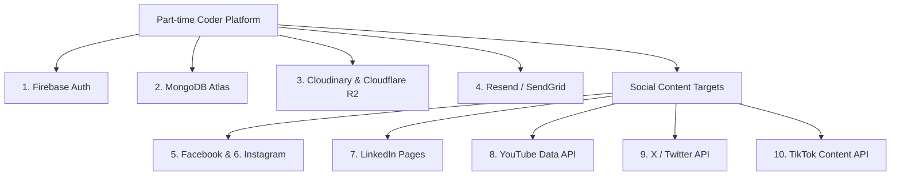

# Part-time Coder — Identity & Integration Provider Feasibility Register (IMP-00-09)

> **Document ID:** PTC-INT-REG-001  
> **Version:** 1.0.0  
> **Task ID:** `IMP-00-09`  
> **Phase:** P00 (Discovery, Environment, CI and Feasibility)  
> **Gate:** G0  
> **Status:** Active Provider Feasibility Register  
> **Effective Date:** 15 October 2026  
> **Governing Policy:** `AGENTS.md` Section 2, `docs/PRD.md` Section 11, `docs/TRD.md` Section 6, `docs/IMPLEMENTATION_PLAN.md` Section 11  
> **Applicable Requirement IDs:** `PTC-INT-001`–`005`, `PTC-SOC-001`–`006`, `PTC-IAM-001`–`005`

---

## 1. Executive Summary & Gating Protocol

The Part-time Coder platform integrates with external identity providers, database services, media delivery networks, email delivery gateways, and six major social publishing targets.

In strict compliance with **AGENTS.md Section 2** and **PRD Section 11**:
- **Manual Publishing Is Invariant:** Automated social publication is independently capability/permission/approval gated. The MVP pillars require drafting, review, asset assembly, and human manual publication to function end-to-end regardless of third-party API availability.
- **Provider-Conditional Activation (Gate G8):** Live API posting requires verified developer accounts, verified OAuth scopes, and explicit Owner authorization per account.
- **Zero Paid Subscriptions Without Approval:** No paid API plan (e.g., X API $100/mo tier) or paid cloud service may be activated autonomously by AI agents.

---

## 2. Master Provider Feasibility Register

---

### 2.1 Identity: Firebase Authentication (`PTC-IAM-001`–`005`)

- **Official Documentation:** [https://firebase.google.com/docs/auth](https://firebase.google.com/docs/auth)
- **Supported Operations:** User registration, email/password authentication, Google OAuth sign-in, server-side session cookie issuance (`createSessionCookie`), session revocation check, multi-factor authentication (MFA).
- **Required Developer Accounts:** Google Cloud Console / Firebase Project.
- **OAuth Scopes:** `openid`, `email`, `profile`.
- **App Review / Verification:** None for baseline email/password and Google login. OAuth consent screen verification required if requesting sensitive Google Drive/Workspace scopes (not needed for PTC MVP).
- **Sandbox / Emulation:** Comprehensive local Firebase Auth Emulator supported (`firebase emulators:start --only auth`).
- **Quotas & Billing Costs:**
  - *Spark Plan ($0):* Up to 50,000 Monthly Active Users (MAUs) for baseline authentication. Includes 10 free SMS verifications/day.
  - *Blaze Plan (Pay-as-you-go):* Required if using custom SMS MFA at scale ($0.01–$0.06/SMS depending on recipient carrier). TOTP/authenticator app MFA avoids carrier surcharges.
- **Known Restrictions & Security Boundaries:** Firebase Admin SDK must run strictly server-side (`packages/auth`). Service account private keys must never be bundled into browser client builds.
- **Current Approval Status:** `approved` for Spark free tier (ADR-0004). Blaze upgrade requires Owner approval.
- **Required Owner Actions:** Create isolated Firebase projects for Staging and Production; inject credentials into secure environment stores.

---

### 2.2 Database: MongoDB Atlas (`PTC-DATA-001`–`004`)

- **Official Documentation:** [https://www.mongodb.com/docs/atlas/](https://www.mongodb.com/docs/atlas/)
- **Supported Operations:** Multi-document ACID transactions (`session.startTransaction()`), compound unique indexes, optimistic concurrency versioning (`__v`), tenant isolation filters.
- **Required Developer Accounts:** MongoDB Atlas Cloud Account.
- **Quotas & Billing Costs:**
  - *M0 Free Tier ($0/mo):* 512 MB storage, shared vCPU/RAM. **No automated backups or PITR.** Approved for staging only.
  - *Flex Tier (~$8–$30/mo):* 5 GB storage, metered compute with $30 hard spending cap. Daily snapshots (7 days retention). Recommended for initial production.
  - *Dedicated M10 (~$58/mo):* 2 GB RAM, 10 GB SSD, 3-node replica set, continuous Cloud Backup with 35-day PITR.
- **Known Restrictions:** IP Access Lists must explicitly whitelist server static IPs or NAT gateway IPs.
- **Current Approval Status:** M0 approved for staging; Flex/M10 pending Owner selection at Gate G13.
- **Required Owner Actions:** Provision Atlas clusters; whitelist production host IPs.

---

### 2.3 Media Storage: Cloudinary (`PTC-CMS-004`)

- **Official Documentation:** [https://cloudinary.com/documentation](https://cloudinary.com/documentation)
- **Supported Operations:** Signed direct asset uploads, on-the-fly transformations (crop, scale, watermark), responsive image format optimization (AVIF/WebP), video streaming optimization.
- **Required Developer Accounts:** Cloudinary Account.
- **Quotas & Billing Costs:**
  - *Free Tier ($0/mo):* 25 monthly shared credits (1 credit = 1,000 transformations OR 1 GB storage OR 1 GB net delivery bandwidth). Shared pool across all dimensions.
  - *Plus Tier ($89/mo):* 225 monthly credits, custom domain CNAME.
- **Known Restrictions:** Media uploads from browser client must use server-signed upload signatures with short expiration to prevent asset injection.
- **Current Approval Status:** `approved` for Free tier (ADR-0006).
- **Required Owner Actions:** Register free Cloudinary workspace; supply Cloud Name, API Key, and Secret.

---

### 2.4 Transactional Email: Resend / SendGrid (`PTC-COM-001`–`003`)

- **Official Documentation:** [https://resend.com/docs](https://resend.com/docs)
- **Supported Operations:** Staff/client invitations, lead inquiry confirmation, quote delivery, deliverable review notifications, operational invoice delivery with PDF attachments.
- **Required Developer Accounts:** Resend Account.
- **Verification & DNS Requirements:** Custom domain DNS records required: DKIM (`CNAME`), SPF (`TXT`), DMARC (`TXT`) to prevent spam degradation.
- **Quotas & Billing Costs:**
  - *Resend Free ($0/mo):* 3,000 emails/month, 100 emails/day cap.
  - *Resend Pro ($20/mo):* 50,000 emails/month, dedicated IP options.
- **Manual / Local Fallback:** Console logger driver in local development and staging (`ENABLE_EMAIL=false`).
- **Current Approval Status:** Console mock driver active in dev/staging. Production email delivery gated for Gate G10.
- **Required Owner Actions:** Configure DNS TXT/CNAME records on production domain.

---

### 2.5 Social Content Target: Facebook Pages (`PTC-SOC-001`)

- **Official Documentation:** [https://developers.facebook.com/docs/pages-api/](https://developers.facebook.com/docs/pages-api/)
- **Supported Operations:** Publish page status, photo, video, link previews; retrieve page post engagement metrics.
- **Required Developer Accounts:** Meta for Developers account, verified Meta Business Manager.
- **Required OAuth Scopes:** `pages_show_list`, `pages_read_engagement`, `pages_manage_posts`.
- **App Review & Verification:** Standard App Review required for public posting. Business Verification required for Live application mode. Development mode restricted to app administrators and invited testers.
- **Rate Limits:** 200 calls per user per hour standard graph API call limit.
- **Manual Fallback (`PTC-SOC-006`):** If API is unverified or disabled, platform provides formatted copy-to-clipboard, downloaded media assets, and deep link to Facebook Page Publishing Tools.
- **Current Approval Status:** `manual_fallback_active`. Live API posting pending Owner app review and Gate G8 authorization.

---

### 2.6 Social Content Target: Instagram Professional (`PTC-SOC-001`)

- **Official Documentation:** [https://developers.facebook.com/docs/instagram-platform/instagram-graph-api](https://developers.facebook.com/docs/instagram-platform/instagram-graph-api)
- **Supported Operations:** Single photo publishing, carousel publishing, video/reels publishing, caption & hashtag handling, post insights.
- **Required Accounts:** Instagram Business or Creator Account connected to a Facebook Page.
- **Required OAuth Scopes:** `instagram_basic`, `instagram_content_publish`, `instagram_manage_insights`.
- **App Review:** Requires Meta App Review approval for `instagram_content_publish`.
- **Rate Limits:** Hard ceiling of 50 API-published posts per 24 hours per Instagram account.
- **Manual Fallback (`PTC-SOC-006`):** Scheduled notification to mobile operator with downloadable media asset and copied caption text.
- **Current Approval Status:** `manual_fallback_active`. Live publishing gated for Gate G8.

---

### 2.7 Social Content Target: LinkedIn Organization Pages (`PTC-SOC-001`)

- **Official Documentation:** [https://learn.microsoft.com/en-us/linkedin/marketing/](https://learn.microsoft.com/en-us/linkedin/marketing/)
- **Supported Operations:** Organization text posts, image posts, multi-image shares, video shares, article link previews.
- **Required Accounts:** LinkedIn Developer Portal, Administrator access to Part-time Coder LinkedIn Page.
- **Required OAuth Scopes:** `w_organization_social`, `r_organization_social`, `rw_organization_admin`.
- **App Review:** Requires approval for the "Community Management API" or "Share on LinkedIn" product in the LinkedIn Developer Portal.
- **Rate Limits:** 100 posts per day per organization page.
- **Manual Fallback (`PTC-SOC-006`):** Direct deep link to LinkedIn Company Page admin post creator with pre-copied text.
- **Current Approval Status:** `manual_fallback_active`. Live publishing gated for Gate G8.

---

### 2.8 Social Content Target: YouTube (`PTC-SOC-001`)

- **Official Documentation:** [https://developers.google.com/youtube/v3](https://developers.google.com/youtube/v3)
- **Supported Operations:** Video upload (`videos.insert`), title, description, tags, category, privacy status (`private`/`unlisted`/`public`), custom thumbnail upload.
- **Required Accounts:** Google Cloud Console with YouTube Data API v3 enabled.
- **Required OAuth Scopes:** `https://www.googleapis.com/auth/youtube.upload`.
- **Quotas & Billing Costs:**
  - *Default Free Quota:* 10,000 units/day.
  - *Video Insert Cost:* **1,600 units per video upload** (~6 videos per day on free tier).
  - *Quota Extension:* Requires submitting Google audit questionnaire for higher daily quotas.
- **Manual Fallback (`PTC-SOC-006`):** One-click download of processed MP4 video file and copied description metadata with direct link to YouTube Studio (`studio.youtube.com`).
- **Current Approval Status:** `manual_fallback_active`. Live upload gated for Gate G8.

---

### 2.9 Social Content Target: X / Twitter (`PTC-SOC-001`)

- **Official Documentation:** [https://developer.x.com/en/docs/x-api](https://developer.x.com/en/docs/x-api)
- **Supported Operations:** Create Tweet (`POST /2/tweets`), text, media attachments, quote tweets.
- **Required Accounts:** X Developer Portal project.
- **Required OAuth Scopes:** `tweet.read`, `tweet.write`, `users.read`, `offline.access`.
- **Billing Costs & Restrictions:**
  - *Free Tier ($0/mo):* Text-only posting with a 1,500 tweets/month limit. **Media upload is NOT supported on the Free tier.**
  - *Basic Tier ($100.00 / month):* Supports media uploads and up to 3,000 user tweets/month.
- **Cost Policy Ruling:** **Do not purchase the $100/mo X API tier.** In accordance with ADR-0006, X posts will operate under the **Manual Publishing Flow** (`PTC-SOC-006`) unless the Owner explicitly approves a paid API subscription.
- **Manual Fallback (`PTC-SOC-006`):** Formatted tweet copy with attached media download and deep link to X web composer (`x.com/compose/post`).
- **Current Approval Status:** `manual_fallback_active`. Paid API gated.

---

### 2.10 Social Content Target: TikTok (`PTC-SOC-001`)

- **Official Documentation:** [https://developers.tiktok.com/doc/content-posting-api-get-started](https://developers.tiktok.com/doc/content-posting-api-get-started)
- **Supported Operations:** Direct video posting (`/v2/post/publish/video/init/`), video upload, caption, privacy controls, scheduled publishing.
- **Required Accounts:** TikTok for Developers account, TikTok Business Account.
- **Required OAuth Scopes:** `video.publish`, `video.upload`.
- **App Review:** Requires comprehensive developer review, brand identity verification, and video submission proof before production API access is granted.
- **Manual Fallback (`PTC-SOC-006`):** Download mobile-optimized video asset and caption text with link to TikTok Web Studio (`tiktok.com/creator-center`).
- **Current Approval Status:** `manual_fallback_active`. Live publishing gated for Gate G8.

---

## 3. Summary of Owner Actions & Approval Status

| Integration | Tier / Capability | Approval Status | Owner Action Required at Gate |
|---|---|---|---|
| **Firebase Auth** | Spark Free (50k MAUs) | `approved` (ADR-0004) | Supply staging/prod service account keys at P02/P13 |
| **Firebase Auth** | Blaze SMS MFA | `gated_owner` | Decide between SMS MFA (pay-as-you-go) vs TOTP MFA ($0) |
| **MongoDB Atlas** | M0 Staging Free | `approved` (ADR-0006) | Connect staging database cluster at P12 |
| **MongoDB Atlas** | Flex Production (~$8–$30/mo) | `gated_owner` | Authorize Atlas Flex billing at Gate G13 pre-flight |
| **Cloudinary** | Free (25 credits) | `approved` (ADR-0006) | Supply Cloud Name and API keys at P03 |
| **Resend Email** | Free (3,000/mo) | `gated_owner` | Configure DKIM/SPF DNS records on production domain at P10 |
| **Meta (FB/IG)** | Live API Posting | `gated_owner` | Complete Meta Business Verification & App Review at P08 |
| **LinkedIn Pages** | Live API Posting | `gated_owner` | Request Community Management API product approval at P08 |
| **YouTube** | Live Video Insert | `gated_owner` | Enable YouTube Data API v3 in Google Cloud at P08 |
| **X (Twitter)** | Paid API ($100/mo) | `rejected_mvp` | Manual publishing workflow active; paid API requires explicit consent |
| **TikTok** | Live API Posting | `gated_owner` | Complete TikTok Developer App Review at P08 |
