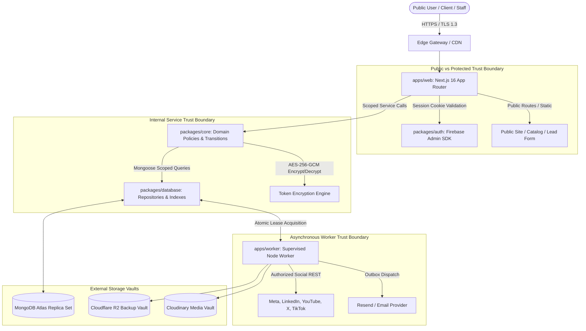

# Part-time Coder — Security Baseline & STRIDE Threat Model (IMP-00-10)

> **Document ID:** PTC-SEC-BASE-001  
> **Version:** 1.0.0  
> **Task ID:** `IMP-00-10`  
> **Phase:** P00 (Discovery, Environment, CI and Feasibility)  
> **Gate:** G0  
> **Status:** Active Security Policy & Threat Model  
> **Effective Date:** 15 October 2026  
> **Governing Policy:** `AGENTS.md` Section 6, 7 & 11, `docs/PRD.md` Section 15, `docs/TRD.md` Section 9, `docs/IMPLEMENTATION_PLAN.md` Section 3  
> **Applicable Requirement IDs:** `PTC-SEC-001`–`011`, `PTC-DATA-001`–`004`, `PTC-IAM-001`–`010`

---

## 1. Executive Summary & Security Principles

This document establishes the comprehensive Security Baseline, Attack Surface Map, and STRIDE Threat Model for the Part-time Coder unified platform.

### Non-Negotiable Security Invariants
1. **Deny by Default:** Every API endpoint, database query, file download, and worker job must reject access unless an explicit permission grant and tenant boundary match are verified.
2. **Server-Side Authority:** The UI never decides authorization. Client-supplied IDs (`companyId`, `clientOrganizationId`, `userId`, `role`) are never trusted without server-derived session verification.
3. **Strict Client Isolation:** Client organizations operate in complete logical isolation. Cross-tenant leakage is treated as a P0 security incident.
4. **Zero Production Secrets in Git:** All secrets are injected dynamically via environment variables with Zod validation on boot.
5. **Defense in Depth:** Security controls exist at the transport (TLS/HSTS), network, application gateway, service layer, and database index levels.

---

## 2. Platform Attack Surface Map



---

## 3. STRIDE Threat Model & Domain Analysis

### 3.1 Domain 1 — Authentication and Session Trust Boundaries (`PTC-IAM-001`–`010`, `PTC-SEC-003`)
- **STRIDE Category:** Spoofing, Elevation of Privilege
- **Threat Scenario:** Attacker steals or forges session cookies, replays expired sessions, or bypasses revoked grants after account suspension.
- **Controls & Mitigations:**
  - Firebase server-side session cookies (`createSessionCookie`) with cryptographic signature validation.
  - Cookies set with `HttpOnly`, `SameSite=Lax`, and `Secure` (enforced in production).
  - Explicit revocation checks via `checkRevoked: true` on privileged mutations.
  - Immediate session invalidation upon user suspension or offboarding (`packages/auth`).
  - Strict MFA enforcement for Owner/Admin roles.

### 3.2 Domain 2 — Client Organization Isolation (`PTC-ORG-001`–`006`, `PTC-SEC-001`, `PTC-SEC-002`)
- **STRIDE Category:** Information Disclosure, Tampering
- **Threat Scenario:** Malicious client attempts IDOR (Insecure Direct Object Reference) to query another client organization's projects, deliverables, quotes, or invoices.
- **Controls & Mitigations:**
  - Multi-tenant single-company architecture (ADR-0003). Every resource collection includes mandatory `companyId` and `clientOrganizationId` fields.
  - Compound unique indexes at the database level (e.g. `{ companyId: 1, clientOrganizationId: 1, code: 1 }`).
  - Repository-level query scoping: Service layer enforces `filter.clientOrganizationId = session.clientOrganizationId` before executing any query.
  - Cross-tenant queries return `404 Not Found` rather than `403 Forbidden` to prevent resource existence enumeration.

### 3.3 Domain 3 — Scoped RBAC & Permission Boundaries (`PTC-IAM-004`–`008`)
- **STRIDE Category:** Elevation of Privilege
- **Threat Scenario:** Regular staff member or client user manipulates API parameters to perform administrative actions (e.g., inviting users, modifying company settings, or accessing global finance margins).
- **Controls & Mitigations:**
  - Granular RBAC grants evaluated at the service boundary:
    ```typescript
    allow = session.isValid &&
            user.isActive &&
            hasPermission(action, resourceType, user.grants) &&
            tenantMatches(resource, user) &&
            projectGrantExists(resource.projectId, user);
    ```
  - Organization membership does not confer blanket access across all projects; explicit project assignment is mandatory.
  - Protection against last-owner lockout: The system strictly prohibits suspending, revoking, or downgrading the last active Owner account.

### 3.4 Domain 4 — Social OAuth Token Encryption at Rest (`PTC-SEC-004`, `PTC-SOC-004`)
- **STRIDE Category:** Information Disclosure, Tampering
- **Threat Scenario:** Database snapshot or replica set read access leaks plaintext third-party OAuth refresh tokens, allowing unauthorized posting to client social accounts.
- **Controls & Mitigations:**
  - Authenticated symmetric encryption using **AES-256-GCM**.
  - Initialization Vector (IV, 12 bytes) and Authentication Tag (16 bytes) stored alongside ciphertext.
  - Key derived from `INTEGRATION_ENCRYPTION_KEY` (minimum 32 characters, validated at process startup).
  - Decryption happens exclusively in-memory inside the Worker process immediately prior to executing an authorized API request.

### 3.5 Domain 5 — Background Worker Trust Boundaries (`PTC-OPS-004`, `PTC-SOC-005`)
- **STRIDE Category:** Denial of Service, Tampering, Repudiation
- **Threat Scenario:** Worker crash leaves jobs permanently locked, duplicate jobs execute concurrently (double posting to social networks), or worker processes unauthorized actions.
- **Controls & Mitigations:**
  - Distributed atomic lease acquisition using `findOneAndUpdate({ status: 'pending', lockedAt: null })`.
  - Lease duration hard cap (60 seconds) with automated crash recovery.
  - Worker concurrency bound (`MAX_CONCURRENT_JOBS = 5`) to prevent host memory exhaustion.
  - Worker re-validates post approval state and content version before dispatching third-party API calls. If an approved post was modified, publishing is revoked.

### 3.6 Domain 6 — Secrets & Configuration Protection (`PTC-OPS-003`, `PTC-SEC-008`)
- **STRIDE Category:** Information Disclosure
- **Threat Scenario:** Accidental check-in of `.env` files, logging secrets in console outputs, or exposing backend API secrets in Next.js browser client bundles.
- **Controls & Mitigations:**
  - Two distinct Zod schemas in `packages/config/src/env.ts`: `serverEnvSchema` (contains secrets) and `publicEnvSchema` (allowlisted `NEXT_PUBLIC_*` client variables).
  - Server validation throws fatal errors if invoked in browser context.
  - Error formatter strips and redacts raw secret values from validation messages.
  - `.gitignore` strictly excludes all `.env*` files except `.env.example`.
  - Automated pre-push and CI Gitleaks secret scanning across complete git history.

### 3.7 Domain 7 — Audit Log Integrity (`PTC-SEC-005`, `PTC-SEC-006`)
- **STRIDE Category:** Repudiation, Tampering
- **Threat Scenario:** Malicious insider modifies or deletes audit logs to hide unauthorized changes to quotes, invoices, or client permissions.
- **Controls & Mitigations:**
  - Append-only `audit_logs` collection. Mongoose schema rejects update and delete mutations.
  - Every sensitive domain event records: `actorUserId`, `actorRole`, `companyId`, `clientOrganizationId`, `action`, `resourceId`, `ipAddress`, `userAgent`, and `timestamp`.
  - Retention schedule: Audit logs preserved for 1 year online, archived to encrypted cold storage.

### 3.8 Domain 8 — Payment and Invoice Integrity (`PTC-FIN-001`–`009`)
- **STRIDE Category:** Tampering, Repudiation
- **Threat Scenario:** Floating-point rounding errors cause financial imbalances; concurrent invoice requests issue duplicate invoice numbers; unauthorized adjustments alter issued invoices.
- **Controls & Mitigations:**
  - All currency calculations use integer minor units (cents/pence) or approved exact decimal representations. JavaScript floating-point arithmetic is prohibited.
  - Server-assigned sequential invoice numbering executed inside a MongoDB multi-document ACID transaction.
  - Issued invoices are immutable snapshots; adjustments require explicit credit notes or reversing records.

### 3.9 Domain 9 — File Storage & Media Access Control (`PTC-CMS-004`, `PTC-SEC-007`)
- **STRIDE Category:** Information Disclosure, Tampering
- **Threat Scenario:** Attacker accesses confidential client deliverables or invoice PDFs via guessed storage URLs or performs unauthorized file uploads.
- **Controls & Mitigations:**
  - Direct browser uploads require server-generated cryptographic signatures with strict upload presets and 15-minute expiration windows.
  - Private client files (e.g. invoice PDFs) served via authenticated proxy routes with tenant permission validation, not public CDN URLs.

### 3.10 Domain 10 — CI/CD & Supply-Chain Security (`PTC-SEC-009`, `PTC-NFR-011`)
- **STRIDE Category:** Tampering, Elevation of Privilege
- **Threat Scenario:** Compromised third-party GitHub Action injects malicious code into build artifacts or exfiltrates secrets during CI runs.
- **Controls & Mitigations:**
  - Immutable commit-SHA pinning for third-party actions (`gitleaks/gitleaks-action@e0c47f4f8be36e29cdc102c57e68cb5cbf0e8d1e`).
  - Top-level workflow permissions locked to `permissions: contents: read`.
  - `pnpm-lock.yaml` frozen lockfile enforcement in CI (`pnpm install --frozen-lockfile`).
  - `onlyBuiltDependencies` allowlist in `pnpm-workspace.yaml` restricts native build scripts.
  - Automated dependency vulnerability scans via `pnpm audit --audit-level=high` (0 high/critical CVEs allowed).

### 3.11 Domain 11 — Backup & Disaster Recovery Threats (`PTC-OPS-005`, `PTC-NFR-006`)
- **STRIDE Category:** Information Disclosure, Denial of Service
- **Threat Scenario:** Ransomware or cloud failure destroys primary database cluster; database backups stored in cleartext are intercepted.
- **Controls & Mitigations:**
  - Daily automated `mongodump` archives encrypted with AES-256 before egress.
  - Encrypted archives transferred over TLS to Cloudflare R2 backup vault in an independent failure domain.
  - Restore rehearsal mandatory under non-production conditions before production launch (Phase P11).

---

## 4. Master Risk Assessment Matrix

| Risk ID | STRIDE Category | Threat Description | Inherent Severity | Applied Mitigation | Residual Risk | Verification Evidence |
|---|---|---|---|---|---|---|
| **SEC-001** | Spoofing | Forged or stolen session cookies | High | Firebase Admin signed HttpOnly cookies with `checkRevoked` | Low | Unit tests in `packages/auth`, integration tests |
| **SEC-002** | Info Disclosure | IDOR cross-client project access | Critical | Mandatory compound indexes `{ companyId, clientOrgId, code }` + repo scoping | Very Low | Integration tests (12/12 passing in `packages/database`) |
| **SEC-003** | Elevation | Unauthorized role escalation | High | Scoped RBAC grants checked at domain service boundary | Low | P02 RBAC verification suite |
| **SEC-004** | Info Disclosure | Plaintext OAuth token database leak | Critical | AES-256-GCM token encryption with startup key validation | Very Low | `packages/config/src/env.test.ts` encryption key enforcement |
| **SEC-005** | DoS / Tampering | Worker queue race / double posting | High | Atomic MongoDB `findOneAndUpdate` leases + 60s timeout | Low | P07 worker concurrency tests |
| **SEC-006** | Info Disclosure | Accidental secret commit to Git | Critical | Pinned Gitleaks v3 scanner + `.gitleaks.toml` allowlist | Very Low | CI Run `38652937037` passed; zero local findings |
| **SEC-007** | Tampering | Issued invoice total modification | High | Immutable document snapshots + integer minor units | Very Low | P09 finance transaction tests |
| **SEC-008** | Tampering | CI supply-chain malicious action | High | Immutable commit-SHA pinning + read-only permissions | Very Low | `.github/workflows/ci.yml` audit clean |
| **SEC-009** | DoS / Data Loss | Unrecoverable Atlas cluster failure | High | Daily encrypted `mongodump` streamed to Cloudflare R2 | Low | P11 restore rehearsal drill |
| **SEC-010** | Info Disclosure | Stack trace / secret leakage in errors | Medium | Centralized error sanitization + secret redaction in Zod | Very Low | `packages/config/src/env.test.ts` (test 15 passing) |

---

## 5. Security Verification Commands

The following security checks are permanently integrated into developer tooling and CI workflows:

```bash
# 1. Full Gitleaks Git History & Working Tree Secret Audit
gitleaks git --verbose --config .gitleaks.toml
gitleaks dir --verbose --config .gitleaks.toml

# 2. Dependency Vulnerability Audit (High & Critical CVEs)
pnpm audit --audit-level=high

# 3. Security Hardened Environment Tests
pnpm test:unit

# 4. Multi-Tenant Database Isolation & Transaction Tests
pnpm test:integration
```
