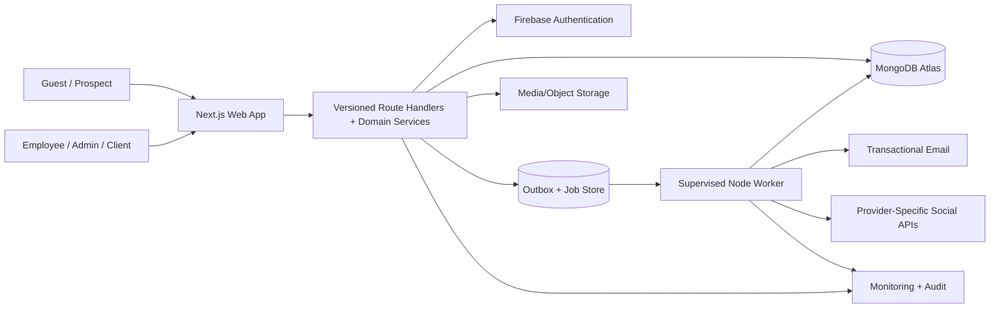
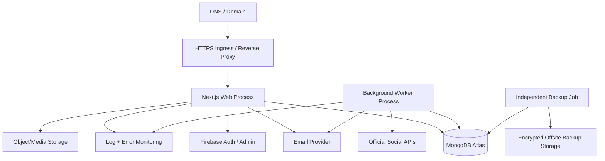

# Part-time Coder — Technical Requirements Document (TRD)

> **Document ID:** PTC-TRD-001  
> **Version:** 1.0.0  
> **Status:** Implementation baseline / proposed technical design, pending Owner and technical review  
> **Prepared:** 14 October 2026  
> **Product:** Part-time Coder Unified Company Platform  
> **Canonical repository path:** `docs/TRD.md`  
> **Source of truth:** `docs/PRD.md` — PTC-PRD-001 v1.0.0, Architecture Baseline v1.0 and approved `DEC-001` through `DEC-015`  
> **Audience:** Owner, engineering leads, frontend/backend developers, DevOps, security, QA, and AI coding agents  
> **Next:** `docs/APP_FLOW.md` → `docs/UI_UX_DESIGN_BRIEF.md` → `docs/BACKEND_SCHEMA.md` → `docs/IMPLEMENTATION_PLAN.md` → `AGENTS.md`

---

## 0. Document control, authority, and conventions

### 0.1 Purpose
This TRD specifies **how** Part-time Coder will implement the requirements in its approved PRD: component architecture, contracts, authorization, data persistence, application services, background publishing, external adapters, infrastructure, observability, testing, deployment, and operational control. It is intended to be detailed enough for phased AI-assisted implementation without guessing security boundaries or treating unapproved provider APIs as available.

### 0.2 Normative language and status
- **MUST / SHALL**: mandatory for stated release; deviations require approved ADR.
- **SHOULD**: default engineering decision, subject to documented exception.
- **MAY**: nonblocking option.
- **P0/M**: mandatory for MVP; **P1/F / P2/F**: future; **C**: conditional on third-party approval/budget.
- **Design proposal**: technical implementation selected here but still subject to owner/engineering approval and phase-gate validation.
- **No invented evidence**: proposed latency, availability, costs, migration results and provider eligibility are *targets*, not measured performance or successful deployment claims.

### 0.3 Document precedence
1. Owner-approved product decisions (`DEC-001`–`DEC-015`), PRD, and owner-signed ADRs.
2. This TRD for approved technical approaches; it must refine, not contradict, the PRD.
3. `APP_FLOW.md` for UI journeys, navigation, states and redirect semantics.
4. `UI_UX_DESIGN_BRIEF.md` for visual system and interaction accessibility.
5. `BACKEND_SCHEMA.md` for final field-level schema, cardinalities, indexes and migration scripts.
6. `IMPLEMENTATION_PLAN.md` for tasks, dependencies and phase gates.
7. `AGENTS.md` for daily AI coding workflow, commits and checkpoints.

If documents disagree, stop the *affected* implementation, report the conflict with IDs, and record a decision. Independent work may proceed. All changes to role authority, privacy boundary, public publishing, financial integrity or deployment model MUST have an ADR.

### 0.4 Reference IDs
- **Product requirements:** `PTC-<DOMAIN>-###`, unchanged from PRD.
- **Technical decisions:** `TD-###` in this TRD; ADRs are named `docs/ADR/NNNN-title.md`.
- **API contracts:** `API-<DOMAIN>-###`.
- **Architecture/security tests:** `AT-###` with linked PRD requirement IDs.
- **Operational runbooks:** `RUN-###`.
- **Gate:** `G0`–`G7` in the PRD.

### 0.5 Authoritative scope
**In scope at MVP:** one internal company (Part-time Coder) with many *isolated client organizations*; public services/products/case studies/blog and CMS; identity/invitations/scoped access; leads/quotes/client conversion; projects/tasks/milestones/deliverables/feedback; employee and client workspaces; six-network social planning/approval/scheduling/publishing-capability/fallback/metrics; basic invoices/manual payment records; notifications/reports; security, backups and recoverability.

**Not in MVP:** payroll, taxation engine, general ledger, SaaS reselling, real-time chat, fully featured HR, social inbox or scraping, AI autonomous publishing, automated e-signatures, native mobile apps, advanced GitHub two-way synchronization and end-to-end Bangla translations. Do not build deferred modules merely because future routes/entities are documented.

### 0.6 Technical decision record
| ID | Decision | Reason / guardrail | PRD linkage |
|---|---|---|---|
| TD-001 | One TypeScript monorepo with Next.js App Router web app and a separate supervised Node.js worker | Shared contracts, low operational overhead, independent scheduled execution | DEC-008/009/010; PTC-OPS-004 |
| TD-002 | Domain-organized modular monolith, not early microservices | Isolate business rules without network and deployment complexity | PTC-GOV-001/005 |
| TD-003 | Firebase Authentication as identity provider; database as authority for grants | Authentication and business authorization remain distinct | PTC-IAM-001–009 |
| TD-004 | HttpOnly Secure same-site Firebase session cookie with server verification | Avoid exposing privileged access through frontend-only authentication | PTC-SEC-001/003/006 |
| TD-005 | MongoDB Atlas/Mongoose primary persistence with explicit scoped queries and indexed unique keys | Matches baseline, simple operational model | PTC-INT-002; PTC-DATA-001 |
| TD-006 | MongoDB-backed persisted jobs first; abstract queue backend | Avoid mandatory Redis cost; support recoverable scheduling | PTC-SOC-008–013; PTC-NFR-007 |
| TD-007 | Provider-specific social adapters with capability registry and authorization gates | Platform permissions are not uniform or guaranteed | PTC-SOC-001–019; PTC-INT-006–011 |
| TD-008 | Separate **client-safe** DTO/query path from internal project entities | Avoid accidental financial/internal-data leakage | PTC-CMS-006; PTC-CLI-001–009; PTC-SEC-002 |
| TD-009 | REST `/api/v1`, Zod validation, uniform envelopes/errors and OpenAPI generation | Predictable contracts and deterministic tests | PTC-GOV-001–005 |
| TD-010 | Commercial-use-compatible self-hostable Node deployment target; host finalized at G0/G7 | Respect commercial licensing and cost constraints | DEC-006/014; PTC-INT-003 |
| TD-011 | Assets in private/public object storage; MongoDB stores metadata only | Secure file delivery and manageable database growth | PTC-CMS-004; PTC-SEC-008 |
| TD-012 | Outbox/event + audit pattern for critical domain mutations | Retryable side effects with traceability | PTC-COM-003; PTC-SEC-005 |
| TD-013 | Correctness-first financial amounts in integer minor units and immutable posting history | Avoid floating-point errors and lost audit history | PTC-FIN-001–006 |
| TD-014 | Locale-aware `en` first, `bn` ready; UTC instants + IANA time zones | Avoid later translation and schedule rewrite | DEC-007/012; PTC-NFR-008 |
| TD-015 | Test releases must include cross-client negative tests and uncertain publishing response tests | Highest-impact failure surfaces | PTC-SEC-001–011; PTC-SOC-012 |

All technology package versions must be pinned/locked after checking supported runtimes and maintenance status *during Phase 0*. Do not treat any future major version as guaranteed compatible merely because its name appears below.

---

## 1. System context and architectural principles

### 1.1 System context
Part-time Coder owns one integrated application and business database. Guests access public pages. Authenticated users may hold staff roles, client-organization memberships, or regular-user access. Employees work on company-assigned resources; client staff see only expressly client-visible content. Marketing staff use provider-authorized social accounts through a shared publishing engine. Operators supervise jobs, security and backups.



Mermaid is conceptual: MongoDB and job/outbox collections may live in one database. The diagram is **not** evidence of deployed integrations.

### 1.2 Architectural invariants
1. All private queries, mutations, downloads, exports and background jobs enforce server-side permissions.
2. `companyId` identifies the sole internal operator, **not** an open-ended SaaS tenant. Client organization IDs are confidential authorization scopes.
3. External identity claims do not confer internal roles. Roles/grants are read from protected company data.
4. An internal project and its public case study are different records with different publication policies.
5. A successful API request is not equivalent to provider-confirmed social publication.
6. Approval is tied to an immutable content revision; modifying material after approval invalidates that approval.
7. Schedulers and jobs remain safe after process crashes and retries. At-most-one concurrent worker claim is a coordination target; external exactly-once delivery cannot be assumed.
8. System clock uses UTC for instants; user-selected IANA timezone is presentation and schedule-input context.
9. Sensitive tokens, private file contents and internal cost/margin details must never appear in client DTOs or logs.
10. Every production service needs health visibility, a recovery path and an accountable owner.

### 1.3 Initial capacity assumptions (from PRD)
| Dimension | Initial test dataset, not business hard cap |
|---|---:|
| Internal staff | 25 |
| Client users | 100 |
| Concurrent authenticated sessions | 50 |
| Active projects | 100 |
| Tasks | 10,000 |
| Media metadata records | 5,000 |
| Campaign platform variants / month | 500 |
| Public quote requests / day | 100 |

Use those values to seed realistic performance tests. Query/index review and tier upgrades are required if growth, heavy media, or API costs exceed assumptions.

### 1.4 Quality attributes and tradeoffs
- **Security > convenience:** deny by default, privilege-aware serialization, versioned approvals.
- **Consistency > async speed:** database changes must commit before outward communications, then outbox reliably queues side effects.
- **Portability > proprietary shortcuts:** container-compatible Node runtime; provider abstraction for storage/email/queue.
- **Cost restraint > speculative scale:** Atlas Free can be used where appropriate, but commercial readiness requires independent backups and load validation.
- **Simple MVP > overengineering:** no service mesh, Kafka, GraphQL, Redis, elastic cluster or advanced data warehouse until justified by ADR.

---

## 2. Technology stack and runtime boundaries

### 2.1 Baseline stack
| Layer | Technology | Design restriction |
|---|---|---|
| Language | TypeScript strict mode | No `any` for domain data or external adapter payloads without validated boundary |
| Web | Next.js App Router and React | Server components for read-heavy views; client components only where interaction requires |
| UI | Tailwind CSS, shadcn/ui/Radix primitives, optional Motion, Lucide | Design tokens shared; honor reduced-motion; accessibility reviewed |
| Backend | Node.js LTS, Next.js Route Handlers, domain services | No business logic embedded directly inside UI components |
| Forms/validation | Zod + React Hook Form | Revalidate on server; client checks for UX only |
| Database | MongoDB Atlas + Mongoose | Strict schemas, explicit indexes, stable DTO mapping, pool reuse |
| Identity | Firebase Auth + Firebase Admin SDK | Server-side sessions; grants internal to MongoDB |
| Job execution | Node worker with MongoDB durable lease queue | One process/service separate from web, retry and reconciliation |
| File storage | Cloudinary or S3-compatible implementation behind interface | Private/public separation and short-lived authorized URLs |
| Email | Resend or SMTP behind provider interface | Domain verification, persisted outbox, retries |
| Observability | JSON logs, request/job trace IDs, error tracker where permitted | PII/token redaction |
| Analytics UI | Recharts / accessible tables | Derived from scoped aggregate queries |
| Testing | Vitest, React Testing Library, Playwright, contract/integration tests | Provider mocks in CI; live credentials never mandatory for PR checks |
| CI/CD | GitHub Actions, pinned lockfile, container build optional | Lint/types/test/build/security gate |
| Hosting | Commercially suitable Node host + supervised worker | Must pass licensing, cost, backup and health checks before production |

### 2.2 Monorepo layout
```text
part-time-coder/
├── apps/
│   ├── web/
│   │   ├── src/app/
│   │   │   ├── (public)/
│   │   │   ├── (auth)/
│   │   │   ├── (account)/
│   │   │   ├── (admin)/
│   │   │   ├── (workspace)/
│   │   │   ├── (client)/
│   │   │   ├── (marketing)/
│   │   │   ├── (finance)/
│   │   │   └── api/v1/
│   │   ├── src/components/
│   │   ├── src/features/
│   │   ├── src/lib/
│   │   └── src/messages/en.json
│   └── worker/
│       ├── src/main.ts
│       ├── src/dispatchers/
│       ├── src/handlers/
│       └── src/health/
├── packages/
│   ├── core/              # use cases and domain types
│   ├── database/          # Mongoose, repository interfaces
│   ├── auth/              # Firebase admin + policy enforcement
│   ├── integrations/      # social/storage/email adapters
│   ├── contracts/         # Zod DTOs, errors, event names
│   ├── ui/                # shared design system (when needed)
│   └── config/            # tsconfig, lint, testing config
├── docs/
│   ├── PRD.md
│   ├── TRD.md
│   ├── APP_FLOW.md
│   ├── UI_UX_DESIGN_BRIEF.md
│   ├── BACKEND_SCHEMA.md
│   ├── IMPLEMENTATION_PLAN.md
│   ├── ADR/
│   └── runbooks/
├── .github/workflows/
├── AGENTS.md
├── pnpm-workspace.yaml
└── package.json
```

Filesystem route groups are illustrative and must not accidentally produce conflicting Next.js URL paths. Prefer one route group per shell where possible. Domain package splits are permitted only when they reduce real coupling; Phase 0 may start with fewer packages and split incrementally.

### 2.3 Layering and dependency rules
```text
Presentation (RSC / client UI)
    ↓ calls
REST handlers / server actions as specifically approved
    ↓ invokes
Application use-cases (orchestration + authorization)
    ↓ uses
Domain policy + repositories + outbound ports
    ↓ implementations
MongoDB repositories / Firebase / storage / social adapters
```
- **Route handlers**: parse body/query/path, verify session, invoke use case, serialize result, set HTTP response.
- **Domain services**: own transitions, invariants and safe side-effect intent.
- **Repository methods**: accept an explicitly authorized scope filter/context; never expose a broad database handle to a client route.
- **Adapters**: translate provider errors to typed internal outcomes and register provider request identifiers.
- **Shared contracts**: Zod schemas may be reused; protected authorization policy must execute on the server.
- **No cyclical domain imports**: collaboration and audit consume domain events, not individual feature source files.

### 2.4 Rendering, caching and state management
- Public published pages: server-rendered and cacheable with deliberate invalidation on CMS publish/archive. Never cache preview or unpublished content in public caches.
- Authenticated dashboards: dynamic server-rendered or client-fetched; `no-store` for private/user-specific data, explicit authorization on every fetch. Never share private cached responses across users/clients.
- Client-side: use local state for forms/modals and TanStack Query only where needed for mutation/refetch/optimistic UX; version-check optimistic updates before accepting server results.
- Upload UI: preflight metadata request → authorized direct upload if supported → confirm/finalize metadata. Never trust a client-provided public URL as proof of an uploaded asset.
- SEO: metadata, sitemap, canonical tags, robots policy, OG assets only for published public routes. Auth endpoints and private previews are not indexable.

### 2.5 Dependency and configuration strategy
- Pin a known-compatible Node LTS and package manager version in repo metadata; commit one lockfile; perform dependency update via reviewed PR.
- Dev/staging/prod environments use separate Firebase projects (or strictly isolated tenant configuration where supported), independent MongoDB DB/credentials and file namespaces. No production secrets in previews.
- Client bundle must never import Firebase Admin SDK, DB connection strings, social access/refresh tokens, encryption keys or service account private keys.
- Public Next.js env variables are allowlisted by naming convention and CI bundle inspection.

---

## 3. Domain decomposition and ownership

### 3.1 Modules
| Domain | Primary responsibility | Owns authoritative records | Public interfaces / events | PRD |
|---|---|---|---|---|
| Identity & Access | User sync, sessions, role grants, invitations, account status | Users, grants, invitations | `UserActivated`, `GrantRevoked` | IAM, SEC |
| Company & Governance | Single company settings, departments, admin audit | Company, departments, audit policies | `CompanyUpdated` | ORG, SEC |
| Public/CMS | Website content and publication lifecycle | Services, products, articles, case studies, content revisions | `ContentPublished` | PUB, CMS |
| CRM & Sales | Lead intake, qualification, conversion, quotation | Leads, lead history, quotations | `LeadCreated`, `LeadConverted` | CRM, FIN |
| Project Delivery | Tasks, milestones, member assignments and project activities | Projects, tasks, milestones, deliverables | `TaskAssigned`, `DeliverableReady` | PRJ, EMP |
| Client Collaboration | Client-org membership, safe project read models, feedback | Client orgs, memberships, feedback | `ClientFeedbackSubmitted` | CLI, COM |
| Marketing / Social | Accounts, campaigns, approvals, per-target publication and metrics | Social accounts, variants, approvals, publish jobs | `SocialApproved`, `PublishResolved` | SOC, INT |
| Finance | Invoice lifecycle, manual payments, balances | Invoices, payment records, exchange snapshots | `InvoiceIssued`, `PaymentRecorded` | FIN |
| Notifications | Persist, dispatch and read user notifications | Notifications, delivery outbox | `NotificationQueued` | COM |
| Analytics | Authorized metrics/read models, freshness metadata | Metric snapshots/derived views | `MetricsRefreshed` | ANA, NFR |
| Platform Operations | Jobs, feature switches, observability, backups | Outbox, job leases, integration status | `JobFailed`, `IntegrationDisabled` | OPS, INT |

### 3.2 Domain boundaries and communication
- No module reads another module's collections for a business decision without going through a defined service/repository contract.
- Authorization context is required even for internal admin actions; background jobs use a service principal and a persisted initiating actor ID where relevant.
- Domain transactions produce **state + audit + outbox intent** atomically when supported by deployment; if a deployment tier cannot meet the required atomicity, block that configuration for critical workflows or implement and verify an equivalent consistency protocol before G2/G5/G6.
- Events are internal integration messages with versioned schemas; avoid exposing internal events as unauthenticated external webhooks.

### 3.3 Client data boundary
- Exactly one company can serve many `ClientOrganization` records; client organizations are isolation scopes, not independent platform operators.
- Staff work on projects linked to one client org (or marked internal for owned products). Employees' project assignment allows internal project work, not administrative access to that client org.
- Client members need active membership *and* project/resource permission; an organization membership alone need not expose all organization projects when assignment policy restricts scope.
- Public publication is an explicit sanitized projection to `CaseStudy`, never a direct DTO of `Project`.


---

## 4. Authentication, sessions, authorization and invitations

### 4.1 Identity and session flow
**Identity source:** Firebase Auth `uid`. **Business authorization source:** internal MongoDB user record, active memberships, grants, and resource state. Firebase custom claims are *not* the source of truth for flexible project/client roles; they may carry a minimal bootstrap hint if approved by ADR but must not override database policy.

```mermaid
sequenceDiagram
  participant Browser
  participant Firebase as Firebase Auth
  participant Web as Next.js API
  participant DB as MongoDB
  Browser->>Firebase: Sign in (email/password or approved provider)
  Firebase-->>Browser: Short-lived ID token
  Browser->>Web: POST /api/v1/auth/session (ID token + CSRF protection)
  Web->>Firebase: Verify ID token; check recent sign-in policy
  Web->>DB: Resolve internal user and account status
  Web-->>Browser: Set Secure HttpOnly session cookie
  Browser->>Web: Authenticated request + CSRF token for mutation
  Web->>Firebase: Verify signed session cookie
  Web->>DB: Fetch current user/grants/resource scope
  Web-->>Browser: Scoped response
```

1. **Create session:** Exchange verified Firebase ID token for signed server-session cookie using Firebase Admin SDK, with an expiry policy chosen at G2. Require sufficient recent authentication on initial privileged session establishment where applicable.
2. **Cookie:** `HttpOnly`, `Secure` in HTTPS environments, `SameSite=Lax` by default (tighten for sensitive cross-site policy), bounded path, appropriate domain; no local-storage credentials for app API authentication. Localhost development may require tailored secure-cookie behavior without weakening production.
3. **CSRF:** Require same-origin `Origin`/`Referer` policy plus a CSRF token on cookie-authenticated state-changing requests (or a demonstrably equivalent protection); do not assume SameSite alone is sufficient.
4. **Authorization freshness:** Re-evaluate the DB account status, active memberships/grants and effective resource scope on every sensitive operation. Enforce immediate deny after suspension or grant revocation at the next request; never rely solely on still-valid cached permissions.
5. **Revocation:** On logout, clear the application cookie. On suspension/account compromise/high-risk offboarding, revoke Firebase refresh/session eligibility and deny via internal account status; plan revocation checks for high-risk routes with measured cost. Firebase session-cookie revocation checking adds a remote verification step when enabled; document caching tradeoff and fail-closed behavior.
6. **MFA:** A privileged user must have acceptable MFA proof before accessing privileged functionality; test actual enforcement with the chosen Firebase Auth edition/provider. Require recent reauthentication for role grant, owner change, provider-token operation, finance record voiding, and dangerous exports.
7. **Account deletion:** Separate deletion of internal data according to retention policy from Firebase identity removal. Pending jobs and credentials associated with a suspended employee are reassigned or blocked by documented policies.

**Critical session security test:** a suspended/role-revoked user holding a technically unexpired cookie must be denied on the next privileged API call. A cached RSC/client dashboard does not authorize a mutation.

### 4.2 Permission model
Define `Principal = {uid, userId, accountStatus, authContext}` and `AuthorizationContext = {principal, operation, resourceType, resourceId, clientOrgId?, projectId?, departmentId?, state?, visibility?}`.

Effective allow = authenticated & active & permitted operation by active role/grant & within relevant scope & valid business state & no explicit deny. **Deny by default**. Owner privilege does not override immutable financial history, provider rules or legally required records.

Example grants and scopes:
```ts
type ResourceScope =
  | { type: 'company' }
  | { type: 'department'; departmentId: string }
  | { type: 'project'; projectId: string }
  | { type: 'client_org'; clientOrganizationId: string }
  | { type: 'own'; userId: string };

type RoleGrant = {
  userId: string;
  roleKey: string;                 // e.g. marketing.manager
  scope: ResourceScope;
  grantedBy: string;
  active: boolean;
  revokedAt?: Date;
};
```

Scopes must be validated *at mutation and read time*, not inferred from role names alone. Role permission catalog is internal versioned configuration with security tests, not editable arbitrary JavaScript supplied by admins.

| Resource/action | Required guard | Exclusion / notes |
|---|---|---|
| `company.users.manage` | Owner/Admin with explicit scope | Cannot remove last active owner |
| `cms.publish` | Editor/publisher grant + valid revision/state | Creator self-approval restricted by editorial policy |
| `leads.view` / `leads.convert` | CRM operator grant + scoped assigned lead | Lead PII not available to public users |
| `projects.manage` | Owner/Admin or PM for that project | No access to unrelated private projects |
| `tasks.update` | Project permission or assignee plus task-state check | Assignment alone may not allow reassignment/deletion |
| `client.project.view` | Active client membership and project visibility | Internal comments/financial margin excluded |
| `social.campaign.create` | Marketing creator/manager role | Draft only |
| `social.approve` | Reviewer grant, not own content revision by default | Owner emergency override requires reason/audit |
| `social.accounts.manage` | Explicit trusted delegated grant and step-up auth | Normal creator cannot view tokens |
| `social.publish` | Previously approved immutable revision + valid account capability | Worker must recheck revocations/feature flags |
| `finance.invoices.issue` | Finance grant + valid invoice state | Client may only read authorized issued copy |
| `security.audit.read` | Owner/security-specific grant | Data minimization on audit export |

**Query policy:** repositories expose methods such as `findClientVisibleProjects(actor, clientOrgId, filters)` and `findEmployeeTasks(actor, filters)` that build predicates from server-authorized context. An API `?clientOrgId=` selector never creates a new authorization scope.

### 4.3 User enrollment and invitation lifecycle
- Public registration creates `Regular User` only, including through directly crafted API bodies.
- Internal employee and client grants require time-limited, single-use invitations created by authorized staff.
- Invitation uses a cryptographically random opaque token; persist only a hash, target email/identity constraint, intended organization/project scope, inviter, expiry, status, and consumed time.
- Accept invitation inside a signed authenticated session; verify target identity/email and account status before creating membership. Mark consumed and create grant in a transactional or equivalently idempotent operation.
- Failed/expired/revoked invites do not create partial memberships. Invitation redemption is safe under concurrent requests.
- Offboarding revokes grants, social account access, active provider authorization where appropriate, open invites, and access to private storage; issues necessary handover tasks.

### 4.4 Owner preservation and recovery
- Initialize the first Owner in an auditable bootstrap operation using server-side tooling, not a public registration parameter.
- Invariants: at least one **active** Owner; cannot revoke/deactivate/delete the last Owner through standard admin functions; security events logged.
- Recovery runbook requires verified identity, independent owner-controlled recovery proof and manual two-person/recorded process where possible. No hidden public backdoor or permanent static recovery password.
- Model disabled accounts as **deny** independent of Firebase cookie expiry. Admin UI never alone enforces access.

### 4.5 Threat cases and tests
| Case | Expected guard |
|---|---|
| Forged `role: owner` in registration body | Ignored/rejected; internal role remains Regular User |
| Client A requests Client B URL/attachment/export | Same opaque denial without metadata disclosure |
| Expired invite clicked twice concurrently | Maximum one accepted membership; both responses deterministic |
| Staff deleted from project during open editor session | Next mutation denied; stale form explains access changed |
| Owner removal on sole active owner | Rejected, audited, no changes committed |
| User signed in but privilege MFA absent | Privileged route or operation denied until verified |
| CSRF cross-origin POST with session cookie | Origin/token guard rejects |

**References:** PTC-IAM-001–009, PTC-SEC-001/002/003/005/006, PTC-ORG-004.

---

## 5. REST API conventions and contracts

### 5.1 API policy
- Base path: `/api/v1` over HTTPS in production; use a single source of URL paths and shared Zod schemas.
- Requests/responses: JSON (UTF-8) except authorized download and provider webhook/raw-body verification endpoints.
- IDs: opaque server-generated stable IDs; never rely on sequential unguessability as access control. Public slugs follow separately validated rules.
- Dates: RFC 3339 UTC strings in network responses (e.g. `2026-10-14T12:00:00.000Z`); input timezone for scheduling stored separately as IANA zone.
- Money: `{amountMinor: integer, currency: 'SAR'|'BDT'|'USD'}`; do not send JavaScript floats as accounting totals. Extend ISO currency definitions by reviewed change.
- Pagination: cursor-based preferred for changeable/high-volume collections, bounded default `limit=20`, maximum `limit=100`; deterministic sort with tie-breaker ID. Offset permitted only for small stable administrative lists and documented endpoints.
- Filtering: strict allowlist and typed inputs; server prepends mandatory authorization scope. Unbounded exports use async jobs and explicit authorization.
- Caching: no shared caching of user-specific private responses; `Cache-Control: private, no-store` for sensitive authenticated endpoints.
- Versioning: additive backward-compatible changes within `/v1`; breaking fields/enums/behavior require announced migration/`/v2`, contract tests and support period.
- Rate limiting: actor/IP/org-based based on endpoint risk. Do not trust raw `X-Forwarded-For` outside known proxies. Public forms require anti-bot protection.

### 5.2 Response envelope
```json
{
  "data": {
    "id": "opaque-id",
    "status": "draft"
  },
  "meta": {
    "requestId": "req_01...",
    "apiVersion": "v1"
  }
}
```

Collection responses additionally carry `{ "page": { "nextCursor": "...", "hasMore": false, "limit": 20 } }` inside `meta`. Cursor is opaque and cryptographically protected/signed when it embeds confidential filter information.

**Error contract:**
```json
{
  "error": {
    "code": "FORBIDDEN",
    "message": "You do not have access to this resource.",
    "details": [],
    "retryable": false
  },
  "meta": {
    "requestId": "req_01...",
    "apiVersion": "v1"
  }
}
```

Never include stack traces, raw database errors, client identifiers from unauthorized resources, refresh/access tokens or internal exception messages. Validation details can name safe fields, not secret values.

### 5.3 HTTP semantics
| HTTP | Use | Example error code |
|---|---|---|
| `200` | Successful read/update | — |
| `201` | Created resource | — |
| `202` | Accepted asynchronous task/job, not finished | — |
| `204` | Success without response body | — |
| `400` | Malformed request syntax | `BAD_REQUEST` |
| `401` | No valid authenticated session | `UNAUTHENTICATED` |
| `403` | Authenticated but forbidden | `FORBIDDEN` |
| `404` | Missing or intentionally concealed resource | `NOT_FOUND` |
| `409` | Conflict/duplicate/state mismatch | `CONFLICT` or `INVALID_TRANSITION` |
| `412` | Stale `If-Match` expected revision | `PRECONDITION_FAILED` |
| `413` | Upload exceeds accepted size | `PAYLOAD_TOO_LARGE` |
| `422` | Well-formed but invalid domain payload | `VALIDATION_ERROR` |
| `429` | Rate limit | `RATE_LIMITED` and `Retry-After` |
| `500` | Unexpected safe internal error | `INTERNAL_ERROR` |
| `502`/`503` | Dependency unavailable | `PROVIDER_UNAVAILABLE`/`SERVICE_UNAVAILABLE` |

Client-org-sensitive unauthorized resources SHOULD return non-enumerating `404` where appropriate, while observability records the denial type without leaking target metadata.

### 5.4 Idempotency and optimistic concurrency
- Sensitive commands require `Idempotency-Key` per actor/business operation: public quote submission when a client token is available, lead conversion, invoice issuance/payment recording, post scheduling/dispatch operations and provider webhook ingestion. Keys must be high entropy and bounded in lifespan.
- Store `(actor or domain scope, endpoint/command, key) → request fingerprint, result, expiry`. Same key/same payload returns same logical outcome; reused key/different payload returns `409`.
- For edit/approve/version-sensitive workflows use explicit integer `version` or ETag/`If-Match`. Update succeeds only when expected version matches. Disallow stale social review approval.
- Idempotency covers **local business commands**, not necessarily arbitrary third-party post creation. Provider duplicates are controlled by reconciliation and conservative retry strategy.

### 5.5 Example API contracts and route register
All example routes are proposals pending the detailed App Flow and schema. Specific routes may be adjusted by ADR without relaxing requirements. `R` = authenticated user, `P` = permission gate; `O` = public with abuse controls.

| Contract | Method and route | Gate | Function and key validations | PRD IDs |
|---|---|---|---|---|
| API-PUB-001 | `GET /services`, `GET /services/{slug}` (web routes) | O | Published content only | PUB-001/003 |
| API-PUB-002 | `POST /api/v1/public/inquiries` | O | Verified fields, bot limits, consent and deduplication | PUB-007, CRM-001 |
| API-CMS-001 | `GET/POST /api/v1/cms/articles` | P: `cms.read`/`cms.edit` | Drafts inaccessible publicly | CMS-001/002 |
| API-CMS-002 | `PATCH /api/v1/cms/articles/{id}` | P: edit | Expected `version`; safe content | CMS-003/005 |
| API-CMS-003 | `POST /api/v1/cms/content/{type}/{id}/publish` | P: publish | Valid approved revision; cache invalidation | CMS-002/006 |
| API-IAM-001 | `POST /api/v1/auth/session` | Valid Firebase ID token + CSRF | Sets HttpOnly session cookie | IAM-001/002 |
| API-IAM-002 | `DELETE /api/v1/auth/session` | R | Clears session cookie; revocation policy | IAM-001/006 |
| API-IAM-003 | `GET /api/v1/me` | R | Current server-scoped profile/workspaces | IAM-005/009 |
| API-IAM-004 | `POST /api/v1/invitations` | P: user/member invite | Target/scope/expiry | IAM-004 |
| API-IAM-005 | `POST /api/v1/invitations/accept` | R | Single use/target match/idempotent | IAM-004 |
| API-ORG-001 | `GET /api/v1/admin/overview` | P: admin view | Authorized aggregate only | ORG-003, ANA-001 |
| API-CRM-001 | `GET/PATCH /api/v1/leads[/{id}]` | P: CRM scoped | Status, ownership, optimistic lock | CRM-001+ |
| API-CRM-002 | `POST /api/v1/leads/{id}/convert` | P: convert | Idempotent client/project creation | CRM-005+ |
| API-CRM-003 | `GET/POST /api/v1/quotations` | P: finance/CRM | Exact money, client relationship | FIN-001, CRM-* |
| API-PRJ-001 | `GET/POST /api/v1/projects` | P: project scoped | Project membership filters | PRJ-001+ |
| API-PRJ-002 | `GET/PATCH /api/v1/projects/{id}` | P: project scope | Status/version checks | PRJ-001+ |
| API-PRJ-003 | `GET/POST /api/v1/projects/{id}/tasks` | P: project scope | Task assignee, dates, visibility | PRJ-* , EMP-* |
| API-PRJ-004 | `PATCH /api/v1/tasks/{id}` | P: assignee/manage | State machine, If-Match | PRJ-* |
| API-PRJ-005 | `POST /api/v1/projects/{id}/deliverables` | P: deliverable write | Asset validated; visibility explicit | PRJ-* , CLI-* |
| API-CLI-001 | `GET /api/v1/client/projects` | P: client scoped | Client-safe projection only | CLI-* , SEC-002 |
| API-CLI-002 | `GET /api/v1/client/projects/{id}` | P: client scoped | No internal notes/costs | CLI-* |
| API-CLI-003 | `POST /api/v1/client/deliverables/{id}/feedback` | P: client reviewer | State, version, audit | CLI-*, COM-001 |
| API-SOC-001 | `GET /api/v1/social/providers/capabilities` | P: marketing view | Provider flags + reason, freshness | SOC-001/003 |
| API-SOC-002 | `GET/POST /api/v1/social/accounts` | P: social trusted | Account metadata (NO secrets) | SOC-001/002 |
| API-SOC-003 | `POST /api/v1/social/accounts/{provider}/connect` | P: social trusted + MFA | OAuth state/PKCE/redirect policy | SOC-002, SEC-004 |
| API-SOC-004 | `POST /api/v1/social/campaigns` | P: social draft | Master campaign + targeting | SOC-004/005 |
| API-SOC-005 | `POST /api/v1/social/variants/{id}/submit` | P: creator | Revision frozen for review | SOC-006 |
| API-SOC-006 | `POST /api/v1/social/variants/{id}/approve` | P: reviewer | Exact revision; no self-approval by default | SOC-006/007 |
| API-SOC-007 | `POST /api/v1/social/variants/{id}/schedule` | P: scheduler | Zoned time → UTC, approved version | SOC-008–012 |
| API-SOC-008 | `GET /api/v1/social/jobs` | P: marketing view | Per-platform status and error category | SOC-009–013 |
| API-SOC-009 | `POST /api/v1/social/jobs/{id}/manual-complete` | P: manual publisher | Actor/URL/evidence, manual status only | SOC-010 |
| API-SOC-010 | `POST /api/v1/social/jobs/{id}/reconcile` | P: operator | Bounded recovery; never blind resend | SOC-012 |
| API-FIN-001 | `GET/POST /api/v1/invoices` | P: finance | Exact currency/numbering | FIN-002 |
| API-FIN-002 | `POST /api/v1/invoices/{id}/issue` | P: finance + step-up | Immutable issue event | FIN-002/006 |
| API-FIN-003 | `POST /api/v1/invoices/{id}/payments` | P: finance | Idempotent exact amount entry | FIN-003 |
| API-FIN-004 | `GET /api/v1/client/invoices` | P: client scope | Client-safe issued records | FIN-004/006 |
| API-COM-001 | `GET/PATCH /api/v1/notifications` | R | Recipient-only read/mark-read | COM-002/004 |
| API-ANA-001 | `GET /api/v1/analytics/{dashboard}` | P: dashboard-specific | Scoped aggregations, as-of timestamp | ANA-001–006 |
| API-MED-001 | `POST /api/v1/media/upload-intents` | P: media write | Type/size/quota/storage policy | CMS-004, SEC-007 |
| API-MED-002 | `POST /api/v1/media/{id}/finalize` | P: asset owner | Provider upload verified, malware policies | CMS-004, SEC-008 |
| API-MED-003 | `GET /api/v1/media/{id}/access` | P: media read | Short-lived signed access/no stale scopes | SEC-008 |
| API-OPS-001 | `GET /api/v1/health/live` | Internal/load balancer | No dependency secrets | OPS-004 |
| API-OPS-002 | `GET /api/v1/health/ready` | Internal/load balancer | DB readiness with safe status | OPS-004 |

**Notation:** PRD ID ranges in API rows are high-level mappings. Before implementation, each endpoint must be mapped to the exact applicable registered ID(s), not an entire unrelated range.

### 5.6 Example typed contract
```ts
const CreateSocialVariantSchema = z.object({
  campaignId: z.string().min(1),
  socialAccountId: z.string().min(1),
  caption: z.string().min(1).max(10000),
  mediaAssetIds: z.array(z.string()).max(20),
  scheduledLocal: z.string().optional(),
  timezone: z.string().optional(),  // validate as IANA zone on server
});

type ApiError = {
  error: { code: string; message: string; retryable: boolean; details?: unknown[] };
  meta: { requestId: string; apiVersion: 'v1' };
};
```

Provider-specific limits and accepted media shapes are validated **after** generic schema validation; do not assume `max(10000)` means every provider accepts that length. The exact DTOs will be frozen in `packages/contracts` with contract tests.

### 5.7 API documentation and breaking change policy
- Generate OpenAPI 3.1 definitions from reviewed contracts (or maintain generated/schema parity tests).
- Every endpoint documents auth scope, ownership filters, status codes, idempotency/revision requirements, request and response examples, and rate limit class.
- Restrict staging Swagger/OpenAPI interactive execution to trusted developers where private routes are exposed; public spec may omit privileged operational details.
- Deprecation rules: additive changes allowed in v1; removal/semantic redefinition requires version/ADR, advance client migration and contract checks.

---

## 6. Persistence, schema principles, consistency and migrations

### 6.1 Primary data store design
- MongoDB Atlas is the authoritative business store. Use Mongoose strict schema validation plus Zod on inputs. Apply uniqueness/indexes at the database, not only in validators.
- Store immutable `_id`, `createdAt`, `updatedAt`, `createdBy`, `updatedBy` where meaningful; `version` for optimistic concurrency; `deletedAt` only on categories with approved soft-delete lifecycle.
- Sensitive PII fields are classified; limit projections, access, retention and observability. Encrypt provider credentials at application layer (envelope encryption/key management) in addition to provider encryption at rest.
- Keep media/video binaries in object storage, not MongoDB. Store key, MIME/type, checksum, size, access class, provider reference, upload state and owner/scope metadata.
- Multi-document workflows (conversion, invoice issue/payment and publication approval enqueueing) use MongoDB transactions **where the selected tier supports them**, validated in G0. Do not infer tier transaction support from marketing labels. Critical flows cannot ship with inconsistent partial writes.
- Database pools are reused, bounded to cluster limits; separate web/worker connection budgets. Validate connectivity under expected concurrency.

### 6.2 Initial collection registry (conceptual)
| Domain | Main collections | Key invariant |
|---|---|---|
| Identity | `users`, `roleGrants`, `invitations`, `sessionSecurityEvents` | Unique Firebase UID; active user required |
| Company | `companies`, `departments`, `companySettings` | Single internal operator; owner invariant |
| Client | `clientOrganizations`, `clientMemberships`, `clientFeedback` | Scoped access to authorized org/project |
| CMS | `services`, `ownedProducts`, `articles`, `caseStudies`, `contentRevisions`, `mediaAssets` | Only publication-safe projections are public |
| Sales | `leads`, `leadActivities`, `quotations`, `clientContacts` | Lead conversion idempotent |
| Projects | `projects`, `projectMemberships`, `tasks`, `milestones`, `deliverables`, `comments` | Client visibility explicit per resource |
| Social | `socialAccounts`, `campaigns`, `postVariants`, `contentApprovals`, `publishJobs`, `publishAttempts`, `metricSnapshots` | Per-target revision, outcome and trace |
| Finance | `invoices`, `paymentRecords`, `exchangeRateSnapshots` | Exact balance = issued amount − recorded valid payments |
| Collaboration | `notifications`, `emailJobs`, `activityEvents` | Recipient/scope enforced |
| Governance | `auditEvents`, `outboxEvents`, `idempotencyRecords`, `integrationStatus`, `featureFlags` | Append-only security history where relevant |

Definitive Mongoose schema field specifications, compound unique indexes, reference integrity and cascade/retention policies belong in `BACKEND_SCHEMA.md`. This registry is a design envelope, not the finalized schema.

### 6.3 Key indexes (initial candidates)
```text
users                  unique(firebaseUid), (status, updatedAt)
roleGrants              (userId, active, roleKey), (scopeType, scopeId, active)
clientMemberships       unique(clientOrganizationId, userId), (userId, active)
projects                (clientOrganizationId, status, updatedAt), (managerId, status)
projectMemberships      unique(projectId, userId, memberType)
tasks                   (projectId, status, dueAt, _id), (assigneeId, status, dueAt)
leads                   (status, ownerId, createdAt), (normalizedContact, createdAt)
articles/caseStudies    unique(slug) within intended published/company scope
postVariants            (campaignId, platform, socialAccountId), (status, updatedAt)
publishJobs             (state, runAt, _id), (leaseUntil, state), unique(variantId, approvedRevision, targetAccountId, operationKey)
publishAttempts         (jobId, attemptNumber), (provider, providerRequestId)
invoices                unique(companyId, invoiceNumber), (clientOrganizationId, status, issueDate)
idempotencyRecords      unique(scope, command, keyHash), TTL(expireAt)
auditEvents             (actorId, occurredAt), (resourceType, resourceId, occurredAt)
```

Use unique **partial** indexes for active-only semantics only after resolving archived/soft-deleted behavior. Name, test and deploy indexes through migrations; do not rely on Mongoose `autoIndex` in production.

### 6.4 Data correctness and concurrency
- **Public lead submission:** atomic lead+audit+outbox; detect duplicate submissions by idempotency key, not fuzzy matching that may merge different clients.
- **Lead conversion:** idempotent command keyed by lead ID plus action; atomically attach/create client org, project, link lead and emit audit/outbox event.
- **Project edits:** optimistic `version`; stale edits return `412`/`409` with refetch instruction.
- **CMS publication:** draft revision frozen or copied to public snapshot with state flip and cache invalidation intent. If cache invalidation fails, retry outbox and set operational warning; private data must never become public due to cache reuse.
- **Social approval:** approval points to content revision hash/id; editing content transitions variant out of approved status and cancels/invalidates future job where safe.
- **Invoice record:** `invoiceNumber` allocated transactionally or via atomic counter; no duplicate issued numbers under parallel issue requests.
- **Payments:** record immutable payment entry and derived outstanding balance in exact minor units; never edit historical payments to conceal changes—use reversal/correction entry.
- **Background events:** outbox consumers tolerate duplicate notifications; every handler has a stable business idempotency key.

### 6.5 Data migration and schema lifecycle
1. Migration naming: `YYYYMMDDHHMM_description`, versioned in repository.
2. Additive changes first: new nullable fields/indexes, backfill, switch reads/writes, then remove old fields in a later separately approved release.
3. Production migration script must be repeatable or resumable, idempotent, and log counts without exposing PII.
4. Pre-deploy compatibility matrix: old/new app vs old/new schema; rollback policy documented before deployment.
5. Require backup/snapshot/export and restore path before destructive changes.
6. Backfill with bounded batches/cursors, checkpoints and observability; do not run unbounded `updateMany` blindly on production.
7. If transaction or index constraints fail in a selected Atlas tier, stop relevant release and upgrade/change strategy through ADR rather than relaxing business correctness.

### 6.6 Data retention, consent and export
The definitive retention periods are **not yet legally approved**. Create a data inventory by category including processing purpose, owner, visibility, origin, retention basis, deletion dependencies, backups and jurisdiction. Configurable policies may include lead expiration, invitation TTL, OAuth token purges, notification expiry, private asset destruction and audit preservation. A deletion request must verify requester identity and never erase invoices/audit records whose lawful retention is required without legal review. External providers may retain published social content beyond app deletion. **Do not assert GDPR/PDPL/tax compliance automatically**; undertake jurisdiction-specific review for actual company operations.

---

## 7. Feature engineering specifications

### 7.1 Public website and CMS
**Required services:** `PublicContentQuery`, `CMSContentCommand`, `MediaService`, `LeadIntakeService`, `SEORevalidationService`.

- Pages include homepage, services and service detail, owned products, sanitized projects/case studies, blog/articles, About/team public profiles, contact/quote form, and legally approved policies.
- CMS types support title, stable slug, status (`draft`, `in_review`, `published`, `archived`), author/editor, content blocks, approved media, revisions, SEO metadata and publication timestamps.
- Draft preview is signed/authorized, user-scoped and non-cacheable; preview bearer identifiers (if any) are short-lived and do not replace session authorization.
- Rich text HTML is sanitized and rendered using a reviewed allowed-node/attribute policy. Do not interpolate arbitrary untrusted scripts, iframe HTML or SVG into pages.
- Public case study is a curated sanitized document. It may reference a public project identifier/link but must not read internal project documents directly at render time.
- CMS publish emits revalidation/SEO update event. Sitemap reflects published records only; unpublished slugs are inaccessible via public URL or public metadata endpoints.
- Public forms have per-IP + anti-spam rate control, typed phone/email validation, consent/reference capture, normalized service ID and deduplicated retries. Show success only after persisted record exists.

**P0 test:** create a draft case study based on a confidential internal project, ensure public endpoints/indexes/images disclose none of its internal budget, team-only comments, files or private project properties; explicitly approve sanitized fields and publish; verify cache freshness and sitemap.

**Trace:** PTC-PUB-001–009, PTC-CMS-001–006, PTC-SEC-002/006/007, PTC-NFR-003/014.

### 7.2 CRM and sales conversion
**Required services:** `LeadService`, `LeadActivityService`, `QuotationService`, `ClientOnboardingService`.

Suggested states: `new → contacted → qualified → proposal_sent → negotiation → won | lost | closed`. Reject nonpermitted transitions, record actor/time and allowed reason. A won lead is not a received payment.

- Lead captured with contact and request details, intake source, consent metadata, preferred service, owner and privacy classification.
- Admin/CRM staff assign leads and record activity. Search/reporting scoped to CRM grants.
- Quotations reference a lead/client and exact-money line items; can be revised/accepted according to separate workflow.
- Conversion creates or links client org + project in an idempotent transaction; duplicates from retries rejected/replayed; project default access never given to all client members automatically.
- Client invitations occur only after appropriate staff/client authority and identity validation.
- Outbox emits acknowledgment email and assigned-staff notification with safe summarized content.

**Trace:** PTC-CRM-001–008, PTC-FIN-001, PTC-PUB-007, PTC-IAM-004, PTC-COM-002/003. Replace shorthand in actual implementation tasks with source IDs.

### 7.3 Project and employee workspace
**Required services:** `ProjectService`, `MembershipService`, `TaskService`, `MilestoneService`, `DeliverableService`, `CommentService`.

- Project supports `internal_owned_product` or `client_delivery`, owner/project manager, client scope if applicable, status, dates, description, milestones and visibility metadata.
- Project membership explicitly associates employees and optionally client-scoped memberships. Department membership alone does not expose projects.
- Task supports title, description, status, priority, assignee, due date, optional milestone and activity history. Invalid status/reassignment operations denied.
- Employee `/workspace` widgets query `my tasks`, `due soon`, assigned projects, alerts; each respects permission filters and pagination.
- Files and comments have audience classification (`internal`, `client_visible`), with default **internal**, immutable exposure/audit on visibility changes.
- Deliverable workflow: create/upload → internal review → explicitly client-shared → client feedback/accept/revisions → closed. Access to a media object is checked independently of its containing record.
- Client-visible milestone percentages are derived from client-approved status fields, not automatically from private tasks/internal time logs.

**Trace:** PTC-PRJ-001–012, PTC-EMP-001–006, PTC-CLI-001–009, PTC-COM-001, PTC-SEC-002/008.

### 7.4 Client organization and portal
- Client org IDs and membership objects are distinct from internal company user accounts; a user may be a client of one organization and an employee of Part-time Coder, but effective scope is determined per request.
- Client Admin may invite/manage client members only under explicit delegated policy and cannot escalate internal roles.
- Portal uses **dedicated read service/DTO** (client-safe project, shared milestones, shared deliverables, discussion, invoice summaries), not filtered frontend rendering of internal data.
- Guard read/list/search/export/download and inference channels (counts, autocomplete, timing-sensitive identifiers) against cross-client data exposure.
- Client feedback is linked to visible deliverable and authorized project membership; internal notes never copied into feedback notifications.
- Client portal branded from company design tokens; custom client brand portals are post-MVP.

**Trace:** PTC-CLI-001–009, PTC-IAM-005, PTC-SEC-001/002/008, PTC-FIN-004.

### 7.5 Finance — limited operational accounting
**Required services:** `MoneyService`, `QuotationService`, `InvoiceService`, `ManualPaymentService`.

- Monetary representation uses exact integer **minor units** for SAR, BDT and USD (normally two decimal places each); arithmetic uses bigint/integer-safe server calculations and converts cautiously for JSON. Never binary floating-point accumulation for billing totals.
- Invoice fields: stable ID, unique company-scoped number, client/project linkage, line items, currency, subtotal, tax/discount *only when legally/configurationally approved*, total, issue/due date, immutable status events.
- Statuses: `draft`, `issued`, `partially_paid`, `paid`, `void`, `overdue` (derived overdue may be computed from due date rather than irreversibly stored); forbid nonsensical transitions.
- Manual payment record: external/manual reference, entry source, amount/currency, event actor, status, optional evidence, idempotency key, reversal reference. Payment records are not proof a bank transfer actually cleared without reconciliation.
- Financial permissions split internal cost/profit data from client-visible issued invoice copies. Client organization can access only its own specifically eligible documents.
- Quote and invoice outputs must carry a prominent **not legally tax-compliant by default** disclaimer until a qualified jurisdiction review determines formatting, tax/e-invoice, numbering and disclosure requirements.
- Future Stripe/regional gateway hooks must verify raw signature and idempotency before posting payment entries; no placeholder “paid” on client redirect.

**Trace:** PTC-FIN-001–006, PTC-DATA-001/002, PTC-SEC-005.

### 7.6 Notification and reporting
- Write user-scoped `notifications` in persisted storage; link target URI must be validated against recipient authorization during read and opening.
- A transaction emits an outbox event to email/notification consumers. Email delivery failure cannot roll back a committed project or payment action; it must be visible to operators and retried safely.
- Templates are versioned and escape untrusted content. Avoid emailing complete private attachments or sensitive token data.
- Initial dashboard read models: admin lead counts, active project counts, overdue tasks, pending approvals, failed/unknown social jobs; employee due tasks; client shared milestones; finance authorized balance summaries.
- Metrics have explicit `definition`, `scope`, `period`, `asOf`, `freshness`, `source`, `supported` flags. Unsupported/unavailable data appears as `not available`, not zero.
- Marketing publication metrics distinguish `api_confirmed_published`, `manually_reported_published`, `failed`, `unknown_outcome`, `queued`. Never aggregate manual reports into provider-confirmed counts.

**Trace:** PTC-COM-001–004, PTC-ANA-001–006, PTC-NFR-010/013.


---

## 8. Social media hub — six-provider integration architecture

### 8.1 Functional boundary and rollout
The marketing workspace MUST recognize **Facebook Pages, Instagram Professional, LinkedIn Organization Pages, YouTube, X, and TikTok** as platform types and support unified campaigns, target-specific variants, drafts, review, approval, planning calendar, publish states, manually completed posts, basic analytics where permitted, and permission/connection status. **Automatic publishing is C/integration-gated** separately per provider/account/action.

| Provider | Official API integration direction | Approval/credential gate | Mandatory fallback |
|---|---|---|---|
| Facebook | Meta Page APIs for eligible Page posting and insights | Authorized Meta app permissions/Page access | Manual copy/assets + official publish link + manual status |
| Instagram | Official Professional account media publishing where eligible | Supported Professional account setup, app review/scopes, media compliance | Manual handoff + evidence |
| LinkedIn | Organization posting/media and eligible metrics | Authorized app, organization Page roles, version/scopes | Manual handoff + evidence |
| YouTube | OAuth video upload and eligible analytics | OAuth consent, upload quota, project verification/visibility limits | Manual Creator Studio upload + evidence |
| X | Official approved posting/media where economically permitted | Developer API access, usage credits/rate and monthly budget gate | Manual X interface + evidence |
| TikTok | Official Content Posting API when app audited/eligible | Account authorization, approved scopes, audit and visibility constraints | Manual TikTok app + evidence |

**No unofficial scraping, login sharing, headless browser posting, platform restriction bypass, or fabricated provider-confirmed status is allowed.** Provider-specific restrictions change: revalidate official developer documentation and real app permissions before marking an adapter production-enabled.

### 8.2 Capability-based adapter contract
An adapter is a typed interface; each provider supplies capability discovery, validation and supported operations. A capability is evaluated per **account + current authorization + media/post type + environment + feature flag**, not merely by platform name.

```ts
type SocialPlatform = 'facebook' | 'instagram' | 'linkedin' | 'youtube' | 'x' | 'tiktok';
type Availability = 'enabled' | 'not_supported' | 'pending_approval' |
  'needs_reauthorization' | 'budget_disabled' | 'temporarily_unavailable';

type Capability = {
  availability: Availability;
  reasonCode?: string;
  checkedAt: string;
  maxMediaCount?: number;
  maxCaptionLength?: number;
  supportedMediaTypes?: string[];
};

type SocialCapabilities = {
  publishText: Capability;
  publishImage: Capability;
  publishVideo: Capability;
  publishShortVideo: Capability;
  scheduleByPlatform?: Capability;
  analytics: Capability;
  providerDelete?: Capability;
};

type SocialPublishResult =
  | { outcome: 'confirmed'; providerPostId: string; providerUrl?: string; receivedAt: string }
  | { outcome: 'rejected'; code: string; retryable: false; safeMessage: string }
  | { outcome: 'retryable'; code: string; retryAfter?: string; safeMessage: string }
  | { outcome: 'uncertain'; correlationId?: string; safeMessage: string };

interface SocialPlatformAdapter {
  readonly provider: SocialPlatform;
  getCapabilities(accountId: string): Promise<SocialCapabilities>;
  validateVariant(variant: ApprovedPostSnapshot, accountId: string): Promise<void>;
  publish(snapshot: ApprovedPostSnapshot, accountId: string, requestKey: string): Promise<SocialPublishResult>;
  reconcile(attempt: PublishAttempt): Promise<SocialPublishResult | { outcome: 'unresolved' }>;
  fetchMetrics?(providerPostId: string, accountId: string): Promise<MetricSnapshot | null>;
}
```

`requestKey` does **not** promise the third-party API supports idempotency. For unsupported provider idempotency, use correlation/reconciliation, preserve uncertain state, and require manual review rather than auto-resending ambiguous publications.

### 8.3 Account connection and credentials
1. Only trusted marketing/admin principals with step-up authentication can initiate OAuth connection/reauthorization/disconnection.
2. Use provider OAuth with `state` binding to session and exact redirect URI, PKCE where supported/appropriate, minimal scopes, and server-side code exchange. Validate callbacks and timeout/replay controls.
3. Persist `socialAccount` provider, external account ID, display metadata, scopes, granted capability snapshot, expiry, connection health, linked company, credential reference and audit metadata. Store access/refresh tokens encrypted server-side, never in account DTOs/local storage/frontend error logs.
4. Encrypt secrets with authenticated encryption (e.g. AES-256-GCM via envelope scheme), environment-specific keys managed outside DB, key ID/version, rotation schedule and least-privilege worker access.
5. Token refresh is single-flight or lock-coordinated to avoid races. `invalid_grant`/rejection sets `needs_reauthorization`, pauses applicable jobs, and informs an authorized operator.
6. Disconnection prevents future post dispatch and revokes provider tokens if supported; historical audit/legally required status remains. Reconnection must validate the same authorized account or explicitly relink through audited flow.
7. Store `lastCapabilityCheckedAt` and re-evaluate before scheduling and dispatch; stale cached capabilities cannot authorize forbidden posting.

### 8.4 Campaign and variant domain model
- `Campaign`: company-owned strategy, title, internal notes, time window, creator, organizational tags, campaign state.
- `PostVariant`: one intended **account/platform**, caption, media reference/version, approved content snapshot hash, creator, reviewer, state, target calendar, scheduling time, locale.
- `ContentApproval`: approver ID, approved snapshot hash, version, timestamp, rationale/override metadata.
- `PublishJob`: variant ID, approved revision/hash, platform/account target, `runAt` UTC, original IANA timezone/local time/offset resolution, state, lease, attempt count, budget/capability policy version and dispatch key.
- `PublishAttempt`: immutable attempt number, start/end times, idempotency/correlation ID, provider response class, provider post ID if confirmed, sanitized reason and reconciliation history.
- `MetricSnapshot`: provider metric name, unit, window, as-of, source, fetched time, null/unsupported reason. Cross-provider metrics are not assumed comparable by default.

### 8.5 Approval and state machines
**Editorial variant state:**
```text
draft → in_review → approved → scheduled → publishing
   ↖       ↓           ↓          ↓
    revision_required  revoked    cancelled

publishing → api_confirmed_published
           → retry_scheduled
           → needs_reauthorization
           → unknown_outcome
           → permanently_failed

approved → manual_ready → manually_published
                         → manual_cancelled
```

These are conceptual states, not automatically all separate UI statuses. `unknown_outcome` is *not* failure or success. `manually_published` is not provider-confirmed. `retry_scheduled` may transition to `publishing` only after conditions are rechecked. `cancelled` after provider publication only cancels future attempts; does not delete an already published external post.

**Approval invariant:** `approval.snapshotHash === variant.currentSnapshotHash` at schedule *and* publish time. An approved variant cannot be modified without invalidating or reissuing approval. Approver cannot be creator of the same revision by default; Owner exception must be justified and audited.

**Schedule invariant:** `runAt` is a future UTC instant computed from validated local date/time and real IANA zone. For DST gaps or folds, require explicit resolution or reject ambiguous times. A timezone abbreviation like `EST` is not sufficient.

### 8.6 Durable job store and dispatch leases
The dedicated Node worker MUST use a persistent queue. Proposed MVP backend is MongoDB with atomic `findOneAndUpdate` claims, leases, attempt records, unique dispatch keys and recovery scans. Redis/BullMQ can be adopted later via ADR without changing business events.

Minimal job fields:
```ts
type PublishJob = {
  id: string;
  variantId: string;
  approvedRevision: number;
  approvedSnapshotHash: string;
  socialAccountId: string;
  provider: SocialPlatform;
  state: 'scheduled' | 'claimed' | 'publishing' | 'retry_scheduled' |
    'unknown_outcome' | 'api_confirmed_published' |
    'needs_reauthorization' | 'permanently_failed' |
    'cancelled' | 'manual_ready' | 'manually_published';
  runAt: Date;
  leaseOwner?: string;
  leaseUntil?: Date;
  attemptCount: number;
  nextAttemptAt?: Date;
  operationKey: string;
  lastErrorCode?: string;
  version: number;
};
```

**Worker dispatch algorithm (normative behavior):**
```text
1. Atomically claim one eligible job (scheduled/retry_scheduled, due, no valid lease),
   record leaseOwner, leaseUntil, increment version; establish heartbeat where needed.
2. Re-load actual variant/account/grants/feature flags; enforce current approval hash,
   account connection, capabilities, spending budget and publishing permission.
3. Persist immutable PublishAttempt and state=publishing BEFORE making a network call.
4. Invoke adapter.publish with correlation/request key where provider supports it.
5. On confirmed provider response: record provider ID/URL + completion/audit atomically.
6. On definite rejection: classify permanent vs retryable; attach safe reason.
7. On 429/5xx with known non-acceptance: honor Retry-After + bounded exponential backoff.
8. On timeout/connection drop after request may have reached provider:
   mark unknown_outcome; reconcile using provider evidence; DO NOT blind-retry.
9. On worker interruption: recover expired leases; if provider call may have begun,
   reconcile before any re-dispatch. Preserve attempts and original schedule.
10. Emit notification/reporting events via durable outbox, with deduped consumers.
```

**Lease and crash details:** Multiple worker instances may exist later, but only one obtains a live lease. Lease expiry is not proof the provider call failed. Heartbeat can extend lease while processing video upload. Completion uses lease owner + expected version. If a replaced worker later returns success, reconcile without overwriting a newer confirmed outcome or duplicating a job.

### 8.7 Retry, reconciliation and manual fallback policy
| Failure | Recorded state | Automatic action |
|---|---|---|
| Credentials revoked/expired, cannot refresh | `needs_reauthorization` | Stop, notify owner; do not send again |
| Provider explicit validation rejection | `permanently_failed` | No blind retry; editor can create corrected revision |
| Provider explicit 429/503 with non-acceptance evidence | `retry_scheduled` | Exponential backoff with jitter and platform Retry-After |
| Timeout after request may have been accepted | `unknown_outcome` | Reconcile; defer to human if unresolved |
| Worker crash before any network request | Eligible for safe recovery | Restart/claim with persisted attempt stage |
| Account becomes budget-disabled | `manual_ready` or paused | No paid API call; manual fallback available |
| Adapter not approved for auto posting | `manual_ready` | Copy assets and instructions for official site |
| Published manually by operator | `manually_published` | Record actor, timestamp and external URL/evidence if available |

**Manual completion:** allow an authorized operator to mark a post manually published, with explicit human-reported status. A valid URL may be attached, but should not be equated with API confirmation unless verified through an authorized provider operation. Track revision/account and audit the reporter.

**Uncertain outcome policy:** If the provider offers reliable lookup by known external correlation/provider ID, resolve; otherwise do not assume duplicate-safe retries. Alert human reviewer who can inspect official platform and either link confirmed post or authorize a new dispatch explicitly after documenting proof of non-publication. The system should default to avoiding duplicate public posts.

### 8.8 Safety and budgets
- Per-provider kill switch (`provider.autoPublish.enabled`), per-account suspension and global emergency stop.
- X and all potentially metered services start disabled until access and monthly spending envelope are approved. Record planned cap, current billed/estimated spend and hard stop behavior; never promise a real-time provider-billing safeguard if charges are delayed.
- Introduce rate limit budgets by provider/account; quotas refreshed based on actual API results and documented provider windows.
- Media preflight validates MIME, codec/duration/size/aspect requirements when known, and rejects unsupported cross-post attempts before approval. Avoid expensive transcoding in the MVP.
- Only eligible public content approved by marketing; disallow confidential project/client assets in social library without explicit sanitized publication approval.

### 8.9 Social analytics
- Fetch supported provider metrics asynchronously within quotas, storing provider definition, granularity, request scope and time window.
- `null / unsupported / pending / failed` are distinct. A count of 0 means a valid provider metric returned zero.
- KPI definitions include successful API publications vs manual reports; views/reach/engagement across providers are not aggregated into a falsely comparable total without approved normalization and disclosure.
- Analytics refresh is non-blocking: a metrics outage cannot mark a previously confirmed publication as failed.

### 8.10 Mandatory social integration tests
1. Facebook confirmed + Instagram invalid token + LinkedIn rate-limited in same campaign remain three independent outcomes.
2. Approved variant edited after review cannot schedule or publish without renewed approval.
3. Provider times out after possibly accepting a video: `unknown_outcome`, no duplicate auto-resend on worker restart.
4. DST ambiguous schedule requires resolution; UTC `runAt` stable across reboot.
5. Owner disables metered X API: background job fails safe/manual mode; no charge-triggering call.
6. TikTok lacking audit/approved scope appears `manual_ready` or explicit disabled; not falsely “posted.”
7. Credential redaction holds across API, console, worker logs, status exports and bug report.
8. Rapid concurrent worker claims produce one eligible dispatch claim; expiration/recovery does not duplicate external posts without reconciliation.
9. A creator cannot approve their own unchanged variant unless explicitly authorized emergency override audited.
10. Web/worker deployment restart leaves approved scheduled job in durable storage; dispatch begins within approved healthy-service objective.

**Trace:** PTC-SOC-001–019, PTC-INT-006–011, PTC-NFR-007/010/015, PTC-SEC-004/005, PTC-OPS-004/007/008.

---

## 9. File/media management and content safety

### 9.1 Storage model
Use a `StorageProvider` interface with `createUploadIntent`, `verifyUpload`, `getPrivateAccessUrl`, `deleteAsset` and `copyToPublic` or equivalent. Selected provider may be Cloudinary or an S3-compatible object store after pricing, size limits and private-delivery controls are tested. Credentials and upload signatures are server-only.

### 9.2 Upload lifecycle
1. Authenticated actor requests upload intent with resource/scope, proposed content type and size.
2. Server checks purpose, ownership, quota, accepted extensions, MIME policy, max object size and allowed audience.
3. Storage creates a constrained short-lived upload token/URL; browser uploads directly when supported.
4. Server verifies stored object's actual metadata/checksum and scans for malicious content where technically appropriate. Unverified asset remains `pending_validation`, never linkable publicly.
5. Asset becomes `available` only after verification; finalization request is idempotent.
6. A download request evaluates current actor authorization and returns a short-lived signed URL or streams through a protected endpoint.
7. Delete is lifecycle-aware: published/social-referenced assets cannot be hard-deleted without review; retention and backups must be accounted for.

### 9.3 File classifications
| Classification | Examples | Delivery |
|---|---|---|
| Public approved | Site images, published logos, sanitized case study screenshots | Cacheable public CDN object |
| Company internal | Employee documents, internal notes, project drafts | Authorized short-lived signed/private proxy |
| Client-private | Contracts, client project files and approved deliverables | Client org + project/resource authorization; short-lived URL |
| Restricted credentials | OAuth tokens, private keys | Never file upload/CDN; secret vault/encrypted restricted DB |

Prevent SVG scripts or HTML documents from executing in an authenticated origin; use separate asset domain/CSP and controlled MIME/content-disposition. Detect disallowed files from actual type, not extension alone. Large social videos use provider-supported resumable transfer and upload-status tracking; do not hold complete buffers in web API processes.

**Trace:** PTC-CMS-004/005, PTC-PRJ-001–012, PTC-CLI-001–009, PTC-SEC-007/008, PTC-INT-004.

---

## 10. Security architecture, threat model and privacy

### 10.1 Trust boundaries
| Boundary | Threat | Control |
|---|---|---|
| Browser ↔ Next.js | XSS, CSRF, cookie theft, forged IDs | Secure cookies, CSP, CSRF/origin checks, validation, encoded output |
| Next.js ↔ Firebase | Invalid/stale token, role spoofing | Admin SDK verification, expiry/revocation policy, DB grants |
| Next.js ↔ MongoDB | Injection, unrestricted query, role bypass | Typed repositories, server scope predicates, least-privilege DB credential |
| Staff ↔ Client data | IDOR, overbroad aggregation/export | Client/org/project scope, client DTO projections, negative tests |
| Worker ↔ Social APIs | Token leak, duplicate post, budget bleed | Secret encryption, capabilities, retry classification, emergency stop |
| Upload ↔ Storage | Malware, unauthorized direct access, file type spoof | Upload intent, verification, separate public/private assets |
| Worker ↔ Job database | Duplicate claims, stale leases, poison jobs | Atomic lease claims, expected version, dead-letter/unknown review |
| Application ↔ Email | Template injection, email address leak, spoofing | Escape templates, verified sender/domain, rate limits, persisted jobs |
| Admin ↔ Security/finance | Privilege escalation, irreversible errors | Step-up MFA, audit, owner invariant, separation of duties |
| CI/deployment ↔ Secrets | Supply-chain attack, log leakage | Least-privilege tokens, secret scanner, protected env, dependency review |

### 10.2 Core controls
- **Authentication:** signed server-side session, enforced privileged MFA and recent reauth on high-risk actions.
- **Authorization:** central policy engine; default deny; no user-provided scope IDs accepted without server membership check.
- **Transport:** HTTPS/TLS end to end; HSTS after verified HTTPS readiness; trusted proxy configuration; secure cookie flags.
- **Web security:** CSP, `frame-ancestors`, `X-Content-Type-Options`, safe referrer policy, sensitive path `no-store`, safe redirect validation; implement CORS narrowly, not `*` with credentials.
- **API abuse:** rate limit by source + actor and domain/action; cap payload sizes and list pagination; anti-bot form controls.
- **Secrets:** secret storage outside repo; environment-separated encryption keys; rotate; redact; no plaintext social credential in backup logs or front-end bundles.
- **Database:** least-privilege app DB user, restricted connection IPs/network policies where provider supports them, secure TLS and per-environment credentials; no broad public DB connection where avoidable.
- **Audit:** append-only logical security events for grants, owner changes, suspension, client-sharing, payments, CMS approvals, provider account connection, and publishing outcomes; application admin may not silently edit logs.
- **Supply chain:** dependency and action version pinning where practical, lockfile integrity, secret scanning, vulnerability review, protected main branch, signed deployment provenance if feasible.
- **Incident response:** emergency provider stop, token revocation, environment rotation, account suspension, backup restoration and owner recovery runbooks.

### 10.3 Audit record contract
```ts
type AuditEvent = {
  id: string;
  occurredAt: Date;
  actorType: 'user' | 'service';
  actorId: string;
  action: string;                  // stable namespaced event key
  resourceType: string;
  resourceId?: string;
  scopeType?: 'company'|'client_org'|'project'|'department';
  scopeId?: string;
  requestId?: string;
  reasonCode?: string;
  sanitizedBefore?: Record<string, unknown>;
  sanitizedAfter?: Record<string, unknown>;
  outcome: 'allowed' | 'denied' | 'failed';
};
```

Before/after metadata must exclude passwords, tokens, full document bodies, payment account numbers and gratuitous PII. Company-wide audit access is limited to authorized owner/security principals. Retention/preservation is controlled under jurisdiction policy.

### 10.4 Sensitive operations and step-up
Explicit fresh-auth confirmation required for: owner/admin grants, social account connect/reconnect/disconnect, API cost configuration, suspicious payout/invoice void, bulk data export/deletion and security settings changes. Re-auth proof cannot be inferred merely from a visible MFA UI component.

### 10.5 Privacy and legal review gates
- Maintain data-processing inventory: company staff, customers, end-users, social credentials, inquiries, invoices, media and analytics. Document collected field/purpose/retention/processor/region.
- Provider terms and company domicile can impose separate requirements, including Saudi Personal Data Protection Law or other applicable privacy/financial rules; conduct qualified jurisdiction review before production processing.
- Consent is collected where legally necessary; do not set nonessential tracking cookies before valid consent where required.
- Deleted client records may require legal hold or invoices retention; exercise anonymization/deletion with auditable authorization.
- Ensure backups preserve confidentiality and independent recovery, and expiration/purging is documented for restored copies.

**Trace:** PTC-SEC-001–011, PTC-DATA-001–004, PTC-IAM-007–009, PTC-NFR-009.

---

## 11. Background processing beyond social publishing

### 11.1 Durable outbox
Every high-value business mutation writes an outbox record with `eventId`, `type`, `schemaVersion`, `payload` (minimized), `subjectId`, `createdAt`, `availableAt`, `attempts`, `state`, `lease` and `dedupeKey` in the same consistency boundary as the business record. Worker handlers are idempotent by `eventId`/business dedupe key.

Initial outbox handlers: invitation emails, inquiry acknowledgment, task notifications, client deliverable notices, CMS cache revalidation, social job creation, publication failures and periodic metrics collection. Sending the same invitation twice must not issue multiple invitations unless intentionally requested.

### 11.2 Worker supervision and schedules
- One independently supervised long-running process: managed service restart or systemd/container supervisor; never bind scheduler uptime to an open browser or serverless HTTP request.
- Poll interval and lease length are configuration-driven; backlog stays below the PRD's scheduling target in healthy infrastructure.
- A worker *readiness* check validates database access and ability to claim jobs without side effects; liveness proves process responds. Alerts on stalled heartbeat, >5-minute eligible backlog, failed jobs and unusual API cost use.
- Graceful shutdown ceases claims, waits bounded time for in-flight safe completion, persists reconciliation markers for uncertain operations and exits for supervisor restart.
- Poison events move to a reviewed dead-letter state after bounded retries with actionable failure codes; never retry forever with invisible costs.

### 11.3 Scheduling correctness
- Use a monotonic process clock for elapsed-time intervals and database/UTC wall clock for scheduled due time; monitor clock skew.
- Persist the exact UTC due timestamp; local timezone metadata is for explanation and future rescheduling, not repeatedly converting past scheduled time.
- Scheduled notifications/social jobs need idempotent re-enqueue and clean cancellation semantics.
- External provider rate limits, upload processing and platform outages are reported separately from internal worker start delay.

### 11.4 Jobs deployment portability
Implement a `JobStore` / `JobHandler` boundary. If MongoDB lease contention, volume or provider quotas justify upgrade, evaluate BullMQ/Redis with equivalent state/visibility and data migration ADR, retaining historical publish attempts and audit.

**Trace:** PTC-OPS-004/007/008, PTC-NFR-007/010/012, PTC-COM-003/004, PTC-SOC-008–013.


---

## 12. Environments, infrastructure, deployment and cost control

### 12.1 Reference deployment topology
**Approved approach, provider undecided:** use a commercial-use-compatible Node runtime for Next.js and a separately supervised background worker, MongoDB Atlas, Firebase Authentication, an asset storage provider, and a transactional email provider. One economical VPS with two isolated supervised processes may meet early needs, provided backups, network hardening, patching and operational competence are in place. Managed container/application hosting may reduce maintenance at higher expense. A deployment choice must be recorded at G0 and reapproved for production at G7.



Do **not** deploy commercial production on a plan whose terms prohibit commercial use. Vercel Hobby is not the selected production target in the approved baseline. Likewise, do not treat deployment on any free tier as proof of production reliability or contractual eligibility.

### 12.2 Required environments
| Environment | Purpose | Data/credential policy | Deployment behavior |
|---|---|---|---|
| Local | Development | Seed/synthetic data; Firebase emulator where possible; mock providers | Local Next.js + local worker + development DB |
| CI | Deterministic checks | Ephemeral fixtures and fake credentials; no production secrets | Unit, integration, contract, build and static security tests |
| Staging | Preproduction review and selected live sandbox APIs | Isolated staging DB/Firebase/storage and nonproduction tokens | Same build artifact pattern as production |
| Production | Commercial operations | Restricted secrets, backup, monitoring, real provider approvals | Manual/approved gated release with rollback |

Production and staging MUST have distinct OAuth redirect URI configuration and credentials where provider supports it. A staging callback must never be allowed to overwrite production social account connections.

### 12.3 Environment variable contract (names only)
```dotenv
# Public-safe configuration (no secrets)
NEXT_PUBLIC_APP_URL=
NEXT_PUBLIC_FIREBASE_API_KEY=
NEXT_PUBLIC_FIREBASE_AUTH_DOMAIN=
NEXT_PUBLIC_FIREBASE_PROJECT_ID=

# Server-only identity
FIREBASE_PROJECT_ID=
FIREBASE_CLIENT_EMAIL=
FIREBASE_PRIVATE_KEY=
SESSION_COOKIE_NAME=
SESSION_COOKIE_MAX_AGE_SECONDS=

# Database / security
MONGODB_URI=
MONGODB_DB_NAME=
APP_ENCRYPTION_KEY_CURRENT=
APP_ENCRYPTION_KEY_ID=
CSRF_SIGNING_KEY=

# Storage / media
STORAGE_PROVIDER=
STORAGE_BUCKET_OR_CLOUD_NAME=
STORAGE_ACCESS_KEY=
STORAGE_SECRET_KEY=

# Email
EMAIL_PROVIDER=
EMAIL_FROM=
EMAIL_API_KEY=

# Worker and observability
WORKER_ID=
WORKER_POLL_INTERVAL_MS=
WORKER_LEASE_SECONDS=
LOG_LEVEL=
SENTRY_DSN=

# Integration/app-specific secrets (illustrative)
META_APP_ID=
META_APP_SECRET=
LINKEDIN_CLIENT_ID=
LINKEDIN_CLIENT_SECRET=
GOOGLE_OAUTH_CLIENT_ID=
GOOGLE_OAUTH_CLIENT_SECRET=
X_CLIENT_ID=
X_CLIENT_SECRET=
TIKTOK_CLIENT_KEY=
TIKTOK_CLIENT_SECRET=

# Feature flags/budgets should be DB-governed + access-controlled, not public .env
```

The exact credential sets vary by selected OAuth flow and provider version; these are **placeholders** for a future `.env.example`, not claims that every provider requires precisely these names. Build-time failure should identify missing required variables without showing their values. Secret values must never be committed.

### 12.4 Networking and process isolation
- Bind internal processes to loopback/private interfaces; expose only HTTPS ingress plus approved health/admin ports with access control.
- Use TLS certificate automation, restrict ingress to known ports, apply OS security updates and least-privilege service accounts. Restrict MongoDB network access based on real hosting IP strategy; do not allow unrestricted ingress for convenience.
- Separate web vs worker environment permissions wherever practical; worker has publishing keys only where needed. Do not run Node as root.
- Configure bounded memory/CPU, request timeouts and upload limits; use object storage for binaries.
- Choose region considering user/client latency, applicable data-residency/contract requirements and cloud availability. Region is a **G0 owner/compliance decision**, not assumed from the user's location.
- Domain/email DNS work (A/AAAA/CNAME, TLS, SPF/DKIM/DMARC) requires verified owner-controlled settings before production outbound mail.

### 12.5 Capacity and performance scaling
- Start with one web process and one worker only after load tests confirm PRD baseline and database constraints.
- Bound MongoDB pools/connection counts; monitor connections, query p95, database storage and transfer limits.
- Add CDN/static caching for public assets; paginate lists and use indexes/explain plans for high-cardinality queries.
- When web traffic rises, horizontally scale stateless web only after session/asset/cache behavior is verified. Keep job leases shared and independent of web replicas.
- Upgrade MongoDB tier before the selected free tier's storage, rate/transfer, backup or security limitations threaten business continuity. Atlas Free does not include managed backups; maintain independent backup procedures or select paid backup-capable tier.
- Provider API quotas are not infrastructure throughput; per-platform limits need separate telemetry and budget policies.

### 12.6 Backup and recovery design
**Proposed RPO ≤ 24 hours; RTO ≤ 8 hours** from PRD, to be verified in an actual drill.

1. Daily encrypted MongoDB logical backup/export (or tier-appropriate snapshots) to independent restricted storage, with checksum and versioned retention. If Atlas Free is used, do not assume built-in backups exist.
2. Media-object inventory plus independent object backup/export according to vendor/versioning capabilities; a DB backup alone is insufficient to restore client deliverables.
3. Backup **decryption-key custody** independent from application runtime where operationally feasible; securely tested restoration to isolated staging.
4. Backup logs prove scheduled run, object counts, bytes, checksum verification and failure alert. Do not log secret/PII payloads.
5. Restore drill validates app login, sample client org, project, invoice, media access, job recovery, audit continuity and provider account reconnection requirements.
6. During recovery, pause social publishing until restored job states and provider confirmations are reconciled; do not dispatch old queued posts automatically immediately after restoring a previous backup snapshot.
7. Backup retention/deletion periods require legal/privacy review; test safe purge without leaving unrestricted copies.

**Release gate:** record actual measured RPO/RTO in the drill. A design claiming RPO/RTO without restoration evidence does not pass G7.

### 12.7 Cost dashboard and approval
Track monthly vendor charges and usage estimates for: web host, worker, Atlas/backup, object storage/bandwidth, email, monitoring, domain/DNS, X and other social API consumption, optional AI services. Define budget owner, warning threshold and hard-stop behavior by integration.

Costs should be displayed as **actual provider billed amount** where available vs **estimated cost** where derived. Delayed billing can exceed a local estimate, so operational safeguards do not guarantee a zero-overage bill.

Recommended policy: social APIs with metered risk remain disabled until the owner accepts projected charges. Missing billing telemetry must surface `unknown`, not `$0`.

### 12.8 CI/CD and release pipeline
```text
Developer branch / focused change
    ↓
Pull request / code review
    ↓
format + lint + strict TS typecheck + unit tests
    ↓
DB integration + permission negatives + API contracts
    ↓
web/worker builds + dependency/secret scan
    ↓
preview/staging deploy with isolated config
    ↓
E2E smoke + migrations + accessibility checks
    ↓
Owner/maintainer approval of production gate
    ↓
versioned artifact deploy + health/metrics watch
    ↓
rollback, incident notes or promotion
```

Migration deploy order should be expand-compatible schema/index → application/worker rollout → verified backfill → obsolete schema cleanup in later release. Avoid automatic destructive migrations on startup.

### 12.9 Deployment and rollback playbook
1. Record release SHA/tag and impacted requirement IDs.
2. Verify staging gate reports and specific provider-credential changes.
3. Run backup and verify a recovery point exists.
4. Apply reviewed additive migrations and verify index/collection state.
5. Deploy web, then worker (or a deliberate compatible order), confirm readiness and worker queue status.
6. Perform smoke tests: public services, session, scoped client project, lead capture, job scheduler health, invoice read and monitoring.
7. Watch error rate, DB pool, provider authorization and job backlog. Do not trial-post to public accounts without authorization.
8. If regressions occur, pause worker dispatch if relevant; redeploy prior compatible build; never blindly revert irreversible financial/public provider side effects.
9. Capture incident, affected customers/data, rollback outcomes and remediation ADR.

**Trace:** PTC-INT-002–005, PTC-NFR-004–007/010/012/015, PTC-OPS-001–008, DEC-006/009/014.

---

## 13. Observability, reliability and support operations

### 13.1 Structured logs and correlation
- Assign `requestId` at HTTP ingress and `jobId`/`attemptId` in background processing; propagate context through service calls and audit metadata.
- JSON log fields: `timestamp`, `environment`, `service`, `level`, `requestId`, `actorIdHash`, `action`, `domain`, `durationMs`, `outcome`, `errorCode`; scrub tokens, direct identifiers and raw sensitive bodies.
- Log enough to debug one publishing attempt end-to-end without revealing captions not approved for logs, client files or credentials.
- Aggregate error tracker must enforce redaction/privacy policy and access restrictions. Use retention schedules and sampled telemetry if budget-limited.

### 13.2 Health checks
| Probe | Liveness | Readiness |
|---|---|---|
| Web | Node process responds; no DB dependency | DB available, required config parsed, service not in maintenance mode |
| Worker | Heartbeat/process responding | Can read/claim queue; required provider settings available for enabled work |
| External provider | Not part of generic liveness | Integration health status; failure does not take down all web readiness |

A social network outage must degrade that network only; it must not make the entire company site unavailable.

### 13.3 Metrics and alerts
| Signal | Trigger / interpretation | Operator action |
|---|---|---|
| Web 5xx spike / elevated latency | Threshold confirmed in G7 monitoring config | Inspect correlated traces/dependencies |
| Worker heartbeat absent | No heartbeat beyond tolerated interval | Restart supervisor, assess leased jobs |
| Eligible job age >5 minutes (healthy service) | Scheduling SLA risk | Identify backlog/rate limits, escalate |
| `unknown_outcome` publications | Any unresolved high-risk outward action | Reconcile/manual provider inspection |
| Provider auth failure | Account needs reauthorization | Owner reconnect flow; stop dependent jobs |
| X/API cost warning | Threshold approached/unknown metering | Disable automated paid actions pending approval |
| Mongo capacity approaching tier limit | Storage/connections/transfer abnormal | Optimize or upgrade tier |
| Backup job missing/invalid checksum | RPO risk | Fix backup and assess release block |
| Cross-client authorization denial spike | Possible abuse or bug | Security triage with sanitized events |
| Expiring domain/TLS/key | Operational hazard | Rotate/renew ahead of outage |

### 13.4 Incident classifications and runbooks
- **SEV-1:** confirmed cross-client leak, credential compromise, unsafe mass publication, unrecoverable data loss or broad outage. Immediate owner notification, isolate compromised component, disable relevant integrations, preserve evidence and invoke incident plan.
- **SEV-2:** major client portal outage, job scheduler stopped or invoices corrupted without confirmed leak. Restore business flow under runbook.
- **SEV-3:** minor visual, noncritical analytics stale or isolated retryable issue. Track/release fix.

Runbooks required:
- `RUN-001` Social credential revocation and reconnect.
- `RUN-002` Unknown/duplicate-risk publishing outcome.
- `RUN-003` Worker outage, lease recovery and backlog handling.
- `RUN-004` Firebase user suspension and owner account recovery.
- `RUN-005` MongoDB restore + media reattachment.
- `RUN-006` Permission leak / security incident.
- `RUN-007` Finance correction and audit review.
- `RUN-008` Data export/deletion request verification.
- `RUN-009` Deploy/rollback and post-release verification.
- `RUN-010` Emergency provider budget stop.

---

## 14. Nonfunctional requirements — engineering acceptance plan

**The numeric objectives below are inherited from the PRD and must be tested, not assumed.**

| PRD ID | Target | Method and acceptance evidence | Implementation owner |
|---|---|---|---|
| PTC-NFR-001 | Responsive at 360/768/1280/1920px | Visual/manual viewport matrix and Playwright core flows | Frontend |
| PTC-NFR-002 | WCAG 2.2 AA core journeys | axe + manual keyboard/focus/screen-reader review; no release-blocking findings | Frontend/QA |
| PTC-NFR-003 | LCP ≤2.5s, INP ≤200ms, CLS ≤0.1 at p75 target | Field RUM if available; distinguish Lighthouse lab from actual field measures | Web/QA |
| PTC-NFR-004 | p95 reads ≤500ms, writes ≤1s (excluding specified provider waits) | Load test with PRD capacities, region, concurrency, data sizes and warm/cold states recorded | Backend/QA |
| PTC-NFR-005 | ≥99.5% monthly app-owned availability objective | External uptime probe, incident ledger; exclusions documented | Operations |
| PTC-NFR-006 | RPO ≤24h, RTO ≤8h proposed | Independent restore drill with exact measured timestamps | Operations/DB |
| PTC-NFR-007 | Eligible jobs begin within 5 min in healthy service | Fake clock and real worker restart/backlog tests, provider time separate | Worker/QA |
| PTC-NFR-008 | English UI; all strings localization-ready for `bn` | Lint/static UI audit and sample locale formatting tests | Frontend |
| PTC-NFR-009 | No unresolved exploitable Critical/High security issues | Dependency scan, secret scan, permission tests, security review | Security/QA |
| PTC-NFR-010 | Traceable logs, health and alerting | Induced failure traced HTTP → domain → job → alert | Operations |
| PTC-NFR-011 | Deterministic CI without paid APIs | Mock adapters, fixtures, integration DB, repeatable CI | QA |
| PTC-NFR-012 | Deployment-portable architecture | Rebuild from clean env, documented startup and restore | Operations |
| PTC-NFR-013 | Explicit loading, empty, error, access-denied UI | E2E scenario review; no silent loss of user form data | Frontend |
| PTC-NFR-014 | Published SEO / private exclusion | sitemap, robots, canonical, social OG, restricted previews | Frontend |
| PTC-NFR-015 | Configurable cost controls | Simulate threshold trigger, verify API disable/fallback and alert | Operations/Marketing |
| PTC-NFR-016 | Current stable major browsers | Release matrix Chrome/Firefox/Safari/Edge and mobile smoke | QA |

Load test target throughput and host price are left as actual **G0/G7 measured outcomes**, not fabricated numerical baselines. Security and data-isolation correctness remain launch blocking even if latency targets require capacity investment.

### 14.1 Degraded dependency behavior
| Dependency fails | Required behavior |
|---|---|
| Firebase | Reject private sessions that cannot be safely validated; never grant access through UI-only fallback |
| MongoDB | Explicit persistence error; no false success response; worker pauses claims safely |
| Storage | Upload remains unverified; dependent publication blocks; authorized read errors are handled clearly |
| Email | Business transaction completes if data committed; message stays queued with visible retry/failure |
| One social API | Only targeted platform/variant degrades; other platforms proceed independently |
| Worker | Site and content drafting may remain available; pending jobs persist and health alert fires |
| Analytics provider | Last known supported metric with as-of or unavailable state; no fake zero |
| Budget limit | Metered dispatch paused with explanation and manual fallback where allowed |

---

## 15. Test architecture, quality gates and security verification

### 15.1 Test layers
| Layer | Focus | Execution |
|---|---|---|
| Static | Formatting, TypeScript, lint, dependency/secret review | Every PR |
| Unit | Domain policies, money, timezone, status transitions, capability predicates | Every PR |
| Repository/integration | MongoDB indexes, transactions, scoped data queries, rollback | Relevant PR and pre-release |
| API/contract | Zod validation, response envelope, authorization, idempotency, OpenAPI compatibility | Every API PR |
| UI/component | State/keyboard/form validation and accessible primitives | Feature PR |
| E2E | Lead→project, employee updates, client-safe reviews, social workflow, invoice summary | G1–G7 |
| Chaos/recovery | Worker kill, DB outage, expired token, backup restore | G5/G7 and periodic exercises |
| Live provider sandbox | Only officially authorized API flows, rate limits and real eligibility | Before each integration enabled |
| Accessibility/manual | WCAG 2.2 AA keyboard, screen reader, mobile | G1/G7 |
| Load | PRD capacity fixture/latency thresholds | G7 and after substantial architecture change |

CI tests must use synthetic identities/projects/clients. Never connect test automation to live company social accounts without an explicit authorized scenario that prevents unintended publication.

### 15.2 Core negative/security tests
| AT ID | Scenario | Expected result | PRD references |
|---|---|---|---|
| AT-001 | Crafted public signup requests owner role | Regular User only; no role escalation | IAM-003; SEC-001 |
| AT-002 | Revoked privileged user attempts mutation with old cookie | Denied, auditable, no business change | IAM-005/006; SEC-003 |
| AT-003 | Client A fetches Client B project via ID URL/list/search/export | Denied without existence disclosure | CLI-*, SEC-002 |
| AT-004 | Client A uses previously signed Client B media URL | Signed URL fails/was never issued across scope | SEC-008 |
| AT-005 | Unpublished CMS case study guessed by slug/cache | Not public/SEO-indexed; authorized preview only | CMS-002/005/006 |
| AT-006 | Two concurrent lead conversion calls | One linked client/project; consistent replay/conflict | CRM-*; GOV-003 |
| AT-007 | Two concurrent payment record calls with same idempotency key | Single ledger entry and correct outstanding balance | FIN-003; GOV-003 |
| AT-008 | Deactivate last active Owner | Atomic rejection and audit | IAM-008; SEC-005 |
| AT-009 | Social approval then edit content before publishing | Job blocked; review required | SOC-006/007/008 |
| AT-010 | Worker crashes after external request, before reply | `unknown_outcome`, reconciliation, no blind repost | SOC-011/012; NFR-007 |
| AT-011 | TikTok lacks posting approval / X budget exhausted | Manual-only/disabled safely, no unauthorized API call | SOC-003/015; INT-010/011 |
| AT-012 | Social token leaked through error simulation | Token absent from API/console/monitoring logs | SEC-004/009 |
| AT-013 | CSRF request with valid cookie from malicious origin | Rejected | SEC-006 |
| AT-014 | Worker resumes scheduled job after restart | Job present, claimed once, measured schedule delay | NFR-007; OPS-004 |
| AT-015 | Restore encrypted DB/media backup in staging | Data and ACLs valid; measured RPO/RTO | DATA-004; NFR-006; OPS-005 |
| AT-016 | Read admin KPI with restricted project and cross-client fixture | Counts scoped, no inference leak | ANA-001; SEC-002 |
| AT-017 | Invalid invoice transition / currency rounding edge | Rejected or exact correct arithmetic, audit maintained | FIN-001/002/003 |
| AT-018 | Revoked client membership follows old notification deep link | Resource denied at destination | CLI-*; COM-002; SEC-002 |
| AT-019 | Public quote bot spike and duplicate retry | Rate-limit/idempotent handling without data loss | PUB-007; SEC-007 |
| AT-020 | Disable provider while dispatch queued | No new paid API calls; clear operator status | SOC-015; OPS-007 |
| AT-021 | Invoice data leaked through generic project DTO | No internal margin/other client finance fields | FIN-004/006; SEC-002 |
| AT-022 | Old app build after additive migration | Rollback still operates under compatibility plan | OPS-003; NFR-012 |

All shorthand references in this table must be expanded to precise PRD IDs by the implementing issue/test owner. These are **technical test scenarios to implement**, not evidence they have already passed.

### 15.3 Release gate evidence matrix
| Gate | Architecture/test deliverables | Hard stop conditions |
|---|---|---|
| G0 — Foundation | Repository/lockfile, CI smoke, env template, ADR baseline, host eligibility, DB capability check | Unreproducible build, unknown production licensing, no security boundaries |
| G1 — Public/CMS | Published/draft parity, SEO tests, inquiry persisted, preview ACL and upload validation | Draft/private content exposure, fake inquiry success |
| G2 — IAM/RBAC | Session cookie, MFA, grants, invitations, owner invariant, cross-user negative tests | Privilege escalation, client isolation hole, stale role allowed |
| G3 — CRM/Delivery | Indexed scopes, idempotent conversion, task/member workflow, audit | Duplicate conversion, unauthorized work edits |
| G4 — Client | Client-safe projections, file ACL, feedback, issued financial visibility | Cross-org read/write/export or file access |
| G5 — Social | Provider registry, approval hashes, worker claims/leases, uncertainty tests, manual fallback, real approved API checks | Blind duplicate repost, token leak, false provider-confirmed status |
| G6 — Finance/Analytics | Exact money/numbering, access separation, dashboard reconciliation | Double payment, incorrect balances, privacy leak |
| G7 — Production | All P0/M acceptance evidence, WCAG, load, monitoring, backup drill, commercial host, owner sign-off | Critical/High exploitable security finding, failed restore, unsafe publishing, unresolved legal go-live blocker |

Phase work may be dependency-sliced; G0–G7 are *acceptance checkpoints*, not a prohibition on implementing foundation services needed earlier.

### 15.4 Required PR report template
```text
Change / PR:
Requirement IDs:
ADR(s) / contracts impacted:
Scope of change:
Security/data-boundary impact:
Implemented:
Not implemented / deferred:
Unit/integration/API/E2E outcomes:
External integration live approval evidence:
Migrations, feature flags, rollback:
Changed docs, files, and commit SHA(s):
Known blockers/manual steps:
Reviewer verdict:
```

---

## 16. Release-by-release implementation sequence and AI engineering handoff

### 16.1 Suggested dependency order
1. **Foundation:** repo, lint/TS/CI, error contracts, Mongo connection, secrets/config, audit/outbox skeleton, domain packages.
2. **Identity before restricted CMS:** Firebase admin verification, session cookies, DB user sync, grants and scope middleware; permission tests.
3. **Public/CMS workflows:** services/products/blog/case study models, publishing, media, public lead intake, SEO.
4. **Lead and project management:** CRM pipeline, conversion, client organization model, project/team/task services.
5. **Client-safe portal:** explicit DTOs and file sharing, feedback and notifications; extensive cross-client negative tests.
6. **Social content management:** campaigns, variants, approvals, account metadata and capability registry without real API dispatch.
7. **Worker and integrations:** durable leases, outbox, test adapters, budget flags, provider OAuth, **one approved live API at a time**.
8. **Finance and reporting:** exact quote/invoice/payment and scoped metrics.
9. **Hardening:** load, accessibility, incident runbooks, security scans, backup/restore, deployment and rollback drills.

This dependency order deliberately recognizes that parts of G2 must exist before a secure admin CMS is usable, even though the PRD presents user-visible CMS functionality earlier in the product roadmap.

### 16.2 AI agent start-of-task checklist
- Read current `docs/PRD.md`, this TRD, relevant App Flow, UI/UX and Backend Schema sections, then `AGENTS.md` when created.
- Identify exact PTC requirement IDs, data permissions, endpoints, business states and acceptance tests; restate any unresolved ADR and do not guess.
- Inspect actual repository/package versions before editing. Avoid inventing already-built modules.
- Choose a small, reviewable vertical slice; list affected files and risks.
- Implement with strict TypeScript, validated DTOs, server authorization, audit/outbox, relevant tests and accessible UI states.
- Run available checks and report **actual outputs** with failures; do not claim checks that were not run.
- Update phase tracker/docs and use focused conventional commits; never bundle unrelated work into a “huge Phase complete” commit without explainability.
- At completion, summarize evidence, changed files, commit SHA, pending manual actions and next safe task.

### 16.3 Git policy
Use conventional commits and minimal coherent changes, examples:
```text
chore(repo): bootstrap pnpm workspace and strict tsconfig
feat(auth): enforce verified Firebase session and active user status
feat(cms): add role-guarded article publication flow
feat(crm): make lead-to-project conversion idempotent
feat(social): implement provider capability registry
feat(worker): add durable publish claim and uncertain-outcome handling
test(client): cover cross-organization file and project isolation
docs(trd): record social worker recovery invariants
```

A test/bug fix/ADR/docs update associated with a feature should be committed alongside or immediately after the focused change. Push, PR merge and production deployment require permissions/approval; an AI agent must not claim they occurred without actual tool confirmation.

### 16.4 Human-controlled steps
At an affected phase, provide exact owner steps and wait for authorized completion before proceeding with the dependent operation:
- Configure Firebase project, MFA policy and authorized domains; protect service account material.
- Create MongoDB Atlas network/DB credentials and independent backup store; verify legal region/commercial suitability.
- Register domain, DNS, email sender domain, object storage and encryption key custody.
- Create provider developer apps, OAuth callback URLs, permissions, app reviews, account ownership and monthly spend permissions.
- Select eligible production hosting and provide billing approval.
- Decide company legal identity, tax/e-invoice use, privacy/retention policy and client terms with qualified adviser as needed.
- Approve final marketing publication policy, owner recovery operator and emergency stop access.

Independent feature work may continue while approvals are pending. Disabled integration or a working manual fallback is never described as automatically approved.

---

## 17. Requirements traceability and ownership matrix

The table maps PRD domains to their mandatory technical subsystems and tests. It does not supersede the PRD's individual IDs; each implementation task must cite its **exact IDs**.

| PRD domain/IDs | TRD sections | Main implementation artifact(s) | Key test/gate |
|---|---|---|---|
| `PTC-GOV-001–005` | 3, 5, 6 | API contracts, DTO Zod schemas, idempotency store | Contract tests; G0/G2 |
| `PTC-PUB-001–009` | 2, 5, 7.1 | Public Next routes, content queries, lead form | AT-005/019; G1 |
| `PTC-CMS-001–006` | 2, 6, 7.1, 9 | CMS editor, publication revisions, media service | AT-005; G1 |
| `PTC-IAM-001–009` | 4, 5, 10 | Firebase session service, grants, invitation flow | AT-001/002/008/013; G2 |
| `PTC-ORG-001–005` | 3, 4, 7 | Company admin service and admin overview | AT-008/016; G2 |
| `PTC-CRM-001–008` (as enumerated in PRD) | 5, 6, 7.2 | Leads, quotations, conversion use case | AT-006/019; G3 |
| `PTC-PRJ-001–012` and `PTC-EMP-001–006` (PRD registered IDs) | 3, 6, 7.3 | Project/membership/tasks/deliverables | AT-003/018; G3 |
| `PTC-CLI-001–009` (PRD registered IDs) | 3, 4, 7.4, 9 | Scoped client read models, feedback | AT-003/004/018; G4 |
| `PTC-SOC-001–015` | 8, 11 | Accounts, adapters, publishing jobs, approvals, worker | AT-009–012/014/020; G5 |
| `PTC-FIN-001–006` | 6, 7.5, 10 | Invoice/quotations/entry ledger | AT-007/017/021; G6 |
| `PTC-COM-001–004` | 7.6, 11 | Notifications/outbox/email jobs | E2E delivery/failure; G4–G6 |
| `PTC-ANA-001–006` | 7.6, 13, 14 | Dashboard scoped read services | AT-016; G6 |
| `PTC-SEC-001–011` | 4, 6, 8, 9, 10 | Policy checks, secure storage, MFA, audit | AT-001–005/008/012/013/021; G2/G7 |
| `PTC-DATA-001–004` | 6, 10, 12 | Retention inventory, backups, restore | AT-015; G7 |
| `PTC-INT-001–013` | 2, 8, 9, 12 | Provider abstractions and integration register | Integration gates; G5/G7 |
| `PTC-NFR-001–016` | 12, 13, 14, 15 | Quality/security/reliability infrastructure | Performance/restore/mobile; G7 |
| `PTC-OPS-001–008` | 11, 12, 13, 15 | CI/CD, monitoring, job runbooks and cost alerts | AT-014/015/020/022; G7 |

**Warning:** The shorthand `PTC-CRM-001–008`, `PTC-PRJ-001–012`, etc. is used only for domain-level navigation. It is invalid as a standalone task's final acceptance mapping. Extract the complete applicable IDs from the PRD for individual tickets and acceptance tests.

### 17.1 Technical decision → product objective mapping
| Objective | Primary product workflow | TRD anchors |
|---|---|---|
| OBJ-01 | Public trust + content | 2.4, 7.1, 9 |
| OBJ-02 | Lead intake and conversion | 5, 6.4, 7.2 |
| OBJ-03 | Delivery execution | 3, 7.3, 7.6 |
| OBJ-04 | Safe client access | 3.3, 4.2, 7.4, 10 |
| OBJ-05 | Unified social publishing | 8, 11, 13 |
| OBJ-06 | Scoped metrics and auditability | 7.6, 10.3, 13 |
| OBJ-07 | Economical, portable and resilient operations | 2, 12, 14, 15 |

---

## 18. Open technical decisions, risks and constraints

### 18.1 Owner/engineering decisions pending before dependent production work
| Open ID | Question / proposed resolution | Owner | Deadline gate / impact |
|---|---|---|---|
| OTD-001 | Which commercial-use-compatible Node host/VPS/region and monthly maximum? Use G0 deployment comparison | Owner/DevOps | G0/G7; infra provisioning |
| OTD-002 | Is chosen Atlas tier adequate for critical multi-doc transaction guarantees, limits and recovery? Verify in staging | Backend/DevOps | G0/G3/G6 |
| OTD-003 | Which storage provider supports private assets, large video, signed access and acceptable bandwidth costs? | Owner/Backend | G1/G5 |
| OTD-004 | Which Firebase session age, MFA flow and step-up policy are supported by actual account edition? | Security/Owner | G2 |
| OTD-005 | Which legal operating jurisdiction, privacy, retention and invoice requirements apply? | Owner/legal adviser | G7 and finance public issuance |
| OTD-006 | Who is backup/key custodian and second recovery authority; how are offsite backups tested? | Owner/DevOps | G0/G7 |
| OTD-007 | Which of six social apps/accounts have approved scopes/live eligibility and what are actual billable limits? | Owner/Marketing | Per adapter G5; may remain manual |
| OTD-008 | What is policy for owner emergency publication override and evidence? | Owner/Marketing | Before production social approval |
| OTD-009 | Which analytics/monitoring provider and privacy terms suit budget? | Owner/DevOps | G7 |
| OTD-010 | Final public company brand/domain/legal copy and approved case study data? | Owner/Content | G1/G7 |

These are **documented gates, not reasons to invent assumptions**. Development of unrelated, mock-backed modules can proceed.

### 18.2 Architecture risk register
| Risk ID | Description | Severity | Mitigation and stop condition |
|---|---|---|---|
| RSK-001 | Social API review/permission denied | High | Manual workflow, capability flags; never fake auto posting |
| RSK-002 | Ambiguous provider acceptance causes duplicate public posts | Critical | Unknown state + reconciliation before retry; G5 hard stop |
| RSK-003 | Client data exfiltration via IDOR/export/media | Critical | Scope predicate/DTO, private storage and negative tests; G4/G7 hard stop |
| RSK-004 | Unauthorized role escalation or stale privileged session | Critical | DB authorization freshness, suspension deny, MFA, tests; G2 hard stop |
| RSK-005 | Atlas Free capacity, backup and throughput mismatch | High | Connection budgeting, load test, independent backups or tier upgrade |
| RSK-006 | Worker stalled / missed scheduled posts | High | Durable leases, supervisor, delay alerts, recovery and clear service target |
| RSK-007 | Social tokens exposed or improperly stored | Critical | Encryption, least privilege, redaction, rotation; block adapter enablement |
| RSK-008 | Commercial production hosted on disallowed/free plan | High | Licensing sign-off and eligible hosting before G7 |
| RSK-009 | Business invoice presented as compliant legal invoice incorrectly | High | Scope limitation/disclaimer + qualified jurisdiction review |
| RSK-010 | Accidental CMS release of confidential project material | Critical | Sanitized case-study projection, editorial review and negative tests |
| RSK-011 | Failure to restore DB/media or leaked backup key | Critical | Independent encrypted backups + drill and custody separation |
| RSK-012 | Scope creep from post-MVP modules | Medium | Requirement IDs, release tags, ADR and phase gates |
| RSK-013 | Unclear social analytics meaning across networks | Medium | Metric definitions, freshness, provider support and non-comparable disclaimers |
| RSK-014 | Financial duplicate/rounding error | High | Exact minor units, idempotent ledger, concurrency/transition tests |
| RSK-015 | Cross-region legal/data processing violation | High | Jurisdiction and transfer review before production data collection |

---

## 19. Operational acceptance checklist and sign-off

Before production release, Owner and technical lead must approve:

- [ ] PRD decisions `DEC-001`–`DEC-015` preserved; deviations recorded as ADRs.
- [ ] Monorepo builds reproducibly with pinned lockfile and CI.
- [ ] Owner bootstrap, session revocation, privileged MFA and last-owner protection tested.
- [ ] Permission matrix implemented at API/repository/file/export boundaries, not UI-only.
- [ ] Client cross-organization negative tests passed for records, search, files and KPIs.
- [ ] Public CMS does not expose unpublished or project-confidential data.
- [ ] Idempotent lead conversion and exact money/invoice workflows passed concurrency tests.
- [ ] Six provider types appear with truthful capabilities and per-account health.
- [ ] Social approvals tied to immutable revision hashes and separate target outcomes.
- [ ] Unknown provider outcomes cannot cause blind duplicate posts; tested worker kill/restart.
- [ ] Each production-enabled provider passed real authorized permission/API validation; others use honest manual/disabled states.
- [ ] Social/API cost caps and emergency stop work under simulated failures.
- [ ] Sensitive tokens excluded from API DTO, logs and client JavaScript bundles.
- [ ] Separate envs, compliant commercial hosting, TLS and restricted secrets complete.
- [ ] Data inventory, privacy/legal policies, incident response and finance compliance review completed where applicable.
- [ ] Monitoring, alerts, liveness/readiness, dashboards and escalation contacts configured.
- [ ] Encrypted independent DB/media backups succeeded; restore drill measured RPO/RTO.
- [ ] PRD P0/M IDs individually traced to executed acceptance tests and evidence.
- [ ] Web accessibility, mobile, SEO, browser and performance tests performed with recorded results.
- [ ] Deployment/rollback rehearsal, known limitations and production on-call owner signed off.

### 19.1 Sign-off record
| Field | Entry |
|---|---|
| Product baseline | PTC-PRD-001 v1.0.0 |
| Technical document | PTC-TRD-001 v1.0.0 |
| Owner | **Pending** |
| Technical reviewer | **Pending** |
| Security reviewer | **Pending** |
| Approved ADRs | **Pending selection at G0** |
| Production hosting/provider | **Pending** |
| Actual provider scopes/eligibility | **Pending per integration** |
| Tested build/deploy | **Not yet executed; document only** |
| Final acceptance | **Pending G0–G7 evidence** |

---

## Appendix A — Glossary
| Term | Definition |
|---|---|
| ADR | Architecture Decision Record for documented exception/selection |
| RSC | React Server Component |
| DTO | Explicit API-facing projection, not raw persistence object |
| RBAC | Role-based access control combined here with resource-specific scopes |
| IDOR | Insecure direct object reference / unauthorized cross-resource access |
| MFA | Multi-factor authentication |
| OAuth | Delegated authorization for external accounts |
| CSRF | Cross-site request forgery |
| CSP | Content Security Policy |
| API capability | Verified provider action allowed for a specific account/scope/content |
| Outbox | Persisted internal event to trigger asynchronous work reliably |
| Lease | Time-bounded ownership of a queued background job |
| Unknown outcome | Provider request may have succeeded; unsafe to assume success/failure |
| Reconciliation | Determination of provider outcome from trustworthy evidence |
| RPO | Maximum acceptable loss of recent data in a recoverable failure |
| RTO | Maximum restoration time objective |
| p95 / p75 | Observed performance percentile; not provider guarantee |
| Client-safe DTO | Client-visible records with whitelisted fields and scoped query |
| G0–G7 | PRD-defined milestone exit gates requiring acceptance evidence |

## Appendix B — Current external technical references to verify at implementation
The URLs below are reference starting points, **not proof of approved API access or permanent quota/pricing**. Verify updates and record date in integration ADRs:

1. Firebase Admin session cookies: https://firebase.google.com/docs/auth/admin/manage-cookies
2. Firebase token revocation: https://firebase.google.com/docs/auth/admin/manage-sessions
3. MongoDB Atlas Free limits/backups: https://www.mongodb.com/docs/atlas/reference/free-shared-limitations/
4. MongoDB Atlas connection/service limits: https://www.mongodb.com/docs/atlas/reference/atlas-limits/
5. MongoDB Mongoose transaction reference: https://mongoosejs.com/docs/transactions.html
6. Meta Instagram official API materials: https://developers.facebook.com/docs/instagram-platform/
7. Facebook Pages API: https://developers.facebook.com/docs/pages-api/
8. LinkedIn Posts API: https://learn.microsoft.com/en-us/linkedin/marketing/community-management/shares/posts-api
9. YouTube video uploads: https://developers.google.com/youtube/v3/docs/videos/insert
10. TikTok Content Posting API: https://developers.tiktok.com/doc/content-posting-api-get-started
11. X developer portal and applicable API policy/billing: https://developer.x.com/
12. Next.js App Router: https://nextjs.org/docs/app
13. OWASP ASVS/security verification: https://owasp.org/www-project-application-security-verification-standard/
14. WCAG 2.2: https://www.w3.org/TR/WCAG22/
15. Vercel Hobby commercial-use boundaries (for avoiding ineligible hosting): https://vercel.com/docs/plans/hobby

## Appendix C — Technical review checklist for any new module
```text
Module name:
Exact PRD requirement IDs and priority:
Relevant approved decisions/ADRs:
Business state machine and invariant:
Authorization matrix, client/org/resource scope:
API input/output Zod DTOs and response errors:
Database records, indexes, migration plan:
Security/privacy/retention classification:
Jobs, side effects, retries and idempotency:
Provider prerequisites, capabilities and fallback:
Logging, metrics, error and loading states:
Positive + negative + concurrency tests:
Build/lint/typecheck/test results with evidence:
Manual provisioning/approval dependencies:
Conventional commit(s), changed documents:
Gate verdict: PASS / CONDITIONAL / FAIL
```


## Appendix D — Complete PRD-to-TRD requirement register

This register is generated from **every individually named functional/nonfunctional requirement ID** in the authoritative PRD (excluding the PRD document identifier). Domain-level mapping is not evidence of implementation. Individual issues must refine these mappings into specific API, model, UI and executable test cases. The **Priority** column is copied from source PRD requirement definitions where available; `See PRD` means refer to authoritative source instead of guessing. Future `P1/F` and `P2/F` items remain post-MVP regardless of appearing here.

| PRD requirement | Priority / release | TRD section(s) | Relevant gate |
|---|---|---|---|
| `PTC-ANA-001` | P0/M | §7.6, 13 | G6 |
| `PTC-ANA-002` | P0/M | §7.6, 13 | G6 |
| `PTC-ANA-003` | P0/M | §7.6, 13 | G6 |
| `PTC-ANA-004` | P0/M | §7.6, 13 | G6 |
| `PTC-ANA-005` | P0/M | §7.6, 13 | G6 |
| `PTC-ANA-006` | P0/M | §7.6, 13 | G6 |
| `PTC-ANA-007` | P1/F | §7.6, 13 | G6 |
| `PTC-ANA-008` | P2/F | §7.6, 13 | G6 |
| `PTC-CLI-001` | P0/M | §3.3, 7.4, 9 | G4 |
| `PTC-CLI-002` | P0/M | §3.3, 7.4, 9 | G4 |
| `PTC-CLI-003` | P0/M | §3.3, 7.4, 9 | G4 |
| `PTC-CLI-004` | P0/M | §3.3, 7.4, 9 | G4 |
| `PTC-CLI-005` | P0/M | §3.3, 7.4, 9 | G4 |
| `PTC-CLI-006` | P0/M | §3.3, 7.4, 9 | G4 |
| `PTC-CLI-007` | P0/M | §3.3, 7.4, 9 | G4 |
| `PTC-CLI-008` | P1/F | §3.3, 7.4, 9 | G4 |
| `PTC-CLI-009` | P1/F | §3.3, 7.4, 9 | G4 |
| `PTC-CMS-001` | P0/M | §6, 7.1, 9 | G1 |
| `PTC-CMS-002` | P0/M | §6, 7.1, 9 | G1 |
| `PTC-CMS-003` | P0/M | §6, 7.1, 9 | G1 |
| `PTC-CMS-004` | P0/M | §6, 7.1, 9 | G1 |
| `PTC-CMS-005` | P0/M | §6, 7.1, 9 | G1 |
| `PTC-CMS-006` | P0/M | §6, 7.1, 9 | G1 |
| `PTC-CMS-007` | P1/F | §6, 7.1, 9 | G1 |
| `PTC-COM-001` | P0/M | §7.6, 11 | G4–G6 |
| `PTC-COM-002` | P0/M | §7.6, 11 | G4–G6 |
| `PTC-COM-003` | P0/M | §7.6, 11 | G4–G6 |
| `PTC-COM-004` | P0/M | §7.6, 11 | G4–G6 |
| `PTC-COM-005` | P1/F | §7.6, 11 | G4–G6 |
| `PTC-COM-006` | P2/F | §7.6, 11 | G4–G6 |
| `PTC-CRM-001` | P0/M | §5, 6.4, 7.2 | G3 |
| `PTC-CRM-002` | P0/M | §5, 6.4, 7.2 | G3 |
| `PTC-CRM-003` | P0/M | §5, 6.4, 7.2 | G3 |
| `PTC-CRM-004` | P0/M | §5, 6.4, 7.2 | G3 |
| `PTC-CRM-005` | P0/M | §5, 6.4, 7.2 | G3 |
| `PTC-CRM-006` | P0/M | §5, 6.4, 7.2 | G3 |
| `PTC-CRM-007` | P1/F | §5, 6.4, 7.2 | G3 |
| `PTC-CRM-008` | P2/F | §5, 6.4, 7.2 | G3 |
| `PTC-DATA-001` | P0/M | §6.6, 12.6 | G7 |
| `PTC-DATA-002` | P0/M | §6.6, 12.6 | G7 |
| `PTC-DATA-003` | P0/M | §6.6, 12.6 | G7 |
| `PTC-DATA-004` | P0/M | §6.6, 12.6 | G7 |
| `PTC-DATA-005` | P1/F | §6.6, 12.6 | G7 |
| `PTC-EMP-001` | P0/M | §4, 7.3 | G3 |
| `PTC-EMP-002` | P0/M | §4, 7.3 | G3 |
| `PTC-EMP-003` | P0/M | §4, 7.3 | G3 |
| `PTC-EMP-004` | P0/M | §4, 7.3 | G3 |
| `PTC-EMP-005` | P1/F | §4, 7.3 | G3 |
| `PTC-EMP-006` | P2/F | §4, 7.3 | G3 |
| `PTC-FIN-001` | P0/M | §6.4, 7.5 | G6 |
| `PTC-FIN-002` | P0/M | §6.4, 7.5 | G6 |
| `PTC-FIN-003` | P0/M | §6.4, 7.5 | G6 |
| `PTC-FIN-004` | P0/M | §6.4, 7.5 | G6 |
| `PTC-FIN-005` | P0/M | §6.4, 7.5 | G6 |
| `PTC-FIN-006` | P0/M | §6.4, 7.5 | G6 |
| `PTC-FIN-007` | P1/F | §6.4, 7.5 | G6 |
| `PTC-FIN-008` | P1/F | §6.4, 7.5 | G6 |
| `PTC-FIN-009` | P2/F | §6.4, 7.5 | G6 |
| `PTC-GOV-001` | P0/M | §5, 6 | G0–G2 |
| `PTC-GOV-002` | P0/M | §5, 6 | G0–G2 |
| `PTC-GOV-003` | P0/M | §5, 6 | G0–G2 |
| `PTC-GOV-004` | P0/M | §5, 6 | G0–G2 |
| `PTC-GOV-005` | P0/M | §5, 6 | G0–G2 |
| `PTC-IAM-001` | P0/M | §4, 10 | G2 |
| `PTC-IAM-002` | P0/M | §4, 10 | G2 |
| `PTC-IAM-003` | P0/M | §4, 10 | G2 |
| `PTC-IAM-004` | P0/M | §4, 10 | G2 |
| `PTC-IAM-005` | P0/M | §4, 10 | G2 |
| `PTC-IAM-006` | P0/M | §4, 10 | G2 |
| `PTC-IAM-007` | P0/M | §4, 10 | G2 |
| `PTC-IAM-008` | P0/M | §4, 10 | G2 |
| `PTC-IAM-009` | P0/M | §4, 10 | G2 |
| `PTC-IAM-010` | P1/F | §4, 10 | G2 |
| `PTC-INT-001` | See PRD | §2, 8, 12 | G5/G7 |
| `PTC-INT-002` | See PRD | §2, 8, 12 | G5/G7 |
| `PTC-INT-003` | See PRD | §2, 8, 12 | G5/G7 |
| `PTC-INT-004` | See PRD | §2, 8, 12 | G5/G7 |
| `PTC-INT-005` | See PRD | §2, 8, 12 | G5/G7 |
| `PTC-INT-006` | See PRD | §2, 8, 12 | G5/G7 |
| `PTC-INT-007` | See PRD | §2, 8, 12 | G5/G7 |
| `PTC-INT-008` | See PRD | §2, 8, 12 | G5/G7 |
| `PTC-INT-009` | See PRD | §2, 8, 12 | G5/G7 |
| `PTC-INT-010` | See PRD | §2, 8, 12 | G5/G7 |
| `PTC-INT-011` | See PRD | §2, 8, 12 | G5/G7 |
| `PTC-INT-012` | See PRD | §2, 8, 12 | G5/G7 |
| `PTC-INT-013` | See PRD | §2, 8, 12 | G5/G7 |
| `PTC-INT-014` | See PRD | §2, 8, 12 | G5/G7 |
| `PTC-INT-015` | See PRD | §2, 8, 12 | G5/G7 |
| `PTC-NFR-001` | See PRD | §12–15 | G7 |
| `PTC-NFR-002` | See PRD | §12–15 | G7 |
| `PTC-NFR-003` | See PRD | §12–15 | G7 |
| `PTC-NFR-004` | See PRD | §12–15 | G7 |
| `PTC-NFR-005` | See PRD | §12–15 | G7 |
| `PTC-NFR-006` | See PRD | §12–15 | G7 |
| `PTC-NFR-007` | See PRD | §12–15 | G7 |
| `PTC-NFR-008` | See PRD | §12–15 | G7 |
| `PTC-NFR-009` | See PRD | §12–15 | G7 |
| `PTC-NFR-010` | See PRD | §12–15 | G7 |
| `PTC-NFR-011` | See PRD | §12–15 | G7 |
| `PTC-NFR-012` | See PRD | §12–15 | G7 |
| `PTC-NFR-013` | See PRD | §12–15 | G7 |
| `PTC-NFR-014` | See PRD | §12–15 | G7 |
| `PTC-NFR-015` | See PRD | §12–15 | G7 |
| `PTC-NFR-016` | See PRD | §12–15 | G7 |
| `PTC-OPS-001` | P0/M | §11–13 | G7 |
| `PTC-OPS-002` | P0/M | §11–13 | G7 |
| `PTC-OPS-003` | P0/M | §11–13 | G7 |
| `PTC-OPS-004` | P0/M | §11–13 | G7 |
| `PTC-OPS-005` | P0/M | §11–13 | G7 |
| `PTC-OPS-006` | P0/M | §11–13 | G7 |
| `PTC-OPS-007` | P0/M | §11–13 | G7 |
| `PTC-OPS-008` | P0/M | §11–13 | G7 |
| `PTC-ORG-001` | P0/M | §3, 4, 7.6 | G2 |
| `PTC-ORG-002` | P0/M | §3, 4, 7.6 | G2 |
| `PTC-ORG-003` | P0/M | §3, 4, 7.6 | G2 |
| `PTC-ORG-004` | P0/M | §3, 4, 7.6 | G2 |
| `PTC-ORG-005` | P0/M | §3, 4, 7.6 | G2 |
| `PTC-ORG-006` | P1/F | §3, 4, 7.6 | G2 |
| `PTC-PRJ-001` | P0/M | §6, 7.3 | G3 |
| `PTC-PRJ-002` | P0/M | §6, 7.3 | G3 |
| `PTC-PRJ-003` | P0/M | §6, 7.3 | G3 |
| `PTC-PRJ-004` | P0/M | §6, 7.3 | G3 |
| `PTC-PRJ-005` | P0/M | §6, 7.3 | G3 |
| `PTC-PRJ-006` | P0/M | §6, 7.3 | G3 |
| `PTC-PRJ-007` | P0/M | §6, 7.3 | G3 |
| `PTC-PRJ-008` | P0/M | §6, 7.3 | G3 |
| `PTC-PRJ-009` | P0/M | §6, 7.3 | G3 |
| `PTC-PRJ-010` | P1/F | §6, 7.3 | G3 |
| `PTC-PRJ-011` | P1/F | §6, 7.3 | G3 |
| `PTC-PRJ-012` | P2/F | §6, 7.3 | G3 |
| `PTC-PUB-001` | P0/M | §2.4, 7.1 | G1 |
| `PTC-PUB-002` | P0/M | §2.4, 7.1 | G1 |
| `PTC-PUB-003` | P0/M | §2.4, 7.1 | G1 |
| `PTC-PUB-004` | P0/M | §2.4, 7.1 | G1 |
| `PTC-PUB-005` | P0/M | §2.4, 7.1 | G1 |
| `PTC-PUB-006` | P0/M | §2.4, 7.1 | G1 |
| `PTC-PUB-007` | P0/M | §2.4, 7.1 | G1 |
| `PTC-PUB-008` | P0/M | §2.4, 7.1 | G1 |
| `PTC-PUB-009` | P0/M | §2.4, 7.1 | G1 |
| `PTC-PUB-010` | P1/F | §2.4, 7.1 | G1 |
| `PTC-PUB-011` | P1/F | §2.4, 7.1 | G1 |
| `PTC-PUB-012` | P1/F | §2.4, 7.1 | G1 |
| `PTC-SEC-001` | P0/M | §4, 10 | G2/G7 |
| `PTC-SEC-002` | P0/M | §4, 10 | G2/G7 |
| `PTC-SEC-003` | P0/M | §4, 10 | G2/G7 |
| `PTC-SEC-004` | P0/M | §4, 10 | G2/G7 |
| `PTC-SEC-005` | P0/M | §4, 10 | G2/G7 |
| `PTC-SEC-006` | P0/M | §4, 10 | G2/G7 |
| `PTC-SEC-007` | P0/M | §4, 10 | G2/G7 |
| `PTC-SEC-008` | P0/M | §4, 10 | G2/G7 |
| `PTC-SEC-009` | P0/M | §4, 10 | G2/G7 |
| `PTC-SEC-010` | P0/M | §4, 10 | G2/G7 |
| `PTC-SEC-011` | P0/M | §4, 10 | G2/G7 |
| `PTC-SEC-012` | P1/F | §4, 10 | G2/G7 |
| `PTC-SOC-001` | P0/M | §8, 11 | G5 |
| `PTC-SOC-002` | P0/M | §8, 11 | G5 |
| `PTC-SOC-003` | P0/M | §8, 11 | G5 |
| `PTC-SOC-004` | P0/M | §8, 11 | G5 |
| `PTC-SOC-005` | P0/M | §8, 11 | G5 |
| `PTC-SOC-006` | P0/M | §8, 11 | G5 |
| `PTC-SOC-007` | P0/M | §8, 11 | G5 |
| `PTC-SOC-008` | P0/M | §8, 11 | G5 |
| `PTC-SOC-009` | P0/M | §8, 11 | G5 |
| `PTC-SOC-010` | P0/M | §8, 11 | G5 |
| `PTC-SOC-011` | P0/M | §8, 11 | G5 |
| `PTC-SOC-012` | P0/M | §8, 11 | G5 |
| `PTC-SOC-013` | P0/M | §8, 11 | G5 |
| `PTC-SOC-014` | P0/M | §8, 11 | G5 |
| `PTC-SOC-015` | P0/M | §8, 11 | G5 |
| `PTC-SOC-016` | P1/F | §8, 11 | G5 |
| `PTC-SOC-017` | P1/F | §8, 11 | G5 |
| `PTC-SOC-018` | P2/F | §8, 11 | G5 |
| `PTC-SOC-019` | P2/F | §8, 11 | G5 |

**Coverage:** 173 requirement IDs mapped, across 18 technical domains. Source document identifier `PTC-PRD-001` is not a functional requirement and is excluded. This is a trace map, not an implementation or test completion claim.

---

**End of PTC-TRD-001 v1.0.0 — technical implementation baseline, pending owner/engineering sign-off.**  
**Next document:** `docs/APP_FLOW.md` (routes, UI states, multi-role journeys, authorization gates, redirects, forms, empty/error/success states and interaction sequences). Final detailed field types/indexes remain the responsibility of `docs/BACKEND_SCHEMA.md`; phase task assignment remains the responsibility of `docs/IMPLEMENTATION_PLAN.md`.
