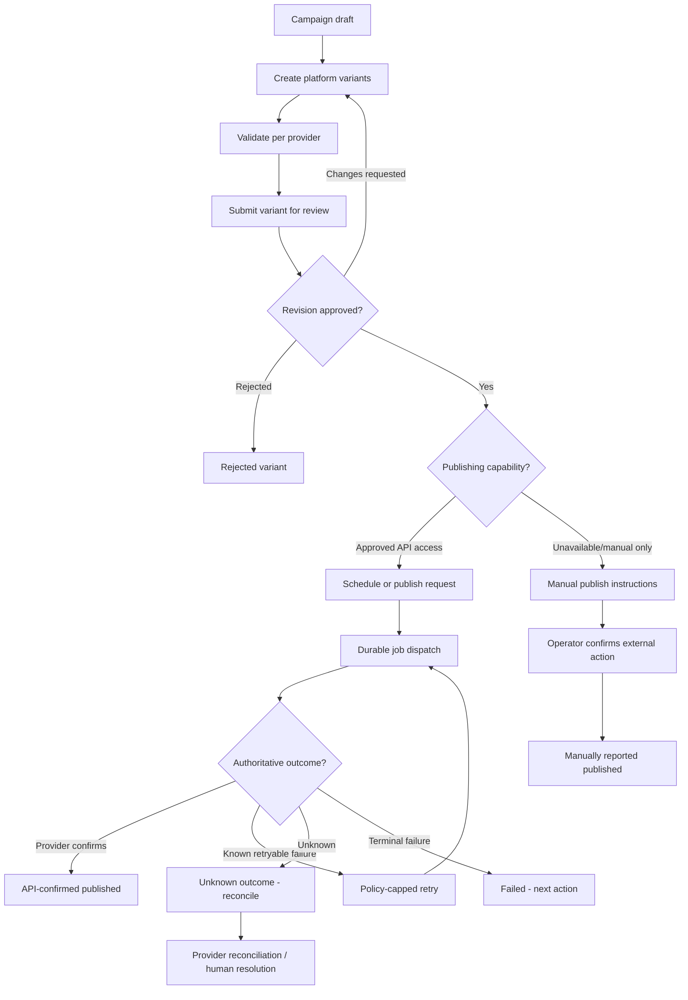

# Part-time Coder — UI/UX Design Brief & Design System Specification

> **Document ID:** PTC-UX-001  
> **Version:** 1.0.0 — proposed visual baseline / implementation-ready interaction specification  
> **Status:** Draft for owner visual sign-off. Confirmed product, security and workflow decisions are binding; proposed brand values require approval.  
> **Date:** 14 October 2026  
> **Repository path:** `docs/UI_UX_DESIGN_BRIEF.md`  
> **Product:** Part-time Coder Unified Company Platform  
> **Predecessors:** `Part_time_Coder_PRD_v1.0.md` (`PTC-PRD-001`), `docs/TRD.md`, `docs/APP_FLOW.md`  
> **Following deliverables:** `docs/BACKEND_SCHEMA.md`, `docs/IMPLEMENTATION_PLAN.md`, `AGENTS.md`  
> **Audience:** Founder, product/design team, frontend/backend engineers, QA, accessibility reviewers and AI coding agents

---

## 0. Governance, authority and how to use this brief

### 0.1 Purpose

This brief defines how Part-time Coder **looks, communicates and behaves** across the public website, internal company dashboards, employee and project workspaces, client portal, finance, CMS and unified six-network social media hub. Its role is to make the product visually distinctive, coherent, responsive and accessible without changing approved business scope or backend security rules. Specifications include initial design tokens, screen templates, interaction contracts, component inventory, edge states, design artifacts, testable acceptance conditions, and developer handoff rules.

### 0.2 Precedence and approval

1. **PRD:** authoritative product requirements, release priorities, role permissions, business policies and contractual promises.
2. **TRD:** authoritative technical boundaries, auth/session/security, backend/API behavior, event model and data integrity.
3. **App Flow:** authoritative route names, screen inventory, task flows, state transitions and guard strategy.
4. **This design brief:** presentation, navigation anatomy, information hierarchy, visual components, responsive interaction, copy and accessibility treatment. Where a discrepancy exists, the predecessors win; record an ADR/decision instead of silently overwriting them.
5. **Final brand assets, exact colors, fonts and imagery remain proposed** until owner sign-off. Do not assert that logo, legal identity, domain or real customer testimonials have been approved or supplied.

The product is **one internal Part-time Coder company** with many distinct client organizations—not a multi-company SaaS. A person's multiple workspace memberships cannot create permissions the server has not granted. API publishing and analytics for Facebook, Instagram, LinkedIn, YouTube, X and TikTok are **capability- and approval-gated**, not guaranteed. The first commercial production deployment must use terms permitting commercial activity.

### 0.3 Normative vocabulary

- **MUST**: required for MVP or core safety. **SHOULD**: preferred, deviation documented. **MAY**: optional.
- **M / F / C**: MVP / future / provider-conditional, consistent with PRD.
- **Proposed design**: visual direction for validation; not a new binding product requirement until owner-approved.
- **Authorized visibility**: server-validated user, organization, project, resource and workflow scope—not simply hidden links.
- **Truthful status**: clear separation between confirmed, pending, failed, unknown, unsupported and human-reported operations.

### 0.4 Definition of design-ready and implementation-ready

A screen is **design-ready** when its purpose, actor, route, information priority, component composition, primary/secondary/destructive actions, form states, permission-sensitive variants, loading/empty/error/resolved states, responsive variants and content have been specified. It is **implementation-ready** only when routes, API contract, fixtures, accessibility expectations and relevant PRD IDs agree. A screenshot alone is not an implementation specification.

### 0.5 UX requirement identifiers

This brief introduces *design acceptance IDs* `UX-###`, **not replacement PRD requirement IDs**. Each `UX-###` maps to explicit, existing `PTC-...` requirements in §19. Existing screens retain the `AF-###` IDs from App Flow §3 where cited. Never invent `PTC-...` IDs; new product scope requires an approved PRD change.

---

## 1. Product experience and brand strategy

### 1.1 Experience north star

**“Build confidence outside; remove friction inside.”** The public site should convey a capable, human software studio; operations should feel fast, focused and auditable; clients should feel informed without seeing confidential internal data; marketing should always know what will be published, where, when, by whom and with which degree of certainty.

### 1.2 Audience and desired feelings

| Audience | Primary job | Desired impression | UX anti-goal |
|---|---|---|---|
| Prospective client/visitor | Evaluate services, work and trust; request quotation | Credible, transparent, approachable | Unverifiable claims; noisy effects; vague CTAs |
| Registered user | Track own inquiries and profile | Clear, private, self-service | Empty dashboard packed with irrelevant modules |
| Owner/Admin | See company health and act on exceptions | Control, confidence, traceability | Huge wall of vanity KPIs; accidental irreversible action |
| Project manager | Deliver scoped work on time | Prioritized, predictable, collaborative | Dashboard without owners/next actions |
| Engineer/designer/staff | Know next task and complete it quickly | Calm, low interruption | Excessive popups, vanity animation, permission confusion |
| Marketing lead/creator | Move content from draft to confirmed outcome | Focus, creative clarity, publishing truth | Misleading “published” flags and hidden API limitations |
| Finance operator | Issue correct quotations/invoices | Accurate, careful, reviewable | Ambiguous currency, mutable issued invoices |
| Client admin/member | Inspect deliverables and give feedback | Trust, progress and privacy | Internal notes exposed, unexplained status or finance |
| Accessibility / multilingual user | Complete same essential workflows | Equitable, comprehensible and operable | Hover-only interactions, clipped text, icon-only errors |

### 1.3 Brand personality and voice

**Archetype:** technical craft + thoughtful partnership. Four visual qualities: **precise, dependable, ambitious, human**. Copy is concise, plain-English, respectful and action-led; avoid unsubstantiated superiority (“#1”), overconfident AI claims, empty hype and manipulative urgency. Use “Request a quote”, “Review deliverable”, “Needs manual publishing”, not “Unlock the future” as the only actionable label. Public copy may be more editorial; administrative copy should be literal and operational.

**Suggested public tagline exploration (not approved brand copy):** “Thoughtful software. Built to last.” Keep “Part-time Coder” as the displayed brand; do not imply the company only provides part-time labor. A final tagline is an owner/content approval item.

### 1.4 Distinctive design direction

**Preferred direction: “Editorial tech studio meets precise operational SaaS.”** Public pages: dark navy hero, expressive but restrained blue/cyan accent, oversized editorial headings, generous whitespace, true project screenshots and credible case-study outcomes. Internal workspaces: calm light surfaces by default, sharp typography, sensible density, persistent context and discoverable actions. Dark theme available across both. Unify both using typography, color intent, spacing, icons and surface rules, not identical density.

**Avoid:** generic floating neon blobs on every screen; animated KPI counters with false precision; stock-client logos, invented reviews or fake metrics; excessive glassmorphism; meaningless 3D models; patterned gradients behind tables; different visual systems per role; decorative graphics in data-entry views; hardcoded colors in feature components.

### 1.5 Logo and imagery guidelines (provisional)

- **Logo:** use owner-provided official mark when available; until then, use a plainly labeled wordmark placeholder (“Part-time Coder”) without inventing a final logo. Prepare horizontal, stacked, icon-only and monochrome placements *after approval*.
- **Safe usage:** minimum clear space roughly equal to the mark's cap-height, do not stretch, place only on sufficiently contrasting backgrounds. Do not treat this approximate guideline as a final brand standard.
- **Favicon/app icon:** derived from approved vector master; include reduced-detail small-size variant and dark/light variants as needed.
- **Portfolio imagery:** approved screenshots, device mockups and product interface captures with descriptive alt text. Mark concepts as concepts and unreleased work as unreleased.
- **People/testimonials:** real and consented. Never fabricate employee photos, customer logos, team size, achievements or testimonials.
- **Motion/3D:** reserved for an optional public hero enhancement with static fallback; not mandatory for MVP or any dashboard.

### 1.6 Brand approval gate

Owner to approve: official wordmark/logo, color direction, one public homepage and one dashboard visual, typeface licensing/performance, imagery style, public tone, dark/light examples. Absent approval, these remain **draft direction** while semantic component and UX behavior can still be implemented.

---

## 2. Design principles and measurable heuristics

| Principle | Product-level implication | Verification |
|---|---|---|
| Clarity over novelty | One dominant next step; recognizable control labels | First-time users identify primary CTA without instruction |
| Permission-aware, never permission-dependent | UI hides irrelevant actions but server enforces access | Direct unauthorized deep links remain denied |
| Truthful system state | Pending, unknown, manual, API-confirmed and unsupported distinct | Status audit against backend/source data |
| Fast for repeat work | Keyboard, preserved context, saved filters and batch operations only where safe | Common task completed without unnecessary route detours |
| Progressive disclosure | Summary before detail, simple before advanced | Important primary data visible without opening menus |
| Recoverable mistakes | Drafts, confirmations, version checks and actionable errors | Network/conflict recovery retains safe edits |
| Accessible by default | Keyboard, touch, screen readers, zoom and reduced motion | WCAG 2.2 AA core-journey testing |
| Consistency across workspaces | Same components and state semantics | Shared component inventory and visual regressions |
| Responsive by function | Different compositions at small screens; no lost core actions | 360/768/1280/1920 viewport matrix |
| Performance as experience | Measured loading, no expensive dashboard decoration | Real-device and lab tests against PRD budgets |

**Experience goals, not pre-existing measured claims:** Visitors should find “Get a quote” within 2 interactions from homepage hero (`PTC-PUB-001`). Staff should locate their assigned work from their workspace landing without navigating through unrelated departments. Client members should distinguish “ready for review” from “accepted” without guessing. Marketing should distinguish platform-specific outcomes at a glance.

---

## 3. Proposed design tokens (theme-safe, semantic, implementation-ready)

### 3.1 Color design strategy

Use **semantic role tokens** with light and dark implementations. Direct use of hex values is allowed only in the theme definition and exceptional approved illustrations. Functional elements use `background`, `foreground`, `primary`, `secondary`, `muted`, `border`, `ring`, `destructive`, `success`, `warning`, `info`, `chart-*` roles. Distinguish brand **accent** from status; a blue CTA does not mean “approved.”

All values below are **proposed initial tokens, not an approved Part-time Coder brand identity**. The samples for primary text and major state labels must satisfy the contrast requirements in §15 before release. Check contrast for *actual foreground/background combinations*, disabled elements and rendered overlays; nominal swatch labels alone are not proof.

#### Light palette

| Semantic token | Hex | Recommended use |
|---|---|---|
| `--background` | `#F8FAFC` | App canvas |
| `--foreground` | `#0F172A` | Primary text |
| `--surface` | `#FFFFFF` | Cards, panels, forms |
| `--surface-subtle` | `#F1F5F9` | Secondary sections, hover wells |
| `--foreground-muted` | `#475569` | Descriptions and metadata |
| `--foreground-quiet` | `#64748B` | Low-emphasis but still readable labels on white |
| `--border` | `#CBD5E1` | Input and card boundaries |
| `--border-strong` | `#94A3B8` | Emphasized boundaries |
| `--primary` | `#2563EB` | Main CTAs and active elements |
| `--primary-foreground` | `#FFFFFF` | Text on primary buttons |
| `--link` | `#1D4ED8` | Text links |
| `--ring` | `#2563EB` | Keyboard focus |
| `--success-foreground` | `#065F46` | Success label text |
| `--success-background` | `#ECFDF5` | Success status tint |
| `--warning-foreground` | `#9A3412` | Warning label text |
| `--warning-background` | `#FFF7ED` | Warning tint |
| `--danger-foreground` | `#B91C1C` | Destructive label text |
| `--danger-background` | `#FFF1F2` | Destructive tint |
| `--info-foreground` | `#1E3A8A` | Info label text |
| `--info-background` | `#DBEAFE` | Info tint |

#### Dark palette

| Semantic token | Hex | Recommended use |
|---|---|---|
| `--background` | `#0B1120` | App canvas |
| `--foreground` | `#F8FAFC` | Primary text |
| `--surface` | `#111C2F` | Cards and panels |
| `--surface-subtle` | `#1E293B` | Secondary surfaces |
| `--foreground-muted` | `#CBD5E1` | Explanations, metadata |
| `--foreground-quiet` | `#94A3B8` | Lower emphasis text |
| `--border` | `#334155` | Component borders |
| `--border-strong` | `#64748B` | Emphasized separation |
| `--primary` | `#60A5FA` | Primary CTA on dark |
| `--primary-foreground` | `#0B1120` | Text on dark theme primary |
| `--link` | `#93C5FD` | Text links |
| `--ring` | `#93C5FD` | Keyboard focus |
| `--success-foreground` | `#6EE7B7` | Success label text |
| `--success-background` | `#064E3B` | Success tint |
| `--warning-foreground` | `#FDBA74` | Warning label text |
| `--warning-background` | `#7C2D12` | Warning tint |
| `--danger-foreground` | `#FCA5A5` | Danger label text |
| `--danger-background` | `#7F1D1D` | Danger tint |
| `--info-foreground` | `#BFDBFE` | Info label text |
| `--info-background` | `#1E3A8A` | Info tint |

**Reference contrast spot checks (not a full audit):** light primary white-on-`#2563EB` ≈5.17:1; dark primary `#60A5FA` on `#0B1120` ≈7.41:1; subdued light `#64748B` on white ≈4.76:1. Recompute after design changes; never apply quiet/disabled opacity to essential text that must remain readable.

### 3.2 Typography

**Proposal:** headings and interface use `Inter` or a licensed/system equivalent; code uses `JetBrains Mono` or system monospace. If network/font licensing or loading makes a web font unsuitable, prefer system UI stack. For future Bangla: `Noto Sans Bengali` or an equivalently tested Bengali UI font, loaded for `bn` only or via appropriate subset/fallback. Actual font files must be licensed and performance checked.

| Token | Desktop | Mobile | Line-height | Usage |
|---|---:|---:|---:|---|
| `display-xl` | 64px / 700 | 40px / 700 | 1.08 | Public hero only |
| `display` | 48px / 700 | 34px / 700 | 1.14 | Public landing headings |
| `h1` | 36px / 700 | 28px / 700 | 1.2 | Page title |
| `h2` | 28px / 650 | 24px / 650 | 1.28 | Section heading |
| `h3` | 22px / 650 | 20px / 650 | 1.35 | Card grouping |
| `body-lg` | 18px / 400 | 17px / 400 | 1.6 | Public paragraphs |
| `body` | 16px / 400 | 16px / 400 | 1.5 | Standard UI body/forms |
| `body-sm` | 14px / 400 | 14px / 400 | 1.45 | Metadata/navigation, not crucial fine print |
| `caption` | 12px / 500 | 12px / 500 | 1.5 | Auxiliary labels only; avoid dense critical copy |
| `code` | 13–14px / 400 | 13–14px / 400 | 1.5 | IDs, snippets, monospace values |

**Rules:** Use a clear semantic heading structure, not arbitrary size jumps; maintain 16px default form text on mobile to avoid browser zoom surprises; favor sentence case; avoid ALL CAPS navigation and excessive tight tracking. Set `font-variant-numeric: tabular-nums` for amounts, KPI cards, calendars and times. Ensure Bangla shaping, punctuation and mixed Latin/Bengali numerals do not clip.

### 3.3 Spacing, sizing, radii, elevation and dividers

| Group | Proposed values | Guideline |
|---|---|---|
| Spacing scale | 4, 8, 12, 16, 20, 24, 32, 40, 48, 64, 80, 96 px | Prefer 4px base; no arbitrary gap soup |
| Compact input | min-height 36px | Only for dense desktops where usability is verified |
| Default input | min-height 44px | Preferred accessible control height |
| Primary CTA | min-height 44px; 12–20px horizontal padding | Larger public hero CTA may be 48–52px |
| Icon button | 40×40px default; 44×44px on touch | Visual icon ≈16–20px; accessible name |
| Card padding | 16px mobile / 20–24px desktop | Dense table shells may use 12–16px |
| Radius | `sm` 6px, `md` 10px, `lg` 14px, `xl` 20px, `pill` 999px | Avoid mixed arbitrary corner treatments |
| Shadows | `sm` subtle card separation; `md` elevated popover; `lg` dialog | Dark mode uses borders and slight tonal contrast |
| Borders | 1px semantic border; 2px visible focus ring plus offset | No color-only focus state |
| Content public | Max-width 1200–1280px | Editorial articles max 68–74 characters per line |
| Content dashboard | Max-width 1600px where useful; full-bleed tables as needed | Context-specific rather than arbitrary width |

### 3.4 Motion system

- Micro transitions 120–180ms; drawer/sheet 180–240ms; nonessential page enter 200–300ms; easing `ease-out` or a documented cubic curve.
- Use opacity/transform rather than layout thrashing. Loading skeletons should not become a distracting constant animation.
- `prefers-reduced-motion: reduce` removes nonessential parallax, page transitions, chart build animations and animated 3D effects; functionality persists.
- Hover states never carry information that is unavailable on focus/touch.
- Toasts should not disappear before a user can perceive them; critical actions require persistent or retrievable status, not a transient toast alone.

### 3.5 Iconography and data visualization

Use one consistent icon family (Lucide recommended) with stroke scale ≈1.75–2, 16/20/24px sizes and accessible labels for icon-only actions. Prefer inline labels on critical controls. Status is **text + optional icon + optional color**. Chart palettes must distinguish series by more than hue (markers, patterns, legend and accessible data table). Dashboard data summaries link to the same authorized filtered records used by their counts.

### 3.6 Theme and design token delivery

Implement theme variables through CSS custom properties (`:root` / `.dark`) referenced by Tailwind semantic utilities and shadcn/ui components. Persist theme choice (`light`, `dark`, `system`) without rendering a flash of wrong theme. Server and client must agree on an initial theme strategy. Do not store secret or sensitive user data in theme/localization preferences.

---

## 4. Responsive foundations and workspace layout architecture

### 4.1 Test widths and breakpoint strategy

At minimum test **360, 768, 1280, 1920 CSS px** (`PTC-NFR-001`), plus one intermediate 1024px and 200% zoom/reflow. Proposed implementation breakpoints: `sm 640px`, `md 768px`, `lg 1024px`, `xl 1280px`, `2xl 1536px` (Tailwind defaults unless intentionally overridden). Breakpoints follow content fit, not assumed devices.

| Context | Mobile (<768px) | Tablet (768–1023px) | Desktop (≥1024px) |
|---|---|---|---|
| Public header | Wordmark, menu, visible quote CTA where space allows | Compact horizontal nav | Full nav, quote CTA, login |
| Dashboard navigation | Accessible sheet + compact header; no permanent sidebar | Collapsible navigation rail or sheet | Persistent sidebar, optional collapse |
| Page title/actions | Wrapping title; primary action in natural position | Title/action row where fits | Title + breadcrumbs + scoped actions |
| Cards | Single column, purposeful grouping | 2 columns | 2–4 columns depending on density |
| Data list/table | Priority columns, responsive rows/cards, details drawer or deliberate horizontal scroll | Fewer columns, filters in sheet | Full table with visible filters |
| Forms | Single column, input controls ≥44px | 1–2 columns | 2 columns only if grouping improves readability |
| Side panels | Full-height sheet/dialog | 420–560px drawer | 480–640px panel where space permits |
| Calendar | Agenda/day-first accessible view | Week or agenda | Month/week/agenda with view switcher |
| Kanban | Selectable-column list or horizontal board with keyboard alternative | Scrollable columns plus list | Multi-column board with accessible list switch |
| Analytics | One chart per row, summary first | 2 columns | Grid, chart + table/legend |

**Non-negotiable:** No horizontal page overflow from navigation or forms at 360px. Wide tables/boards may scroll *inside clearly labeled regions* with keyboard support and another accessible reading path.

### 4.2 Public website shell

Desktop: skip-to-content link → slim optional announcement (only if real content) → brand/header nav → main content → context-aware CTA → footer with company/legal/contact/social links. Keep header predictable; if sticky, ensure anchor targets and keyboard focus are not obscured (`scroll-padding-top`). Do not autoplay marketing video with sound. Public skeletons should be subtle and content-first.

### 4.3 Auth shell

Two-column branded contextual layout on desktop, single centered card on mobile. Email/password or supported provider sign-in, explicit sign-up distinction, reset/invite links, helpful error/verification states, safe return path. Decorative image cannot overshadow form. Auth layout must never reveal an account's existence through wording or varied timing beyond documented privacy policy. Sensitive reauthentication screen must state action purpose and return to safe route afterward.

### 4.4 Private workspace shell

```text
+--------------------------------------------------------------------+
| Skip link -> Main                                                   |
| Topbar: [Brand] [Workspace switcher] [Search?] [Help] [Bell] [You] |
+------------+-------------------------------------------------------+
| Sidebar    | Breadcrumbs                                            |
| Workspace  | Page title                 Primary action / utility   |
| Overview   | Summary / filters / scoped context                    |
| Projects   |                                                       |
| Tasks      | Main content: table | detail | editor | board | form   |
| Marketing* |                                                       |
| Admin*     |                                                       |
| Finance*   |                                                       |
|            | Inline states, validation and task completion         |
+------------+-------------------------------------------------------+
* Only when effective server-sourced permissions allow.
```

- Workspace switcher changes the visible workspace context, **not authentication identity or grants**. If the user belongs to multiple client organizations, a client-org selector is separately scoped and explicit.
- Active navigation indicates current location with semantics (`aria-current="page"`), not only color. Parent items remain expanded for nested routes. Nav is generated from permission-aware descriptors; server still enforces every API request.
- Notification bell shows own authorized counts only and links to allowed deep links. A global search/command palette is **optional** in MVP; if implemented, results must be scoped and keyboard accessible.
- Breadcrumbs show stable hierarchy, omitting client/secret names until authorized data loads. Page headers include contextual primary action, status and last-updated information where relevant.
- Multi-role workspaces share controls and patterns but may use distinct default dashboards; avoid maintaining separate forks of the same component.

### 4.5 Context persistence and safe navigation

Filters, sort, view mode and pagination may live in URL parameters if **non-sensitive**; client/org/project access is never granted by a query parameter. Return after mutation to a safe contextual page, not an arbitrary external `next` URL. Discard sensitive cached content immediately upon membership revocation, logout or client-org change. Preserve only non-sensitive user preference settings between sessions.

### 4.6 Safe mobile ergonomics

Prioritize top three actions; put less-used actions in labeled overflow menus. Persistent bottom actions on mobile only when they do not obscure focus, form validation or system safe areas. Ensure dialogs can scroll, their submit buttons remain reachable, and keyboard appearance does not hide validation errors. Avoid drag-only interactions and long menus without search/grouping.

---
## 5. Information architecture, navigational hierarchy and page templates

### 5.1 Route authority

**Do not rename or improvise paths from the App Flow.** The authoritative MVP route registry is `docs/APP_FLOW.md` §2.2–2.8. URL path groups do not necessarily equal permission group names. Each page's navigation entry depends on effective server-sourced grants and resource membership. Deferred routes (`/careers`, `/hr/*`, `/finance/expenses`, `/marketing/inbox`, `/client/support`, `/workspace/timesheets`) are **not live promises or functional MVP navigation entries**.

### 5.2 Primary navigation / hierarchy (MVP)

| Public | Own account | Company admin | Workspace | Client | Marketing | Finance |
|---|---|---|---|---|---|---|
| Home | Dashboard | Overview | My Work | Overview | Overview | Quotes |
| Services | My Requests | Leads | Projects | Projects | Composer | Invoices |
| Projects | Notifications | Clients | My Tasks | Deliverables* | Campaigns | — |
| Products | Profile | Users/Invites | Notifications | Requests | Reviews | — |
| Blog | Security | CMS/Media | — | Invoices | Calendar | — |
| About | — | Projects | — | Messages | Posts/Jobs | — |
| Contact | — | Settings/Audit | — | Members* | Accounts | — |
| Get a Quote | — | — | — | Settings | Analytics/Media | — |

`*` appears when user has corresponding membership, accessible resource and relevant permission. Detail pages are reached from list rows, not forced into persistent global navigation. Company operators with multiple roles see appropriate workspace switcher entries without duplicated “Admin” copies inside unrelated sidebars.

### 5.3 Common page templates

| Template | Composition | Primary use |
|---|---|---|
| `MarketingLanding` | Hero → trust/evidence → services/value → featured outcomes → CTA | Public home/product/service |
| `EditorialIndex` | Heading → category/search → story/card grid → pagination | Blog/case studies/products |
| `EditorialDetail` | Breadcrumb → title/deck/meta → media → structured body → related items → CTA | Article, case study, product |
| `FormJourney` | Intro/expectations → stepper or grouped form → review → reference/success | Quote/contact/invitation |
| `WorkspaceOverview` | Status/alerts → KPI tiles → work queues → activity → next actions | Admin/client/employee/marketing |
| `DirectoryList` | Title/actions → filters/search → table/list → pagination → detail | Users/clients/projects/quotes/posts |
| `RecordDetail` | Identity/status → contextual tabs → details/actions → activity timeline | Project/lead/campaign/invoice |
| `Editor` | Title/version → structured fields → preview → workflow actions → history | CMS/social/quote |
| `ReviewSurface` | Immutable snapshot → checks → approve/request changes/reject → audit | Social approval/deliverables/CMS |
| `CalendarPlanner` | Timezone/view controls → calendar/agenda → selected item preview | Social scheduling |
| `Configuration` | Scoped settings → current capability/status → guarded actions | Integrations/company/security |

### 5.4 Screen layouts, standardized anatomy

**Directory:** A concise title, visible total *within permitted scope* when provided, a search/filter bar, rows/cards, a row action (open detail) and secondary commands. Avoid more than one emphasized primary action. Filter options should not leak existence of another client's items. Empty state reflects “no records yet” vs “filters return zero.”

**Record detail:** Breadcrumb, identifier/name, concise status, owning/client-org context when permitted, major next action, description/summary, tabs or anchored sections, version/timestamp, activity/history. Activity may be redacted by audience. When access is revoked, discard previously rendered record instead of displaying stale cached content.

**Editor:** Persistent field labels, draft/dirty indicator, current revision, explicit Save (autosave only if commit is visible), Preview and workflow action. Moving from draft to review/approval/publish requires a server-confirmed status transition; never treat opening a dialog as approval.

**Review:** Clear document snapshot and source version; who submitted it; permissions; exact proposed action; material risks; reason field for reject/request changes; commit confirmation and audit reference if available. Show stale revision conflict with latest content and no “force approve” shortcut.

### 5.5 Navigation safety states

- **401:** route to a safe sign-in/reauth flow with controlled return destination; avoid redirect loops.
- **403/404:** use neutral denial/not found without exposing unauthorized record existence.
- **Invitation invalid/used/expired:** explain next steps; do not grant access or list protected resource details.
- **Pending verification:** show restricted tasks and instructions instead of a falsely usable dashboard.
- **Account suspended/revoked:** immediately clear private views and redirect to `/auth/access-disabled` or safe landing.
- **Deep links from notifications:** reauthorize on navigation; if missing permission, show neutral safe state, not prior sensitive notification payload.

---

## 6. Public website: creative direction and page-by-page experience

### 6.1 Public homepage `/` — suggested content hierarchy

1. **Hero:** strong concise company positioning, one primary **Request a Quote** CTA and secondary **Explore Projects**, optional authentic product visual; no giant auto-playing background video.
2. **Capabilities/services:** 3–6 real service categories, short plain-English outcomes, link to canonical service pages.
3. **Selected work:** 2–4 approved cases with project role, problem, implemented approach and verifiable result; no fabricated ROI figures.
4. **Owned products:** distinguish product launches from client work; label alpha/beta/live truthfully.
5. **Working approach:** discovery → plan → build → test → deliver/support, presented simply.
6. **People/trust:** real approved team details, expertise and process evidence; testimonials only if verified and consented.
7. **Latest insights:** 2–3 published articles or updates (omit gracefully if none).
8. **Final CTA:** service quote/contact with response expectations only if operationally supported.
9. **Footer:** approved contact methods, policy pages, real company social links and copyright.

**Visual composition:** use a 12-column wide layout on desktop, alternating white/subtle surface sections and one navy brand section. Use a restrained blue highlight for focused interaction—not gradient-text for long reading. Hero heading at `display-xl` only where it fits. Imagery should showcase code/work/product outcomes, not generic anonymous AI illustrations.

**Empty CMS readiness:** if no approved case studies/testimonials exist, omit the section or use truthful “Work in progress” information. Never insert fabricated projects. Keep prominent CTA and informative services even at initial content launch.

### 6.2 `/services`, `/services/[slug]`

Service index supports category chips/search, succinct cards (who it's for, deliverable, outcome) and a quote CTA. Detail page structure: problem solved, offering, typical deliverables, approach, boundaries/exclusions, relevant approved case study, FAQ and **Request Quote for This Service** with preselected service context. Price bands only if owner approves figures and legal/contractual qualifiers. Distinguish a public service from an internal task/product record.

### 6.3 `/projects` and approved public case studies

Cards show project category, chosen cover image, concise one-line summary, approved tech tags, and optional public live demo/repo links. Filters by type/tech only where validated data exists. A case study template includes: background, challenge, Part-time Coder's contribution, solution, stack, annotated visuals, scope/timeline where approved, results with sourcing, and next steps. Internal project logs, client-private deliverables, code credentials, unapproved client identities and financial numbers are prohibited. Published case studies are separate public projections, not a direct read of internal project records.

### 6.4 `/products` and `/products/[slug]`

Product showcase distinct from client work. Cards include positioning, lifecycle badge (`concept`, `beta`, `live` etc., mapped to approved CMS state), screenshots and verified public links. If a product is in planning, prefer “In development” with no misleading purchase/download affordance. SaaS subscription management is **future**, not implied by an MVP product page.

### 6.5 `/blog` and article detail

Blog index: article title, summary, publish date, category and appropriate optional cover image. Article: max reading width, visible hierarchy, author only if approved, code blocks with horizontal internal scroll, linked headings, images with alt, captioned diagrams, updated date and related articles. Do not auto-append company claims or unrelated promotional sections to technical tutorials. Public 404 for unpublished slugs. Visible “Updated” date must correspond to published content revision.

### 6.6 `/about`, `/contact`, `/get-quote`, legal

- **About:** genuine company purpose, verified capabilities, approved team/approach; do not claim registered status without confirmation.
- **Contact:** official contact methods if provided, minimal validated form, privacy explanation, anti-spam mechanism; avoid public staff personal phone details by default.
- **Get a Quote:** guided, low-friction sections: contact → service/needs → optional budget/timeline → confirmation; show required vs optional. On success show **request reference** if server confirms. Do not promise a response SLA not actually supported.
- **Legal:** readable privacy/terms, effective date, contact for requests, proper links near data submission; final legal wording requires authorized review. Never paste boilerplate as verified law compliance.

### 6.7 Public visual quality bar

Use real typography, consistent crops, high-quality media and strong hierarchy. Maintain responsive text and legibility on small devices. Ensure meta/OG images and page previews use only published approved content. External links indicate destination as appropriate and use safe `rel` attributes where necessary. Public website should be fast enough for users on low-end phones; avoid loading dashboard bundles in public routes.

---

## 7. Authentication, onboarding and personal account UI

### 7.1 Auth screen specifications

| Route | Primary action | Key fields/info | Required exception state |
|---|---|---|---|
| `/auth/login` | Sign in | Email + password and supported identity providers | Generic invalid login, outage, unverified user, suspended account |
| `/auth/register` | Create regular account | Email, password/provider, consent as required | Public registration never assigns staff/admin/client privileges |
| `/auth/forgot-password` | Request reset | Email | Neutral acknowledgment; avoid user enumeration |
| `/auth/verify-email` | Verify / resend supported instructions | Status + action | Expired link, delayed delivery, already verified |
| `/auth/accept-invite` | Accept authorized scope | Safe recipient/org role summary after validation | Expired, revoked, used, wrong identity; no grant |
| `/auth/reauth` | Confirm identity for sensitive action | Purpose of action + verified challenge | Cancel safely, timeout, retry limit |
| `/auth/access-disabled` | Learn safe recovery path | Neutral account state/contact | No exposure of investigative/audit internals |

OAuth identity-provider login (such as Google through Firebase) is distinct from connecting a **social media publishing account**. Label both clearly; do not put provider publishing tokens into browser-accessible client state.

### 7.2 Invitation behavior

A staff or client member opens a safe invite link → authenticates the matching identity → sees only permitted org/role context after validity check → explicitly accepts → reaches authorized landing. Invitations expire and are single-use. UI shows request new invite / contact admin without exposing the target person's employer/org to unauthenticated strangers. Client Admin cannot invite someone as internal staff.

### 7.3 Personal dashboard `/dashboard`

Show “My requests” summary, recent authorized status changes, personal notifications, profile completion and contextual CTAs. Hide empty marketing/admin tiles for regular users. Do not show client-org selector unless user is actually a member. Account settings include name/photo where permitted, locale/timezone, notification preferences, session/security controls. Do not expose raw RBAC grants to users as an editable role menu.

---

## 8. Role-based dashboard and workspace experiences

### 8.1 Dashboard composition system

Use `WorkspaceOverview` with widgets defined by **permission, job-to-be-done, freshness and scope**. Widgets show title, metric/next action, underlying filter link, “as of” when relevant, and degraded/unavailable state. All totals come from server-filtered data; if an API cannot provide a metric, show **Unavailable** rather than `0`. Role composition should be declarative, so users holding multiple roles can switch the workspace view but not elevate privileges.

### 8.2 Owner / admin `/admin`

**First fold:** alerts requiring action (failed publishing, pending reviews, blocked work), then compact counts (new leads, active projects, milestones at risk, invited users, current invoices if authorized). Below: recent lead activity, project delivery snapshot, integration health, activity/audit drill-down. Owner-only controls remain visually differentiated by descriptive labels and step-up requirements—not “super powers” decorative badge. Do not display employee private HR information in general overview.

**Suggested desktop grid:** 12 columns; alert banner full width; four KPI cards; 7-col project status table + 5-col approvals/notifications; 8-col leads pipeline + 4-col system health. Mobile stacks exceptions before metrics. All widget order proposals are subject to user testing.

### 8.3 Employee/developer/designer/staff `/workspace`

Prioritize **My tasks due soon**, assignment updates, assigned project cards, unread mentions and links to permitted project resources. Each task row shows clear title, project, priority (if configured), status, due date with timezone, and a quick safe action. A user with no tasks sees helpful “No tasks assigned” and links to permitted projects rather than a generic empty administrative interface.

### 8.4 Project manager workspace

Project manager uses the same `/workspace/projects/*` route family, with additional allowed commands for project creation, assignment, milestones, team scope, review and client visibility. Project header includes state, owner, authorized client name, due date and next milestone. A project summary should make blockers and handoffs visible before overall percentage. Any progress percentages require documented derivation; do not compute fake completion from “tasks in progress.”

### 8.5 Marketing manager and content creator `/marketing`

Top: **Review queue / Scheduled upcoming / Needs action / Account health**. Then editorial calendar and recent outcomes with provider-specific status. Managers may see approval and scheduling controls; creators see drafts, editing, submission and review feedback. A creator not allowed to approve must see “Awaiting approval,” not a disabled “Approve” button as their primary CTA. Social account permissions and integration budgets are visible only to the roles authorized to inspect them.

### 8.6 Finance operators `/finance`

Finance overview through quote/invoice registers (no new standalone route unless App Flow is updated). Dense, precise tables: document number, client, date, currency, total, amount paid, balance, status and permitted actions. Separate draft from issued records and manual payment history. Confirm issuing/voiding with consequences, and state when a payment is **manually recorded**, not gateway-verified. Never sum SAR + USD + BDT into an unlabeled total without a documented conversion policy.

### 8.7 Client administrator/member `/client`

Above fold: selected client organization, authorized project progress, pending deliverable reviews and recent client-visible messages. Client Admin may see member management; Client Member sees only assigned projects and files. Client project detail uses a **client-safe DTO** with straightforward terms; do not expose internal backlog comments, employee evaluations, internal risks not approved for sharing, implementation secrets or profit margin. Client feedback action must be obvious next to the specific deliverable version.

### 8.8 Registered user (not yet a client)

Own inquiry statuses, profile and notification preferences, links to service pages. No employee or client dashboard mock data. If an inquiry is not associated with an authenticated account, do not claim ownership solely from a matching email unless the backend's verified ownership flow explicitly supports it.

### 8.9 Multi-role and org switching

Workspace switcher presents only allowed workspaces and remembers the last *valid* destination. Client-org selector lists only memberships verified by backend; switching invalidates prior client-scoped caches and closes previously open client records. If a user loses a role mid-session, dynamically remove its commands and block current mutations; authoritative response controls outcome. Client org display names appear only after permission confirmation.

---

## 9. CRM, lead pipeline, project delivery and client review

### 9.1 CRM lead directory and detail

**Lead list** (`/admin/leads`): default sort newest actionable leads; status, service, contact (authorized only), owner, follow-up activity, submitted date; filters/search and clear applied-filter chips. No bulk destructive mutation in MVP. **Lead detail:** a primary action appropriate to state (Qualify / Assign / Convert), editable internal notes clearly marked *Internal — not shared with client*, timeline and quote/proposal association. Conversion should show reviewed mapping from lead to client organization and project; on duplicate-safe retry, show authoritative project link rather than create a second project.

### 9.2 Project directory

Use table/list as primary, optional cards for portfolio-like browsing. Key columns: project name, internal/client badge, scoped client, owner, stage, next milestone/due date and risk if computed. Filters by active/completed/internal/client as authorized. New-project form requests project type, name, validated owner, client-org relationship when relevant and initial visibility. Project detail context is explicit in every tab.

### 9.3 Task management

- **Primary views:** task list and accessible Kanban. Both read/update identical server statuses; keyboard list always available.
- **Task card:** concise title, assignee avatar/name, due date, priority (if active), blocked status and attachment/comment indicator.
- **Task drawer/detail:** description, current state, assignee, due date, related milestone, comments/files with visibility, activity and save.
- **Board move:** optimistic update only if safely revertible. On 409/412, restore latest state and offer refresh/compare; never silently overwrite another teammate.
- **Status meaning:** use exact App Flow state machine; avoid introducing new labels in UI that imply unsupported backend transitions.
- **Permissions:** an employee can edit tasks in their allowed scope; UI never assumes assignment alone permits all project administration.

### 9.4 Milestones and project membership

Milestones show name, target date, progress/status and explicitly whether visible to client. Visibility defaults private until approved. User additions/removals use searchable permitted assignees, explanation of scope and confirmation when access changes. On removal, close/stale-out already open protected views immediately.

### 9.5 Internal deliverable release → client review

**Internal:** upload → classify asset → complete validation → select exact version → authorized person marks approved/visible to client → notification issued after commit. **Client:** select approved deliverable → inspect version, size/type, description and action → download through protected URL → comment, accept or request revision as supported → see feedback history.

Distinguish:

- `Upload pending` vs `Uploaded/verified` vs `Approved to share`.
- `Ready for client review` vs `Client accepted` vs `Revision requested`.
- `Client-visible comments` vs `Internal-only notes` through separate audiences and **server-backed** visibility fields, not merely CSS labels.

A stale client review is recoverable: show a comparison to latest permitted version, retain unsent safe text where allowed, and require confirmation on the new revision. Do not allow the client to inspect upload areas or metadata for non-shared drafts.

### 9.6 Client organization membership and invoices

Client Admin members page includes current members, role grants scoped to that client org, invitations and remove action. No controls to assign internal employees or any other organization. Client invoice display is **issued-only** and read-only unless future product requirements allow payment. Download filenames should avoid sensitive client identifiers when delivered by shared links. Internal draft quotes or invoice notes must never appear to client members.

---
## 10. Unified social media hub — detailed interaction specification

### 10.1 Non-negotiable truth model

Every social network is represented from day one, but the UI must distinguish **modeled**, **connectable**, **connected**, **publishing authorized**, **analytics authorized**, **manual-only** and **temporarily unavailable**. Connected does **not** imply publishing or analytics permission. No action may represent `manually_published` as `API-confirmed published`, and `unknown_outcome` must never be displayed as failed-safe-to-retry.

**Six integrations in the MVP design:** Facebook Pages, Instagram Professional accounts, LinkedIn Organization/Company Pages, YouTube channels, X accounts, TikTok eligible accounts. For each account, indicate supported post/media types, scope/permission status, rate/credit/quota limitations if known, last check, next action and provider/source of truth. Provider checks occur on server; UI displays server-computed effective capability, not guessed endpoint access.

### 10.2 Marketing navigation & information design

```
Marketing
├── Overview             review queue, upcoming, failures, account health
├── Composer             new campaign and independently edited variants
├── Campaigns            drafts, active, completed, archived
├── Reviews              submit, approve, request changes, reject
├── Calendar             editorial + schedule/job states, timezone
├── Posts & Jobs         per-platform status, attempts, recovery
├── Accounts             provider connections and capabilities
├── Analytics            sourced metrics and unsupported states
└── Media                reusable authorized media assets
```

**Marketing dashboard card semantics:** `Awaiting Review` counts only exact pending variants; `Scheduled` counts only committed, eligible jobs; `Needs Action` counts revoked accounts, unsupported/manual-required and unresolved job exceptions with clear drill-down; `Published` is separated into API-confirmed and human-reported publication counts. Avoid combined “all sent” totals with different confidence sources.

### 10.3 Composer (`/marketing/composer`, `/marketing/campaigns/[id]/edit`)

Desktop suggested layout:

```text
+------------------------ Campaign name / status / Save Draft --------+
| Platforms & accounts | Editor: active variant     | Live preview    |
| [Facebook  ✓]        | Content/caption            | Platform mock   |
| [Instagram ✓]        | Media / alt / format       | Validation      |
| [LinkedIn  ✓]        | Link/metadata              | Character/media |
| [YouTube   ]         |                            | checks          |
| [X         ]         | Switch target variant      |                |
| [TikTok    ]         |                            |                |
+--------------------------------------------------------------------+
| Per-variant checklist: Draft / Needs Fix / Ready for Review         |
| [Save draft] [Review all variants] [Submit for approval]            |
+--------------------------------------------------------------------+
```

**Mobile:** platform selector becomes a horizontally scrollable, fully keyboard-accessible tablist or labeled select; editor first, preview on secondary tab; bottom save/submit action reachable without obscuring input. All platform-specific values persist only after successful save, or are clearly labelled unsaved local edits.

**Behavior:**

1. Choose campaign name/purpose, owned channels/accounts, intended publishing mode.
2. Select one or more available platforms; for each create a **separate target variant** with its own text, media, type and validation result.
3. Optionally start from a master message, but copying into another variant creates **independent editable content**, not live-synchronized fields.
4. Show per-platform editor and preview with *approximate* visual treatment. Label preview as a simulation; it cannot promise exact provider rendering.
5. Surface known constraints (media size/type, caption/description length, aspect ratio, required alt where applicable), with last-verified timestamp or “Check provider rules” when unknown.
6. Save each variant with revision/version; show authoritative save status. Material edits after approval invalidate **only affected** variant approval and require re-review.
7. Submit for review only valid variants or explicitly choose a subset. Explain blockers per target; one invalid TikTok asset must not corrupt approved LinkedIn text.
8. On navigate-away or org/context change, warn if unsaved local edits exist. Avoid storing protected media credentials or sensitive copy in unrestricted local storage.

**Never:** silently propagate edits to approved targets; claim a provider uploaded content when only media validation passed; auto-post AI-generated copy without human approval.

### 10.4 Review and approvals (`/marketing/reviews`)

List awaiting review by submitted date, campaign, platform, target account, submitter, requested publish time and exact revision. Approver opens snapshot with locked content, media, validation and checklist, then **Approve**, **Request changes**, or **Reject**. Require reason for request changes/reject; show history and reviewer attribution. Default rule: no self-approval for the same variant; an approved variant cannot be modified without new approval. On stale hash/version conflict show “This version changed while you were reviewing” and reload with side-by-side or clearly separated current/snapshot view; **do not approve stale content**.

**Review conditions:** Action labels depend on current state and permissions; if the user lacks review rights, show submitted/read-only status rather than a cosmetically disabled workflow promise. After approval, next CTA is **Schedule** or **Publish now** only if provider/capability/budget gates allow, otherwise **Prepare manual publish**.

### 10.5 Scheduling calendar (`/marketing/calendar`)

Calendar view switcher: month/week/agenda. Agenda is primary on mobile and accessible regardless of drag support. Show exact target account/platform, local time and displayed timezone (`Asia/Riyadh` is a typical selectable zone, not hardcoded system-wide), future/past, author/approver if permitted, content thumbnail and a **two-part state model**: editorial approval vs dispatch outcome. Color chips never replace plain text.

**Scheduling form**: approved revision, target account and timezone, localized intended date/time, UTC preview, capability and account-health check, conflict warning and explicit confirmation. DST ambiguous/nonexistent times require a clear resolution; don't silently shift post time. The backend stores UTC + IANA timezone and revision hash; UI shows both local time and timezone label. Provide reschedule/cancel only for jobs that remain cancellable; already published content is not retroactively cancellable through this UI.

### 10.6 Publish jobs and outcome detail (`/marketing/posts`, `/marketing/posts/[id]`)

| State | UI language | Allowed next action | Prohibited impression |
|---|---|---|---|
| `pending` | Queued for [date/time, zone] | Inspect, cancel if authorized | Already sent |
| `claimed` / `publishing` | Publishing in progress | View detail; prevent duplicate trigger | Completed successfully |
| `retry_scheduled` | Will retry after [time] | Inspect reason; administrative cancel if permitted | Manually retry repeatedly |
| `published` (provider verified) | Published via API | Open verified provider URL when available | Generic green “done” without provider evidence |
| `failed` | Could not publish; [safe category] | Fix/retry only according to job policy | Silently discarded |
| `unknown_outcome` | Result unconfirmed — verification required | Reconcile/inspect; do **not** blind resend | Equivalent to “failed” |
| `needs_manual_action` | Manual publishing required | Copy/export and follow guided steps | Automatically posted |
| `manual_ready` | Prepared for manual publishing | Open instructions; copy content/media | Provider accepted |
| `manually_published` | Marked published manually by [actor] | View proof/history; optionally verify externally | API-confirmed |
| `cancelled` | Scheduled action cancelled | View audit/history | Published action undone |

If some variants succeed and others fail, the **campaign overview is partially completed**, showing explicit independent status per platform. Show attempt history (number, safe error category, timestamp, reconciliation status, provider ID/URL if verified). Any “Retry” control for sensitive/ambiguous states must adhere to TRD §8.7; the UI cannot implement a naive send-again button.

### 10.7 Provider account center (`/marketing/accounts`, `/marketing/accounts/[id]`)

Each of six platform cards has provider branding (appropriate use), account type, connection state, last checked time, publishing and analytics capabilities, quota/cost caution if known and role-appropriate action: **Connect**, **Reconnect**, **Review permissions**, **Manage**, **Disconnect**, or **Use manual workflow**. A capability details panel explains *why* an action is unavailable (app approval, account eligibility, missing scope, account revoked, budget block, quota or provider down) without showing raw secrets/access tokens.

OAuth initiation must occur as a trusted redirect/handler; never ask staff to paste social passwords/tokens into a custom form. On return, present a short neutral success/failure result; server validates state/PKCE before access. Disconnect requires confirmation with impact: already queued publication jobs must be blocked/updated according to system rules. Status reflects the verified server result.

### 10.8 Manual publishing — first-class supported UX

When a network cannot be automatically published:

1. Show **Manual publishing required** and reason, not a hidden exception.
2. Prepare platform-specific approved text, validated asset download/export, approved target channel and human checklist.
3. Offer **Copy caption**, **Download authorized media**, **Open official destination** only when a known approved URL is available; do not invent deep-links or post a request automatically.
4. Human operator marks instructions viewed, performs external task, then explicitly records completion/proof URL where supported.
5. UI records `manually_published` with actor/time and an optional *unverified* link. Require supervisor validation if operational policy chooses it.
6. Analytics and campaign totals keep this separate from provider-confirmed success.

### 10.9 Marketing analytics (`/marketing/analytics`)

Metrics must include platform, account, defined metric name, sample/reporting window, last refresh timestamp, coverage/availability and relevant source status. “Not authorized,” “unsupported,” “not yet fetched,” “stale,” “provider outage” and true numeric zero are **different presentation states**. The default overview should show content workflow counts and **verified** platform metrics, not an invented blended “engagement score.” Across platforms, avoid comparing non-equivalent impressions/reach definitions without disclosures.

### 10.10 Campaign/variant/job lifecycle diagram



This diagram explains UX handoffs; it does not replace the precise state transition and idempotency contracts in TRD §8 and App Flow §5/§7.

---

## 11. CMS, media, finance and notifications

### 11.1 CMS content directory and editor (`/admin/cms/*`)

CMS home groups `services`, `case-studies`, `products`, `articles`, `team`, `testimonials`, `homepage`, `legal` from the App Flow allowlist. Content index includes title, content type, audience/publication status, editor, updated date, revision and permitted actions. **Draft / In review / Published / Archived** chips use documented state transitions; where CMS model differs, follow App Flow state machine, not this shorthand.

Editor design: title/slug, summary, body (structured rich text or approved blocks), approved imagery with mandatory contextual alt text, SEO metadata, preview, version history and actions. Show status + “Saved at [time]” only after server acknowledgment. Public preview tokens are short-lived and guarded, never indexable or accessible by guessing slug. Publishing warns about public visibility and checks data classification, case-study permissions and missing alt/metadata. Archive is not the same as delete. External links use validated protocols.

### 11.2 Shared media library (`/admin/media`, `/marketing/media`)

Grid/list toggle and category filters by authorized content class. Tiles show thumbnail, file type, accessible name, dimensions/size, origin, owner scope, usage links where permitted and verification status. Upload lifecycle: choose/select file → client-side pre-check → server upload intent → transfer/progress → server verification/finalization → safe asset available. Display processing, rejected file, insufficient permission, unsafe content and expired download separately. No sensitive files in public URLs or long-lived local caches. Distinguish marketing-public media from client-private deliverables; **reusing the same media component must not reuse visibility rules**.

### 11.3 Quotation list and editor (`/finance/quotes*`)

Quote list: client/lead, status, quote number, created/expiry dates, currency, total and action. Editor: client/lead picker (authorized), description, itemized line items (description, unit minor amount, quantity, discounts/taxes only if contract supports), currency, expiry and notes marked internal vs client-safe. Live calculation may preview, but **server recalculation is authoritative**. Summary must display explicit currency, e.g., `SAR 1,250.00`, not `$1,250` for all contexts. Conflict/invalid item validation keeps draft edits until safe resolution.

### 11.4 Invoice list and editor (`/finance/invoices*`)

Invoice form allows draft creation and review. Prior to issue, show client, items, currency, due date, totals, payment expectations, and clear confirmation: issuing makes specified fields immutable; if edit/void rules differ by jurisdiction, the legal/business rule governs. Issued invoice detail clearly separates **outstanding amount**, **manually recorded payments**, **balance**, and document status. A record of manual payment must never be described as payment-provider confirmation. Use stable document identifiers, printer-friendly layout and protected downloads; include correct `SAR`, `BDT`, `USD` formatting and avoid cross-currency aggregation without explicit conversion rate/valuation date.

### 11.5 Notification center (`/account/notifications`, `/workspace/notifications`)

Group by recency, with role-aware categories (assignment, comment, deliverable, invoice, social review/publish exception, invitation, system alerts). Every notification displays concise *safe* text, timestamp, read/unread state, and protected deep-link. Email digests/alerts avoid full client-sensitive document content. If the target becomes unauthorized, link resolves to neutral 403/404 rather than opening cached data. Accessible unread indicators are text/semantic, not dot-only. Permit marking read and notification preferences only when supported by the backend.

### 11.6 Reports/analytics UI

Report cards require: metric title, definition/help affordance, value with units, time window, source/as-of timestamp, scope (company/client/authorized project), link to detail, and `unavailable`/`partial` state. Charts must include accessible table equivalents for core data. No unapproved financial cross-org exports; client project analytics are explicitly filtered to the client's authorized project and visibility.

---

## 12. Component system — reusable primitives and feature compositions

### 12.1 Component tiers

- **Tier 0 foundations:** tokens, type scale, layout, spacing, dark/light scheme, icons, focus and motion rules.
- **Tier 1 primitives:** Button, Link, Input, Textarea, Select, Checkbox, Radio, DateTimeInput, Label, Tooltip, Dialog, Alert, Badge, Avatar, Skeleton, Divider, Tabs, Popover, Toast, Table.
- **Tier 2 patterns:** PageHeader, WorkspaceShell, Breadcrumbs, SearchFilterBar, DataTable, Pagination, EmptyState, ErrorPanel, StatusChip, PermissionHint, ConfirmDialog, AuditTimeline, FileUploader, ProtectedDownload, Stepper, UnsavedChangesDialog, SaveStatus, ReviewPanel.
- **Tier 3 domain composites:** LeadPipeline, TaskBoard, DeliverableReview, ProjectProgress, CMSContentEditor, SocialVariantEditor, AccountCapabilityCard, PublishingTimeline, MarketingCalendar, InvoiceBuilder, KpiCardGrid.

Prefer shadcn/ui + Radix primitives, **not wholesale unreviewed component generation**. Shared components may be styled and behaviorally adapted only through documented variants; domain-specific server logic stays in feature layers.

### 12.2 Core component specification matrix

| Component | Required variants | States / behavior | A11y/performance notes |
|---|---|---|---|
| `Button` | primary, secondary, outline, ghost, destructive; small/default/large | default, hover, focus, pressed, pending, disabled | Label describes action; disabled reason discoverable where needed |
| `IconButton` | neutral/danger | hover/focus/pending | Accessible name; min touch target; avoid icon-only primary decisions |
| `TextInput/Textarea` | default, compact only if needed | empty, filled, focus, error, disabled, read-only | Persistent label, `aria-describedby`, server error summary |
| `Select/Combobox` | single/multi as approved | open/closed, no options, invalid | Keyboard arrow/typeahead, async query scoped, correct ARIA |
| `DateTimeInput` | locale-aware | timezone, ambiguous DST, invalid | Show zone, UTC preview for schedules; no inaccessible custom calendar |
| `Checkbox/Radio/Switch` | standard | checked/unchecked/indeterminate/disabled | Use switch only for immediately effective settings, not multi-step commands |
| `Badge/StatusChip` | draft, review, approved, warning, error, API/manual, unknown | text+icon+color | Status semantics are mapped per domain; screen reader label |
| `Alert` | info, success, warning, error | inline/dismissible/persistent | Persistent until addressed if critical; `role=alert` sparingly |
| `Dialog/Sheet` | confirm, form, contextual | open, pending, success, failure | Focus trap, title, escape behavior, focus return; mobile scroll |
| `Toast` | informational confirmation | visible/dismissed | Supplemental only; accessible announcements; not sole audit state |
| `Tabs` | page/record | active/disabled | Keyboard operable, URL or state stable, no hidden dangerous actions |
| `DataTable` | responsive, selectable if needed | loading, empty, error, sorted, filtered | Semantic headers, page controls, authorized cell content |
| `Pagination` | cursor-aware | before/after, end, failed | No fictitious total pages where API only provides cursor |
| `KpiCard` | trend/non-trend | loading, partial, stale, unavailable | Units/source/date, drill-down; avoid decorative fake graph |
| `Skeleton` | block/list/detail | initial loading | No privacy leaks from prior session, reduced-motion |
| `EmptyState` | no-data, filtered-empty, no-access-safe | illustration optional, CTA if allowed | Do not conflate zero records with unavailable data |
| `FileUploader` | public, internal, client-safe, marketing | upload, scanning, failed, verified | Error by file, type/size check, accessible alternative to drag |
| `CommandMenu` | optional | open, query, no results | Contextual authorization; global search not MVP blocker |
| `Avatar` | image/initials/fallback | loading, missing | Alt/name according to context, not decorative duplicate |
| `Breadcrumbs` | standard, collapsed | unknown/loaded, nested | `nav aria-label=Breadcrumb`, authorized names only |
| `AuditTimeline` | domain-specific | current/partial | Event timestamps, actor display only if authorized, read-only |
| `ConfirmDialog` | standard/high-risk | preconfirm, pending, failure | Describe consequences; typed confirmation only for very high risk |
| `UnsavedChangesDialog` | draft | dirty, save, discard, cancel | Never fake local recovery after permission lost |

### 12.3 State semantics dictionary

**Use domain words plus objective state rather than a universal color-only mapping.** Examples:

| Domain | Normal progression | Special differentiation |
|---|---|---|
| CRM | New → Contacted/Qualified → Converted/Closed per App Flow | Conversion pending and duplicate-safe recoverable |
| Projects | Planned → Active → Review → Completed per App Flow | Blocked/paused and client visibility separate |
| Tasks | To do → In progress → Review/Done per App Flow | Rejected/stale move, assignment changes |
| CMS | Draft → Review → Published/Archived per App Flow | Preview/private/public remain distinct |
| Deliverables | Internal → Approved shared → Review → Accepted/revise | Exact version and audience visible |
| Social | Draft → In review → Approved → Scheduled/Manual | API vs human published; unknown result vs failure |
| Quotes/invoices | Draft → Issued/Sent → Paid/Partially/Voided as supported | Manually entered payment != verified gateway settlement |
| Invitations | Pending → Accepted/Expired/Revoked | Wrong identity never receives grant |
| Connections | Connected/Eligible vs No permission/Expired/Disabled | Token health != publish authorization |

Never use green solely because a post was *queued*, or red solely because a metric is *unavailable*. Unknown means uncertainty, not error; capability denied means manual mode may still be fully usable.

### 12.4 Action hierarchy and destructive patterns

One visually dominant primary action per view. Secondary actions are less prominent; destructive actions require semantic red/confirmation and belong in contextual menus where sensible, but must remain discoverable. Confirm dialog states: affected resource, consequences, whether reversible, dependent outcomes, explicit confirm, cancel and any step-up requirement. Client member revocation, social disconnect, invoice issue/void and publishing actions need extra clarity. For sensitive irreversible operations, never dismiss with a “success” toast before server commits.

### 12.5 Data-dense tables and mobile counterparts

Choose columns by decision relevance: primary identifying attribute and status always visible, contextual secondary fields optional. Support sort by configured fields with visual+screen-reader cue, filters as chips, clear filters, properly bounded server pagination. Row selection for batch actions is **not assumed MVP**. On narrow screens, transform into stacked records or an explicitly labeled horizontal scrolling region; preserve all primary and safety-critical data via detail view. For financial numbers, right-align numeric amounts and use tabular digits; date/time shows zone when ambiguity matters.

### 12.6 Naming and code placement conventions

Suggested names: `src/components/ui/*` primitives; `src/components/layout/*` common shells; `src/features/{domain}/components/*` composites; `src/features/{domain}/screens/*` route views; `src/lib/design/*` token/accessibility utilities. Exact folder names must align to TRD monorepo layout and AI rule file. Keep display-only `PermissionGuard` distinct from backend authorization; no React component authorizes a mutation.

---
## 13. Universal interaction, feedback and system-state patterns

### 13.1 Standard view-state contract

Each key view supports at least the following states, as specified in App Flow §3.5. Implement screen-specific content, not generic “Something went wrong” everywhere.

| State | What user sees | Required action/recovery | Guardrail |
|---|---|---|---|
| Initial load | Neutral skeleton with meaningful title/context | Wait; eventually load or error | Never flash a former client organization's cached data |
| Background refresh | Subtle updating indicator with permissible prior content | Continue reading, retry if failed | “As of” accuracy preserved |
| First-use empty | Clear meaning, guidance, authorized CTA | Create first item/request | No invented sample business data |
| Filtered empty | Active chips and “No results for these filters” | Clear/reset filters | Do not show unauthorized counts |
| No permission | Neutral unavailable view or absent action | Back/switch permitted workspace | No protected metadata in explanation |
| Partial data | Successful regions plus module-level warning | Retry affected tile only | Unknown KPI not represented as `0` |
| Validation failure | Summary and field-level explanations | Correct, retain safe entries | No server error hidden by client validation |
| Unauthenticated | Sign-in requirement, safe return link | Log in / recover | No open redirect or redirect loop |
| Forbidden/not found | Accessible neutral error | Return to permitted landing | Avoid disclosure of resource existence |
| Conflict (409/412) | Current-vs-edited revision, explanation | Compare/reload/reapply safely | No silent last-writer-wins |
| Rate limited (429) | Limited action notice with wait guidance | Retry when allowed | Do not auto-retry in tight loops |
| Dependency down | Service currently unavailable | Safe retry/status when known | Do not claim successful mutation |
| Mutation pending | Progress indicator on initiating control | Await server confirmation | Prevent duplicate click; action semantics preserved |
| Result unknown | “We cannot confirm whether this completed” | Check authoritative status/reconcile | No blind duplicate submission |
| Confirmed success | Concise event outcome and persisted change | Continue, view updated record | Toast not substituted for persisted state |
| Revoked access | Private view cleared, neutral message | Switch eligible context / seek authorized help | No stale sensitive display |
| Manual action required | Platform/account capability reason | Guided human action | Do not imply API publication |

### 13.2 Feedback wording guidelines

Use verbs and explicit subjects: “Invoice issued”, “Your draft was saved at 14:32”, “This post was marked published manually by your team”, “We could not confirm the X publication; verify before trying again”. Avoid “Success!” without identifying the operation, “Something went wrong” as sole message, “Unauthorized user detected” for ordinary expired sessions, or “Posted” when job only scheduled.

### 13.3 Errors by HTTP contract

- **400/422:** identify invalid fields or request details that are safe to expose; map server error codes to localized text.
- **401:** sign-in or reauthenticate; sensitive draft recovery only within authorized policy.
- **403/404:** neutral and safe; do not distinguish resource existence when privacy requires concealment.
- **409/412:** explicit conflict with latest permitted revision and safe recovery.
- **429:** rate-limit notice with server-provided wait guidance if available.
- **502/503:** dependency unavailability and retry for idempotent operations only.
- **Network failure after a write:** unknown outcome until queried using the request's idempotency key or authoritative status endpoint.

Each system-level failure page may show a copyable **request ID** generated by server, not stack trace, credentials or PII. Forms should retain non-sensitive entries on validation errors and allow safe resubmission based on actual operation semantics.

### 13.4 Inline vs modal vs toast

Use **inline validation** for form fields, **banner/alert** for page-level blockers, **toast/live announcement** for routine confirmed completion, **modal/dialog** for user decision or high-risk confirmation, and **persistent status panel** for operational exceptions such as unknown publishing outcomes. A toast must never be the only place to find a failed scheduled social post or a revoked integration token.

### 13.5 Autosave and unsaved-change behavior

Autosave is permitted only where the API and UX explicitly support draft writes. Show `Unsaved changes`, `Saving…`, `Saved [timestamp]`, `Save failed` and actionable retry, with authoritative version. If a user loses permission or token while editing, do not retain sensitive drafts across users or organizations. “Saved” is never displayed before server commit. For editors with expensive uploads, distinguish file transfer completion from server verified asset readiness.

### 13.6 Notifications and realtime perception

Notifications can be eventually consistent; do not invent realtime accuracy. Important workflow transitions may use polling/refetch, server events only if supported by TRD. Unread count is own-authorized data. On notification click, re-check destination rights and handle revocation gracefully. Keyboard and screen-reader users should receive polite live updates, not rapid repeated announcements from dashboard polling.

### 13.7 Confirmations and undo semantics

Not all actions have undo. UI must explicitly distinguish reversible state changes, guarded cancellations, irreversible issuing/publication and externally executed effects. Deletion, role revocation, public publishing, invoice issue and account disconnect require action-specific confirmation text. Never display an “Undo” affordance unless server actually supports guaranteed reversal; external published posts are outside ordinary cancellation scope.

### 13.8 Time display and relative dates

Use date with context and IANA timezone where required. For social schedules, invoices/due dates, audit records and cross-border staff, absolute timestamp must be available even if relative dates (“2 hours ago”) are shown. Do not render scheduled timestamps by assuming every viewer shares Saudi time. If `Asia/Riyadh` is configured as company default, users can still display their chosen timezone. Store UTC in backend; display locale-specific but never silently adjust ambiguous times.

---

## 14. Forms, validation, content and interaction microcopy

### 14.1 Universal form conventions

- Persistent field labels; placeholders are examples, not labels.
- Mark required fields explicitly, and do not use color alone.
- Explain why data is requested when sensitive or business-critical.
- Group related fields in titled sections; disclose optional fields without overloading first step.
- Client-side validation accelerates feedback; backend Zod/permission validation is authoritative.
- After validation failure: display summary, associate errors with fields, move focus to summary/first invalid field in a predictable way, preserve safe input.
- Only submit once; if network outcome is ambiguous, query authoritative record/status using idempotency token before retrying.
- Forms requiring uploads support keyboard-based browse, progress, type/size errors and cancellation only if actually supported.
- Selection options come from scoped backend data; forbidden target choices cannot be submitted by manipulating DOM.
- Status-changing actions show the current record version and warn about stale edits.

### 14.2 Form inventory (authoritative source: App Flow §3.4)

| Form IDs | UI contract | Key edge cases |
|---|---|---|
| FORM-01/02 Contact + quote | Compact guided form with service preset, personal contact, description, optional budget/timeline and confirm reference | Spam/rate limit; ambiguous network result; privacy notice |
| FORM-03/04 Register + invitation | Minimal identity fields, verification, invitation scope preview | Expired/mismatched invite; public users cannot choose roles |
| FORM-05 User/member invite | Email + exact role/org/project scope, review and confirm | Inviter cannot grant wider rights; pending/expired/revoked |
| FORM-06/07 Lead qualify/convert | Scoped contact and progression, conversion summary | Duplicate-safe conversion; stale lead; client/org conflict |
| FORM-08–10 Project/task/milestone | Structured fields, validated assignee, dates and visibility | Cross-project assignee; unauthorized client visibility; version conflict |
| FORM-11/12 Deliverable + review | Verified upload and version release, audience, client feedback | Private upload not client-visible; stale client review |
| FORM-13 CMS editor | Rich content, SEO, media, preview and workflow states | Duplicate slug; invalid markup; approval/publish rights |
| FORM-14–18 Social | Separate target variants, revision review, timezone scheduling, manual and OAuth connection | Platform-specific constraints; unknown outcome; self-approval blocked |
| FORM-19–21 Quote, invoice, manual payment | Currency-qualified line items, server totals and authorized issuing | Duplicate payment; wrong currency; issued immutability |
| FORM-22 Profile/preferences | Own profile, locale/timezone/notification settings | Stale session; account suspended; invalid locale |

### 14.3 Copy examples for critical patterns

| Situation | Preferred UI copy | Why |
|---|---|---|
| Saving CMS draft | “Saved as draft at 14:32” | Proven persistence + clear state |
| Awaiting social review | “Submitted for approval — revision 8” | Exact review version |
| Manual social mode | “Manual publishing required. Automatic posting is not enabled for this account.” | Honest capability |
| Ambiguous API publication | “Publication status is unconfirmed. Check the provider before retrying.” | Prevent duplicate post |
| Invoice issue | “Issue invoice INV-204? Issued fields will be locked.” | Action/consequence |
| Unauthorized client resource | “This page isn't available.” | No forbidden owner data |
| Empty tasks | “No tasks are assigned to you yet.” | Accurate personalized empty |
| Delayed analytics | “Latest available data: 12 Oct, 18:00 UTC” | Source freshness |
| Converted lead | “Lead converted. Open linked project.” | Immediate next step |
| Invalid schedule time | “This local time does not exist in the selected timezone. Choose another time.” | Correct DST handling |

### 14.4 Search, filters and command selection

Search fields include accessible search labels, submitted query feedback and clear. Long option lists use debounced server-scoped query only when backend supports it. Separate filtering from sorting; show number of active filters. Avoid persisting sensitive private search terms in analytics, browser URL/history or telemetry where policy prohibits it. Client-organization filter must never expose names/record counts outside memberships.

### 14.5 Helpful but careful AI content UX (future)

AI drafting, translation, summarization or scheduling suggestions are **post-MVP unless later approved**. If implemented, show origin (“Suggested by AI”), editable content, permission-checked data usage, human approval and no autonomous publication. Never silently use private client/project materials for marketing content; enforce provenance and consent.

---

## 15. Accessibility and inclusive UX — mandatory WCAG 2.2 AA target

### 15.1 Scope and methods

All MVP core routes and journeys aim to meet **WCAG 2.2 Level AA** (`PTC-NFR-002`). Test the actual built app using automated axe checks **and** manual keyboard, screen-reader, zoom/reflow and touch checks. Passing automation alone does not prove accessibility. Reference: [W3C WCAG 2.2 Recommendation](https://www.w3.org/TR/WCAG22/) and WAI's [WCAG 2.2 additions](https://www.w3.org/WAI/standards-guidelines/wcag/new-in-22/).

### 15.2 Keyboard, focus, pointer and semantics

- Entire essential experience operable without mouse. Tab order follows visible task order; no invisible focus on hidden menus.
- Skip link visible on focus; landmarks (`header`, `nav`, `main`, `aside`, `footer`) used semantically.
- Visible focus indicator with adequate contrast; focus not wholly obscured behind sticky header/drawer (`WCAG 2.4.11`).
- Keyboard-accessible navigation menu, forms, dialog, tabs, calendar, Kanban alternate list, media upload and review actions.
- Focus moves appropriately when dialogs open, closes back to invoking control, and after form errors/route transitions. No keyboard trap except focus containment inside active modal with a supported exit.
- Minimum pointer target **24×24 CSS px or applicable WCAG-defined spacing exception** (`WCAG 2.5.8`); product preference is ≥44×44px for primary touch actions.
- Drag-and-drop tasks always have discrete button/menu actions satisfying `WCAG 2.5.7 Dragging Movements`.
- Do not require complex gestures or precise mouse movement for social calendars or kanban.

### 15.3 Color, contrast, zoom and reflow

- Normal text contrast at least **4.5:1**, large text at least **3:1**, non-text UI boundaries/state affordances at least **3:1** where applicable.
- No meaning by color alone; status includes text and optionally shape/icon; links distinguishable without relying solely on color where necessary.
- At 200% zoom and reflow conditions, essential actions remain accessible; target 400% zoom at narrow effective viewport where WCAG applies. Test text spacing overrides for legibility.
- Use native text rather than rasterized text inside hero/background images for essential messages.
- High contrast modes and dark theme require semantic token testing, not merely inversion.

### 15.4 Forms and errors

Persistent labels, help text, error summary, `aria-invalid`, `aria-describedby`, and clear submit success. Required fields identifiable without relying only on an asterisk/color. Errors explicitly state field/problem/fix. Authentication must provide accessible alternatives consistent with `WCAG 3.3.8 Accessible Authentication (Minimum)` and policy; avoid needless cognitive-function tests beyond normal password/provider sign-in where inappropriate. Session timeout/warnings should not unexpectedly erase unsaved safe form data.

### 15.5 Charts and rich content

Charts need visible titles, axis/series labels, readable color choices and **table/text equivalent** for critical values. Diagrams and non-decorative images require descriptive alternatives; purely decorative assets get empty alt. Videos need appropriate captions/transcripts as applicable. Code snippets support keyboard scroll/copy and maintain line readability. CMS authoring should prompt for alternative text before publication.

### 15.6 Motion, status announcements and notifications

Honor `prefers-reduced-motion`. Do not autoplay flashing content or critical animation. Use polite live regions for completed updates and assertive alerts only for urgent errors; debounce repeated notifications/polling changes to avoid screen reader flooding. Calendar, upload and job progress must have accessible text, not only animated spinner.

### 15.7 Accessibility QA sampling matrix

| Journey | Keyboard | Screen reader | Zoom 200%/400% | Touch/360px | Automated |
|---|---|---|---|---|---|
| Home → quote → confirmation | Required | Required | Required | Required | Required |
| Sign-up/login/invite/switch workspace | Required | Required | Required | Required | Required |
| Admin lead → conversion | Required | Required | Required | Required | Required |
| Employee task edit & Kanban alternative | Required | Required | Required | Required | Required |
| Client deliverable review | Required | Required | Required | Required | Required |
| CMS draft → preview → publication | Required | Required | Required | Required | Required |
| Social composer/review/scheduling/manual | Required | Required | Required | Required | Required |
| Finance invoice/quote workflow | Required | Required | Required | Required | Required |
| Revocation/conflict/outage states | Required | Required | Required | Required | Required |

**Release rule:** unresolved critical/blocking WCAG violations in required journeys are no-go. An accessibility report must name tested build, browsers, assistive tech combinations, paths, severity, evidence and fixes.

---

## 16. Localization, currency, dates and cross-cultural support

### 16.1 Locale scope

MVP launch language: **English (`en`)**, architecture prepared for **Bangla (`bn`)** (`DEC-007`). English copy is the source locale; put visible UI messages in typed translation catalogs rather than inline hardcoded strings, including error text, status chips, aria labels, dates and notification templates. Translation availability must be explicit; do not claim full Bangla support before review. Arabic or RTL interface is **not in MVP scope** and requires a later product decision, though avoid irreversible direction-dependent components.

### 16.2 Layout readiness for Bangla

- Allow 30–50% text expansion in headers/buttons and wrapping in tables/cards; avoid pixel-perfect fixed heights.
- Choose fonts that render Bengali ligatures/diacritics correctly and maintain comparable visual weight.
- Keep icon placement logical (`start`/`end`) where possible; do not assume text always fits in a single line.
- Localized examples, plural rules, calendars and word breaks need future native-speaker review, not only machine translation.
- Keep user-generated content language-independent and sanitize rich content; translation is opt-in, not automatically modifying source.

### 16.3 Money

Support display/record currency units **SAR, BDT, USD** per PRD. Format with locale-aware `Intl.NumberFormat` while respecting source amounts in **minor units**; do not change the recorded currency because the viewer has a different locale. Example: `SAR 1,250.00`, `BDT 12,500.00`, `USD 300.00`; formatting will vary by locale and approved display convention. Exchange conversions, if shown, require historical rate source/date and explicit “approximate converted value”; summing mixed currencies directly is forbidden.

### 16.4 Dates and timezones

All scheduling operations use IANA timezone and UTC-backed persisted instants. Show format chosen by locale, always label timezone for cross-team operations and social scheduling. Client due date not bound to a clock can use an explicit `date-only` semantic if backend supports it; do not invent a midnight UTC meaning. Past/future/relative copy must not depend on local system clocks for authoritative job state.

### 16.5 Content governance

Public service descriptions, legal pages, product releases and case studies are CMS-managed approved content; localization cannot bypass review or publish a draft. For post-MVP Bangla, per-locale publication state and missing-translation fallback must be specified before rollout.

---

## 17. Performance, privacy-aware UX and secure visual behavior

### 17.1 Performance budget as an experience requirement

Use actual targets in `PTC-NFR-*` and TRD §13 as binding; the following are **techniques, not replacements for measurable targets**:

- Server-render/stream public content where appropriate; avoid sending employee dashboard code on anonymous public pages.
- Optimize responsive images, use only appropriately sized images, defer noncritical below-fold media and never rely on a slow 3D hero.
- Load charts and rich editors only on routes that use them; prevent global hydration cost from table/editor libraries.
- Use meaningful skeletons instead of long blank pages; expose partial failures without breaking unrelated widgets.
- Paginate/filter server-side; avoid rendering thousands of rows or calendar items; use virtualization only when accessible.
- Prefer progressive disclosure over heavyweight mega-pages; include coherent offline/degraded messaging, not fake optimistic success.
- Avoid layout shift caused by unknown-size images or late-loading fonts; reserve aspect ratios.

### 17.2 Privacy-safe components

- Public and private layouts use distinct loading/caching policies. Protected screens: `noindex`, prevent caching of cross-org sensitive DTOs in shared/public caches.
- Credentials/OAuth tokens are never shown in any UI text, URLs, debug toasts, screenshots, query parameters or copyable blocks.
- Private media and client deliverables use authorized short-lived access, with reauthorization on download; avoid persistent exposed object URLs.
- Project/client organization switching clears incompatible cached data before rendering new content; no stale “flash”.
- Admin audit events are viewable only by permitted roles and show scoped metadata; sensitive payloads redacted.
- Permissions shown on screen are cues, not authority; backend rejects cross-client paths even if someone manually enters URL/IDs.
- Never show staff/private profile information as a public team page without explicit publication approval.

### 17.3 Accessibility/privacy security tensions

An error should be actionable without disclosing protected identifiers. Generic 403/404 screens may hide details; give safe back navigation or request access instructions. Screen readers should announce denial, but not serialized sensitive resource names. Session-expiry dialogs cannot leave private content visible after revocation; document this explicitly in component tests.

### 17.4 Provider failure UX

If LinkedIn/Meta/YouTube/X/TikTok services have outages or permissions lapse, show account-level and job-level status without disabling unrelated content editing. Do not auto-convert failures to manual publication without recording accurate history; guide the user through explicit transition. Costs/credits and quota risk should be visible to authorized managers when metered; never invent current credit balance.

---
## 18. Complete MVP screen coverage and responsive design inventory

### 18.1 Screen-family map (cross-reference to App Flow §3.2)

The following covers all **35 AF screen families**. Route details, action permissions and screen states are authoritative in `docs/APP_FLOW.md` §2–§3; this matrix provides the visual design artifact and responsive review needed for each.

| App Flow ID | Screen family / major routes | Design artifact required | Mobile emphasis | Core states |
|---|---|---|---|---|
| AF-001 | Public home `/` | Public landing desktop/mobile | Hero CTA + service discovery | Loading, incomplete CMS, content ready |
| AF-002 | Services `/services`, detail | Service grid + rich detail | Filter and quote CTA | No matches, unpublished 404 |
| AF-003 | Public projects/products `/projects`, `/products` | Case/product card system, detail template | Story cards and approved links | Unpublished, asset missing |
| AF-004 | Blog `/blog`, detail | Editorial index/detail | Readable typography, code scroll | No content, article 404 |
| AF-005 | Contact and quote `/contact`, `/get-quote` | Accessible form + confirmation | Single-column short flow | Validation, rate limit, ambiguous submit |
| AF-006 | Auth `/auth/login`, `/auth/register`, reset | Identity form states | Visible labels, full keyboard | Invalid/expired/outage |
| AF-007 | Invite `/auth/accept-invite` | Invited role/org disclosure (safe) | One CTA, simple recovery | Used/expired/wrong identity |
| AF-008 | Personal `/dashboard`, `/account*` | Basic user shell/settings | Own requests, notifications | No requests, revoked membership |
| AF-009 | Admin `/admin` | KPI/exception dashboard | Exceptions before counts | Partial metrics, stale source |
| AF-010 | Admin users/invitations | Directory, profile, invite/revoke dialogs | List cards, safe actions | Final-owner protection/conflict |
| AF-011 | Client org administration | Client-org directory/detail | Org picker, members | Duplicate/revoked org |
| AF-012 | Leads `/admin/leads*` | Pipeline/list, conversion detail | Follow-up action first | Conversion pending/conflict |
| AF-013 | CMS `/admin/cms*` | Content index/editor/preview/review | Focused edit form | Draft, stale, unpublished, archive |
| AF-014 | Admin settings/audit | Scoped settings, audit timeline | Simple grouped settings | Step-up, secret redaction |
| AF-015 | Employee `/workspace`, `/workspace/my-tasks` | My-work overview/task list | Due work first | No tasks, denied resource |
| AF-016 | Project list/create | Projects table/card, creation form | Core fields only | Invalid org, assignee, role |
| AF-017 | Project detail/tasks | Detail tabs, Kanban+list, task drawer | List before wide board | Reverted move, stale version |
| AF-018 | Milestones/members | Timeline/membership table | Priority milestone | Revoked access/visibility |
| AF-019 | Internal deliverables/activity | Upload, classify, share, audit | File steps | Upload unverified/rejected |
| AF-020 | Client overview `/client` | Client-friendly project KPIs | Selected org, review queue | No projects, org revoked |
| AF-021 | Client project detail | Client-safe milestone/deliverable card | Progress and feedback | Hidden internal info |
| AF-022 | Client deliverable review | Version-specific review panel | Full-width file/feedback | Stale version, expired URL |
| AF-023 | Client members/requests/invoices | Restricted lists/forms | Only permitted actions | Other-org denial, invite revoke |
| AF-024 | Marketing `/marketing` | Review/upcoming/failure overview | Needs-action above chart | Provider partial outage |
| AF-025 | Composer/campaign editing | Multi-platform variant editor/preview | Platform tabs + preview toggle | Dirty/save/invalid variant |
| AF-026 | Reviews `/marketing/reviews` | Snapshot + decision layout | Single-variant review | Self-approval denial, stale hash |
| AF-027 | Calendar `/marketing/calendar` | Month/week/agenda + schedule modal | Agenda-first | DST conflict, invalid account |
| AF-028 | Posts/jobs `/marketing/posts*` | Status list + attempt timeline | Outcome/next action first | Unknown, retry, manual, partial |
| AF-029 | Accounts `/marketing/accounts*` | Six-provider health/capability cards | Card stack + reconnect | Missing scope, disabled, budget |
| AF-030 | Social analytics | Source-attributed metrics/chart/table | Metrics + freshness | Unavailable != zero |
| AF-031 | Finance quotes | Itemized editor and list | Single-column totals | Invalid currency, stale revision |
| AF-032 | Finance invoices | Issue review, issued read-only/history | Currency and due date first | Issue blocked, manual payment |
| AF-033 | Notifications | Inbox, preferences, protected deep-link | Read/unread text | Revoked destination |
| AF-034 | Media library | Grid/list, upload workflow | Browse/upload | Reject, scanning, verified |
| AF-035 | Error/operational states | System errors/recovery templates | Safe single-action recovery | 401/403/404/409/412/429/503 |

**Route exceptions:** Additional public/auth pages `/about`, `/privacy`, `/terms`, `/auth/verify-email`, `/auth/reauth`, `/auth/access-disabled` are covered by corresponding page shells and AF-006/AF-035 behavior. The authoritative route table—not only these family examples—must drive implementation tickets.

### 18.2 Page data and UI fixture matrix

All major screen types need populated, zero-record, slow, forbidden, stale and dependency-failure fixtures. Minimum fixtures:

- **Public:** no case studies (omit section), several approved cases, unpublished case slug, long service title, unavailable cover image, real-content alt.
- **Admin:** many projects but zero new leads, recent social exception with stale KPI source, users with multiple roles, inaccessible client org.
- **Employee:** no tasks, 100+ tasks paginated, overdue task, long task description, task assigned to another person, concurrent update.
- **Client:** one client member with project A access but not project B; client admin in two organizations; approved vs internal-only file.
- **Social:** all six provider cards; Facebook connected/no analytics; Instagram manual-only; LinkedIn publish-enabled; YouTube video upload pending; X budget blocked; TikTok audit pending. **These are synthetic test fixtures, not statements of live provider capabilities.** Add partial success and unknown-outcome cases.
- **Finance:** SAR/BDT/USD document rows, mixed-currency view with no false total, draft/issued/part-paid, duplicate manual payment attempt.
- **CMS/media:** draft vs public publication, duplicate slug, unsafe file, media scanning, expired preview.
- **Identity:** regular user, owner, admin, creator, approver, project manager, employee, client admin/member, suspended user and revoked invitation.

### 18.3 Annotated wireframes required for design sign-off

Minimum high-fidelity compositions **at mobile (360px), tablet (768px), desktop (1280px) and large desktop (1920px)** for representative templates:

1. Public homepage (light hero/content and dark accent section).
2. Services detail and quote form.
3. Login/invite failure.
4. Owner/Admin dashboard.
5. Employee my tasks + project board/list.
6. Project detail and internal deliverable release.
7. Client dashboard and specific deliverable review.
8. Marketing composer (multi-variant) and approval snapshot.
9. Social calendar/agenda and unknown-result job detail.
10. Social account capability center, including manual-only and revoked access.
11. CMS editor preview/publish.
12. Finance invoice issue/detail.
13. Universal loading/empty/403/conflict/503 state set.

**Screens do not need separate visual mockups for every role permutation** if shared templates, permission variants and example data states are explicit. However, access-sensitive compositions must be validated, not simply hidden in Figma layers.

---

## 19. Design acceptance criteria and PRD traceability

The following `UX-*` IDs are **measurable design/test contracts**. `PTC-*` references are existing PRD requirements; confirm with source document before creating tickets. A requirement row does not prove implementation.

| UX ID | Acceptance requirement | PRD reference(s) | Evidence/test |
|---|---|---|---|
| UX-001 | Public homepage communicates company purpose, service paths, portfolio/owned product separation and a discoverable quote CTA | `PTC-PUB-001`, `PTC-PUB-003`, `PTC-PUB-005` | Usability walkthrough at 360/1280 |
| UX-002 | Public published-only pages never reveal draft/internal case data; unpublished slugs return public 404 | `PTC-PUB-004`, `PTC-CMS-005` | Public browser and unauthorized route tests |
| UX-003 | Public CMS imagery and editorial pages handle missing assets, alt text and stable layout | `PTC-PUB-006`, `PTC-CMS-004`, `PTC-NFR-001` | Image-blocked and slower-network tests |
| UX-004 | Contact/quote forms expose persistent labels, errors, confirmation reference and safe retry | `PTC-PUB-007`, `PTC-CRM-001` | Form flow and ambiguous submit tests |
| UX-005 | Auth, invite and access-disabled routes do not offer role self-selection or leak invitation target | `PTC-IAM-003`, `PTC-IAM-004`, `PTC-SEC-002` | Wrong-recipient/expired invite tests |
| UX-006 | Private shells show only allowed workspace entries; direct unauthorized URL/API remains denied | `PTC-IAM-005`, `PTC-SEC-002` | Multi-role and negative access tests |
| UX-007 | Client-org switch immediately clears incompatible client-scoped records/caches | `PTC-CLI-001`, `PTC-SEC-002` | Org A→B cache leak test |
| UX-008 | Admin metrics/alerts show scope, freshness and partial unavailability rather than false zeros | `PTC-ORG-003`, `PTC-ANA-001` | Partial API outage fixture |
| UX-009 | Users, client organizations and invitations use clear scope, confirmations and audit-aware feedback | `PTC-ORG-004`, `PTC-CRM-005`, `PTC-IAM-008` | Suspend/revoke/last-owner tests |
| UX-010 | Lead qualify/convert shows role permissions, state and authoritative linked project | `PTC-CRM-002`, `PTC-CRM-004` | Idempotent conversion, conflict |
| UX-011 | Task board provides accessible list alternative; stale task move does not overwrite newer state | `PTC-PRJ-002`, `PTC-PRJ-004`, `PTC-NFR-002` | Keyboard task-edit and 412 |
| UX-012 | Project members/milestones use explicit scope and client visibility cues | `PTC-PRJ-003`, `PTC-PRJ-005`, `PTC-PRJ-007` | Cross-role and visibility tests |
| UX-013 | Client sees only authorized project-safe data; internal notes/files never flash during load | `PTC-CLI-002`, `PTC-CLI-003`, `PTC-SEC-002` | Cross-client data fixtures |
| UX-014 | Deliverable review displays exact version, protected download, feedback and recoverable stale state | `PTC-CLI-003`, `PTC-CLI-004` | Version conflict and expired signed URL |
| UX-015 | Social hub exposes all six modeled networks and precise connection/capability status | `PTC-SOC-001`, `PTC-SOC-002` | Six-provider capability matrix fixtures |
| UX-016 | Composer stores independent platform variants; material edit invalidates approval only for modified variant | `PTC-SOC-003`, `PTC-SOC-004` | Two-platform revision E2E |
| UX-017 | Review screen identifies exact revision and blocks self-approval/stale approvals | `PTC-SOC-004` | Review/409 tests |
| UX-018 | Calendar shows local time + timezone, handles invalid DST and distinguishes editorial/job states | `PTC-SOC-005` | Timezone/fold/gap tests |
| UX-019 | Jobs distinguish API-confirmed, manually reported, failed and unknown; ambiguity cannot blindly resend | `PTC-SOC-006`, `PTC-SOC-008`, `PTC-SOC-009` | Failure/reconciliation tests |
| UX-020 | Provider unavailable/budget gated shows actionable manual fallback rather than false successful publishing | `PTC-SOC-007`, `PTC-SOC-008`, `PTC-SOC-015` | Revoked/budget/manual fixtures |
| UX-021 | Social analytics differentiates zero, missing, unapproved, stale and provider outage, with source/time | `PTC-SOC-012`, `PTC-ANA-003` | Metric-state snapshot tests |
| UX-022 | CMS editor supports drafts, preview, version checks, approval, safe publish/archive | `PTC-CMS-001`, `PTC-CMS-002`, `PTC-CMS-005` | Draft→publish, slug collision |
| UX-023 | Shared media UI distinguishes upload/scan/verified, authorization and public/private asset classes | `PTC-CMS-004`, `PTC-SOC-011`, `PTC-PRJ-006` | Type/size/authorization tests |
| UX-024 | Quote/invoice display exact currency/units and server-confirmed totals; no unlabeled mixed-currency aggregation | `PTC-FIN-001`, `PTC-FIN-002`, `PTC-FIN-005` | Multi-currency fixtures |
| UX-025 | Issued invoice and manual payment UI truthfully show immutability/provenance | `PTC-FIN-002`, `PTC-FIN-003`, `PTC-FIN-004` | Issue/payment negative E2E |
| UX-026 | Notifications show recipient-safe text and reauthorize deep links | `PTC-COM-002`, `PTC-COM-004` | Revoked access notification test |
| UX-027 | Core pages meet responsiveness at 360/768/1280/1920 without loss of primary function | `PTC-NFR-001` | Responsive visual/E2E matrix |
| UX-028 | Core journeys pass WCAG 2.2 AA review and accessible UI states | `PTC-NFR-002` | axe + manual keyboard/screen-reader |
| UX-029 | Safe loading, error, empty, conflict, unknown and partial states display truthful recovery | `PTC-NFR-013`, `PTC-SEC-002` | State and network-fault matrix |
| UX-030 | English-first UI is translation-ready; Bangla expansion does not break shared components | `PTC-NFR-008`, `PTC-NFR-001` | Localization pseudo-translation |
| UX-031 | Public and private UI respect PRD performance/security targets and protected caching boundaries | `PTC-NFR-003`, `PTC-SEC-002` | Performance and cross-org cache tests |
| UX-032 | Privileged actions use specific confirmations and required reauthentication without exposing secrets | `PTC-IAM-007`, `PTC-SEC-003`, `PTC-SEC-004` | Step-up/credential redaction tests |

**Verification note:** Requirement references must be validated against the current PRD by an automated existence check and a **manual semantic check**. An existing ID is not enough if its requirement does not actually support the UX acceptance criterion. Do not silently add a new PRD requirement.

### 19.1 UX-to-screen-family test mapping

| UX tests | AF screens | Core end-to-end user journey(s) |
|---|---|---|
| UX-001–004 | AF-001–005 | J-001, J-005 |
| UX-005–007 | AF-006–008, AF-020, AF-035 | J-002, J-004, J-009, J-020 |
| UX-008–010 | AF-009–012 | J-003, J-004 |
| UX-011–014 | AF-015–023 | J-006, J-007, J-008, J-009 |
| UX-015–021 | AF-024–030 | J-010–J-016 |
| UX-022–023 | AF-013, AF-034 | J-005, J-007, J-011 |
| UX-024–025 | AF-031–032 | J-017 |
| UX-026 | AF-033 | J-018 |
| UX-027–032 | All AF-001–035 | J-019–J-021 plus each core scenario |

---

## 20. Design quality assurance and implementation gates

### 20.1 Acceptance checklist for every screen

Before marking a screen UX-ready or developed:

- [ ] Matches authoritative App Flow route, permission and user intent.
- [ ] Clear heading, primary action, breadcrumbs/context and correct content scope.
- [ ] Desktop + tablet + mobile layouts annotated with no lost critical action.
- [ ] Light and dark theme contrast verified; translated expansion and theme toggle checked.
- [ ] Initial load, empty, filtered empty, validation, forbidden, not found, partial, failure, conflict, pending and success states specified where applicable.
- [ ] Backend state wording is truthful; no inferred business progress or phantom integration capability.
- [ ] Keyboard, screen reader, 200%/400% zoom and reduced-motion behavior addressed.
- [ ] No protected data in unauthorized counts, placeholders, previews, logs or wrong-org cache.
- [ ] All mutations explain save/submit/approval vs actual commit; sensitive confirmation included.
- [ ] Uses approved design tokens, component variants, icon family, spacing and copy style.
- [ ] Relevant existing `PTC-*`, `AF-*` and `UX-*` identifiers attached to ticket/tests.
- [ ] Screenshots/QA fixtures contain synthetic data, never production client secrets.

### 20.2 Design gates aligned to proposed engineering phases

| Gate | UX deliverables | Exit evidence |
|---|---|---|
| G0 — Foundation | Proposed brand direction, semantic token definitions, navigation layout skeleton, accessibility policy | Design baseline decision recorded; route/permission boundary review |
| G1 — Public/CMS | Homepage/service/case/product/article/quote templates, CMS editor and review | Responsive design sign-off + public publication safety |
| G2 — Identity/RBAC | Login/invite/account, company dashboard shell, errors, workspace switcher | Authorized/denied states and secure redirects tested |
| G3 — Projects/team | Admin/employee/task/PM layouts, accessible board/list, delivery upload | Scope correctness, conflict and keyboard tests |
| G4 — Client/CRM | Leads, conversion, client dashboard, org switch, deliverable review | Cross-client visual + API denial tests |
| G5 — Social hub | Six-provider capability cards, composer, approval, calendar, jobs/manual/unknown states | Failure simulation; verified vs manual clarity |
| G6 — Finance/reporting | Quote/invoice forms, currency formatting, notifications and metric cards | Amount provenance, no false totals, protected links |
| G7 — Production | Complete responsive/a11y/visual regression suite and content/brand sign-off | Owner approval, high-risk UX defects cleared, rollback-ready |

Gate labels and actual implementation sequencing follow the **Implementation Plan** when created. These design gates are proposed UX checks, not permission to change PRD-defined release blockers.

### 20.3 Visual regression matrix

Baseline at 360, 768, 1280, 1920px and light/dark modes for main templates, plus a dense 200% zoom subset. Fixtures must stabilize time, locale, seeded content and random data. Compare screenshots for header overflow, table clipping, modal focus, misaligned status tags, chart labels, long Bangla strings and asset aspect ratios. Screenshot equality alone is insufficient; inspect meaningful layout changes manually.

### 20.4 Automated/manual accessibility and E2E

Use Playwright for user journeys, axe for automated accessibility, and documented manual NVDA/VoiceOver/keyboard tests. Include unauthorized direct link tests, client-org cache changes, stale 409/412 conflicts, API timeouts, job `unknown_outcome`, manual publishing attribution, and invoice issue/duplicate payment. Accessibility blockers and cross-client data leaks are production no-go conditions.

### 20.5 Performance acceptance collaboration

UX team reviews Web Vitals and route sizes with engineering rather than setting unattached aesthetic-only targets. Public imagery/editor and social media uploader must be measured against actual network constraints. If a design creates unacceptable loading, replace decorative motion/large assets before relaxing nonfunctional targets.

### 20.6 Design review checklist and sign-off owners

| Review | Responsible | Evidence |
|---|---|---|
| Brand mark, palette, fonts, copy direction | Owner + design | Approved sample homepage/dashboard, usage notes |
| Public content truth and client permissions | Owner/content lead | Case-study/testimonial consent and approved assets |
| Navigation, workflows and role context | Product/design + project lead | Annotated flows and tested routes |
| Accessibility | Frontend/QA + accessibility reviewer | Axe/manual report with issue disposition |
| Social status language/capabilities | Marketing + backend/integration owner | Capability fixtures, provider test evidence |
| Privacy and client/org separation | Security/engineering owner | Authorization and cache tests |
| Launch readiness | Owner + engineering/QA | Requirement trace matrix and gate sign-off |

---

## 21. Design implementation rules for AI coding agents

**Binding instructions for AI-assisted design implementation:**

1. Read **PRD → TRD → App Flow → this brief** before making changes. Use existing requirement IDs; don't invent role permissions, API states, routes or provider support.
2. Work in small reviewable changes: tokens → shells → primitives → feature composites → routes → end-to-end behavior. Avoid writing the entire interface in one generated file.
3. Use semantic tokens and shared components. Do not scatter fixed hex/spacing values, copy a landing-page template into the admin or create six separate disconnected design systems.
4. Generate accurate empty/loading/error/forbidden/conflict/unknown states alongside successful states, not at the very end.
5. Check scoped permissions and server DTO shapes before showing data; no frontend-only client-isolation policy.
6. Make synthetic fixtures explicit, with seeded owners/org IDs and publication states. Never fabricate actual provider approval, live metrics, customers or company credentials.
7. Treat proposed brand color/font as provisional until approved. If final brand assets become available, change tokens/approved identity, not business logic.
8. Implement keyboard accessible alternatives and reduced-motion behavior at the same time as custom visuals.
9. On every affected component: update relevant tests, screenshots/stories, requirements mapping and design decisions. Run lint, typecheck, unit/component tests and route-specific Playwright where appropriate.
10. For any manual external setup (OAuth app review, company branding, legal content, commercial hosting), stop at a documented gate and provide step-by-step owner instructions **before** claiming the dependent feature works.
11. Each small logical change gets a conventional commit: e.g. `feat(ui): add scoped workspace shell` or `test(a11y): verify keyboard task board`. Do not conceal failed tests or uncommitted changes.
12. If predecessor documents conflict, propose an ADR with alternatives, security/scope impact, affected IDs and owner sign-off. Do not silently overwrite existing approved requirements.
13. Mark features blocked by API permission or budget as manual/disabled with tested guidance, not fake success or placeholder controls.
14. This brief does **not** authorize starting implementation, deploying commercially, or declaring accessibility achieved; these require the planned implementation gates.

### 21.1 Suggested design file and storybook organization

```text
part-time-coder/
├── docs/
│   ├── UI_UX_DESIGN_BRIEF.md
│   ├── DESIGN_DECISIONS.md           # optional visual decisions log
│   └── design/                      # exported specs/screenshots if approved
├── apps/web/src/
│   ├── app/                         # authoritative App Flow routes
│   ├── components/ui/               # shared primitives
│   ├── components/layout/           # shells and nav
│   ├── features/
│   │   ├── public/
│   │   ├── admin/
│   │   ├── crm/
│   │   ├── projects/
│   │   ├── client/
│   │   ├── marketing/
│   │   ├── cms/
│   │   └── finance/
│   └── styles/                      # semantic CSS tokens
└── packages/ui/                    # optional shared components per TRD
```

Component stories/examples should cover critical states such as `ConnectedNoPublish`, `ApprovalStale`, `PostUnknownOutcome`, `ClientOrgRevoked`, `InvoiceIssueReview`, `UploadPendingScan`, not just happy-path aesthetic screenshots. This tree is a proposal; follow the TRD/Implementation Plan's final directory structure.

### 21.2 Suggested UI development batch order

- **Batch A:** core theme tokens, typography, icons, layout primitives, accessible buttons/inputs/status chips/dialogs.
- **Batch B:** public site and authentic CMS content templates; SEO/accessibility baseline.
- **Batch C:** authentication/invitations and workspace navigation, empty/denied states, client scope switching.
- **Batch D:** admin lists, CRM, projects, task list/Kanban, deliverable review.
- **Batch E:** marketing provider center, variant composer, revision review, timezone calendar, job exception/reconciliation UI.
- **Batch F:** finance, notifications, reports and final responsive/a11y/security validation.

The implementation plan may split/reorder these to match dependencies and resources; do not start the next high-risk workflow without the relevant backend contract and fixtures.

---

## 22. Open design approvals, assumptions and next documents

### 22.1 Unresolved visual decisions (not blockers for drafting)

| Item | Draft assumption | Owner validation point |
|---|---|---|
| Official logo | Text wordmark placeholder; optional approved logo later | Provide official logo/vector/variants |
| Palette | Navy/blue/cyan direction with proposed semantic tokens in §3 | Approve one public + one dashboard example |
| Display and UI font | Inter/system UI; future tested Bengali font | License and visual approval |
| Domain/contact/legal | CMS placeholders are **not** production identity | Provide verified domain, company contact and legal text |
| Team/testimonials/client logos | Only real owner-approved entries | Approvals/rights to publish |
| Brand copy/tagline | Proposed sample; no assumed registered company status | Approve public company voice and final tagline |
| Portfolio/case-study assets | Publish only approved project imagery | Approved images, links and permissions |
| Charts/filters details | Base chart tokens; source-specific metric definitions | Provider analytics availability + tested mapping |
| Content moderation/governance | Human approval prior to public release | Role/publishing SOP approval |
| Responsive sidebar behavior | Mobile sheet, desktop rail, semantic token styling | Device usability session |

### 22.2 Not part of MVP design commitment

No guarantee of live publishing on all six platforms without API approval, no AI autonomous publishing, no social omnichannel inbox, no full HR/payroll suite, no complex ERP accounting, no per-client white-label portal, no subscription SaaS reseller/multi-company product, no unnecessary real-time chat or mandatory 3D homepage. Design explorations for these are optional roadmap ideas only.

### 22.3 Risk register (design-specific)

| Risk | Impact | Mitigation |
|---|---|---|
| Social status looks successful before provider confirmation | Duplicate/confusing external posts | Separate `unknown`, API and manual statuses; job detail audit |
| Attractive but unreadable dashboard | Accessibility failure, slower work | Contrast, reduced motion, type hierarchy, testing |
| Brand aesthetic differs from owner direction | Rework | Approve design tokens, public + private sample early |
| Client secrets accidentally appear in UI preview | Privacy breach | Client-safe DTO, scope cache partition, fixtures, tests |
| Translation breaks dense tables/layout | Rework and inaccessible controls | Expansion/pseudo-localization in components from G0 |
| Mobile productivity suffers from desktop-only widgets | Inability to complete core task | List and agenda equivalents, device testing |
| Overdesigned animation slows public site | Poor performance/usability | Fast static fallback, budget checks, asset optimization |
| UI creates unsupported capability expectation | Trust/operations failure | Disabled/manual mode with why/next action |
| Design tokens diverge across workspaces | Inconsistent brand/maintenance cost | Shared theme package and visual regression |

### 22.4 Final handoff to the remaining documents

- **`docs/BACKEND_SCHEMA.md`:** Define data models that make these screens truthful (role memberships, scoped client DTO projections, content revisions, social capability snapshots, job outcomes, analytics provenance, finance immutable states). This brief is not the schema authority.
- **`docs/IMPLEMENTATION_PLAN.md`:** Plan small dependent tasks, design/QA gates, manual owner setup actions, verification evidence, time/budget risks and Git milestones.
- **`AGENTS.md`:** Enforce design token use, route consistency, small commits, test gates, docs synchronization, no fake OAuth/publishing completion and mandatory explicit handoffs.

### 22.5 Final design readiness checklist

- [ ] Founder approves actual brand mark/palette/type sample or records an explicit temporary design baseline.
- [ ] Public page concepts and one internal dashboard reviewed for credibility and distinctiveness.
- [ ] Design component inventory/states accepted for MVP routes.
- [ ] 35 AF screen families covered, with key mobile and exception variants.
- [ ] Social status language and manual fallback approved by operations/marketing.
- [ ] Permission-aware navigation and client-isolation review completed.
- [ ] Accessibility and performance tests planned; no claim of conformance before validation.
- [ ] PRD/TRD/App Flow references validated programmatically against source documents.
- [ ] Implementation-ready items are defined independently from future scope.
- [ ] Documents committed after owner review with precise conventional commit.

---

## Appendix A. Example semantic CSS token contract (provisional)

```css
/* Illustrative token baseline. Confirm framework token mappings and color contrast. */
:root {
  color-scheme: light;
  --background: #f8fafc;
  --foreground: #0f172a;
  --surface: #ffffff;
  --surface-subtle: #f1f5f9;
  --foreground-muted: #475569;
  --foreground-quiet: #64748b;
  --border: #cbd5e1;
  --primary: #2563eb;
  --primary-foreground: #ffffff;
  --link: #1d4ed8;
  --ring: #2563eb;
  --success-foreground: #065f46;
  --success-background: #ecfdf5;
  --warning-foreground: #9a3412;
  --warning-background: #fff7ed;
  --danger-foreground: #b91c1c;
  --danger-background: #fff1f2;
  --info-foreground: #1e3a8a;
  --info-background: #dbeafe;
  --radius-sm: 0.375rem;
  --radius-md: 0.625rem;
  --radius-lg: 0.875rem;
  --radius-xl: 1.25rem;
}
.dark {
  color-scheme: dark;
  --background: #0b1120;
  --foreground: #f8fafc;
  --surface: #111c2f;
  --surface-subtle: #1e293b;
  --foreground-muted: #cbd5e1;
  --foreground-quiet: #94a3b8;
  --border: #334155;
  --primary: #60a5fa;
  --primary-foreground: #0b1120;
  --link: #93c5fd;
  --ring: #93c5fd;
  --success-foreground: #6ee7b7;
  --success-background: #064e3b;
  --warning-foreground: #fdba74;
  --warning-background: #7c2d12;
  --danger-foreground: #fca5a5;
  --danger-background: #7f1d1d;
  --info-foreground: #bfdbfe;
  --info-background: #1e3a8a;
}
:focus-visible {
  outline: 2px solid var(--ring);
  outline-offset: 2px;
}
@media (prefers-reduced-motion: reduce) {
  *, *::before, *::after {
    scroll-behavior: auto !important;
    transition-duration: 0.01ms !important;
    animation-duration: 0.01ms !important;
    animation-iteration-count: 1 !important;
  }
}
```

When using Tailwind v4/shadcn/ui, reconcile token naming and semantic channels with the actual installation; this sample is illustrative, not paste-and-ship framework configuration. Don't create global `*` focus outlines without testing nested controls and accessibility.

## Appendix B. Core design reference documents

- Part-time Coder PRD v1.0 (`PTC-PRD-001`): `/Part_time_Coder_PRD_v1.0.md` in artifact workspace; preferred repository destination `docs/PRD.md`.
- Part-time Coder Technical Requirements Document v1.0: `docs/TRD.md`.
- Part-time Coder Application Flow v1.0: `docs/APP_FLOW.md`.
- WCAG 2.2 normative standard: https://www.w3.org/TR/WCAG22/
- WAI explanations for new 2.2 criteria: https://www.w3.org/WAI/standards-guidelines/wcag/new-in-22/
- WAI target size minimum: https://www.w3.org/WAI/WCAG22/Understanding/target-size-minimum
- WAI focus not obscured: https://www.w3.org/WAI/WCAG22/Understanding/focus-not-obscured-minimum

## Appendix C. Release-note and design decision template

```md
### UI decision / design change
- ID: UX-ADR-YYYY-NNN
- Date, owner, review status:
- Related PTC-* and AF-* IDs:
- User problem and affected roles:
- Current behavior / proposed design:
- Alternatives considered:
- Accessibility / privacy / performance / localization impact:
- Screens/components/tokens changed:
- Before/after evidence and tests:
- Manual approval/asset dependency:
- Conventional commit / pull request link:
```

---

**Document end — `PTC-UX-001` v1.0.0 (Draft for owner visual approval).**
